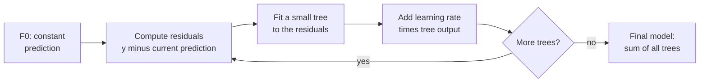

Gradient boosting builds a strong model out of many weak ones, but unlike a random forest it trains them **in sequence**, each new tree fitted to the mistakes the ensemble is still making. On structured data such as churn, fraud, credit risk or demand forecasting, gradient-boosted trees are usually at or near the top. This lesson builds the algorithm from scratch, then uses scikit-learn's implementations; the next three lessons cover XGBoost, LightGBM and CatBoost.

## The idea: fix the residuals

Start with a deliberately poor model, such as predicting the mean for everyone. Look at what is left over, the **residuals** $y_i - \hat{y}_i$. Fit a small tree that predicts those residuals. Add a fraction of that tree's output to the model. Repeat. Each tree nudges the predictions towards the targets, concentrating on whatever the current ensemble gets most wrong.



## Boosting in miniature

Four training targets, a starting prediction of their mean (4), "trees" that are stumps splitting the first two points from the last two, and a learning rate of 0.5:

```trace
{
  "title": "two rounds of gradient boosting",
  "code": [
    "from statistics import mean",
    "",
    "y = [1, 2, 6, 7]",
    "pred = [4, 4, 4, 4]          # F0: the mean of y",
    "for m in range(2):",
    "    r = [yi - pi for yi, pi in zip(y, pred)]          # residuals",
    "    left, right = mean(r[:2]), mean(r[2:])            # a stump fitted to r",
    "    step = [left, left, right, right]",
    "    pred = [p + 0.5 * s for p, s in zip(pred, step)]  # learning rate 0.5",
    "    print(r, pred)"
  ],
  "steps": [
    { "line": 4, "vars": { "y": "[1, 2, 6, 7]", "pred": "[4, 4, 4, 4]" }, "note": "The initial model F0 predicts the mean, 4, for every point. It is the best constant under squared error." },
    { "line": 6, "vars": { "m": "0", "pred": "[4, 4, 4, 4]", "r": "[-3, -2, 2, 3]" }, "note": "Residuals: what the current model still gets wrong. The first two points are too high, the last two too low." },
    { "line": 7, "vars": { "m": "0", "r": "[-3, -2, 2, 3]", "left": "-2.5", "right": "2.5" }, "note": "A stump predicts the mean residual in each leaf: -2.5 on the left, +2.5 on the right." },
    { "line": 9, "vars": { "m": "0", "step": "[-2.5, -2.5, 2.5, 2.5]", "pred": "[2.75, 2.75, 5.25, 5.25]" }, "note": "Only half of each correction is applied (learning rate 0.5). The predictions move towards the targets but not all the way." },
    { "line": 10, "vars": { "m": "0", "pred": "[2.75, 2.75, 5.25, 5.25]" }, "out": ["[-3, -2, 2, 3] [2.75, 2.75, 5.25, 5.25]"], "note": "End of round 1." },
    { "line": 6, "vars": { "m": "1", "pred": "[2.75, 2.75, 5.25, 5.25]", "r": "[-1.75, -0.75, 0.75, 1.75]" }, "note": "The residuals are smaller. The second tree is trained on these new residuals, not on y." },
    { "line": 9, "vars": { "m": "1", "left": "-1.25", "right": "1.25", "pred": "[2.125, 2.125, 5.875, 5.875]" }, "note": "Again half a step. The predictions approach the group means 1.5 and 6.5, which is the best a stump on this split can do." },
    { "line": 10, "vars": { "m": "1", "pred": "[2.125, 2.125, 5.875, 5.875]" }, "out": ["[-3, -2, 2, 3] [2.75, 2.75, 5.25, 5.25]", "[-1.75, -0.75, 0.75, 1.75] [2.125, 2.125, 5.875, 5.875]"], "note": "Each round closes half of the remaining gap. Real boosting uses deeper trees that can choose different splits each round." }
  ]
}
```

## Why "gradient"

For squared error $L = \frac{1}{2}(y - F)^2$, the residual $y - F$ is exactly the **negative gradient** of the loss with respect to the prediction $F$. So fitting a tree to the residuals is a step of [gradient descent](/learn/calculus/gradient-descent), taken in the space of functions rather than parameters. That insight generalises boosting to any differentiable loss. At round $m$:

1. Compute the **pseudo-residuals** $r_{im} = -\dfrac{\partial L(y_i, F(\mathbf{x}_i))}{\partial F(\mathbf{x}_i)}\Big|_{F = F_{m-1}}$ for every training example $i$.
2. Fit a regression tree $h_m$ to the pairs $(\mathbf{x}_i, r_{im})$.
3. Update $F_m(\mathbf{x}) = F_{m-1}(\mathbf{x}) + \eta\, h_m(\mathbf{x})$.

Here $F_{m-1}$ is the ensemble after $m-1$ trees and $\eta$ (between 0 and 1) is the **learning rate** or **shrinkage**. For classification with log loss, $F$ is the log-odds, and the pseudo-residual works out to $y_i - p_i$, the label minus the predicted probability, the same quantity that appeared in the [logistic regression](/learn/supervised-learning-algorithms/logistic-regression) gradient.

## From scratch with real trees

```python
import numpy as np
from sklearn.tree import DecisionTreeRegressor

rng = np.random.default_rng(0)
X = rng.uniform(0, 6, size=(200, 1))
y = np.sin(X[:, 0]) + rng.normal(0, 0.2, size=200)

learning_rate = 0.1
pred = np.full_like(y, y.mean())        # F0: a constant
trees = []
for m in range(1, 201):
    residual = y - pred                 # negative gradient of squared error
    tree = DecisionTreeRegressor(max_depth=2, random_state=0).fit(X, residual)
    pred += learning_rate * tree.predict(X)
    trees.append(tree)
    if m in (1, 10, 50, 200):
        print(f"trees={m:<4} train MSE={np.mean((y - pred) ** 2):.4f}")
```

```output
trees=1    train MSE=0.4458
trees=10   train MSE=0.1216
trees=50   train MSE=0.0317
trees=200  train MSE=0.0192
```

Each depth-2 tree is a weak model on its own, yet 200 of them fit a sine curve closely. The training error approaches the noise variance ($0.2^2 = 0.04$) and then goes below it, which is a warning sign: with enough rounds, boosting starts fitting noise.

## Gradient boosting in scikit-learn

```python
from sklearn.datasets import load_breast_cancer
from sklearn.ensemble import GradientBoostingClassifier
from sklearn.model_selection import train_test_split

Xc, yc = load_breast_cancer(return_X_y=True)
X_train, X_test, y_train, y_test = train_test_split(
    Xc, yc, test_size=0.25, random_state=42, stratify=yc
)
gbc = GradientBoostingClassifier(
    n_estimators=300, learning_rate=0.1, max_depth=3, subsample=0.8, random_state=0
).fit(X_train, y_train)
print("test accuracy:", round(gbc.score(X_test, y_test), 3))

for i, y_pred in enumerate(gbc.staged_predict(X_test), start=1):
    if i in (1, 10, 50, 100, 300):
        print(f"after {i:>3} trees: test accuracy={np.mean(y_pred == y_test):.3f}")
```

```output
test accuracy: 0.958
after   1 trees: test accuracy=0.629
after  10 trees: test accuracy=0.937
after  50 trees: test accuracy=0.951
after 100 trees: test accuracy=0.958
after 300 trees: test accuracy=0.958
```

`staged_predict` replays the ensemble one tree at a time. After one tree with learning rate 0.1, the model has barely moved from its starting log-odds and predicts the majority class for everyone (63% of the test set is benign). Accuracy then climbs quickly and levels off.

`subsample=0.8` trains each tree on a random 80% of rows, called **stochastic gradient boosting**, which adds randomness that usually improves generalisation.

### Faster: histogram-based boosting and early stopping

`GradientBoostingClassifier` is exact but slow on large data. `HistGradientBoostingClassifier` first bins each feature into at most 255 buckets and searches splits over bins, which is dramatically faster on large datasets. It also handles missing values natively and supports **early stopping**: hold out part of the training data and stop adding trees when the validation score stops improving.

```python
from sklearn.ensemble import HistGradientBoostingClassifier

hgb = HistGradientBoostingClassifier(
    max_iter=1000, learning_rate=0.1, early_stopping=True,
    validation_fraction=0.15, n_iter_no_change=20, random_state=0
).fit(X_train, y_train)
print("trees actually built:", hgb.n_iter_)
print("test accuracy:", round(hgb.score(X_test, y_test), 3))
```

```output
trees actually built: 60
test accuracy: 0.958
```

Asked for up to 1,000 trees, it stopped at 60 because 20 rounds passed without improvement on the validation slice. This is the same histogram idea that LightGBM and XGBoost's `hist` method use.

## Hyperparameters

| Hyperparameter | Effect | Typical values |
| --- | --- | --- |
| `learning_rate` | Shrinks each tree's contribution; lower needs more trees but generalises better | 0.01 to 0.3 |
| `n_estimators` / `max_iter` | Number of boosting rounds | Set high and use early stopping |
| `max_depth` / `max_leaf_nodes` | Size of each tree; controls interaction depth | Depth 3 to 8 |
| `subsample` | Fraction of rows per tree | 0.5 to 1.0 |
| `min_samples_leaf` | Minimum rows per leaf | 10 to 100 on large data |
| `l2_regularization` (hist version) | Penalty on leaf values | 0 to 10 |

> [!TIP]
> `learning_rate` and the number of trees trade off against each other. A reliable recipe: fix a small learning rate (such as 0.05), allow many trees, and let early stopping on validation data choose how many to keep. Then tune tree size and subsampling.

## Bagging versus boosting

| | Random forest (bagging) | Gradient boosting |
| --- | --- | --- |
| Trees trained | Independently, in parallel | Sequentially, each correcting the last |
| Typical tree | Deep, low bias, high variance | Shallow, high bias, low variance |
| Mainly reduces | Variance | Bias |
| More trees | Never hurts, only plateaus | Eventually overfits without early stopping |
| Tuning needed | Little | More, but higher ceiling |

> [!WARNING]
> Unlike random forests, boosting can overfit by adding too many trees, because each tree chases ever-smaller residuals, including noise. Always monitor a validation set and use early stopping, and never select the number of trees by test-set accuracy.

## Strengths, weaknesses and when to choose it

| Strengths | Weaknesses |
| --- | --- |
| Usually the most accurate model on tabular data | Sequential training is harder to parallelise |
| Works with any differentiable loss | More hyperparameters to tune than a forest |
| No scaling needed; histogram versions handle missing values | Can overfit noisy data |
| Fast prediction with shallow trees | Like all trees, cannot extrapolate |

> [!KEY]
> Gradient boosting adds trees one at a time, each fitted to the negative gradient of the loss (the residuals, for squared error), scaled by a learning rate. Choose it, typically through `HistGradientBoosting*`, [XGBoost](/learn/supervised-learning-algorithms/xgboost), [LightGBM](/learn/supervised-learning-algorithms/lightgbm) or [CatBoost](/learn/supervised-learning-algorithms/catboost), whenever accuracy on tabular data matters most.

## Exercises

**1.** Using the from-scratch loop, write a `predict(X_new)` function that starts from the training mean and adds `learning_rate * tree.predict(X_new)` for every stored tree. Predict at `x = 1.5` and compare with `np.sin(1.5)`.

<details>
<summary>Show solution</summary>

```python
def predict(X_new):
    out = np.full(len(X_new), y.mean())
    for tree in trees:
        out += learning_rate * tree.predict(X_new)
    return out

print(predict(np.array([[1.5]])), np.sin(1.5))
```

```output
[0.96761767] 0.9974949866040544
```

The prediction lands close to $\sin(1.5) \approx 0.997$; the gap is due to noise and the step-shaped trees.

</details>

**2.** Train `GradientBoostingClassifier` on the breast cancer data with `learning_rate=1.0` and `n_estimators=300`. Use `staged_predict` to find the best number of trees, and compare with the learning rate 0.1 run.

<details>
<summary>Show solution</summary>

```python
fast = GradientBoostingClassifier(n_estimators=300, learning_rate=1.0, max_depth=3, random_state=0)
fast.fit(X_train, y_train)
accs = [np.mean(p == y_test) for p in fast.staged_predict(X_test)]
print(int(np.argmax(accs)) + 1, round(max(accs), 3))
```

```output
24 0.965
```

With a large learning rate each tree makes a big correction, so the best score comes after only 24 trees, but the model is more erratic and prone to overfitting. In real work, pick the number of trees on a validation set, not the test set as this illustration does.

</details>

**3.** For log loss, the pseudo-residual is $y_i - p_i$. Compute it for three examples with labels `[1, 0, 1]` and predicted probabilities `[0.9, 0.4, 0.2]`, and say which example the next tree will focus on most.

<details>
<summary>Show solution</summary>

The residuals are $0.1$, $-0.4$ and $0.8$. The third example, a positive predicted at only 0.2, has the largest residual, so the next tree's fit is pulled most strongly towards raising its prediction.

</details>

```quiz
[
  {
    "q": "What does each new tree in gradient boosting try to predict?",
    "options": ["The original target y", "A bootstrap sample of the targets", "The negative gradient of the loss, which is the residual for squared error", "The prediction of the previous tree"],
    "answer": 2,
    "why": "Each tree is fitted to the pseudo-residuals of the current ensemble, so it corrects what the model still gets wrong."
  },
  {
    "q": "What is the main role of the learning rate in gradient boosting?",
    "options": ["It shrinks each tree's contribution, trading more trees for better generalisation", "It sets the depth of each tree", "It controls the fraction of rows sampled", "It decides the loss function"],
    "answer": 0,
    "why": "Smaller steps make the ensemble build up gradually, which reduces overfitting but requires more rounds."
  },
  {
    "q": "How does gradient boosting mainly differ from a random forest?",
    "options": ["Boosting uses deeper trees", "Boosting cannot do classification", "Boosting trains trees independently", "Boosting trains trees sequentially, each one correcting the errors of those before it"],
    "answer": 3,
    "why": "Forests average independent trees to reduce variance; boosting adds dependent trees to reduce bias."
  },
  {
    "q": "Why is early stopping especially important for gradient boosting?",
    "options": ["Training would otherwise never finish", "Adding too many trees eventually fits noise and hurts generalisation", "It makes the trees deeper", "It is required for histogram binning"],
    "answer": 1,
    "why": "Each extra tree chases smaller residuals, including noise, so validation performance eventually worsens."
  }
]
```
