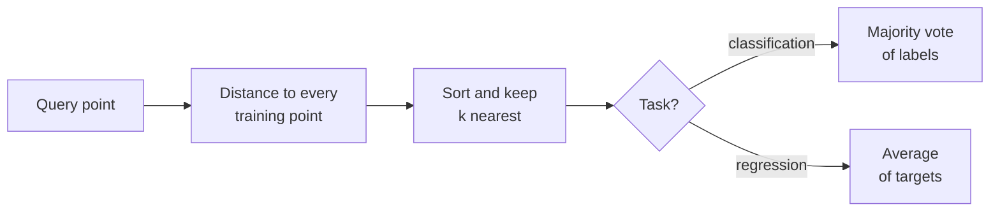

K-nearest neighbors (KNN) is the simplest idea in machine learning: to predict for a new example, find the $k$ training examples most similar to it and let them vote. There are no weights to learn and no loss to minimise. "Training" is just storing the data. Despite that, KNN can learn complicated boundaries, and its core operation, finding the nearest vectors to a query, is exactly what powers semantic search and retrieval-augmented generation later in this curriculum. Understanding where KNN works and where it breaks teaches you a lot about distances in high-dimensional spaces.

## The algorithm

For a query point $\mathbf{x}$:

1. Compute the distance from $\mathbf{x}$ to every training point.
2. Take the $k$ closest points, its **neighbourhood** $N_k(\mathbf{x})$.
3. **Classification:** predict the most common label among them. **Regression:** predict the average of their targets.

For classification the predicted probability of class $c$ is simply the fraction of neighbours with that label:

$$
\hat{P}(y = c \mid \mathbf{x}) = \frac{1}{k} \sum_{i \in N_k(\mathbf{x})} \mathbb{1}[y_i = c]
$$

where $\mathbb{1}[\cdot]$ is 1 when the condition holds and 0 otherwise.



KNN is called a **lazy** or **instance-based** learner: all the work happens at prediction time. It is also **non-parametric**: the model is the training set itself, so it grows with the data.

## Measuring distance

The default is the **Euclidean distance** from [Norms and distances](/learn/linear-algebra/norms-and-distances):

$$
d(\mathbf{x}, \mathbf{x}') = \sqrt{\sum_{j=1}^{p} (x_j - x'_j)^2}
$$

where $p$ is the number of features. Alternatives include the **Manhattan** distance $\sum_j |x_j - x'_j|$, which is less dominated by one large difference, and **cosine distance**, which compares directions rather than lengths and is standard for text embeddings. In scikit-learn you choose with the `metric` parameter (and `p` for the Minkowski family, where `p=2` is Euclidean and `p=1` is Manhattan).

## A KNN vote, step by step

Six labelled points in two dimensions, a query at $(3, 3.5)$ and $k = 3$:

```trace
{
  "title": "a 3-nearest-neighbour vote",
  "code": [
    "import numpy as np",
    "from collections import Counter",
    "",
    "X_train = np.array([[1.0, 1.0], [1.5, 2.0], [3.0, 4.0], [5.0, 7.0], [3.5, 5.0], [4.5, 6.0]])",
    "y_train = np.array([\"blue\", \"blue\", \"red\", \"red\", \"red\", \"blue\"])",
    "query = np.array([3.0, 3.5])",
    "",
    "dists = np.sqrt(((X_train - query) ** 2).sum(axis=1))",
    "order = np.argsort(dists)",
    "k = 3",
    "nearest = y_train[order[:k]]",
    "print(\"distances:\", dists.round(2))",
    "print(\"nearest labels:\", nearest)",
    "print(\"prediction:\", Counter(nearest).most_common(1)[0][0])"
  ],
  "steps": [
    { "line": 6, "vars": { "query": "[3.0, 3.5]" }, "note": "Training is just storing X_train and y_train. All the work starts when a query arrives." },
    { "line": 8, "vars": { "query": "[3.0, 3.5]", "dists": "[3.2, 2.12, 0.5, 4.03, 1.58, 2.92]" }, "note": "Broadcasting subtracts the query from every row. For point 2 at (3, 4): sqrt(0^2 + 0.5^2) = 0.5. For point 0 at (1, 1): sqrt(2^2 + 2.5^2) = 3.2." },
    { "line": 9, "vars": { "dists": "[3.2, 2.12, 0.5, 4.03, 1.58, 2.92]", "order": "[2, 4, 1, 5, 0, 3]" }, "note": "argsort returns the indices from nearest to farthest: point 2 (0.5), point 4 (1.58), point 1 (2.12), and so on." },
    { "line": 11, "vars": { "order": "[2, 4, 1, 5, 0, 3]", "k": "3", "nearest": "['red', 'red', 'blue']" }, "note": "The three nearest points are red, red and blue." },
    { "line": 13, "vars": { "nearest": "['red', 'red', 'blue']" }, "out": ["distances: [3.2  2.12 0.5  4.03 1.58 2.92]", "nearest labels: ['red' 'red' 'blue']"], "note": "Red has 2 of 3 votes, so the estimated probability of red is 2/3." },
    { "line": 14, "vars": { "nearest": "['red', 'red', 'blue']" }, "out": ["distances: [3.2  2.12 0.5  4.03 1.58 2.92]", "nearest labels: ['red' 'red' 'blue']", "prediction: red"], "note": "The majority wins: red. Try k = 5 in your head: the next two neighbours (points 5 and 0) are both blue, so the vote flips to blue, 3 to 2." }
  ]
}
```

That last note is the heart of KNN: the answer depends on $k$. A common refinement is **distance weighting** (`weights="distance"`), where each neighbour's vote counts $1/d$, so closer points matter more. With $k = 5$ and distance weights, the two very close red points outweigh the three distant blue ones, and the prediction returns to red.

## Feature scaling decides everything

Because KNN is built on distances, a feature measured in large units dominates all the others. The wine dataset shows this sharply:

```python
from sklearn.datasets import load_wine
from sklearn.model_selection import train_test_split
from sklearn.neighbors import KNeighborsClassifier
from sklearn.pipeline import make_pipeline
from sklearn.preprocessing import StandardScaler

X, y = load_wine(return_X_y=True)
X_train, X_test, y_train, y_test = train_test_split(
    X, y, test_size=0.3, random_state=0, stratify=y
)
print("proline range:", X_train[:, 12].min(), "to", X_train[:, 12].max())
print("hue range:    ", X_train[:, 10].min(), "to", X_train[:, 10].max())

raw = KNeighborsClassifier(n_neighbors=5).fit(X_train, y_train)
scaled = make_pipeline(StandardScaler(), KNeighborsClassifier(n_neighbors=5)).fit(X_train, y_train)
print("k=5 without scaling:", round(raw.score(X_test, y_test), 3))
print("k=5 with scaling:   ", round(scaled.score(X_test, y_test), 3))
```

```output
proline range: 278.0 to 1680.0
hue range:     0.48 to 1.42
k=5 without scaling: 0.722
k=5 with scaling:    0.963
```

Without scaling, a difference of 100 in proline swamps any difference in hue, so the "nearest" wines are simply those with similar proline. Standardising gives every feature an equal say.

> [!WARNING]
> Always scale features before KNN, and fit the scaler on the training data only (a `Pipeline` does this for you). Also think about which features to include: irrelevant features add noise to every distance and can quietly ruin KNN, while tree models would simply ignore them.

## Choosing k

Small $k$ follows the training data closely: $k = 1$ always gets 100% training accuracy, because every training point's nearest neighbour is itself. Large $k$ smooths the boundary towards predicting the majority class everywhere. Choose $k$ with [cross-validation](/learn/model-evaluation/cross-validation), not training accuracy:

```python
from sklearn.model_selection import cross_val_score

for k in (1, 3, 5, 11, 25, 51):
    m = make_pipeline(StandardScaler(), KNeighborsClassifier(n_neighbors=k))
    scores = cross_val_score(m, X_train, y_train, cv=5)
    train_acc = m.fit(X_train, y_train).score(X_train, y_train)
    print(f"k={k:<3} train={train_acc:.3f}  cross-validated={scores.mean():.3f}")
```

```output
k=1   train=1.000  cross-validated=0.920
k=3   train=0.944  cross-validated=0.928
k=5   train=0.968  cross-validated=0.944
k=11  train=0.960  cross-validated=0.960
k=25  train=0.968  cross-validated=0.976
k=51  train=0.952  cross-validated=0.944
```

`k=1` is perfect on training data and weakest in cross-validation: high variance. The validated score peaks in the middle and falls again as $k$ grows too large. For binary problems, an odd $k$ avoids tied votes.

| Hyperparameter | Effect | Typical values |
| --- | --- | --- |
| `n_neighbors` | Size of the neighbourhood; small is wiggly, large is smooth | 3 to 50, chosen by cross-validation |
| `weights` | `"uniform"` votes or `"distance"` weighting | Try both |
| `metric` / `p` | Distance function | Euclidean default; cosine for embeddings |
| `algorithm` | Search structure: brute force, KD-tree or ball tree | `"auto"` |

## Cost and the curse of dimensionality

Predicting with brute force means computing the distance to all $n$ training points in $p$ dimensions for every query, about $n \times p$ operations. Tree structures (KD-trees, ball trees) speed this up in low dimensions, and approximate nearest-neighbour indexes, the technology inside vector databases, make it practical for millions of high-dimensional vectors.

High dimensions bring a deeper problem, the **curse of dimensionality**. As the number of features grows, distances between random points become more and more similar to each other, so "nearest" carries less information, and you need exponentially more data to fill the space. KNN on raw high-dimensional features often performs poorly. The usual remedy is to reduce dimensionality first (PCA, in the next module) or to work in a learned embedding space where distance is meaningful.

## Strengths, weaknesses and when to choose it

| Strengths | Weaknesses |
| --- | --- |
| No training time; new data is added instantly | Slow predictions on large datasets |
| Simple, intuitive, few hyperparameters | Must store the whole training set |
| Naturally handles many classes and odd-shaped boundaries | Very sensitive to scaling and irrelevant features |
| Predictions are explainable by showing the neighbours | Degrades in high dimensions |

> [!KEY]
> KNN predicts from the labels of the closest training points, so everything depends on the distance being meaningful: scale your features, choose them carefully, and pick $k$ by validation. It works well for small, low-dimensional datasets and, with good embeddings, as the basis of similarity search.

## Exercises

**1.** Repeat the step-through example with scikit-learn: fit `KNeighborsClassifier` on the six points and predict the query with `k=3`, `k=5`, and `k=5, weights="distance"`.

<details>
<summary>Show solution</summary>

```python
from sklearn.neighbors import KNeighborsClassifier
for k, w in ((3, "uniform"), (5, "uniform"), (5, "distance")):
    m = KNeighborsClassifier(n_neighbors=k, weights=w).fit(X_train, y_train)
    print(k, w, m.predict([[3.0, 3.5]]), m.predict_proba([[3.0, 3.5]]).round(3))
```

```output
3 uniform ['red'] [[0.333 0.667]]
5 uniform ['blue'] [[0.6 0.4]]
5 distance ['red'] [[0.3 0.7]]
```

Here `X_train` and `y_train` are the six-point arrays from the trace. Columns of `predict_proba` follow `m.classes_`, which is `['blue', 'red']`.

</details>

**2.** Implement KNN regression by hand: for the query, average the targets of the 3 nearest points if the targets are `[10, 12, 20, 30, 22, 25]` in the same order as the six training points.

<details>
<summary>Show solution</summary>

The three nearest points are indices 2, 4 and 1, with targets 20, 22 and 12.

```python
targets = np.array([10, 12, 20, 30, 22, 25])
print(targets[order[:3]].mean())   # 18.0
```

</details>

**3.** Explain why `k=1` always gives 100% training accuracy (assuming no duplicate points with different labels), and why that number is useless for choosing `k`.

<details>
<summary>Show solution</summary>

When you score on the training set, each training point is in the stored data, at distance 0 from itself, so its single nearest neighbour is itself and the label always matches. The score measures memorisation, not generalisation, so `k` must be chosen on held-out or cross-validated data.

</details>

```quiz
[
  {
    "q": "What happens when you call `fit` on a KNN classifier?",
    "options": ["It learns a weight per feature", "It stores the training data (and may build a search structure)", "It finds the optimal k", "It computes a decision boundary equation"],
    "answer": 1,
    "why": "KNN is a lazy learner. The work of finding neighbours happens at prediction time."
  },
  {
    "q": "Why is feature scaling essential for KNN?",
    "options": ["Features with large ranges would dominate the distance calculation", "KNN cannot handle negative values", "Scaling reduces the number of neighbours needed", "It makes training faster"],
    "answer": 0,
    "why": "Distances add up squared differences across features, so a feature in large units swamps all others unless features are standardised."
  },
  {
    "q": "As k increases from 1 towards the size of the training set, what generally happens?",
    "options": ["Variance increases", "The model memorises more", "Training accuracy rises to 100%", "The boundary becomes smoother and eventually predicts the majority class everywhere"],
    "answer": 3,
    "why": "Large neighbourhoods average over more points, lowering variance and raising bias, until every prediction is the overall majority."
  },
  {
    "q": "What is the curse of dimensionality for KNN?",
    "options": ["Too many neighbours cause ties", "Scaling stops working with many features", "In high dimensions distances become similar to each other, so the nearest neighbours are less informative", "Higher dimensions make Euclidean distance impossible to compute"],
    "answer": 2,
    "why": "As dimensions grow, the contrast between near and far points shrinks and data becomes sparse, weakening any method based on distance."
  }
]
```
