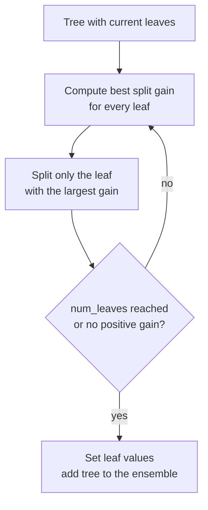

LightGBM is a gradient boosting library from Microsoft designed for speed and memory efficiency on large datasets. It optimises the same kind of regularised, second-order objective as [XGBoost](/learn/supervised-learning-algorithms/xgboost), but changes how trees are grown and how splits are found: it bins every feature into a histogram, grows trees **leaf by leaf** rather than level by level, and adds two tricks for skipping work that does not matter. On datasets with millions of rows these choices often make it markedly faster to train, and it handles categorical features natively. This lesson covers those ideas and how to tune them; the library is revisited in [Machine Learning Libraries](/learn/machine-learning-libraries/lightgbm).

## Histogram-based split finding

Exact split finding sorts every feature and tries every distinct value as a threshold, which is expensive. LightGBM first **bins** each feature into at most `max_bin` buckets (255 by default). To evaluate splits at a node, it builds a histogram per feature: for each bin, the sum of gradients $g_i$ and hessians $h_i$ of the rows that fall in it. Candidate thresholds are then just bin boundaries, and the [XGBoost gain formula](/learn/supervised-learning-algorithms/xgboost) is evaluated by scanning at most 255 bins instead of every row.

A neat consequence is the **histogram subtraction trick**: a parent's histogram equals the sum of its two children's. So LightGBM builds the histogram only for the smaller child and gets the larger one by subtracting it from the parent, roughly halving the work.

Binning also acts as mild regularisation, since thresholds cannot be placed between every pair of values. scikit-learn's `HistGradientBoosting*` and XGBoost's `tree_method="hist"` adopted the same idea.

## Leaf-wise tree growth

XGBoost (by default) and classic implementations grow trees **level-wise**: split every node at depth 1, then every node at depth 2, and so on, producing balanced trees. LightGBM grows **leaf-wise** (best-first): at each step it splits whichever leaf, anywhere in the tree, has the largest gain.



For the same number of leaves, leaf-wise growth reduces the loss more, because it never wastes a split on an unpromising leaf. The cost is that trees can become deep and lopsided, which overfits small datasets. That is why the main complexity control in LightGBM is `num_leaves`, not `max_depth`.

| | Level-wise | Leaf-wise |
| --- | --- | --- |
| Expands | Every node at the current depth | The single best leaf anywhere |
| Tree shape | Balanced | Can be deep and unbalanced |
| Loss reduction per leaf | Lower | Higher |
| Main size control | `max_depth` | `num_leaves` (plus `max_depth` as a safety limit) |
| Overfitting risk on small data | Lower | Higher |

A depth-$d$ balanced tree has up to $2^d$ leaves, so `num_leaves` should usually stay well below $2^{\text{max\_depth}}$ if you set both.

## GOSS and EFB: skipping unimportant work

Two further techniques from the LightGBM paper reduce the amount of data examined:

- **Gradient-based One-Side Sampling (GOSS).** Rows with small gradients are already well predicted and contribute little to the gain. GOSS keeps all rows with large gradients, randomly samples a fraction of the rest, and up-weights that sample so the gain estimates stay roughly unbiased. In LightGBM 4.x it is enabled with `data_sample_strategy="goss"`.
- **Exclusive Feature Bundling (EFB).** In sparse data (one-hot columns, for instance), many features are rarely non-zero at the same time. EFB packs such mutually exclusive features into a single combined feature, cutting the number of histograms to build. It is on by default.

## Native categorical features

One-hot encoding a feature with 40 categories creates 40 sparse columns, and each tree split can only isolate one category at a time. LightGBM instead splits a categorical feature into two **groups** of categories. To find a good grouping without trying every subset, it sorts the categories by their accumulated gradient statistics in the current node and then scans for the best split point in that order, like a numeric feature. Pandas columns with `category` dtype are detected automatically.

> [!WARNING]
> Native categorical splits on high-cardinality features can overfit, because the model can carve out small groups of rare categories. LightGBM provides `min_data_per_group` and `cat_smooth` to regularise them; increase these if a categorical feature with many levels dominates the importances.

## LightGBM in practice

Here is the same synthetic churn dataset used in the XGBoost and CatBoost lessons, regenerated so this lesson stands alone:

```python
import numpy as np
import pandas as pd
from sklearn.model_selection import train_test_split

rng = np.random.default_rng(42)
n = 6000
df = pd.DataFrame({
    "tenure_months": rng.integers(1, 72, n),
    "monthly_spend": rng.normal(60, 20, n).round(2),
    "support_calls": rng.poisson(1.5, n),
    "plan": rng.choice(["basic", "standard", "premium"], n, p=[0.5, 0.3, 0.2]),
    "region": rng.choice([f"r{i:02d}" for i in range(40)], n),
})
region_effect = dict(zip(sorted(df["region"].unique()), rng.normal(0, 0.8, 40)))
plan_effect = {"basic": 0.6, "standard": 0.0, "premium": -0.6}
logit = (0.5 - 0.05 * df["tenure_months"] + 0.6 * df["support_calls"]
         + df["plan"].map(plan_effect) + df["region"].map(region_effect))
y = (rng.random(n) < 1 / (1 + np.exp(-logit))).astype(int)

X_train, X_test, y_train, y_test = train_test_split(df, y, test_size=0.2, random_state=0, stratify=y)
X_train, X_val, y_train, y_val = train_test_split(X_train, y_train, test_size=0.2, random_state=0, stratify=y_train)
```

Train with early stopping, which in LightGBM is a **callback** passed to `fit`:

```python
from lightgbm import LGBMClassifier, early_stopping

cat_cols = ["plan", "region"]
Xtr, Xva, Xte = (d.astype({c: "category" for c in cat_cols}) for d in (X_train, X_val, X_test))

model = LGBMClassifier(
    n_estimators=2000,
    learning_rate=0.05,
    num_leaves=15,
    min_child_samples=20,
    subsample=0.8,
    subsample_freq=1,
    colsample_bytree=0.8,
    reg_lambda=1.0,
    random_state=0,
    verbose=-1,
)
model.fit(
    Xtr, y_train,
    eval_set=[(Xva, y_val)],
    callbacks=[early_stopping(stopping_rounds=50, verbose=False)],
)
print("best iteration:", model.best_iteration_)
print("test accuracy:", round(model.score(Xte, y_test), 3))
```

```output
best iteration: 138
test accuracy: 0.738
```

The test accuracy is in the same range as XGBoost on this data. With 4,800 training rows, speed differences between the libraries are irrelevant; they only show up at much larger scale. These outputs come from LightGBM 4.x.

> [!NOTE]
> Row subsampling in LightGBM needs two settings: `subsample` (the fraction) **and** `subsample_freq` greater than 0 (how often to resample). With the default `subsample_freq=0`, `subsample=0.8` silently does nothing. `verbose=-1` suppresses LightGBM's training log.

Now see how `num_leaves` controls overfitting, scoring on the validation set:

```python
for leaves in (4, 15, 63, 255):
    m = LGBMClassifier(n_estimators=300, learning_rate=0.05, num_leaves=leaves,
                       random_state=0, verbose=-1).fit(Xtr, y_train)
    print(f"num_leaves={leaves:<4} train={m.score(Xtr, y_train):.3f}  val={m.score(Xva, y_val):.3f}")
```

```output
num_leaves=4    train=0.779  val=0.751
num_leaves=15   train=0.851  val=0.753
num_leaves=63   train=0.993  val=0.728
num_leaves=255  train=1.000  val=0.725
```

With 63 or more leaves per tree and 300 rounds, the model memorises the 3,840 training rows and validation accuracy falls. On a dataset this small, small trees win; on millions of rows, larger `num_leaves` values become useful.

Gain importances:

```python
imp = pd.Series(model.booster_.feature_importance(importance_type="gain"), index=model.feature_name_)
print(imp.sort_values(ascending=False).round(0))
```

```output
tenure_months    5853.0
region           5438.0
support_calls    3135.0
monthly_spend    2135.0
plan             1318.0
dtype: float64
```

These are total gains, so the scale differs from XGBoost's average gain. Note that the irrelevant `monthly_spend` still collects gain from many small noisy splits, more than `plan`, which genuinely matters. Continuous features offer many thresholds to exploit noise; treat split-based importances with suspicion.

## Key hyperparameters

| Parameter (sklearn API) | Default | Effect |
| --- | --- | --- |
| `num_leaves` | 31 | Leaves per tree: the main complexity control |
| `max_depth` | -1 (no limit) | Safety limit on leaf-wise depth |
| `learning_rate` | 0.1 | Shrinkage per tree |
| `n_estimators` | 100 | Boosting rounds; use early stopping |
| `min_child_samples` | 20 | Minimum rows per leaf; raise to fight overfitting |
| `subsample` + `subsample_freq` | 1.0 + 0 | Row bagging (needs both) |
| `colsample_bytree` | 1.0 | Fraction of features per tree |
| `reg_alpha` / `reg_lambda` | 0 / 0 | L1 / L2 penalties on leaf values |
| `max_bin` | 255 | Histogram resolution |

> [!TIP]
> When LightGBM overfits, reduce `num_leaves` first, then raise `min_child_samples`, then add subsampling and `reg_lambda`. When it underfits on a large dataset, raise `num_leaves` and lower the learning rate while adding rounds.

## Strengths, weaknesses and when to choose it

| Strengths | Weaknesses |
| --- | --- |
| Very fast training and low memory on large data | Leaf-wise growth overfits small datasets without care |
| Native categorical and missing-value handling | Several parameters interact (`num_leaves`, `max_depth`, `min_child_samples`) |
| Strong accuracy, scales to large data and distributed training | Subsampling settings are easy to misconfigure |
| Familiar scikit-learn interface | Defaults need tuning more often than CatBoost's |

> [!KEY]
> LightGBM bins features into histograms and grows trees leaf-wise, splitting whichever leaf gains the most. Choose it when training speed matters, especially with large datasets, and control complexity mainly with `num_leaves` and `min_child_samples`.

## Exercises

**1.** A node has gradient histograms for a feature with 4 bins: gradient sums `[-3, -1, 2, 4]` and hessian sums `[1, 1, 1, 1]`. With $\lambda = 1$, compute the gain (ignoring the $\frac{1}{2}$ factor and $\gamma$) of splitting after bin 2.

<details>
<summary>Show solution</summary>

Left: $G_L = -4$, $H_L = 2$. Right: $G_R = 6$, $H_R = 2$. Parent: $G = 2$, $H = 4$.

$$
\frac{16}{3} + \frac{36}{3} - \frac{4}{5} = 5.33 + 12 - 0.8 = 16.53
$$

Only the four bin totals are needed, not the individual rows, which is the point of histograms.

</details>

**2.** Fit the churn model with `subsample=0.8` but leave `subsample_freq` at its default. Confirm that predictions are identical to a model with `subsample=1.0`.

<details>
<summary>Show solution</summary>

```python
a = LGBMClassifier(n_estimators=200, subsample=0.8, random_state=0, verbose=-1).fit(Xtr, y_train)
b = LGBMClassifier(n_estimators=200, subsample=1.0, random_state=0, verbose=-1).fit(Xtr, y_train)
print(np.allclose(a.predict_proba(Xte), b.predict_proba(Xte)))
```

It prints `True`: without `subsample_freq` greater than 0, bagging is disabled.

</details>

**3.** Why is `num_leaves` a better complexity control than `max_depth` for leaf-wise trees?

<details>
<summary>Show solution</summary>

A leaf-wise tree with a fixed depth limit can still have very different numbers of leaves, because it may grow one deep branch and leave others shallow. `num_leaves` directly caps the number of regions the tree can carve out, which is what determines its capacity to fit, regardless of shape.

</details>

```quiz
[
  {
    "q": "How does LightGBM grow each tree by default?",
    "options": ["Level-wise, splitting every node at a depth before moving on", "Leaf-wise, always splitting the leaf with the largest gain", "Randomly choosing a leaf to split", "As oblivious trees with the same split per level"],
    "answer": 1,
    "why": "Leaf-wise (best-first) growth reduces the loss most per leaf, at the risk of deep, lopsided trees."
  },
  {
    "q": "What is the histogram subtraction trick?",
    "options": ["Removing outliers before binning", "Subtracting the mean from each feature", "Getting one child's histogram by subtracting the other child's from the parent's", "Dropping bins with few rows"],
    "answer": 2,
    "why": "A parent histogram is the sum of its children's, so only the smaller child needs to be built from data."
  },
  {
    "q": "You set `subsample=0.7` in `LGBMClassifier` and nothing changes. What is the most likely reason?",
    "options": ["`subsample_freq` is still 0, so bagging is disabled", "LightGBM does not support row sampling", "`subsample` only applies to regression", "The learning rate is too high"],
    "answer": 0,
    "why": "LightGBM performs bagging only when the bagging frequency (subsample_freq) is greater than 0."
  },
  {
    "q": "A LightGBM model reaches 100% training accuracy and poor validation accuracy on a few thousand rows. Which change helps most directly?",
    "options": ["Increase `num_leaves`", "Increase `max_bin`", "Set `max_depth=-1`", "Decrease `num_leaves` and raise `min_child_samples`"],
    "answer": 3,
    "why": "Fewer leaves and larger minimum leaf sizes limit how finely each tree can carve up the training data."
  }
]
```
