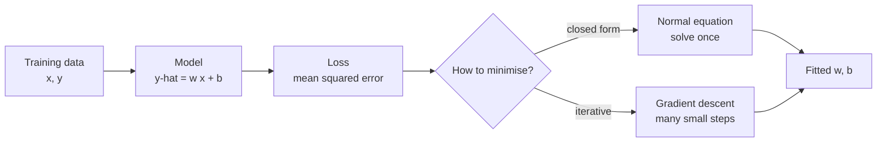

Linear regression predicts a number by drawing the best straight line through your data. It is one of the oldest models in machine learning and still one of the most used, both for real forecasts and as the baseline every fancier model must beat. It is also the cleanest place to see the full recipe of model, loss and optimiser, each simple enough to write by hand. Neural networks reuse exactly this recipe.

## The idea: a line through the points

Suppose you have the years of experience and the salary of 50 people, and you want to predict salary from experience. Plot the points and they roughly follow a rising line. Linear regression finds the line that fits them best and uses it for prediction.

With one input feature the model is

$$
\hat{y} = w x + b
$$

where $x$ is the input (years of experience), $\hat{y}$ is the predicted output (salary), $w$ is the **slope** or **weight** (how much $\hat{y}$ rises for each extra unit of $x$) and $b$ is the **intercept** or **bias** (the prediction when $x = 0$). Training means choosing $w$ and $b$.

## What "best" means: the squared error loss

Each data point $i$ has a true value $y_i$ and a prediction $\hat{y}_i$. The difference $y_i - \hat{y}_i$ is the **residual**. Linear regression picks the line that minimises the **mean squared error** (MSE) over all $n$ training points:

$$
L(w, b) = \frac{1}{n} \sum_{i=1}^{n} \left( y_i - (w x_i + b) \right)^2
$$

Squaring does two jobs: it makes every error positive so that over- and under-predictions cannot cancel, and it punishes large errors much more than small ones. You met this loss in [Loss functions](/learn/essential-mathematics-for-machine-learning/loss-functions). Minimising squared error is also what [maximum likelihood estimation](/learn/essential-mathematics-for-machine-learning/maximum-likelihood-estimation) gives you if you assume the noise around the line is normally distributed, which is why the method is called **ordinary least squares** (OLS).



There are two ways to find the minimum, and both are worth seeing.

## Method 1: the normal equation

Put a column of ones next to the feature so the intercept becomes just another weight. Stack the data into a matrix $X$ (one row per example, first column all ones) and the targets into a vector $\mathbf{y}$. With parameters $\boldsymbol{\theta} = (b, w)$, the predictions are $X\boldsymbol{\theta}$. Setting the gradient of the loss to zero gives the **normal equation**:

$$
X^\top X \, \boldsymbol{\theta} = X^\top \mathbf{y}
\quad\Rightarrow\quad
\boldsymbol{\theta} = (X^\top X)^{-1} X^\top \mathbf{y}
$$

This is an exact answer in one step, using the [transpose and inverse](/learn/linear-algebra/transpose-and-inverse) you learned in linear algebra. Here it is on synthetic data whose true line is $y = 4 + 3x$ plus noise:

```python
import numpy as np

rng = np.random.default_rng(0)
x = rng.uniform(0, 10, size=50)              # e.g. years of experience
y = 4.0 + 3.0 * x + rng.normal(0, 2, size=50)  # true line plus noise

X = np.column_stack([np.ones_like(x), x])    # add a column of ones for the intercept
theta = np.linalg.solve(X.T @ X, X.T @ y)    # solves (X^T X) theta = X^T y
print(theta.round(3))
```

```output
[3.515 3.105]
```

The fitted intercept 3.515 and slope 3.105 are close to the true 4 and 3; the gap comes from the random noise in only 50 points.

> [!TIP]
> Use `np.linalg.solve` (or `np.linalg.lstsq`) rather than computing the inverse explicitly with `np.linalg.inv`. Solving the system directly is faster and numerically more stable.

## Method 2: gradient descent

The normal equation needs to build and solve a matrix with one row and column per feature, which costs roughly the cube of the number of features. With millions of features, or with models that have no closed-form solution at all, you use [gradient descent](/learn/calculus/gradient-descent) instead: start anywhere and repeatedly step downhill.

The [partial derivatives](/learn/calculus/partial-derivatives) of the MSE are

$$
\frac{\partial L}{\partial w} = \frac{2}{n} \sum_{i=1}^{n} (\hat{y}_i - y_i)\, x_i,
\qquad
\frac{\partial L}{\partial b} = \frac{2}{n} \sum_{i=1}^{n} (\hat{y}_i - y_i)
$$

and each step updates $w \leftarrow w - \eta \, \partial L / \partial w$ (and the same for $b$), where $\eta$ is the **learning rate**.

```python
b, w = 0.0, 0.0
lr = 0.01
n = len(x)
for step in range(5001):
    y_hat = b + w * x
    error = y_hat - y
    grad_b = 2 / n * error.sum()
    grad_w = 2 / n * (error * x).sum()
    b -= lr * grad_b
    w -= lr * grad_w
    if step in (0, 100, 1000, 5000):
        print(f"step {step:5d}  b={b:.3f}  w={w:.3f}  mse={np.mean(error**2):.3f}")
```

```output
step     0  b=0.397  w=2.621  mse=480.727
step   100  b=1.632  w=3.380  mse=4.812
step  1000  b=3.485  w=3.109  mse=3.974
step  5000  b=3.515  w=3.105  mse=3.973
```

After 5,000 steps gradient descent lands on the normal-equation answer. The slope is found quickly while the intercept creeps up slowly: $x$ ranges up to 10 while the intercept's "feature" is always 1, so the loss surface is stretched. Scaling features to similar ranges fixes this, one reason [data preprocessing](/learn/machine-learning-fundamentals/data-preprocessing) standardises inputs.

| | Normal equation | Gradient descent |
| --- | --- | --- |
| Result | Exact, in one step | Approximate, improves with steps |
| Hyperparameters | None | Learning rate, number of steps |
| Cost with many features | Grows roughly with the cube of the feature count | Grows linearly per step |
| Needs feature scaling | No | Yes, for fast convergence |
| Generalises to other models | No | Yes: it trains neural networks |

## Linear regression in scikit-learn

In practice you call scikit-learn, which solves the least-squares problem for you. Always evaluate on data the model has not seen, as you learned in [Training, validation and testing](/learn/machine-learning-fundamentals/training-validation-and-testing).

```python
from sklearn.linear_model import LinearRegression
from sklearn.model_selection import train_test_split

x_train, x_test, y_train, y_test = train_test_split(
    x.reshape(-1, 1), y, test_size=0.2, random_state=0
)
model = LinearRegression().fit(x_train, y_train)
print("intercept:", round(model.intercept_, 3))
print("slope:    ", model.coef_.round(3))
print("test R^2: ", round(model.score(x_test, y_test), 3))
print("prediction for x=7:", model.predict([[7.0]]).round(2))
```

```output
intercept: 3.419
slope:     [3.135]
test R^2:  0.967
prediction for x=7: [25.37]
```

scikit-learn expects a 2D feature array of shape `(n_samples, n_features)`, hence `reshape(-1, 1)`. The fitted parameters live in `coef_` and `intercept_` (trailing underscores mark attributes learned during `fit`).

`score` returns the **coefficient of determination**, $R^2$:

$$
R^2 = 1 - \frac{\sum_i (y_i - \hat{y}_i)^2}{\sum_i (y_i - \bar{y})^2}
$$

where $\bar{y}$ is the mean of the true values. $R^2 = 1$ is a perfect fit, $R^2 = 0$ means the model does no better than always predicting the mean, and it can go negative on test data for a model worse than that. Here 0.967 means the line explains about 97% of the variance in the test targets. Error metrics such as [MAE](/learn/model-evaluation/mae) and [RMSE](/learn/model-evaluation/rmse), which are in the units of the target, are covered in Module 15.

## Assumptions and pitfalls

Linear regression fits a line whether or not a line makes sense, so check its assumptions:

- **Linearity.** If the true relationship curves, the model underfits. A curve in a plot of residuals against predictions means you need transformed features (such as $x^2$ or $\log x$) or a non-linear model.
- **Outliers.** Squaring means one wild point can drag the whole line. Consider a robust model such as `HuberRegressor` if outliers are genuine.
- **Constant noise.** OLS assumes the spread of residuals does not change with $x$. If errors grow with the prediction (common with prices), predicting $\log y$ often helps.
- **Extrapolation.** A salary model trained on 0 to 10 years of experience says nothing reliable about 40 years.

> [!WARNING]
> A high $R^2$ does not mean the relationship is causal, or even linear. Always plot the data and the residuals. Four very different datasets can produce identical regression lines and identical $R^2$.

## Strengths, weaknesses and when to choose it

| Strengths | Weaknesses |
| --- | --- |
| Fast to train and to predict | Only captures linear relationships unless you engineer features |
| Coefficients are directly interpretable | Sensitive to outliers |
| No hyperparameters in plain OLS | Extrapolates confidently and wrongly |
| Works well with small datasets | Unstable when features are strongly correlated (next lesson) |

> [!KEY]
> Reach for linear regression first on any regression problem. It trains in milliseconds, gives you a baseline score, and its coefficients tell you how the target moves with each input. Only move to a more complex model when it clearly beats this baseline on held-out data.

## Exercises

**1.** Using the same `x` and `y`, fit a line with `np.polyfit(x, y, deg=1)` and check that it matches the normal-equation result.

<details>
<summary>Show solution</summary>

```python
slope, intercept = np.polyfit(x, y, deg=1)
print(round(intercept, 3), round(slope, 3))   # 3.515 3.105
```

`polyfit` returns coefficients from the highest power down, so the slope comes first. Both methods solve the same least-squares problem, so they agree.

</details>

**2.** In the gradient descent loop, change the learning rate to `0.05`. What happens, and why?

<details>
<summary>Show solution</summary>

The parameters and the MSE grow without bound and quickly become `inf` or `nan`. With $x$ values up to 10, the gradient for $w$ is large, and a step of 0.05 overshoots the minimum by more each time, so the updates diverge. Either lower the learning rate or standardise $x$ so that larger steps are safe.

</details>

**3.** Compute $R^2$ for the scikit-learn model by hand from `y_test` and `model.predict(x_test)` and confirm it matches `model.score`.

<details>
<summary>Show solution</summary>

```python
y_pred = model.predict(x_test)
ss_res = np.sum((y_test - y_pred) ** 2)
ss_tot = np.sum((y_test - y_test.mean()) ** 2)
print(round(1 - ss_res / ss_tot, 3))   # 0.967
```

</details>

```quiz
[
  {
    "q": "What does linear regression minimise during training?",
    "options": ["The sum of absolute errors", "The mean of the squared residuals", "The number of misclassified points", "The largest single error"],
    "answer": 1,
    "why": "Ordinary least squares chooses the weights that minimise the mean (or sum) of squared differences between predictions and targets."
  },
  {
    "q": "Why might you use gradient descent instead of the normal equation?",
    "options": ["Gradient descent always gives a more accurate answer", "The normal equation cannot fit an intercept", "With very many features, solving the normal equation becomes expensive", "The normal equation needs a learning rate"],
    "answer": 2,
    "why": "Solving the normal equation scales roughly with the cube of the number of features, while each gradient descent step is cheap. The normal equation is exact when it is affordable."
  },
  {
    "q": "A model scores R^2 = 0 on test data. What does that mean?",
    "options": ["It does no better than always predicting the mean of the targets", "It predicts every point perfectly", "It has no intercept", "It is guaranteed to be overfitting"],
    "answer": 0,
    "why": "R^2 compares the model's squared error to that of a constant prediction equal to the mean. Zero means the model adds nothing over that baseline."
  },
  {
    "q": "Why does scikit-learn's `LinearRegression.fit` need `x.reshape(-1, 1)` for a single feature?",
    "options": ["To convert the values to floats", "To add the intercept column", "To sort the data", "Because it expects a 2D array of shape (n_samples, n_features)"],
    "answer": 3,
    "why": "scikit-learn estimators always take a 2D feature matrix, even when there is only one feature."
  }
]
```
