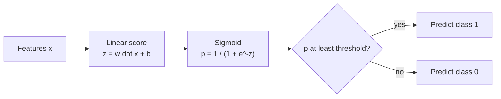

Logistic regression is the standard first model for **classification**: spam or not, fraud or not, will this customer cancel. Despite the name, it does not predict a number. It predicts a **probability** that an example belongs to a class, and turns that into a decision with a threshold. It is fast, well calibrated, easy to explain, and it is exactly the final layer of most neural network classifiers, so understanding it here makes deep learning far less mysterious later.

## From a line to a probability

A linear model computes a score $z = \mathbf{w}^\top \mathbf{x} + b$ that can be any real number. A probability must lie between 0 and 1. Logistic regression squeezes the score through the **sigmoid** (logistic) function:

$$
\sigma(z) = \frac{1}{1 + e^{-z}}, \qquad \hat{p} = P(y = 1 \mid \mathbf{x}) = \sigma(\mathbf{w}^\top \mathbf{x} + b)
$$

where $\mathbf{x}$ is the feature vector, $\mathbf{w}$ the weights, $b$ the intercept and $\hat{p}$ the predicted probability of the positive class. Large positive $z$ gives $\hat{p}$ near 1, large negative $z$ gives $\hat{p}$ near 0, and $z = 0$ gives exactly 0.5.

Rearranging shows what the linear part really models:

$$
z = \log \frac{\hat{p}}{1 - \hat{p}}
$$

The quantity $\hat{p} / (1 - \hat{p})$ is the **odds**, and its logarithm is the **log-odds** or **logit**. So logistic regression is linear regression on the log-odds. A weight $w_j$ means: increasing $x_j$ by one unit adds $w_j$ to the log-odds, which multiplies the odds by $e^{w_j}$.



The **decision boundary** is where $\hat{p} = 0.5$, which is where $z = 0$: the set of points with $\mathbf{w}^\top \mathbf{x} + b = 0$. That is a straight line in two dimensions and a hyperplane in more, so logistic regression is a **linear classifier**.

## The training objective: log loss

Squared error works badly with probabilities (the resulting loss is not convex, so gradient descent can get stuck). Instead, logistic regression maximises the likelihood of the observed labels, which is the same as minimising the **binary cross-entropy** or **log loss** you met in [Cross-entropy](/learn/essential-mathematics-for-machine-learning/cross-entropy):

$$
L(\mathbf{w}, b) = -\frac{1}{n} \sum_{i=1}^{n} \Big[ y_i \log \hat{p}_i + (1 - y_i) \log (1 - \hat{p}_i) \Big]
$$

with $y_i \in \{0, 1\}$ the true label. If the true label is 1, the loss is $-\log \hat{p}_i$: tiny when $\hat{p}_i$ is near 1, enormous when the model is confidently wrong. This loss is convex, so there is a single minimum. There is no closed-form solution, but the gradient is pleasingly simple:

$$
\frac{\partial L}{\partial \mathbf{w}} = \frac{1}{n} \sum_{i=1}^{n} (\hat{p}_i - y_i)\, \mathbf{x}_i,
\qquad
\frac{\partial L}{\partial b} = \frac{1}{n} \sum_{i=1}^{n} (\hat{p}_i - y_i)
$$

It has the same "error times input" shape as linear regression, with $\hat{p}_i$ in place of $\hat{y}_i$.

## Logistic regression from scratch

Here is a single feature, hours studied, predicting whether a student passed:

```python
import numpy as np

def sigmoid(z):
    return 1 / (1 + np.exp(-z))

# hours studied -> passed the exam (1) or not (0)
hours = np.array([0.5, 1.0, 1.5, 2.0, 2.5, 3.0, 3.5, 4.0, 4.5, 5.0])
passed = np.array([0, 0, 0, 0, 1, 0, 1, 1, 1, 1])

w, b, lr = 0.0, 0.0, 0.1
for step in range(20001):
    p = sigmoid(w * hours + b)
    grad_w = np.mean((p - passed) * hours)
    grad_b = np.mean(p - passed)
    w -= lr * grad_w
    b -= lr * grad_b
    if step in (0, 1000, 20000):
        loss = -np.mean(passed * np.log(p) + (1 - passed) * np.log(1 - p))
        print(f"step {step:5d}  w={w:.3f}  b={b:.3f}  log loss={loss:.3f}")

print("P(pass | 2 hours) =", round(sigmoid(w * 2 + b), 3))
print("P(pass | 4 hours) =", round(sigmoid(w * 4 + b), 3))
print("decision boundary at", round(-b / w, 2), "hours")
```

```output
step     0  w=0.057  b=0.000  log loss=0.693
step  1000  w=1.741  b=-4.636  log loss=0.271
step 20000  w=2.603  b=-7.158  log loss=0.251
P(pass | 2 hours) = 0.124
P(pass | 4 hours) = 0.963
decision boundary at 2.75 hours
```

The starting loss of 0.693 is $\log 2$, the loss of predicting 0.5 for everyone. The weight $w = 2.6$ means each extra hour multiplies the odds of passing by $e^{2.6} \approx 13.5$. The boundary sits at $-b/w = 2.75$ hours, between the overlapping pass and fail examples.

## Logistic regression in scikit-learn

The breast cancer dataset has 30 numeric measurements of cell nuclei and a binary label (malignant 0, benign 1).

```python
from sklearn.datasets import load_breast_cancer
from sklearn.linear_model import LogisticRegression
from sklearn.model_selection import train_test_split
from sklearn.pipeline import make_pipeline
from sklearn.preprocessing import StandardScaler

X, y = load_breast_cancer(return_X_y=True)
X_train, X_test, y_train, y_test = train_test_split(
    X, y, test_size=0.25, random_state=42, stratify=y
)

clf = make_pipeline(StandardScaler(), LogisticRegression(C=1.0, max_iter=1000))
clf.fit(X_train, y_train)

print("test accuracy:", round(clf.score(X_test, y_test), 3))
print("first 3 probabilities:\n", clf.predict_proba(X_test[:3]).round(3))
print("first 3 predictions:", clf.predict(X_test[:3]))
```

```output
test accuracy: 0.986
first 3 probabilities:
 [[0.031 0.969]
 [1.    0.   ]
 [0.441 0.559]]
first 3 predictions: [1 0 1]
```

`predict_proba` returns one column per class, in the order of `clf.classes_`. The third example is a borderline 0.559: `predict` calls it benign because it uses a 0.5 threshold, but in a medical setting you might lower the threshold for the malignant class to catch more cases. Choosing thresholds is a [precision and recall](/learn/model-evaluation/precision) trade-off covered in Module 15.

> [!TIP]
> Scale features for logistic regression. The default solver (`lbfgs`) converges much faster on standardised data, and the regularisation penalty treats all weights fairly only when features share a scale. If you see a `ConvergenceWarning`, scaling usually fixes it before raising `max_iter` does.

## Regularisation and the C parameter

scikit-learn's `LogisticRegression` is regularised by default with an L2 penalty, like ridge regression. The strength is set by `C`, the **inverse** of regularisation strength: small `C` means a strong penalty and small weights, large `C` means a weak penalty.

```python
for C in (0.001, 0.01, 1.0, 100.0):
    m = make_pipeline(StandardScaler(), LogisticRegression(C=C, max_iter=5000))
    m.fit(X_train, y_train)
    coef_size = np.abs(m[-1].coef_).sum()
    print(f"C={C:<6}  train={m.score(X_train, y_train):.3f}  test={m.score(X_test, y_test):.3f}  sum|w|={coef_size:.1f}")
```

```output
C=0.001   train=0.892  test=0.916  sum|w|=1.4
C=0.01    train=0.958  test=0.937  sum|w|=3.9
C=1.0     train=0.988  test=0.986  sum|w|=16.8
C=100.0   train=0.998  test=0.944  sum|w|=114.1
```

This is the [bias-variance tradeoff](/learn/machine-learning-fundamentals/bias-variance-tradeoff) in four lines: tiny `C` underfits, huge `C` fits the training set almost perfectly but does worse on the test set.

| Hyperparameter | What it does | Typical values |
| --- | --- | --- |
| `C` | Inverse regularisation strength | Search 0.001 to 100 on a log scale |
| `l1_ratio` | Mix of L1 and L2 penalty, with the `saga` solver (older scikit-learn versions also need `penalty="elasticnet"`) | 0 (pure L2) up to 1 (pure L1, sparse weights) |
| `class_weight` | Up-weights rare classes in the loss | `None` or `"balanced"` |
| `max_iter` | Solver iteration limit | Raise if you get convergence warnings |

## More than two classes

For $K$ classes, scikit-learn fits **multinomial** logistic regression: one weight vector per class, with the scores turned into probabilities by the **softmax** function:

$$
P(y = k \mid \mathbf{x}) = \frac{e^{z_k}}{\sum_{j=1}^{K} e^{z_j}}, \qquad z_k = \mathbf{w}_k^\top \mathbf{x} + b_k
$$

```python
from sklearn.datasets import load_iris

Xi, yi = load_iris(return_X_y=True)
multi = LogisticRegression(max_iter=1000).fit(Xi, yi)
print(multi.coef_.shape)
print(multi.predict_proba(Xi[[0, 75, 149]]).round(3))
```

```output
(3, 4)
[[0.982 0.018 0.   ]
 [0.005 0.92  0.075]
 [0.    0.235 0.764]]
```

Three classes times four features gives a `(3, 4)` weight matrix, and each row of probabilities sums to 1. Softmax followed by cross-entropy is exactly how a neural network's output layer classifies.

## Strengths, weaknesses and when to choose it

| Strengths | Weaknesses |
| --- | --- |
| Outputs reasonably calibrated probabilities | Linear decision boundary only |
| Fast, scales to millions of rows and sparse text features | Needs feature engineering for interactions |
| Coefficients are interpretable as log-odds | Sensitive to correlated features, like linear regression |
| Convex loss: same answer every run | Usually beaten by boosted trees on complex tabular data |

> [!KEY]
> Logistic regression is a linear score passed through a sigmoid and trained with log loss. Use it as the first baseline for any classification task, and as the default when you need probabilities you can explain, such as in credit scoring or medical risk.

## Exercises

**1.** Using the trained `w` and `b` from the from-scratch example, find how many hours of study give an 80% probability of passing.

<details>
<summary>Show solution</summary>

Solve $\sigma(wx + b) = 0.8$, so $wx + b = \log(0.8 / 0.2) = \log 4$.

```python
x80 = (np.log(4) - b) / w
print(round(x80, 2))   # 3.28
```

</details>

**2.** In the breast cancer pipeline, predict class 0 (malignant) whenever its probability exceeds 0.3, instead of 0.5. How many test predictions change?

<details>
<summary>Show solution</summary>

```python
proba_malignant = clf.predict_proba(X_test)[:, 0]
custom = np.where(proba_malignant > 0.3, 0, 1)
print((custom != clf.predict(X_test)).sum())
```

It prints `5`. Only borderline examples change, those with a malignant probability between 0.3 and 0.5. The lower threshold flags more cases as malignant, trading false alarms for fewer misses.

</details>

**3.** Explain why `C=100.0` gives a higher training accuracy but a lower test accuracy than `C=1.0`.

<details>
<summary>Show solution</summary>

A large `C` means almost no penalty, so the weights grow (the sum of absolute weights rises from 16.8 to 114.1) to fit the training points closely, including their noise. That is overfitting: lower bias, higher variance, worse generalisation.

</details>

```quiz
[
  {
    "q": "What does the linear part of logistic regression, w dot x + b, model?",
    "options": ["The probability directly", "The class label", "The log-odds of the positive class", "The squared error"],
    "answer": 2,
    "why": "Inverting the sigmoid gives z = log(p / (1 - p)), the log-odds. The sigmoid then maps it to a probability."
  },
  {
    "q": "In scikit-learn's `LogisticRegression`, what does decreasing `C` do?",
    "options": ["Weakens regularisation", "Strengthens regularisation, shrinking the weights", "Increases the number of classes", "Changes the threshold from 0.5"],
    "answer": 1,
    "why": "`C` is the inverse of regularisation strength, so smaller values mean a stronger penalty and smaller weights."
  },
  {
    "q": "Why is log loss used instead of squared error for training logistic regression?",
    "options": ["It is convex for this model and heavily punishes confident wrong predictions", "It is faster to compute", "Squared error cannot be computed for probabilities", "It removes the need for an intercept"],
    "answer": 0,
    "why": "Log loss comes from maximum likelihood, gives a convex problem with one minimum, and grows without bound as a wrong prediction becomes more confident."
  },
  {
    "q": "A weight of 0.7 on a feature means a one-unit increase in that feature does what?",
    "options": ["Adds 0.7 to the probability", "Multiplies the probability by 0.7", "Adds 0.7 to the odds", "Multiplies the odds by e^0.7, about 2"],
    "answer": 3,
    "why": "Weights act on the log-odds, so adding 0.7 to the log-odds multiplies the odds by e^0.7."
  }
]
```
