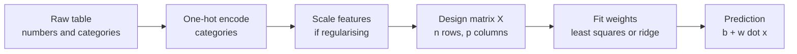

Real targets rarely depend on one thing. A house price depends on floor area, location, age and bedrooms. **Multiple linear regression** extends the straight line of the [previous lesson](/learn/supervised-learning-algorithms/linear-regression) to many input features at once. The maths barely changes, but practical issues appear: how to read the coefficients, how to handle categorical inputs, and what goes wrong when features are correlated.

## The model with many features

With $p$ features $x_1, \dots, x_p$, the prediction is a weighted sum plus an intercept:

$$
\hat{y} = b + w_1 x_1 + w_2 x_2 + \dots + w_p x_p = b + \mathbf{w}^\top \mathbf{x}
$$

where $\mathbf{x}$ is the vector of feature values for one example, $\mathbf{w}$ is the vector of weights (one per feature) and $b$ is the intercept. Geometrically, with two features this is a flat plane through a 3D cloud of points; with more it is a **hyperplane**.

For a whole dataset, stack the $n$ examples as rows of the **design matrix** $X$ (shape $n \times (p+1)$, with a leading column of ones for the intercept). Then all predictions at once are $\hat{\mathbf{y}} = X\boldsymbol{\theta}$, where $\boldsymbol{\theta} = (b, w_1, \dots, w_p)$. The loss is still mean squared error, and the [normal equation](/learn/supervised-learning-algorithms/linear-regression) is unchanged:

$$
\boldsymbol{\theta} = (X^\top X)^{-1} X^\top \mathbf{y}
$$

This is why linear algebra came first in the curriculum: the matrix form handles one feature or a thousand with the same line of code.



## Fitting a real dataset

scikit-learn ships the classic diabetes dataset: 442 patients, 10 baseline measurements (age, sex, body mass index, blood pressure and six blood serum readings `s1` to `s6`) and a target measuring disease progression one year later.

```python
import pandas as pd
from sklearn.datasets import load_diabetes
from sklearn.linear_model import LinearRegression
from sklearn.model_selection import train_test_split

data = load_diabetes(as_frame=True)
X, y = data.data, data.target
print(X.shape)
print(X.columns.tolist())

X_train, X_test, y_train, y_test = train_test_split(X, y, test_size=0.25, random_state=42)
model = LinearRegression().fit(X_train, y_train)

coefs = pd.Series(model.coef_, index=X.columns).round(1)
print(coefs.sort_values())
print("train R^2:", round(model.score(X_train, y_train), 3))
print("test R^2: ", round(model.score(X_test, y_test), 3))
```

```output
(442, 10)
['age', 'sex', 'bmi', 'bp', 's1', 's2', 's3', 's4', 's5', 's6']
s1    -918.5
sex   -242.0
s6      26.3
age     47.7
s3     117.0
s4     269.5
bp     381.6
s2     508.3
bmi    532.0
s5     695.8
dtype: float64
train R^2: 0.519
test R^2:  0.485
```

A test $R^2$ around 0.49 means the linear model explains about half the variance. That is typical for noisy medical data and a useful baseline.

## Interpreting coefficients

Each weight $w_j$ answers one specific question: **how much does the prediction change when $x_j$ increases by one unit and every other feature is held fixed?** Three consequences follow.

1. **Units matter.** A weight is per unit of its feature. The diabetes features were already centred and rescaled by the dataset's authors, which is why the weights look large. If one feature is in metres and another in millimetres, their raw weights cannot be compared. Standardise features (subtract the mean, divide by the standard deviation) if you want to compare weights.
2. **"Holding others fixed" may be unrealistic.** `s1` (total cholesterol) has a large negative weight while `s2` (a cholesterol fraction) has a large positive one. These serum readings are strongly correlated, so in real patients they rarely move independently. The pair of weights partly cancel each other; neither on its own is a trustworthy "effect".
3. **Coefficients are associations, not causes.** Without a controlled experiment, a weight tells you what the model uses, not what would happen if you intervened.

### Categorical features

A feature like `city` with values `London`, `Paris`, `Tokyo` cannot be multiplied by a weight. Convert it with **one-hot encoding**, which you met in [feature engineering](/learn/machine-learning-fundamentals/feature-engineering): one 0/1 column per category. With an intercept in the model, drop one category (`OneHotEncoder(drop="first")` or `pd.get_dummies(..., drop_first=True)`), because the full set of columns always sums to 1 and duplicates the intercept column exactly. Each remaining weight is then "the difference from the dropped reference category".

## Multicollinearity: when features overlap

When two or more features are strongly correlated, the data cannot tell the model how to split the credit between them. Many different weight combinations give almost the same predictions, so the fitted weights become unstable. Here is an extreme case: a feature and a near-copy of it, fitted on two bootstrap resamples of the same data.

```python
import numpy as np

rng = np.random.default_rng(1)
n = 200
size = rng.normal(100, 20, n)                      # floor area
size_copy = size + rng.normal(0, 0.5, n)           # almost the same feature again
price = 2.0 * size + rng.normal(0, 10, n)

for seed in (0, 1):
    idx = np.random.default_rng(seed).choice(n, n, replace=True)   # resample the data
    Xb = np.column_stack([size[idx], size_copy[idx]])
    m = LinearRegression().fit(Xb, price[idx])
    print(f"sample {seed}: coefs = {m.coef_.round(2)}, sum = {m.coef_.sum():.2f}")
```

```output
sample 0: coefs = [ 8.13 -6.02], sum = 2.11
sample 1: coefs = [ 8.8 -6.7], sum = 2.11
```

The true effect is 2 per unit of size, and the **sum** of the two weights recovers it. The individual weights are absurd: +8 and -6. Predictions are still fine, but interpretation is ruined. In normal-equation terms, $X^\top X$ is nearly **singular** (its columns are nearly linearly dependent), so inverting it amplifies noise. A [correlation matrix](/learn/probability-and-statistics/correlation-and-covariance) of the features reveals the problem.

## Regularisation: ridge and lasso

The standard fix is to add a penalty that discourages large weights. **Ridge regression** minimises

$$
L_{\text{ridge}} = \sum_{i=1}^{n} (y_i - \hat{y}_i)^2 + \alpha \sum_{j=1}^{p} w_j^2
$$

and **lasso** uses absolute values instead:

$$
L_{\text{lasso}} = \frac{1}{2n}\sum_{i=1}^{n} (y_i - \hat{y}_i)^2 + \alpha \sum_{j=1}^{p} |w_j|
$$

Here $\alpha \ge 0$ sets the penalty strength: $\alpha = 0$ is plain least squares, and larger values shrink weights harder. The intercept is not penalised. Ridge has the closed form $\boldsymbol{\theta} = (X^\top X + \alpha I)^{-1} X^\top \mathbf{y}$ (for centred data), and adding $\alpha I$ makes the matrix safely invertible.

```python
from sklearn.linear_model import Ridge

for seed in (0, 1):
    idx = np.random.default_rng(seed).choice(n, n, replace=True)
    Xb = np.column_stack([size[idx], size_copy[idx]])
    m = Ridge(alpha=1000.0).fit(Xb, price[idx])
    print(f"sample {seed}: ridge coefs = {m.coef_.round(2)}")
```

```output
sample 0: ridge coefs = [1.18 0.9 ]
sample 1: ridge coefs = [1.17 0.87]
```

Ridge shares the credit between the twin features, and the weights barely change between resamples. Lasso goes further: its absolute-value penalty pushes some weights to exactly zero, which acts as automatic [feature selection](/learn/machine-learning-fundamentals/feature-selection).

```python
from sklearn.pipeline import make_pipeline
from sklearn.preprocessing import StandardScaler
from sklearn.linear_model import Lasso

lasso = make_pipeline(StandardScaler(), Lasso(alpha=1.0))
lasso.fit(X_train, y_train)
lasso_coefs = pd.Series(lasso[-1].coef_, index=X.columns).round(1)
print(lasso_coefs.to_dict())
print("test R^2:", round(lasso.score(X_test, y_test), 3))
```

```output
{'age': 1.2, 'sex': -9.3, 'bmi': 25.7, 'bp': 17.0, 's1': -8.4, 's2': -0.0, 's3': -10.8, 's4': 3.3, 's5': 21.1, 's6': 1.1}
test R^2: 0.496
```

Lasso has zeroed `s2` and shrunk the wild `s1`, and the test score is slightly better than plain least squares. The weights are now per standard deviation of each feature, so they are directly comparable: `bmi` and `s5` matter most.

> [!WARNING]
> Always scale features before ridge or lasso. The penalty treats all weights equally, so a feature measured in large units (needing a small weight) is penalised less than one in small units. A `Pipeline` with `StandardScaler` keeps this correct and fits the scaler on training data only.

| Model | Penalty | Effect on weights | Use when |
| --- | --- | --- | --- |
| `LinearRegression` | None | Unbiased but can be unstable | Few, weakly correlated features |
| `Ridge` | Sum of squares | Shrinks all, none to zero | Many correlated features |
| `Lasso` | Sum of absolute values | Some exactly zero | You want a sparse, interpretable model |
| `ElasticNet` | Mix of both | Sparse but stable with correlated groups | Many correlated features and you want sparsity |

Choosing $\alpha$ is a hyperparameter search, done with [cross-validation](/learn/model-evaluation/cross-validation) in Module 15 (`RidgeCV` and `LassoCV` do it for you).

> [!KEY]
> A multiple regression weight is the effect of one feature with all others held fixed. When features are correlated, that question has no stable answer, and regularisation is how you make the model pick a sensible one.

## Exercises

**1.** Fit `Ridge` with `alpha` values 0.01, 1, 100 and 1000 inside a pipeline with `StandardScaler` on the diabetes training data. Print the test $R^2$ and the largest absolute weight for each. What trend do you see?

<details>
<summary>Show solution</summary>

```python
for a in (0.01, 1, 100, 1000):
    r = make_pipeline(StandardScaler(), Ridge(alpha=a)).fit(X_train, y_train)
    print(a, round(r.score(X_test, y_test), 3), round(abs(r[-1].coef_).max(), 1))
```

```output
0.01 0.485 44.0
1 0.486 34.3
100 0.49 21.0
1000 0.356 8.6
```

As `alpha` grows, the largest weight shrinks steadily. The test $R^2$ improves slightly up to `alpha=100` and then drops sharply at 1000, where the penalty is strong enough to underfit. The best value lies somewhere in between, which is what cross-validation finds.

</details>

**2.** A model predicts rent from `area_m2` and a one-hot encoded `city` with London as the dropped reference. The weight for `city_Paris` is -150. Explain what it means.

<details>
<summary>Show solution</summary>

For two flats with the same area, the model predicts that the one in Paris rents for 150 units less than the one in London. Category weights are always relative to the dropped reference category.

</details>

**3.** Compute the correlation between `s1` and `s2` in the diabetes data. Does it explain their opposite-signed weights?

<details>
<summary>Show solution</summary>

```python
print(round(X["s1"].corr(X["s2"]), 3))
```

The correlation is 0.897, so the two features carry largely the same information. Least squares can trade weight between them almost freely, producing a large positive and a large negative weight that largely cancel.

</details>

```quiz
[
  {
    "q": "In multiple linear regression, what does the weight w_j represent?",
    "options": ["The correlation between x_j and y", "The change in prediction for a one-unit increase in x_j with other features held fixed", "The percentage of variance explained by x_j", "The importance rank of x_j"],
    "answer": 1,
    "why": "Each weight is a partial effect: the change in the prediction when only that feature moves by one unit."
  },
  {
    "q": "Two features are almost identical. What typically happens to their least-squares weights?",
    "options": ["Both become exactly zero", "They become unstable, often large with opposite signs", "They are automatically averaged", "The model refuses to fit"],
    "answer": 1,
    "why": "Many weight combinations give the same predictions, so the fitted split is driven by noise. Their sum stays sensible but the individual values do not."
  },
  {
    "q": "Which statement about lasso is correct?",
    "options": ["It can set some weights exactly to zero", "It never changes the weights compared to least squares", "It only works with categorical features", "It penalises the intercept most strongly"],
    "answer": 0,
    "why": "The absolute-value penalty has corners at zero, so the optimum often puts weights exactly there, which performs feature selection."
  },
  {
    "q": "Why should you standardise features before fitting ridge regression?",
    "options": ["Ridge cannot handle negative values", "Standardising removes multicollinearity", "The penalty treats all weights equally, so feature units would otherwise change how much each is penalised", "It makes the model non-linear"],
    "answer": 2,
    "why": "A feature in large units needs a small weight and escapes the penalty. Scaling puts every feature on an equal footing."
  }
]
```
