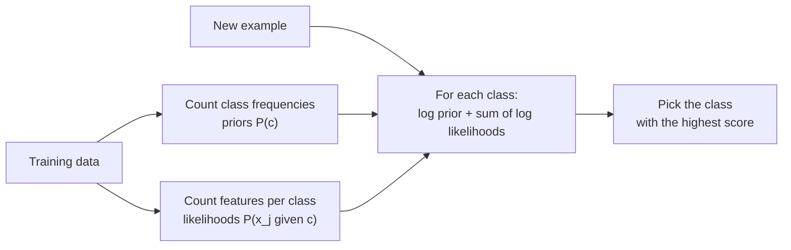

Naive Bayes classifies by applying [Bayes' theorem](/learn/probability-and-statistics/bayes-theorem) with one bold simplification: it assumes every feature is independent of every other once you know the class. That assumption is almost never true, yet the resulting classifier is fast, needs very little data, handles tens of thousands of features with ease, and works surprisingly well, especially on text. Classic spam filters were built on it, and it remains a strong baseline for document classification and a good first model whenever you have little labelled data.

## Bayes' theorem as a classifier

For a class $c$ and a feature vector $\mathbf{x} = (x_1, \dots, x_p)$, Bayes' theorem gives

$$
P(c \mid \mathbf{x}) = \frac{P(\mathbf{x} \mid c)\, P(c)}{P(\mathbf{x})}
$$

where $P(c)$ is the **prior** (how common the class is), $P(\mathbf{x} \mid c)$ is the **likelihood** of seeing these features in that class, and $P(c \mid \mathbf{x})$ is the **posterior** we want. The denominator $P(\mathbf{x})$ is the same for every class, so to pick the most probable class you can ignore it.

The hard part is $P(\mathbf{x} \mid c)$. With 10,000 possible words, the number of possible combinations is astronomical, and you could never estimate their joint probability from data.

## The naive assumption

Naive Bayes assumes the features are **conditionally independent given the class**:

$$
P(\mathbf{x} \mid c) = \prod_{j=1}^{p} P(x_j \mid c)
$$

Now you only need one small distribution per feature per class, which you can estimate by counting. The classifier picks

$$
\hat{y} = \arg\max_{c} \ P(c) \prod_{j=1}^{p} P(x_j \mid c)
$$

In words: an email containing "free" and "prize" is scored for spam by multiplying how often spam contains "free", how often spam contains "prize", and how common spam is; the same for ham; and the larger product wins.



"Training" is a single pass of counting, which is why naive Bayes is one of the fastest classifiers there is.

## A spam filter by hand

Six tiny messages, three spam and three ham ("ham" is the conventional name for not-spam):

```python
from sklearn.feature_extraction.text import CountVectorizer
from sklearn.naive_bayes import MultinomialNB

texts = [
    "win a free prize now",
    "free money click now",
    "claim your free prize",
    "meeting moved to monday",
    "lunch on monday with the team",
    "project notes for the meeting",
]
labels = ["spam", "spam", "spam", "ham", "ham", "ham"]

vec = CountVectorizer()
X = vec.fit_transform(texts)
nb = MultinomialNB(alpha=1.0).fit(X, labels)

new = ["free prize meeting", "team lunch monday", "click for money"]
print(nb.predict(vec.transform(new)))
print(nb.predict_proba(vec.transform(new)).round(3))
print(nb.classes_)
```

```output
['spam' 'ham' 'spam']
[[0.16  0.84 ]
 [0.902 0.098]
 [0.276 0.724]]
['ham' 'spam']
```

`CountVectorizer` turns each message into word counts (its default tokeniser drops one-letter words like "a"). The vocabulary has 20 distinct words; the spam messages contain 12 word occurrences in total and the ham messages 15.

Now reproduce the first prediction, "free prize meeting", by hand. **Multinomial** naive Bayes estimates the probability of word $w$ in class $c$ as

$$
P(w \mid c) = \frac{\text{count}(w, c) + \alpha}{\text{total words in } c + \alpha V}
$$

where $V = 20$ is the vocabulary size and $\alpha = 1$ is the smoothing constant, explained below.

| Word | Count in spam | $P(w \mid \text{spam})$ | Count in ham | $P(w \mid \text{ham})$ |
| --- | --- | --- | --- | --- |
| free | 3 | $4/32 = 0.125$ | 0 | $1/35 \approx 0.0286$ |
| prize | 2 | $3/32 \approx 0.0938$ | 0 | $1/35 \approx 0.0286$ |
| meeting | 0 | $1/32 \approx 0.0313$ | 2 | $3/35 \approx 0.0857$ |

Both priors are $3/6 = 0.5$. Multiply:

- spam: $0.5 \times 0.125 \times 0.0938 \times 0.0313 \approx 1.83 \times 10^{-4}$
- ham: $0.5 \times 0.0286 \times 0.0286 \times 0.0857 \approx 3.50 \times 10^{-5}$

Normalising, $P(\text{spam} \mid \mathbf{x}) = 1.83 / (1.83 + 0.350) \approx 0.84$, exactly what scikit-learn printed. "Meeting" pulls towards ham, but two strong spam words win.

## Smoothing: never multiply by zero

Without smoothing ($\alpha = 0$), "meeting" never appears in spam, so $P(\text{meeting} \mid \text{spam}) = 0$ and the whole spam product becomes zero, however spammy the other words are. One unseen word would veto all other evidence. **Laplace (additive) smoothing** adds $\alpha$ to every count, as if each word had been seen $\alpha$ extra times in every class. `alpha=1.0` is the default; smaller values trust the observed counts more. Treat it as a hyperparameter.

> [!NOTE]
> Real implementations add **log** probabilities instead of multiplying raw ones. Multiplying hundreds of small numbers underflows to 0.0 in floating point, while the sum of their logarithms stays well-behaved. Because the logarithm is increasing, the class with the largest log score is the same as the class with the largest product.

## Continuous features: Gaussian naive Bayes

For numeric features, **Gaussian** naive Bayes assumes each feature follows a [normal distribution](/learn/probability-and-statistics/normal-distribution) within each class:

$$
P(x_j \mid c) = \frac{1}{\sqrt{2\pi\sigma_{jc}^2}} \exp\!\left(-\frac{(x_j - \mu_{jc})^2}{2\sigma_{jc}^2}\right)
$$

where $\mu_{jc}$ and $\sigma_{jc}^2$ are the mean and variance of feature $j$ among training examples of class $c$. Training just computes these.

```python
from sklearn.datasets import load_iris
from sklearn.model_selection import train_test_split
from sklearn.naive_bayes import GaussianNB

X, y = load_iris(return_X_y=True)
X_train, X_test, y_train, y_test = train_test_split(X, y, test_size=0.3, random_state=0, stratify=y)
gnb = GaussianNB().fit(X_train, y_train)
print("test accuracy:", round(gnb.score(X_test, y_test), 3))
print("class means (petal length):", gnb.theta_[:, 2].round(2))
print("class variances (petal length):", gnb.var_[:, 2].round(3))
```

```output
test accuracy: 0.978
class means (petal length): [1.43 4.23 5.61]
class variances (petal length): [0.027 0.273 0.349]
```

The learned parameters are just per-class means and variances: setosa petals average 1.43 cm with very little spread, which makes setosa trivially recognisable.

## Choosing a variant

| Class | Feature type | Typical use |
| --- | --- | --- |
| `MultinomialNB` | Counts (word counts, TF-IDF also works in practice) | Text classification |
| `ComplementNB` | Counts | Text with imbalanced classes; often beats `MultinomialNB` |
| `BernoulliNB` | Binary present/absent features | Short texts, binary indicators |
| `GaussianNB` | Continuous values | Numeric data, quick baselines |
| `CategoricalNB` | Integer-encoded categories | Tabular categorical data |

## The cost of being naive

The independence assumption has two consequences worth knowing.

1. **Rankings are often right, probabilities are not.** Correlated features are counted as independent evidence. If "free" and "prize" nearly always occur together, naive Bayes counts that evidence twice, pushing probabilities towards 0 or 1. The winning class is frequently still correct, so accuracy is fine, but do not trust the probability values. Wrap the model in `CalibratedClassifierCV` if you need calibrated probabilities.
2. **No interactions.** The model cannot learn that a feature matters only in combination with another. Trees and boosted models can.

> [!TIP]
> Naive Bayes shines when data is small or features are many: it has very few parameters to estimate, so it reaches its best performance with fewer examples than discriminative models such as logistic regression. With plenty of data, logistic regression or boosting usually overtakes it.

## Strengths, weaknesses and when to choose it

| Strengths | Weaknesses |
| --- | --- |
| Extremely fast training and prediction | Independence assumption is rarely true |
| Works with very little data | Probabilities are poorly calibrated |
| Scales to huge sparse feature sets (text) | Cannot model feature interactions |
| Supports incremental learning with `partial_fit` | Usually outperformed when data is plentiful |

> [!KEY]
> Naive Bayes multiplies a class prior by independent per-feature likelihoods, estimated by counting with smoothing. Choose it for fast text baselines, small datasets and streaming data, and remember that its predicted classes are more trustworthy than its probabilities.

## Exercises

**1.** By hand, decide how the spam model classifies "money now". The word "money" appears once in spam and never in ham; "now" appears twice in spam and never in ham.

<details>
<summary>Show solution</summary>

Spam: $\frac{2}{32} \times \frac{3}{32} \approx 0.00586$. Ham: $\frac{1}{35} \times \frac{1}{35} \approx 0.000816$. Equal priors cancel, so $P(\text{spam}) \approx 0.00586 / (0.00586 + 0.000816) \approx 0.88$. It is classified as spam. Check with `nb.predict_proba(vec.transform(["money now"]))`.

</details>

**2.** Refit the spam model with `alpha=0.01` and print the probabilities for `"free prize meeting"`. Why do they become more extreme?

<details>
<summary>Show solution</summary>

```python
nb_small = MultinomialNB(alpha=0.01).fit(X, labels)
print(nb_small.predict_proba(vec.transform(["free prize meeting"])).round(3))
```

```output
[[0.002 0.998]]
```

The spam probability jumps from 0.84 to 0.998. With little smoothing, words never seen in a class get a probability close to zero. "Free" and "prize" are almost impossible under ham and "meeting" almost impossible under spam, so the scores are dominated by these near-zero factors and the posterior moves much closer to 0 or 1.

</details>

**3.** Why is it safe to drop the denominator $P(\mathbf{x})$ when classifying?

<details>
<summary>Show solution</summary>

$P(\mathbf{x})$ does not depend on the class, so it scales every class's score by the same amount and cannot change which class is largest. It is only needed to turn scores into probabilities that sum to 1, which can be done afterwards by normalising.

</details>

```quiz
[
  {
    "q": "What is the 'naive' assumption in naive Bayes?",
    "options": ["All classes are equally likely", "Features are normally distributed", "Features are conditionally independent given the class", "The training data has no noise"],
    "answer": 2,
    "why": "It assumes P(x | c) factorises into a product of per-feature probabilities, which makes estimation feasible."
  },
  {
    "q": "Why is Laplace smoothing used in multinomial naive Bayes?",
    "options": ["To prevent a word unseen in a class from forcing that class's probability to zero", "To speed up training", "To make features independent", "To calibrate the probabilities"],
    "answer": 0,
    "why": "Without smoothing, one zero count makes the whole product zero, letting a single unseen word veto all other evidence."
  },
  {
    "q": "Why do implementations sum log probabilities instead of multiplying probabilities?",
    "options": ["Logs make the model more accurate", "Multiplying many small numbers underflows to zero in floating point", "Logs remove the need for priors", "Sums are required by Bayes' theorem"],
    "answer": 1,
    "why": "Products of hundreds of small probabilities become too small to represent. The log is monotonic, so the argmax is unchanged."
  },
  {
    "q": "Two features in your data are almost perfect copies of each other. What is the likely effect on naive Bayes?",
    "options": ["The model ignores one of them", "Training fails", "Accuracy necessarily drops to chance", "Their evidence is double-counted, making probabilities overconfident"],
    "answer": 3,
    "why": "The model treats them as independent pieces of evidence, so their combined effect is exaggerated, pushing probabilities towards 0 or 1."
  }
]
```
