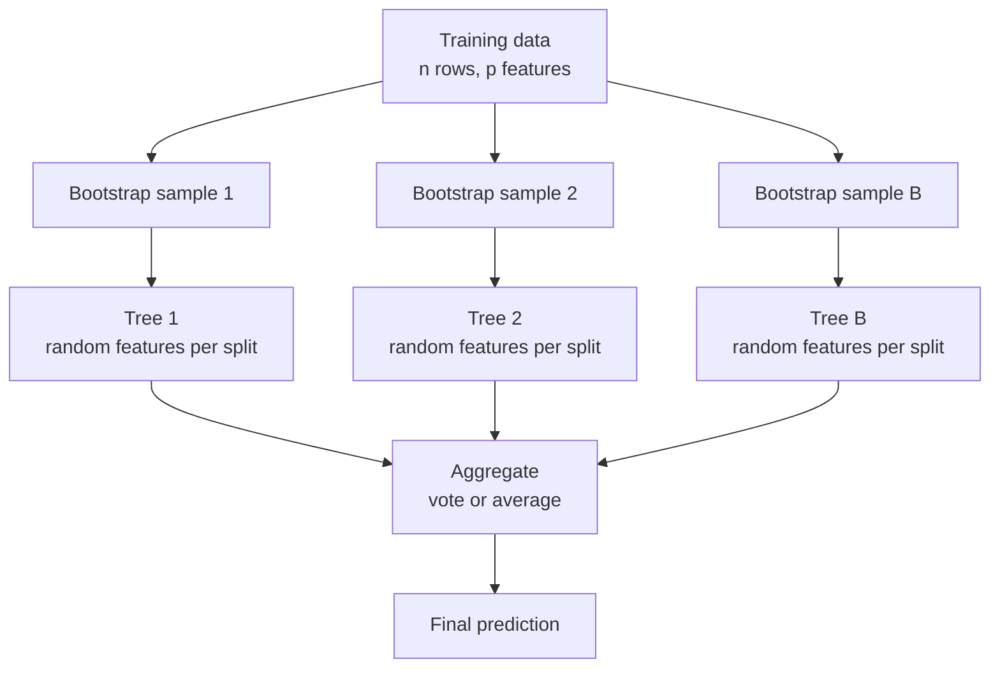

A single deep decision tree is accurate on its training data and unreliable everywhere else: change a few rows and you get a different tree. A **random forest** turns that weakness into a strength. It trains hundreds of deliberately different trees and averages their votes. The individual trees are noisy, but their errors partly cancel, and the result is one of the most dependable models in machine learning: strong accuracy with almost no tuning, no feature scaling and little risk of a bad configuration. For many tabular problems it is the first non-linear model to try.

## The wisdom of many noisy trees

The idea rests on a simple statistical fact. If you average $B$ predictions that each have variance $\sigma^2$ and pairwise correlation $\rho$, the variance of the average is

$$
\operatorname{Var}\Big(\frac{1}{B}\sum_{b=1}^{B} f_b(\mathbf{x})\Big) = \rho\,\sigma^2 + \frac{1 - \rho}{B}\,\sigma^2
$$

where $f_b$ is the $b$-th tree. As you add trees ($B$ grows), the second term shrinks towards zero, but the first term, $\rho\sigma^2$, does not. So averaging helps most when the trees are **as uncorrelated as possible**. Deep trees have low bias but high variance, as you saw in the [bias-variance tradeoff](/learn/machine-learning-fundamentals/bias-variance-tradeoff), so averaging decorrelated deep trees keeps the low bias and removes much of the variance.

Random forests decorrelate their trees with two sources of randomness.

## Two kinds of randomness

**1. Bootstrap sampling (bagging).** Each tree is trained on a **bootstrap sample**: $n$ rows drawn from the $n$ training rows *with replacement*. Some rows appear several times and others not at all. On average a bootstrap sample contains about 63.2% of the distinct rows, because the chance a given row is never picked is $(1 - 1/n)^n \approx e^{-1} \approx 0.368$. This idea, **b**ootstrap **agg**regat**ing**, is called bagging.

**2. Random feature subsets.** At every split, each tree considers only a random subset of the features, of size `max_features`. Without this, every tree would pick the same strong feature at the root and the trees would be highly correlated. Forcing trees to sometimes use other features makes them more diverse.



For classification, scikit-learn averages the trees' predicted class probabilities and picks the most probable class. For regression, it averages the trees' numeric predictions. The trees are independent of each other, so they can be trained in parallel on all CPU cores.

## Out-of-bag evaluation for free

Each tree never saw roughly 36.8% of the training rows. Those **out-of-bag** (OOB) rows act as a built-in validation set: to score row $i$, use only the trees that did not train on it. The OOB score is a nearly unbiased estimate of test performance without setting aside any data, which is valuable when data is scarce.

## Random forests in scikit-learn

Compare a single unrestricted tree with a forest on the breast cancer data:

```python
from sklearn.datasets import load_breast_cancer
from sklearn.ensemble import RandomForestClassifier
from sklearn.model_selection import train_test_split
from sklearn.tree import DecisionTreeClassifier

X, y = load_breast_cancer(return_X_y=True)
X_train, X_test, y_train, y_test = train_test_split(
    X, y, test_size=0.25, random_state=42, stratify=y
)

tree = DecisionTreeClassifier(random_state=0).fit(X_train, y_train)
forest = RandomForestClassifier(
    n_estimators=300, max_features="sqrt", oob_score=True, n_jobs=-1, random_state=0
).fit(X_train, y_train)

print("single tree test accuracy:", round(tree.score(X_test, y_test), 3))
print("forest      test accuracy:", round(forest.score(X_test, y_test), 3))
print("forest out-of-bag accuracy:", round(forest.oob_score_, 3))
```

```output
single tree test accuracy: 0.937
forest      test accuracy: 0.958
forest out-of-bag accuracy: 0.958
```

The forest beats the tree with no tuning at all, and the OOB estimate agrees with the held-out test score. `n_jobs=-1` uses every CPU core; `random_state` makes the bootstrap samples and feature choices reproducible.

How many trees do you need?

```python
for n in (1, 5, 25, 100, 300):
    f = RandomForestClassifier(n_estimators=n, random_state=0, n_jobs=-1).fit(X_train, y_train)
    print(f"n_estimators={n:<4} test={f.score(X_test, y_test):.3f}")
```

```output
n_estimators=1    test=0.937
n_estimators=5    test=0.958
n_estimators=25   test=0.965
n_estimators=100  test=0.958
n_estimators=300  test=0.958
```

Accuracy improves quickly and then plateaus; the small wobble between 25 and 300 trees is one or two test examples out of 143, which is noise. More trees never cause overfitting in the way deeper trees do. They only cost time and memory, while making the predictions more stable.

> [!TIP]
> `n_estimators` is not a hyperparameter to tune for accuracy. Set it as high as your time budget allows (a few hundred is typical) and tune `max_features` and `min_samples_leaf` instead.

## Hyperparameters

| Hyperparameter | Effect | Typical values |
| --- | --- | --- |
| `n_estimators` | Number of trees; more is more stable | 200 to 1000 |
| `max_features` | Features tried per split; lower means more diverse trees | `"sqrt"` (classification default), 0.3 to 1.0 of features for regression |
| `max_depth` | Depth limit per tree | `None` (fully grown) is usually fine |
| `min_samples_leaf` | Minimum rows per leaf; larger smooths predictions | 1 to 20 |
| `max_samples` | Fraction of rows per bootstrap sample | `None` (all), or less to speed up large datasets |
| `class_weight` | Re-weights rare classes | `None`, `"balanced"` or `"balanced_subsample"` |

In scikit-learn, `RandomForestRegressor` defaults to `max_features=1.0` (all features), which is plain bagging; lowering it often helps.

## Feature importance, with a caveat

A forest gives you `feature_importances_`, the total impurity decrease contributed by each feature, averaged over trees. A more trustworthy alternative is **permutation importance**: shuffle one feature's values in a validation set and measure how much the score drops.

```python
import pandas as pd
from sklearn.datasets import load_breast_cancer
from sklearn.inspection import permutation_importance

names = load_breast_cancer().feature_names
impurity = pd.Series(forest.feature_importances_, index=names)
print(impurity.sort_values(ascending=False).head(5).round(3))

perm = permutation_importance(forest, X_test, y_test, n_repeats=10, random_state=0, n_jobs=-1)
perm_s = pd.Series(perm.importances_mean, index=names)
print(perm_s.sort_values(ascending=False).head(5).round(3))
```

```output
worst concave points    0.134
worst perimeter         0.118
worst radius            0.117
mean concave points     0.110
worst area              0.108
dtype: float64
worst concave points    0.003
mean concave points     0.003
worst texture           0.001
mean radius             0.000
smoothness error        0.000
dtype: float64
```

The impurity ranking spreads credit across the size-related features (`radius`, `perimeter`, `area`), which are almost perfectly correlated. The permutation importances are all tiny: shuffling any single feature barely hurts, because a correlated sibling carries the same information. Neither number says "this feature does not matter".

> [!WARNING]
> Impurity-based importances are biased towards features with many distinct values (such as IDs or continuous noise) and are computed on training data. Both kinds of importance split or hide credit among correlated features. Treat them as a rough guide to what the model uses, never as causal effects.

## Strengths, weaknesses and when to choose it

| Strengths | Weaknesses |
| --- | --- |
| Strong accuracy with default settings | Large models: hundreds of deep trees use memory |
| Hard to overfit by adding trees | Slower prediction than a linear model or one tree |
| No scaling; robust to outliers and irrelevant features | Cannot extrapolate beyond the training target range |
| Built-in OOB validation, parallel training | Usually a little less accurate than well-tuned gradient boosting |

> [!KEY]
> A random forest averages many deep trees, each trained on a bootstrap sample with random feature subsets at each split. The randomness decorrelates the trees so that averaging cancels their variance. Choose it when you want a robust, low-effort, non-linear baseline for tabular data.

## Exercises

**1.** Train `RandomForestClassifier(n_estimators=300, random_state=0)` with `max_features` set to 1, `"sqrt"` and `None` (all 30 features) and compare test accuracy. Which setting produces the most correlated trees?

<details>
<summary>Show solution</summary>

```python
for mf in (1, "sqrt", None):
    f = RandomForestClassifier(n_estimators=300, max_features=mf, random_state=0, n_jobs=-1)
    f.fit(X_train, y_train)
    print(mf, round(f.score(X_test, y_test), 3))
```

```output
1 0.958
sqrt 0.958
None 0.951
```

On this small test set the differences are only a test example or two, so do not read much into them. `max_features=None` gives the most correlated trees, since every tree can choose the same best split at each node; it is plain bagging. `max_features=1` gives the most diverse but individually weakest trees. The default `"sqrt"` is usually a good compromise.

</details>

**2.** Simulate one bootstrap sample of 10,000 row indices with NumPy and measure the fraction of distinct rows.

<details>
<summary>Show solution</summary>

```python
import numpy as np
rng = np.random.default_rng(0)
idx = rng.integers(0, 10_000, size=10_000)
print(len(np.unique(idx)) / 10_000)
```

It prints `0.635`, very close to the theoretical $1 - e^{-1} \approx 0.632$.

</details>

**3.** Train a `RandomForestRegressor` on `x` values from 0 to 10 with `y = 2 * x`, then predict at `x = 20`. Explain the result.

<details>
<summary>Show solution</summary>

```python
from sklearn.ensemble import RandomForestRegressor
xs = np.linspace(0, 10, 200).reshape(-1, 1)
rf = RandomForestRegressor(random_state=0).fit(xs, 2 * xs.ravel())
print(rf.predict([[20.0]]))
```

It prints about `[19.95]`: close to 20, not 40. Every leaf predicts an average of training targets, so a tree-based model can never output a value outside the range it saw in training. Linear models extrapolate; trees do not.

</details>

```quiz
[
  {
    "q": "Why does a random forest consider only a random subset of features at each split?",
    "options": ["To reduce the correlation between trees so averaging cancels more variance", "To make each tree more accurate", "To avoid needing feature scaling", "To make the trees shallower"],
    "answer": 0,
    "why": "If all trees could use every feature they would make similar splits and be highly correlated. The variance term rho times sigma squared would then dominate."
  },
  {
    "q": "Roughly what fraction of distinct training rows does a bootstrap sample of size n contain?",
    "options": ["50%", "100%", "About 63%", "About 37%"],
    "answer": 2,
    "why": "Each row is missed with probability (1 - 1/n)^n, about e^-1 = 0.368, so about 63.2% of rows appear."
  },
  {
    "q": "What happens to a random forest's test accuracy as you keep increasing `n_estimators`?",
    "options": ["It rises and then falls sharply because of overfitting", "It improves and then plateaus", "It falls steadily", "It is unaffected at any value"],
    "answer": 1,
    "why": "More trees make the average more stable, with diminishing returns. Adding trees does not cause overfitting; it only costs compute."
  },
  {
    "q": "What is the out-of-bag score?",
    "options": ["The training accuracy of the first tree", "The accuracy on a separate test set", "The score of the trees that were pruned", "An estimate of generalisation using, for each row, only the trees that did not train on it"],
    "answer": 3,
    "why": "Each row is out of bag for about a third of the trees, which gives a free validation estimate."
  }
]
```
