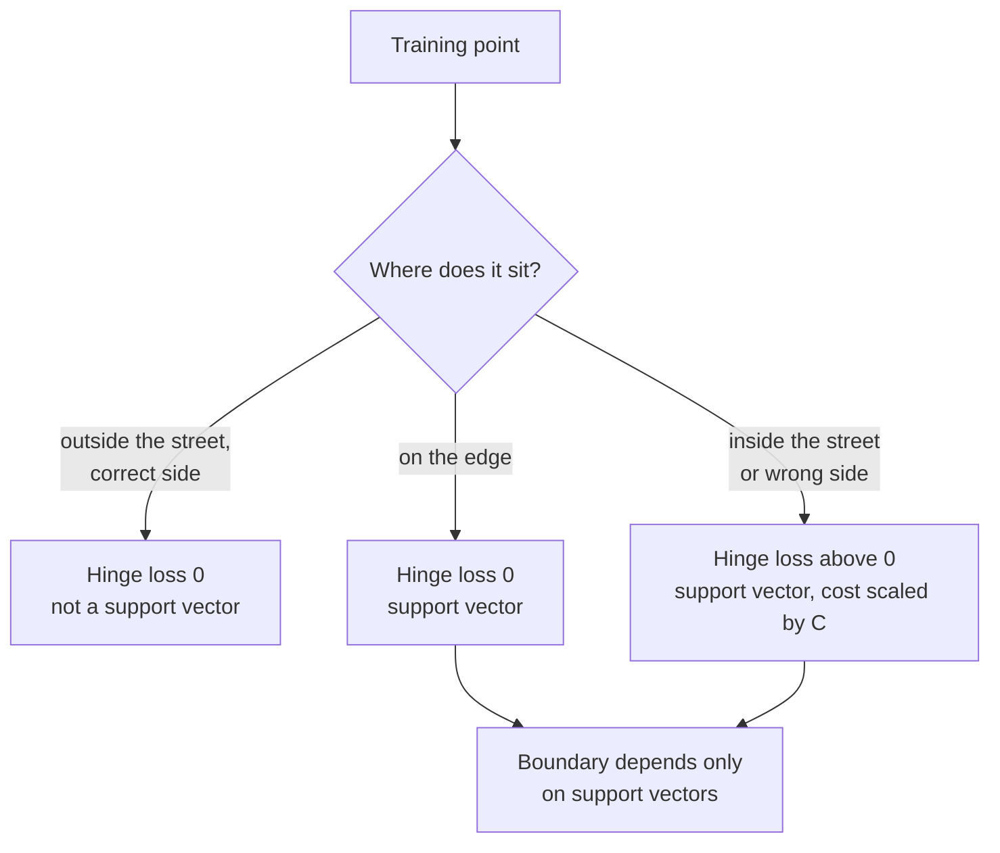

A support vector machine (SVM) is a classifier built on one geometric idea: among all the lines that separate two classes, choose the one that leaves the **widest possible margin** to the nearest points on either side. That choice makes the model robust, and a mathematical shortcut called the **kernel trick** lets the same method draw curved boundaries without ever computing curved features explicitly. Before deep learning, SVMs were the leading method for text classification and many vision tasks. Today they remain a strong choice for small and medium datasets with many features, and the ideas of margins and kernels recur throughout machine learning.

## The widest street

Imagine two classes of points that a straight line can separate. Infinitely many lines do the job. Logistic regression picks one based on probabilities; an SVM picks the one that sits in the middle of the widest "street" between the classes.

The boundary is the hyperplane $\mathbf{w}^\top \mathbf{x} + b = 0$, where $\mathbf{w}$ is a weight vector perpendicular to the boundary and $b$ is an offset. Labels are coded as $y_i \in \{-1, +1\}$. The edges of the street are the parallel hyperplanes $\mathbf{w}^\top \mathbf{x} + b = \pm 1$, and the street's width is $2 / \lVert \mathbf{w} \rVert$. Maximising the width is the same as minimising $\lVert \mathbf{w} \rVert^2$, so the **hard-margin SVM** solves

$$
\min_{\mathbf{w}, b} \ \frac{1}{2}\lVert \mathbf{w} \rVert^2
\quad \text{subject to} \quad
y_i(\mathbf{w}^\top \mathbf{x}_i + b) \ge 1 \ \text{ for every } i
$$

The constraint says every training point must be on the correct side of the street, outside it.

The points that lie exactly on the edges of the street are the **support vectors**. They alone determine the boundary: move or delete any other point and the solution does not change. That is where the name comes from.

## Soft margins and the C parameter

Real data overlaps, so no street is perfectly clean. The **soft-margin SVM** lets points violate the margin, at a price. In its equivalent unconstrained form it minimises

$$
\frac{1}{2}\lVert \mathbf{w} \rVert^2 + C \sum_{i=1}^{n} \max\big(0,\ 1 - y_i(\mathbf{w}^\top \mathbf{x}_i + b)\big)
$$

The second term is the **hinge loss**: zero for points safely outside the street, and growing linearly the further a point sits inside the street or on the wrong side. $C > 0$ sets the trade-off:

- **Small $C$**: a wide street that tolerates many violations. Simpler boundary, more bias.
- **Large $C$**: violations are expensive, so the street narrows to classify training points correctly. More variance.

Every point on or inside the margin, or misclassified, becomes a support vector.



## The kernel trick

A straight boundary cannot separate data shaped like two interlocking moons. One fix is to map the features into a higher-dimensional space, for example adding $x_1^2$, $x_2^2$ and $x_1 x_2$, where a flat boundary may work. That gets expensive fast.

The SVM's optimisation problem can be rewritten (its **dual** form) so that the data appears only through dot products $\mathbf{x}_i^\top \mathbf{x}_j$, which you met in [Dot product](/learn/linear-algebra/dot-product). The prediction becomes

$$
f(\mathbf{x}) = \sum_{i \in \text{SV}} \alpha_i \, y_i \, K(\mathbf{x}_i, \mathbf{x}) + b
$$

where the sum runs over the support vectors, $\alpha_i > 0$ are weights learned in training, and $K$ is a **kernel**: a function that equals a dot product in some feature space without ever building that space. Replacing the dot product by a kernel is the kernel trick. The most common choice is the **RBF (Gaussian) kernel**:

$$
K(\mathbf{x}, \mathbf{x}') = \exp\!\big(-\gamma \lVert \mathbf{x} - \mathbf{x}' \rVert^2\big)
$$

It measures similarity: 1 for identical points, falling towards 0 with distance. $\gamma > 0$ controls how quickly it falls. In effect, an RBF SVM predicts by a weighted vote of similarity to the support vectors.

| Kernel | `SVC(kernel=...)` | Boundary | Key parameters |
| --- | --- | --- | --- |
| Linear | `"linear"` | Hyperplane | `C` |
| Polynomial | `"poly"` | Polynomial curves | `C`, `degree`, `coef0` |
| RBF | `"rbf"` (default) | Arbitrary smooth regions | `C`, `gamma` |

## SVMs in scikit-learn

Here are the three kernels on the two-moons dataset:

```python
from sklearn.datasets import make_moons
from sklearn.model_selection import train_test_split
from sklearn.pipeline import make_pipeline
from sklearn.preprocessing import StandardScaler
from sklearn.svm import SVC

X, y = make_moons(n_samples=400, noise=0.2, random_state=0)
X_train, X_test, y_train, y_test = train_test_split(X, y, test_size=0.25, random_state=0)

for kernel in ("linear", "poly", "rbf"):
    clf = make_pipeline(StandardScaler(), SVC(kernel=kernel, C=1.0))
    clf.fit(X_train, y_train)
    n_sv = clf[-1].n_support_.sum()
    print(f"{kernel:<6}  test={clf.score(X_test, y_test):.3f}  support vectors={n_sv}")
```

```output
linear  test=0.900  support vectors=97
poly    test=0.890  support vectors=102
rbf     test=0.940  support vectors=76
```

The RBF kernel follows the curved moons and needs fewer support vectors. (The default polynomial kernel has degree 3, which is a poor fit for this shape.) Now vary `C` for the RBF kernel; the training set has 300 points:

```python
for C in (0.01, 1, 100, 10000):
    clf = make_pipeline(StandardScaler(), SVC(kernel="rbf", C=C, gamma="scale"))
    clf.fit(X_train, y_train)
    print(f"C={C:<6} train={clf.score(X_train, y_train):.3f}  "
          f"test={clf.score(X_test, y_test):.3f}  support vectors={clf[-1].n_support_.sum()}")
```

```output
C=0.01   train=0.823  test=0.810  support vectors=294
C=1      train=0.940  test=0.940  support vectors=76
C=100    train=0.980  test=0.950  support vectors=30
C=10000  train=0.987  test=0.940  support vectors=25
```

With `C=0.01` the street is so wide that 294 of 300 points are inside it, and the model underfits. As `C` rises, the street narrows, support vectors drop and training accuracy climbs, while test accuracy peaks and then starts to fall. `gamma` behaves similarly:

```python
for gamma in (0.01, 1, 100):
    clf = make_pipeline(StandardScaler(), SVC(kernel="rbf", C=1.0, gamma=gamma))
    clf.fit(X_train, y_train)
    print(f"gamma={gamma:<5} train={clf.score(X_train, y_train):.3f}  test={clf.score(X_test, y_test):.3f}")
```

```output
gamma=0.01  train=0.870  test=0.900
gamma=1     train=0.963  test=0.930
gamma=100   train=1.000  test=0.890
```

A tiny `gamma` makes every point similar to every other, giving an almost linear boundary. A huge `gamma` makes each support vector influence only its immediate neighbourhood, so the boundary wraps around individual training points: 100% training accuracy, worse test accuracy. `C` and `gamma` interact, so tune them together with a [grid search](/learn/model-evaluation/grid-search) on a log scale.

## Scaling is not optional

SVMs measure distances, so a feature with a large range dominates. On the wine dataset, where one feature (proline) is in the hundreds to thousands and others are below 1:

```python
from sklearn.datasets import load_wine
Xw, yw = load_wine(return_X_y=True)
Xw_tr, Xw_te, yw_tr, yw_te = train_test_split(Xw, yw, test_size=0.3, random_state=0, stratify=yw)
raw = SVC(kernel="rbf").fit(Xw_tr, yw_tr)
scaled = make_pipeline(StandardScaler(), SVC(kernel="rbf")).fit(Xw_tr, yw_tr)
print("without scaling:", round(raw.score(Xw_te, yw_te), 3))
print("with scaling:   ", round(scaled.score(Xw_te, yw_te), 3))
```

```output
without scaling: 0.648
with scaling:    1.0
```

> [!WARNING]
> Always put `StandardScaler` (or another scaler) in a pipeline before an SVM. Without it, the kernel effectively looks at only the largest-valued features, and accuracy can collapse, as it does here from 100% to 65%.

## Practical notes

- **Probabilities.** `SVC` outputs a signed distance via `decision_function`, not a probability. `SVC(probability=True)` adds probabilities by fitting an extra calibration model with internal cross-validation, which slows training noticeably.
- **Scale of data.** Kernel SVM training time grows at least quadratically with the number of rows, so it becomes impractical somewhere beyond tens of thousands of rows. For large data with a linear kernel, use `LinearSVC` or `SGDClassifier(loss="hinge")`, which scale to millions of rows.
- **Regression.** `SVR` applies the same ideas to regression: errors smaller than a tolerance `epsilon` cost nothing, and larger errors are penalised linearly.
- **Multi-class.** `SVC` handles several classes automatically by training one classifier per pair of classes.

## Strengths, weaknesses and when to choose it

| Strengths | Weaknesses |
| --- | --- |
| Strong with many features relative to rows (for example text) | Slow to train on large datasets |
| Flexible boundaries through kernels | Needs feature scaling and tuning of `C` and `gamma` |
| Depends only on support vectors; robust margin | No native probabilities |
| Convex problem: a unique solution | Hard to interpret with non-linear kernels |

> [!KEY]
> An SVM finds the maximum-margin boundary, controlled by `C`, and kernels let that boundary curve. Choose it for small to medium datasets, especially high-dimensional ones; for large tabular data, gradient boosting is usually faster and more accurate.

## Exercises

**1.** On the moons data, compute the decision function of the `C=1` RBF model for the first three test points and relate the signs to the predictions.

<details>
<summary>Show solution</summary>

```python
clf = make_pipeline(StandardScaler(), SVC(kernel="rbf", C=1.0)).fit(X_train, y_train)
print(clf.decision_function(X_test[:3]).round(3))
print(clf.predict(X_test[:3]))
```

Positive values are predicted as class 1 and negative as class 0. Values between -1 and 1 lie inside the margin; the magnitude indicates how far a point is from the boundary.

</details>

**2.** Use `GridSearchCV` to search `C` in `[0.1, 1, 10, 100]` and `gamma` in `[0.1, 1, 10]` for the RBF pipeline on the moons training set. Report the best parameters.

<details>
<summary>Show solution</summary>

```python
from sklearn.model_selection import GridSearchCV

pipe = make_pipeline(StandardScaler(), SVC(kernel="rbf"))
grid = {"svc__C": [0.1, 1, 10, 100], "svc__gamma": [0.1, 1, 10]}
search = GridSearchCV(pipe, grid, cv=5).fit(X_train, y_train)
print(search.best_params_, round(search.best_score_, 3))
```

Parameters inside a pipeline are addressed as `stepname__param`, and `make_pipeline` names the step `svc`. Grid search is covered fully in Module 15.

</details>

**3.** Why does deleting a training point that is not a support vector leave the trained SVM unchanged?

<details>
<summary>Show solution</summary>

The prediction function is a sum over support vectors only; every other point has $\alpha_i = 0$ and lies outside the margin, contributing nothing to the loss. Removing it changes neither the objective at the optimum nor the solution.

</details>

```quiz
[
  {
    "q": "What does an SVM maximise?",
    "options": ["The number of support vectors", "The likelihood of the labels", "The margin between the decision boundary and the nearest training points", "The depth of the decision boundary"],
    "answer": 2,
    "why": "The SVM picks the separating hyperplane with the widest margin, which is equivalent to minimising the norm of w."
  },
  {
    "q": "Increasing `C` in a soft-margin SVM usually does what?",
    "options": ["Narrows the margin and fits the training data more closely", "Widens the margin and allows more violations", "Changes the kernel", "Removes the need for scaling"],
    "answer": 0,
    "why": "C is the cost of margin violations. Higher cost forces a narrower street that classifies more training points correctly, risking overfitting."
  },
  {
    "q": "What does the kernel trick allow?",
    "options": ["Training without labels", "Computing probabilities exactly", "Skipping the optimisation step", "Learning non-linear boundaries by replacing dot products with a kernel, without building the high-dimensional features"],
    "answer": 3,
    "why": "The dual problem depends on data only through dot products, so a kernel can stand in for a dot product in a richer feature space."
  },
  {
    "q": "An RBF SVM scores 100% on training data and much lower on test data. Which change is most likely to help?",
    "options": ["Increase `gamma`", "Decrease `gamma` or `C`", "Remove feature scaling", "Switch to `probability=True`"],
    "answer": 1,
    "why": "A large gamma or C produces a very wiggly boundary that memorises training points. Lowering them smooths the boundary."
  }
]
```
