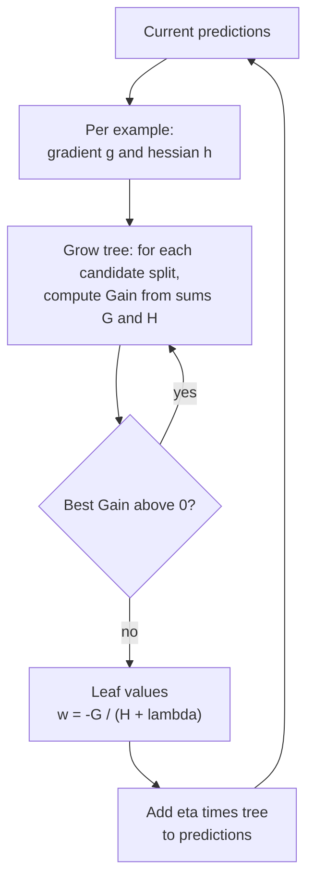

XGBoost ("eXtreme Gradient Boosting") is the library that made gradient-boosted trees the default tool for tabular machine learning. It takes the algorithm from the [previous lesson](/learn/supervised-learning-algorithms/gradient-boosting) and adds a regularised objective, a more precise way of choosing splits using second derivatives, built-in handling of missing values, and a fast, parallel implementation. This lesson focuses on what XGBoost changes in the algorithm and how to use its scikit-learn-style interface well; the library itself, with its native API and deployment options, is covered again in [Machine Learning Libraries](/learn/machine-learning-libraries/xgboost).

## What XGBoost adds to gradient boosting

| Idea | What it does |
| --- | --- |
| Regularised objective | Penalises the number of leaves and the size of leaf values, so trees are pruned by the objective itself |
| Second-order approximation | Uses both the gradient and the curvature (second derivative) of the loss to set leaf values and score splits |
| Sparsity-aware splits | Learns a default direction for missing values at every split |
| Histogram split finding | Bins features (`tree_method="hist"`, the default in recent versions) for speed |
| Row and column subsampling | Adds randomness, as in random forests, to reduce overfitting |
| Native categorical support | Splits on category groups when `enable_categorical=True` |

## The regularised objective

XGBoost builds an additive model of $K$ trees, $\hat{y}_i = \sum_{k=1}^{K} f_k(\mathbf{x}_i)$ (on the log-odds scale for classification), and minimises

$$
\mathcal{L} = \sum_{i=1}^{n} l(y_i, \hat{y}_i) + \sum_{k=1}^{K} \Omega(f_k),
\qquad
\Omega(f) = \gamma T + \frac{1}{2}\lambda \sum_{j=1}^{T} w_j^2
$$

where $l$ is a differentiable loss (log loss, squared error and so on), $T$ is the number of leaves in a tree, $w_j$ is the value predicted by leaf $j$, $\gamma$ is a cost per leaf and $\lambda$ is an L2 penalty on leaf values. Plain gradient boosting has no $\Omega$ term.

When adding a new tree $f_t$, XGBoost approximates the loss with a second-order [Taylor expansion](/learn/calculus/derivatives) around the current predictions. For each example it computes

$$
g_i = \frac{\partial l(y_i, \hat{y}_i)}{\partial \hat{y}_i}, \qquad h_i = \frac{\partial^2 l(y_i, \hat{y}_i)}{\partial \hat{y}_i^2}
$$

the gradient and the second derivative (the "hessian"). For log loss these are $g_i = p_i - y_i$ and $h_i = p_i(1 - p_i)$. Summing them over the examples in leaf $j$ gives $G_j$ and $H_j$, and the best value for that leaf has a closed form:

$$
w_j^* = -\frac{G_j}{H_j + \lambda}
$$

This is a Newton step, rather than the plain gradient step of classic boosting. The tree's quality is

$$
\text{score} = -\frac{1}{2}\sum_{j=1}^{T} \frac{G_j^2}{H_j + \lambda} + \gamma T
$$

and a split of a node into left and right children is worth

$$
\text{Gain} = \frac{1}{2}\left[\frac{G_L^2}{H_L + \lambda} + \frac{G_R^2}{H_R + \lambda} - \frac{(G_L + G_R)^2}{H_L + H_R + \lambda}\right] - \gamma
$$

If the best split's gain is not positive, the node is not split. So $\gamma$ acts as a minimum improvement threshold and $\lambda$ shrinks leaf values towards zero.



### A leaf value by hand

Four examples land in one leaf. The model currently predicts probability 0.5 for each, and three of the four labels are 1:

```python
import numpy as np

p = np.full(4, 0.5)                    # current predicted probabilities
y_node = np.array([1, 1, 0, 1])        # labels of the 4 rows in this leaf
g = p - y_node                         # first derivatives of log loss
h = p * (1 - p)                        # second derivatives
lam = 1.0
G, H = g.sum(), h.sum()
print("G =", G, " H =", H)
print("optimal leaf weight w* =", round(-G / (H + lam), 3))
print("score of this leaf     =", round(-0.5 * G**2 / (H + lam), 3))
```

```output
G = -1.0  H = 1.0
optimal leaf weight w* = 0.5
score of this leaf     = -0.25
```

The leaf adds 0.5 to the log-odds of these examples, pushing them towards class 1 (scaled by the learning rate when added). With $\lambda = 0$ the weight would be 1.0; the regulariser halves it. Leaves with few examples have small $H$, so $\lambda$ shrinks them most, which is exactly where overfitting is likeliest.

## A realistic example with categorical features

The next three lessons share one synthetic dataset: 6,000 customers of a subscription service, with numeric features, two categorical ones (`plan`, and `region` with 40 values) and a churn label. It is synthetic so that you can regenerate it exactly; `monthly_spend` has deliberately no effect on churn.

```python
import numpy as np
import pandas as pd
from sklearn.model_selection import train_test_split

rng = np.random.default_rng(42)
n = 6000
df = pd.DataFrame({
    "tenure_months": rng.integers(1, 72, n),
    "monthly_spend": rng.normal(60, 20, n).round(2),
    "support_calls": rng.poisson(1.5, n),
    "plan": rng.choice(["basic", "standard", "premium"], n, p=[0.5, 0.3, 0.2]),
    "region": rng.choice([f"r{i:02d}" for i in range(40)], n),
})
region_effect = dict(zip(sorted(df["region"].unique()), rng.normal(0, 0.8, 40)))
plan_effect = {"basic": 0.6, "standard": 0.0, "premium": -0.6}
logit = (0.5 - 0.05 * df["tenure_months"] + 0.6 * df["support_calls"]
         + df["plan"].map(plan_effect) + df["region"].map(region_effect))
y = (rng.random(n) < 1 / (1 + np.exp(-logit))).astype(int)

X_train, X_test, y_train, y_test = train_test_split(df, y, test_size=0.2, random_state=0, stratify=y)
X_train, X_val, y_train, y_val = train_test_split(X_train, y_train, test_size=0.2, random_state=0, stratify=y_train)
print(df.head(3))
print("churn rate:", round(y.mean(), 3), " train/val/test:", len(X_train), len(X_val), len(X_test))
```

```output
   tenure_months  monthly_spend  support_calls     plan region
0              7          81.13              0    basic    r07
1             55          44.90              1  premium    r14
2             47           5.21              1    basic    r10
churn rate: 0.489  train/val/test: 3840 960 1200
```

Now train XGBoost with early stopping on the validation set. Converting string columns to the pandas `category` dtype and setting `enable_categorical=True` lets XGBoost split on groups of categories directly, without one-hot encoding:

```python
from xgboost import XGBClassifier

cat_cols = ["plan", "region"]
Xtr, Xva, Xte = (d.astype({c: "category" for c in cat_cols}) for d in (X_train, X_val, X_test))

model = XGBClassifier(
    n_estimators=2000,
    learning_rate=0.05,
    max_depth=4,
    subsample=0.8,
    colsample_bytree=0.8,
    reg_lambda=1.0,
    tree_method="hist",
    enable_categorical=True,
    early_stopping_rounds=50,
    eval_metric="logloss",
    random_state=0,
)
model.fit(Xtr, y_train, eval_set=[(Xva, y_val)], verbose=False)

print("best iteration:", model.best_iteration)
print("test accuracy:", round(model.score(Xte, y_test), 3))
print(model.predict_proba(Xte.head(3)).round(3))
```

```output
best iteration: 82
test accuracy: 0.747
[[0.224 0.776]
 [0.549 0.451]
 [0.62  0.38 ]]
```

Out of an allowed 2,000 rounds, validation log loss was best at iteration 82 (counting from 0); training stopped 50 rounds later, and `predict` and `score` automatically use the best iteration. The labels were drawn randomly from probabilities, so even a perfect model cannot reach 100% accuracy here; what matters is the comparison against alternatives on the same data. These outputs come from XGBoost 3.x; other versions may differ slightly.

> [!NOTE]
> In current XGBoost versions, `early_stopping_rounds` and `eval_metric` are constructor arguments, as above. Older tutorials pass them to `fit`; that form was deprecated and current versions reject it. On macOS, XGBoost also needs the OpenMP runtime; if the import fails with a `libomp` error, install it (for example with Homebrew's `libomp` package).

Gain-based importance shows which features the trees found most useful:

```python
imp = pd.Series(model.get_booster().get_score(importance_type="gain"))
print(imp.sort_values(ascending=False).round(1))
```

```output
support_calls    12.4
tenure_months    12.2
region           10.7
plan              6.5
monthly_spend     3.3
dtype: float64
```

`"gain"` is the average gain per split using the feature. The useless `monthly_spend` ranks last but is not zero: trees still find small, noisy improvements in it. Importances are a hint, not proof.

## Missing values

XGBoost accepts `NaN` directly. At each split, it tries sending all missing values left and then right, and keeps whichever direction gives the higher gain. That learned **default direction** is used at prediction time, so you often do not need to impute. If missingness carries meaning (a customer who never filled in a field), this can be better than imputing a mean.

## Key hyperparameters

| Parameter (sklearn API) | Default | Effect |
| --- | --- | --- |
| `n_estimators` | 100 | Maximum boosting rounds; set high with early stopping |
| `learning_rate` (`eta`) | 0.3 | Shrinkage per tree; lower (0.01 to 0.1) generalises better |
| `max_depth` | 6 | Tree depth; 3 to 8 is common |
| `min_child_weight` | 1 | Minimum sum of hessians $H$ in a leaf; larger is more conservative |
| `gamma` (`min_split_loss`) | 0 | Minimum gain to make a split |
| `reg_lambda` / `reg_alpha` | 1 / 0 | L2 / L1 penalty on leaf values |
| `subsample` / `colsample_bytree` | 1 / 1 | Fraction of rows / features per tree |
| `scale_pos_weight` | 1 | Up-weights the positive class for imbalanced data |

> [!TIP]
> A sound tuning order: fix `learning_rate` around 0.05 with early stopping; tune `max_depth` and `min_child_weight`; then `subsample` and `colsample_bytree`; then the regularisers. Lower the learning rate at the end for a final small gain.

## Strengths, weaknesses and when to choose it

| Strengths | Weaknesses |
| --- | --- |
| Excellent accuracy on tabular data | Many hyperparameters |
| Principled regularisation and missing-value handling | Default learning rate of 0.3 is aggressive; tune it |
| Mature, widely deployed, CPU and GPU support | Depth-wise trees can be slower than LightGBM on very large data |
| Familiar scikit-learn interface | Categorical support is newer than CatBoost's |

> [!KEY]
> XGBoost is gradient boosting with a regularised objective and Newton-style leaf values, $w^* = -G/(H + \lambda)$. Choose it as a robust, well-documented default for tabular problems, always with a validation set and early stopping.

## Exercises

**1.** Repeat the leaf calculation with `lam = 0` and with `lam = 10`. How does the leaf weight change, and why does that matter for small leaves?

<details>
<summary>Show solution</summary>

$w^* = -G/(H + \lambda)$ with $G = -1$, $H = 1$: $\lambda = 0$ gives 1.0, $\lambda = 10$ gives about 0.091. Larger $\lambda$ shrinks leaf values. Because $\lambda$ is added to $H$, it has the largest relative effect on leaves with few examples (small $H$), whose values are the least reliable.

</details>

**2.** Train the same model with `learning_rate=0.3` (the default). Compare `best_iteration` and test accuracy with the 0.05 run.

<details>
<summary>Show solution</summary>

```python
fast = XGBClassifier(n_estimators=2000, learning_rate=0.3, max_depth=4, tree_method="hist",
                     enable_categorical=True, early_stopping_rounds=50, eval_metric="logloss",
                     random_state=0)
fast.fit(Xtr, y_train, eval_set=[(Xva, y_val)], verbose=False)
print(fast.best_iteration, round(fast.score(Xte, y_test), 3))
```

```output
10 0.73
```

The higher learning rate reaches its best validation loss after only 10 rounds instead of 82, and test accuracy drops from 0.747 to 0.73. Each large step overshoots more, so the model is coarser and more sensitive to noise.

</details>

**3.** Using the gain formula, explain why a split that puts one example on the left and the rest on the right is often rejected when `gamma` is large.

<details>
<summary>Show solution</summary>

A single example contributes a small $G_L$ and $H_L$, so it adds little to the bracketed term, and the gain over not splitting is small. Subtracting $\gamma$ then makes it negative, so the split is not made. `gamma` therefore prunes splits that isolate a few examples.

</details>

```quiz
[
  {
    "q": "In XGBoost, what is the optimal value of a leaf given gradient sum G, hessian sum H and L2 penalty lambda?",
    "options": ["-G / (H + lambda)", "G / H", "The mean target in the leaf", "-H / (G + lambda)"],
    "answer": 0,
    "why": "Minimising the second-order approximation of the regularised loss gives w* = -G / (H + lambda), a Newton step."
  },
  {
    "q": "What does the `gamma` parameter control?",
    "options": ["The learning rate", "The fraction of features per tree", "The minimum gain required to make a split", "The number of trees"],
    "answer": 2,
    "why": "gamma is the cost per leaf in the objective, so a split is only made if its gain exceeds it."
  },
  {
    "q": "How does XGBoost handle a missing value at a split?",
    "options": ["It raises an error", "It sends it in a learned default direction chosen to maximise gain", "It replaces it with the feature mean", "It drops the row"],
    "answer": 1,
    "why": "Sparsity-aware split finding evaluates both directions for missing values and keeps the better one."
  },
  {
    "q": "In current XGBoost versions, where do you set `early_stopping_rounds` in the scikit-learn API?",
    "options": ["In `predict`", "As an environment variable", "It is not supported", "In the `XGBClassifier` constructor"],
    "answer": 3,
    "why": "Current versions take early_stopping_rounds (and eval_metric) as constructor parameters; the eval_set is passed to fit."
  }
]
```
