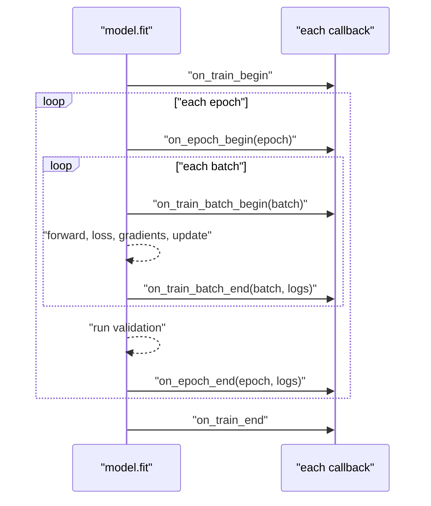

Once you hand the training loop to `fit`, you need a way to act inside it: stop when the model stops improving, save the best weights as you go, lower the learning rate when progress stalls, log metrics for a dashboard. In PyTorch you would add `if` statements to your own loop. In Keras you pass **callbacks**: objects whose methods `fit` calls at fixed points during training. A handful of built-in callbacks cover most needs, and writing your own takes a few lines.

## Where callbacks run

A callback is an instance of `keras.callbacks.Callback` with methods named after moments in training. `fit` calls each method on every callback in the list you pass.



The `logs` dictionary passed to `on_epoch_end` holds that epoch's metrics, such as `loss`, `val_loss` and `val_accuracy`: the same values that end up in the `History` object. Most built-in callbacks do their work in `on_epoch_end` by watching one of these numbers, named by the `monitor` argument.

## A model worth stopping

To see callbacks act, train a model that overfits: a large network on a small, noisy dataset.

```python
import os, tempfile
import numpy as np
import keras
from keras import layers
from sklearn.datasets import make_classification
from sklearn.model_selection import train_test_split

X, y = make_classification(n_samples=400, n_features=20, n_informative=5,
                           flip_y=0.15, random_state=3)
X_train, X_val, y_train, y_val = train_test_split(
    X.astype("float32"), y, test_size=0.3, random_state=3)

def make_model():
    keras.utils.set_random_seed(3)
    m = keras.Sequential([
        keras.Input(shape=(20,)),
        layers.Dense(256, activation="relu"),
        layers.Dense(256, activation="relu"),
        layers.Dense(1, activation="sigmoid"),
    ])
    m.compile(optimizer=keras.optimizers.Adam(1e-3),
              loss="binary_crossentropy", metrics=["accuracy"])
    return m

model = make_model()
history = model.fit(X_train, y_train, validation_data=(X_val, y_val),
                    epochs=60, batch_size=32, verbose=0)
val_loss = history.history["val_loss"]
best = int(np.argmin(val_loss))
print(f"best val_loss {val_loss[best]:.3f} at epoch {best + 1}")
print(f"final val_loss {val_loss[-1]:.3f} at epoch 60")
```

```output
best val_loss 0.513 at epoch 5
final val_loss 1.350 at epoch 60
```

The validation loss reached its minimum early and then climbed while the model memorised the training data. Every epoch after the best one was wasted time, and the final weights are worse than the best ones.

## EarlyStopping

`EarlyStopping` stops training when the monitored value has not improved for `patience` epochs. With `restore_best_weights=True` it also rolls the model back to the best epoch's weights when it stops.

```python
early = keras.callbacks.EarlyStopping(
    monitor="val_loss",          # what to watch
    patience=5,                  # epochs without improvement before stopping
    min_delta=1e-3,              # smaller changes do not count as improvement
    restore_best_weights=True,   # roll back to the best epoch
)

model = make_model()
history = model.fit(X_train, y_train, validation_data=(X_val, y_val),
                    epochs=60, batch_size=32, verbose=0, callbacks=[early])
print("epochs run:", len(history.history["loss"]))
print(f"val_loss after restore: {model.evaluate(X_val, y_val, verbose=0)[0]:.3f}")
```

```output
epochs run: 9
val_loss after restore: 0.513
```

Training stopped a few epochs after the best one, and the model now holds the best weights rather than the last ones. This is [early stopping](/learn/neural-network-fundamentals/regularization) as a regulariser, implemented in one object.

> [!WARNING]
> `restore_best_weights` defaults to `False`. Without it, `EarlyStopping` stops training but leaves the model with the weights from the last epoch, which are `patience` epochs past the best. Set it to `True` unless you are also saving the best model with a checkpoint.

The `mode` argument says whether lower or higher is better. Keras infers it from the name (anything with `loss` is minimised, `accuracy` maximised), and you can set `mode="min"` or `mode="max"` explicitly for custom metrics.

## ModelCheckpoint

`ModelCheckpoint` saves the model during training, so a crash or a pre-empted cloud machine does not lose hours of work, and so you keep the best version on disk.

```python
ckpt_dir = tempfile.mkdtemp()
checkpoint = keras.callbacks.ModelCheckpoint(
    filepath=os.path.join(ckpt_dir, "best.keras"),
    monitor="val_loss",
    save_best_only=True,     # overwrite only when val_loss improves
)

model = make_model()
model.fit(X_train, y_train, validation_data=(X_val, y_val),
          epochs=20, batch_size=32, verbose=0, callbacks=[checkpoint])

best_model = keras.models.load_model(os.path.join(ckpt_dir, "best.keras"))
print(os.listdir(ckpt_dir))
print(f"best checkpoint val_loss: {best_model.evaluate(X_val, y_val, verbose=0)[0]:.3f}")
```

```output
['best.keras']
best checkpoint val_loss: 0.513
```

A `.keras` file holds the architecture, the weights and the optimiser state, so it can be reloaded and even trained further. Pass `save_weights_only=True` with a filename ending in `.weights.h5` to save only the weights. The filepath can include formatting fields, such as `"ckpt-{epoch:02d}-{val_loss:.3f}.keras"`, to keep one file per epoch.

## ReduceLROnPlateau

When the loss plateaus, a smaller [learning rate](/learn/neural-network-fundamentals/learning-rates) often lets the optimiser settle into a better minimum. `ReduceLROnPlateau` multiplies the learning rate by `factor` after `patience` epochs without improvement:

```python
reduce_lr = keras.callbacks.ReduceLROnPlateau(
    monitor="val_loss", factor=0.5, patience=3, min_lr=1e-5)
```

Combine it with early stopping by giving early stopping a longer patience, so the learning rate has a chance to drop a few times before training gives up.

## Other built-in callbacks

| Callback | Does |
| --- | --- |
| `EarlyStopping` | Stops when a metric stops improving; optionally restores best weights |
| `ModelCheckpoint` | Saves the model or weights, every epoch or only the best |
| `ReduceLROnPlateau` | Lowers the learning rate when a metric plateaus |
| `LearningRateScheduler(schedule)` | Sets the learning rate each epoch from a function `schedule(epoch, lr)` |
| `CSVLogger("log.csv")` | Appends each epoch's metrics to a CSV file |
| `TensorBoard(log_dir="logs")` | Writes logs for the TensorBoard dashboard (`tensorboard --logdir logs`) |
| `BackupAndRestore(backup_dir)` | Lets an interrupted `fit` resume from the last completed epoch |
| `TerminateOnNaN()` | Stops immediately if the loss becomes NaN |

A typical production list combines several:

```python
callbacks = [
    keras.callbacks.EarlyStopping(monitor="val_loss", patience=10,
                                  restore_best_weights=True),
    keras.callbacks.ModelCheckpoint(os.path.join(ckpt_dir, "best.keras"),
                                    monitor="val_loss", save_best_only=True),
    keras.callbacks.ReduceLROnPlateau(monitor="val_loss", factor=0.5, patience=4),
    keras.callbacks.CSVLogger(os.path.join(ckpt_dir, "training_log.csv")),
]
```

## Writing your own callback

Subclass `keras.callbacks.Callback` and override the hooks you need. Inside, `self.model` is the model being trained. This one prints the learning rate each epoch and stops training once validation accuracy passes a target:

```python
class StopAtAccuracy(keras.callbacks.Callback):
    def __init__(self, target):
        super().__init__()
        self.target = target

    def on_epoch_end(self, epoch, logs=None):
        acc = logs["val_accuracy"]
        lr = float(self.model.optimizer.learning_rate)
        print(f"epoch {epoch + 1}: val_accuracy={acc:.3f} lr={lr:g}")
        if acc >= self.target:
            print("target reached, stopping")
            self.model.stop_training = True

model = make_model()
model.fit(X_train, y_train, validation_data=(X_val, y_val), epochs=20,
          batch_size=32, verbose=0, callbacks=[StopAtAccuracy(0.75)])
```

```output
epoch 1: val_accuracy=0.742 lr=0.001
epoch 2: val_accuracy=0.733 lr=0.001
epoch 3: val_accuracy=0.750 lr=0.001
target reached, stopping
```

Setting `self.model.stop_training = True` is exactly how `EarlyStopping` ends training. Custom callbacks are the place for anything you would have added to a hand-written loop: logging to an experiment tracker, sending a message when a long job finishes, or saving sample predictions each epoch.

> [!KEY]
> Callbacks let you keep `fit` and still control the loop. Watch a validation metric, never a training one: training loss nearly always keeps falling, so callbacks that monitor it will rarely stop or save at the right time.

## Exercises

**1.** Configure early stopping that watches validation accuracy, waits 8 epochs, and restores the best weights.

<details>
<summary>Show solution</summary>

```python
es = keras.callbacks.EarlyStopping(monitor="val_accuracy", mode="max",
                                   patience=8, restore_best_weights=True)
```

`mode="max"` is inferred from the name, but stating it is clearer.

</details>

**2.** You train with `EarlyStopping(monitor="loss", patience=5)`. Training runs for all 200 epochs and the model overfits badly. What is wrong?

<details>
<summary>Show solution</summary>

It monitors the **training** loss, which keeps decreasing as the model memorises the data, so it never triggers. Monitor `val_loss` instead, which requires validation data in `fit`. Also add `restore_best_weights=True`.

</details>

**3.** Write a callback that prints the training loss every 10 batches.

<details>
<summary>Show solution</summary>

```python
class BatchPrinter(keras.callbacks.Callback):
    def on_train_batch_end(self, batch, logs=None):
        if batch % 10 == 0:
            print(f"batch {batch}: loss={logs['loss']:.4f}")
```

`batch` restarts from 0 each epoch. The loss in batch-level logs is the running average over the epoch so far.

</details>

```quiz
[
  {
    "q": "Which callback method should you override to act after each epoch's validation has run?",
    "options": ["`on_train_batch_end`", "`on_epoch_begin`", "`on_epoch_end`", "`on_train_end`"],
    "answer": 2,
    "why": "`on_epoch_end` receives the epoch's logs, including validation metrics."
  },
  {
    "q": "What does `restore_best_weights=True` do in `EarlyStopping`?",
    "options": [
      "Saves the best weights to disk",
      "When training stops, sets the model's weights back to those from the best monitored epoch",
      "Restarts training from the best epoch",
      "Restores weights from the last checkpoint file"
    ],
    "answer": 1,
    "why": "Without it, the model keeps the weights from the final epoch, which may be several epochs past the best one."
  },
  {
    "q": "`ModelCheckpoint(\"best.keras\", monitor=\"val_loss\", save_best_only=True)` writes the file when...",
    "options": [
      "every epoch",
      "only at the end of training",
      "an epoch's `val_loss` is lower than every previous epoch's",
      "the training loss improves"
    ],
    "answer": 2,
    "why": "With `save_best_only=True` the file is overwritten only when the monitored value improves."
  },
  {
    "q": "How does a custom callback end training early?",
    "options": [
      "`raise StopIteration`",
      "`return False` from `on_epoch_end`",
      "`self.model.stop_training = True`",
      "`self.model.compile(epochs=0)`"
    ],
    "answer": 2,
    "why": "Setting `self.model.stop_training = True` tells `fit` to finish after the current epoch; this is how `EarlyStopping` works."
  }
]
```
