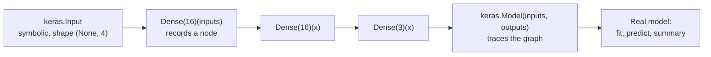
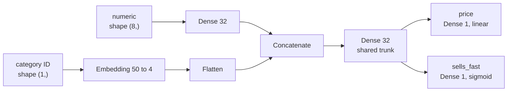

Real models are rarely a straight line. A product-pricing model may combine numeric features with a text description; a ResNet adds each block's input back to its output; a moderation model may predict a category and a severity score at the same time. The Functional API handles all of these. You treat layers as functions, call them on symbolic tensors to wire up any graph you like, and then wrap the graph in a `keras.Model`. It is the style most production Keras code uses, and once you can read it you can read most published Keras architectures.

## Layers as functions

In the Functional API you start from a symbolic `keras.Input`, call each layer on the previous result, and finally tell `keras.Model` which tensors are the inputs and outputs:

```python
import numpy as np
import keras
from keras import layers

keras.utils.set_random_seed(0)

inputs = keras.Input(shape=(4,), name="features")
x = layers.Dense(16, activation="relu")(inputs)
x = layers.Dense(16, activation="relu")(x)
outputs = layers.Dense(3, activation="softmax")(x)

model = keras.Model(inputs=inputs, outputs=outputs, name="mlp")
print(inputs.shape, outputs.shape)
print(model.count_params())
```

```output
(None, 4) (None, 3)
403
```

This is exactly the iris network from the Sequential lesson, with the same 403 parameters. The difference is that you now hold every intermediate tensor in a variable, so you can send it anywhere.

`inputs` is not real data. It is a **symbolic tensor**: a placeholder that records shape and dtype. Calling `layers.Dense(16)(inputs)` does not compute anything; it records an edge in a graph. `keras.Model(inputs, outputs)` then walks that graph backwards from the outputs to find every layer involved.



Because Keras knows the whole graph before any data arrives, it checks shapes at construction time. Wiring a layer to an incompatible tensor fails immediately with a clear message, rather than mid-training as can happen in a subclassed model or a PyTorch `forward`.

## Several inputs and several outputs

Suppose you predict the selling price of a used item (a regression) and whether it sells within a week (a binary classification) from two inputs: eight numeric features and a category ID out of 50 categories. One model, two heads, trained jointly:



```python
num_in = keras.Input(shape=(8,), name="numeric")
cat_in = keras.Input(shape=(1,), dtype="int32", name="category")

a = layers.Dense(32, activation="relu")(num_in)
b = layers.Flatten()(layers.Embedding(input_dim=50, output_dim=4)(cat_in))
trunk = layers.Dense(32, activation="relu")(layers.Concatenate()([a, b]))

price = layers.Dense(1, name="price")(trunk)
fast = layers.Dense(1, activation="sigmoid", name="sells_fast")(trunk)

multi = keras.Model(inputs=[num_in, cat_in], outputs=[price, fast])
print([t.name for t in multi.inputs])
print([t.shape for t in multi.outputs])
```

```output
['numeric', 'category']
[(None, 1), (None, 1)]
```

Give each output its own loss in `compile`, keyed by the output layer's name. `loss_weights` controls how much each head contributes to the total loss that is minimised:

$$
L_{\text{total}} = w_1 L_{\text{price}} + w_2 L_{\text{sells\_fast}},
$$

where $L_{\text{price}}$ is the mean squared error of the price head, $L_{\text{sells\_fast}}$ the binary cross-entropy of the classification head and $w_1, w_2$ the weights you choose.

```python
rng = np.random.default_rng(0)
n = 256
X_num = rng.normal(size=(n, 8)).astype("float32")
X_cat = rng.integers(0, 50, size=(n, 1)).astype("int32")
y_price = (X_num[:, :1] * 3 + 10).astype("float32")
y_fast = (X_num[:, 1:2] > 0).astype("float32")

multi.compile(
    optimizer="adam",
    loss={"price": "mse", "sells_fast": "binary_crossentropy"},
    loss_weights={"price": 0.1, "sells_fast": 1.0},
    metrics={"sells_fast": ["accuracy"]},
)
history = multi.fit(
    {"numeric": X_num, "category": X_cat},
    {"price": y_price, "sells_fast": y_fast},
    epochs=5, batch_size=32, verbose=0,
)
print(sorted(history.history.keys()))
```

```output
['loss', 'price_loss', 'sells_fast_accuracy', 'sells_fast_loss']
```

The data here is synthetic, so ignore the values; the point is the structure. Inputs and targets are passed as dictionaries keyed by the names you gave the `Input` layers and output layers, which is far less error-prone than relying on list order. `fit` then reports the total loss, each head's loss and each head's metrics separately.

> [!TIP]
> Name your inputs and outputs. Names appear in `summary`, in the training history, in dictionary-based `fit` calls, and in the serving signature of an exported model, where they become the field names that clients send.

## Skip connections

A residual connection adds a block's input to its output, $\mathbf{y} = \mathbf{x} + F(\mathbf{x})$, where $F$ is a small stack of layers. It helps very deep networks train, and it is impossible in Sequential because $\mathbf{x}$ feeds two places. In the Functional API it is one line, `layers.Add()`:

```python
def residual_block(x, units):
    h = layers.Dense(units, activation="relu")(x)
    h = layers.Dense(units)(h)
    return layers.Activation("relu")(layers.Add()([x, h]))   # x + F(x)

inp = keras.Input(shape=(32,))
x = residual_block(inp, 32)
x = residual_block(x, 32)
out = layers.Dense(1)(x)
resnet_like = keras.Model(inp, out)
print(len(resnet_like.layers), resnet_like.count_params())
```

```output
10 4257
```

`Add` needs both tensors to have the same shape, which is why the block keeps 32 units. Writing blocks as Python functions that take and return symbolic tensors is the standard way to keep large functional models readable.

| Merge layer | Combines tensors by | Typical use |
| --- | --- | --- |
| `layers.Concatenate(axis=-1)` | Joining along an axis | Fusing different input branches |
| `layers.Add()` | Elementwise sum | Residual connections |
| `layers.Multiply()` | Elementwise product | Gating |
| `layers.Average()` | Elementwise mean | Simple ensembles |

## Sharing layers

Calling the same layer object twice reuses its weights. That is how you build a **Siamese network**, which embeds two inputs with one encoder and compares the results, for example to decide whether two sentences are paraphrases:

```python
encoder = layers.Dense(8, activation="relu", name="shared_encoder")

left = keras.Input(shape=(20,))
right = keras.Input(shape=(20,))
similarity = layers.Dot(axes=1, normalize=True)([encoder(left), encoder(right)])
siamese = keras.Model([left, right], similarity)
print(siamese.count_params())   # one encoder's weights, not two
```

```output
168
```

## Reaching inside a model

Because every intermediate tensor is part of the graph, you can build a new model that outputs any layer's activations. This is how you extract embeddings or features from a trained network:

```python
hidden = model.layers[2]           # layers[0] is the Input layer
probe = keras.Model(inputs=model.inputs, outputs=hidden.output)
print(hidden.name, probe(np.zeros((5, 4), dtype="float32")).shape)
```

```output
dense_1 (5, 16)
```

Unlike Sequential, a functional model's `layers` list does include its `InputLayer`. The probe shares weights with the original model; nothing is copied.

> [!KEY]
> The Functional API turns a model into an explicit graph of layers. That one idea gives you multiple inputs and outputs, branches, skip connections, shared layers and easy feature extraction, all with shape checking before you train.

## Exercises

**1.** Rewrite this Sequential model with the Functional API and confirm both have the same parameter count: `keras.Sequential([keras.Input(shape=(10,)), layers.Dense(8, activation="relu"), layers.Dense(1)])`.

<details>
<summary>Show solution</summary>

```python
i = keras.Input(shape=(10,))
h = layers.Dense(8, activation="relu")(i)
o = layers.Dense(1)(h)
print(keras.Model(i, o).count_params())   # 10*8+8 + 8*1+1 = 97
```

</details>

**2.** Build a model with one image-feature input of shape `(128,)` and one text-feature input of shape `(64,)`. Pass each through its own `Dense(32)` layer, concatenate, and output 5 class probabilities. Print the summary.

<details>
<summary>Show solution</summary>

```python
img = keras.Input(shape=(128,), name="image_features")
txt = keras.Input(shape=(64,), name="text_features")
merged = layers.Concatenate()([
    layers.Dense(32, activation="relu")(img),
    layers.Dense(32, activation="relu")(txt),
])
probs = layers.Dense(5, activation="softmax")(merged)
fusion = keras.Model([img, txt], probs)
fusion.summary()
```

The concatenated tensor has shape `(None, 64)`, and the model has $128 \cdot 32 + 32 + 64 \cdot 32 + 32 + 64 \cdot 5 + 5 = 6533$ parameters.

</details>

**3.** In `residual_block`, what goes wrong if you call it with `units=16` on an input of 32 features? How would you fix it while keeping 16 units?

<details>
<summary>Show solution</summary>

`Add` receives tensors of shapes `(None, 32)` and `(None, 16)` and raises a shape error when the model is built. The usual fix is a projection shortcut: pass `x` through `layers.Dense(16)` before adding, so both sides have 16 features.

</details>

```quiz
[
  {
    "q": "What does `layers.Dense(16)(inputs)` do when `inputs` is a `keras.Input`?",
    "options": [
      "Runs the layer on a batch of zeros",
      "Records a node in the model graph and returns a symbolic tensor; no data is computed",
      "Trains the layer for one step",
      "Raises an error because no data has been provided"
    ],
    "answer": 1,
    "why": "Functional model building is symbolic: shapes are propagated and the graph is recorded, but no real computation happens."
  },
  {
    "q": "How do you share weights between two branches of a functional model?",
    "options": [
      "Create two layers with the same `name`",
      "Call the same layer object on both tensors",
      "Pass `shared=True` to the layer",
      "Copy weights with `set_weights` after every step"
    ],
    "answer": 1,
    "why": "A layer object owns one set of weights; every call reuses them."
  },
  {
    "q": "A two-output model has outputs named `price` and `sells_fast`. How do you give each its own loss?",
    "options": [
      "You cannot; a model has one loss",
      "Compile twice, once per output",
      "`loss={\"price\": \"mse\", \"sells_fast\": \"binary_crossentropy\"}`",
      "Train two separate models"
    ],
    "answer": 2,
    "why": "Losses (and `loss_weights` and metrics) can be dictionaries keyed by output names; the total loss is their weighted sum."
  },
  {
    "q": "Which layer implements a residual connection?",
    "options": ["`layers.Concatenate()`", "`layers.Add()`", "`layers.Dot()`", "`layers.Flatten()`"],
    "answer": 1,
    "why": "A residual connection sums the block input and output elementwise, which requires matching shapes."
  }
]
```
