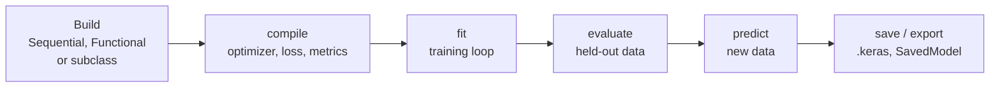
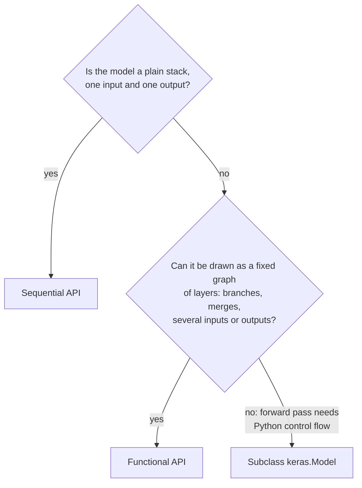

Keras is the part of the TensorFlow ecosystem you will touch most. It gives you layers, models, losses, optimisers and a ready-made training loop, so a network that takes fifty lines of PyTorch can often be written and trained in fifteen. This lesson explains what a Keras model actually is, the three ways to build one, and how the pieces fit together, so that the Sequential and Functional APIs in the next lessons feel like two views of the same thing rather than magic.

## Keras 3: one API, several backends

Keras began as a stand-alone library, was absorbed into TensorFlow as `tf.keras`, and with Keras 3 became multi-backend again. The same Keras code can run on **TensorFlow**, **JAX** or **PyTorch**. You choose the backend with the `KERAS_BACKEND` environment variable, which must be set before Keras is first imported:

```bash
export KERAS_BACKEND="tensorflow"   # or "jax" or "torch"
```

```python
import os
os.environ["KERAS_BACKEND"] = "tensorflow"   # must run before importing keras

import keras
print(keras.backend.backend())
```

```output
tensorflow
```

| Code style | What it means |
| --- | --- |
| `import keras` | Keras 3, the modern convention used in this module |
| `from tensorflow import keras` / `tf.keras` | Older style, still widely seen; recent TensorFlow versions point it at Keras 3 |
| `keras.ops.*` | Backend-neutral maths (`keras.ops.mean`, `keras.ops.matmul`) that works on any backend |
| `tf.*` | TensorFlow-specific operations; only valid on the TensorFlow backend |

This module uses the TensorFlow backend throughout, because deployment tools such as TensorFlow Serving and TensorFlow Lite need it. If you write custom layers with `keras.ops` instead of `tf` functions, they stay portable to the other backends.

> [!NOTE]
> Much code online uses Keras 2 conventions: `from tensorflow import keras`, saving to `.h5` files, or `model.save("folder")` to write a SavedModel. Keras 3 changed some of these defaults, covered in the deployment lesson. When an old snippet fails, a version mismatch is a likely cause.

## Layers: the building blocks

A **layer** is an object that holds some weights and defines a computation from inputs to outputs. It is the Keras counterpart of a PyTorch `nn.Module` such as `nn.Linear`. The `Dense` layer computes

$$
\mathbf{y} = \phi(\mathbf{x} W + \mathbf{b}),
$$

where $\mathbf{x}$ is the input row, $W$ the weight matrix (Keras calls it the **kernel**), $\mathbf{b}$ the bias vector and $\phi$ the activation function.

One difference from PyTorch: you do not tell a Keras layer its input size. `nn.Linear(4, 3)` needs both sizes; `keras.layers.Dense(3)` needs only the output size and creates its weights the first time it sees data. This is called **lazy building**.

```python
import numpy as np
from keras import layers

keras.utils.set_random_seed(0)
dense = layers.Dense(3, activation="relu")
print(dense.built)

x = np.ones((2, 4), dtype="float32")   # batch of 2 rows, 4 features
y = dense(x)                           # first call builds the weights
print(dense.built, dense.kernel.shape, dense.bias.shape)
print(y.shape)
```

```output
False
True (4, 3) (3,)
(2, 3)
```

The weights are `tf.Variable`s under the hood (on the TensorFlow backend), so everything from the fundamentals lesson applies. `layer.trainable_weights` lists what the optimiser will update, and setting `layer.trainable = False` freezes a layer, which you will use for transfer learning.

Common layers you will meet in this and later modules:

| Layer | Purpose | PyTorch analogue |
| --- | --- | --- |
| `Dense(units)` | Fully connected | `nn.Linear` |
| `Dropout(rate)` | [Dropout](/learn/neural-network-fundamentals/dropout) regularisation | `nn.Dropout` |
| `BatchNormalization()` | [Batch normalisation](/learn/neural-network-fundamentals/batch-normalization) | `nn.BatchNorm1d/2d` |
| `Conv2D(filters, kernel_size)` | 2D convolution | `nn.Conv2d` |
| `Embedding(input_dim, output_dim)` | Integer IDs to vectors | `nn.Embedding` |
| `LSTM(units)` | Recurrent layer | `nn.LSTM` |
| `Normalization()` | Standardises features, learns mean and variance from data via `adapt` | No built-in layer |

## A model is a layer with a training loop

A `keras.Model` is itself a layer (it subclasses `Layer`), plus extra methods for training, evaluation, prediction and saving. Because models are layers, you can use a whole model as a layer inside another model.



| Method | Does | PyTorch equivalent |
| --- | --- | --- |
| `model.compile(...)` | Attaches optimiser, loss and metrics | Creating `optimizer` and `loss_fn` objects |
| `model.fit(...)` | Runs the whole training loop | Your `for epoch ... for batch ...` loop |
| `model.evaluate(...)` | Loss and metrics on a dataset | A validation loop under `torch.no_grad()` |
| `model.predict(...)` | Batched inference, returns NumPy arrays | `model.eval()` then forward passes |
| `model.save("m.keras")` | Architecture, weights and optimiser state in one file | `torch.save(model.state_dict(), ...)` |

## Three ways to build a model

Keras offers three styles. All produce a `keras.Model` with the same `fit`, `evaluate` and `predict`.



| Style | Looks like | Strengths | Limits |
| --- | --- | --- | --- |
| Sequential | `keras.Sequential([layer, layer, ...])` | Shortest code | One input, one output, no branches |
| Functional | `keras.Model(inputs, outputs)` after wiring layers like functions | Any graph of layers, full `summary`, easy inspection | Graph must be static |
| Subclassing | `class MyModel(keras.Model)` with a `call` method | Arbitrary Python in the forward pass | Less introspection, more code |

Subclassing will feel most familiar, because it is the PyTorch style:

```python
class TwoLayerNet(keras.Model):
    def __init__(self, hidden, n_classes):
        super().__init__()
        self.hidden = layers.Dense(hidden, activation="relu")
        self.dropout = layers.Dropout(0.2)
        self.out = layers.Dense(n_classes)

    def call(self, inputs, training=False):
        x = self.hidden(inputs)
        x = self.dropout(x, training=training)
        return self.out(x)

model = TwoLayerNet(hidden=16, n_classes=3)
logits = model(np.random.rand(5, 4).astype("float32"))
print(logits.shape)
print(len(model.trainable_weights), model.count_params())
```

```output
(5, 3)
4 131
```

Side by side with PyTorch, the mapping is direct: `__init__` creates layers, and `call` plays the role of `forward`. There are four trainable weight tensors (a kernel and a bias for each `Dense`) holding $4 \times 16 + 16 + 16 \times 3 + 3 = 131$ numbers. Dropout has no weights.

> [!KEY]
> Prefer Sequential or Functional when they can express your model. Keras can then inspect the whole graph: `summary` shows every shape, saving and loading are robust, and many errors are caught when you build the model rather than halfway through training.

## The training argument

Some layers behave differently during training and inference. [Dropout](/learn/neural-network-fundamentals/dropout) zeroes random units only while training, and batch normalisation uses batch statistics while training and stored moving averages at inference. PyTorch handles this with `model.train()` and `model.eval()` mode switches. Keras passes a `training` argument through the call instead:

```python
drop = layers.Dropout(0.5, seed=1)
ones = np.ones((1, 6), dtype="float32")
print(drop(ones, training=False).numpy())
print(drop(ones, training=True).numpy())
```

```output
[[1. 1. 1. 1. 1. 1.]]
[[2. 0. 2. 0. 0. 0.]]
```

In training mode each unit is dropped with probability 0.5 (here four of the six happened to be), and the survivors are scaled by $1/(1 - 0.5) = 2$ so the expected sum is unchanged. You rarely set `training` yourself: `fit` passes `training=True`, while `evaluate` and `predict` pass `training=False`. You need it when you write a subclassed model (forward the argument to sublayers, as `TwoLayerNet` does) or a custom training loop.

> [!WARNING]
> Calling `model(x)` directly defaults to inference behaviour, but in a hand-written training loop you must call `model(x, training=True)`, or dropout and batch normalisation will silently act as if you were evaluating.

## Exercises

**1.** Create `layers.Dense(5)` and call it on an input of shape `(8, 3)`. Before running it, predict the shapes of the kernel, the bias and the output, then check.

<details>
<summary>Show solution</summary>

```python
d = layers.Dense(5)
out = d(np.zeros((8, 3), dtype="float32"))
print(d.kernel.shape, d.bias.shape, out.shape)   # (3, 5) (5,) (8, 5)
```

The kernel maps 3 input features to 5 units; the bias has one entry per unit; the batch size of 8 passes through unchanged.

</details>

**2.** Which build style would you use for each? (a) A three-layer classifier for tabular data. (b) A model that takes an image and a text caption and outputs one score. (c) A model whose forward pass repeats a block a different number of times depending on the input's values.

<details>
<summary>Show solution</summary>

(a) Sequential: a plain stack. (b) Functional: two inputs merged into one graph. (c) Subclassing: the forward pass depends on data-dependent Python control flow, which cannot be drawn as a fixed graph.

</details>

**3.** Count the parameters of `TwoLayerNet(hidden=32, n_classes=10)` on 20 input features by hand, then verify with `count_params()`.

<details>
<summary>Show solution</summary>

$20 \times 32 + 32 = 672$ for the hidden layer and $32 \times 10 + 10 = 330$ for the output, 1,002 in total.

```python
m = TwoLayerNet(hidden=32, n_classes=10)
m(np.zeros((1, 20), dtype="float32"))   # build the weights
print(m.count_params())                 # 1002
```

</details>

```quiz
[
  {
    "q": "How do you make Keras 3 run on the JAX backend?",
    "options": [
      "Call `keras.use(\"jax\")` after importing",
      "Set the `KERAS_BACKEND` environment variable to `jax` before importing Keras",
      "Install `keras-jax` instead of `keras`",
      "Pass `backend=\"jax\"` to `model.compile`"
    ],
    "answer": 1,
    "why": "The backend is chosen from `KERAS_BACKEND` (or the Keras config file) when Keras is first imported."
  },
  {
    "q": "Why does `layers.Dense(3)` not need to know its input size?",
    "options": [
      "It always assumes 3 inputs",
      "It creates its weights lazily, the first time it receives data",
      "Dense layers have no weights",
      "The input size is set in `compile`"
    ],
    "answer": 1,
    "why": "Keras layers are built on first use, inferring the kernel shape from the input."
  },
  {
    "q": "In a subclassed `keras.Model`, which method plays the role of PyTorch's `forward`?",
    "options": ["`build`", "`fit`", "`call`", "`__call__`"],
    "answer": 2,
    "why": "You implement `call`; Keras's `__call__` wraps it with building and other bookkeeping, as PyTorch's `__call__` wraps `forward`."
  },
  {
    "q": "What is the Keras equivalent of switching a PyTorch model between `model.train()` and `model.eval()`?",
    "options": [
      "`model.trainable = True/False`",
      "Recompiling the model",
      "The `training` argument passed when the model or layer is called",
      "There is no difference between training and inference in Keras"
    ],
    "answer": 2,
    "why": "Layers such as Dropout read the `training` argument; `fit` sets it to `True` and `predict`/`evaluate` set it to `False`. `trainable` controls freezing, not mode."
  }
]
```
