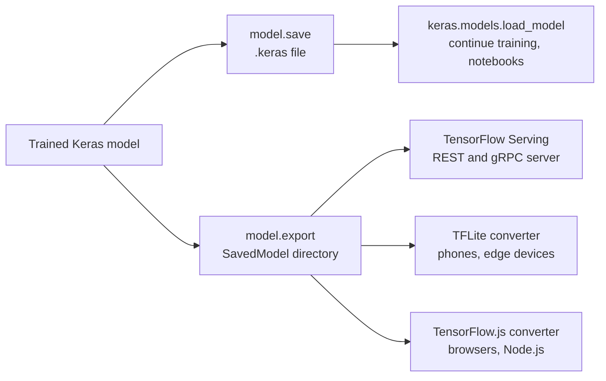
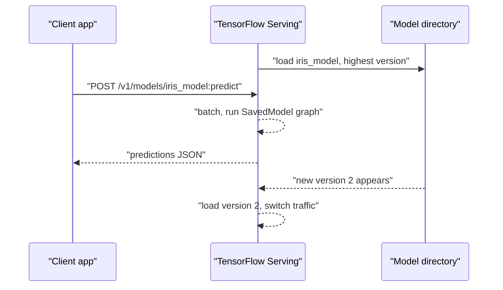

A trained model only creates value once something outside your notebook can use it: a web service, a mobile app, a browser page, a batch job. Deployment is one of the TensorFlow ecosystem's main strengths, and often the reason teams choose it: one trained Keras model can be exported to a server runtime, converted for phones and microcontrollers, or run in a browser. This lesson covers the two Keras save formats and what each is for, exporting a SavedModel for inference, serving it with TensorFlow Serving, and converting it for edge devices with TensorFlow Lite and for the web with TensorFlow.js.

## Saving for later versus exporting for serving

There are two different jobs, and Keras 3 gives each its own format:

| Goal | Call | Produces | Needs Python and Keras to load? |
| --- | --- | --- | --- |
| Resume training, share with other Keras users | `model.save("model.keras")` | One `.keras` file: architecture, weights, optimiser state | Yes |
| Weights only, for a model you rebuild in code | `model.save_weights("model.weights.h5")` | Weights only | Yes, plus the model-building code |
| Inference in production | `model.export("export_dir")` | A TensorFlow **SavedModel** directory: a graph plus weights | No: any TensorFlow runtime can load it |

The PyTorch analogue of `.keras` is saving a `state_dict` plus your model code ([model saving and loading](/learn/pytorch/model-saving-and-loading)); the analogue of a SavedModel is exporting with TorchScript or `torch.export`. The idea is the same: a training checkpoint is tied to your Python code, while an exported artefact is a self-contained graph a server can run.



## The .keras format

First, a small trained model to work with:

```python
import os, tempfile
import numpy as np
import keras
import tensorflow as tf
from keras import layers
from sklearn.datasets import load_iris

keras.utils.set_random_seed(0)
X, y = load_iris(return_X_y=True)
X = ((X - X.mean(axis=0)) / X.std(axis=0)).astype("float32")

inputs = keras.Input(shape=(4,), name="features")
x = layers.Dense(16, activation="relu")(inputs)
outputs = layers.Dense(3, activation="softmax", name="species")(x)
model = keras.Model(inputs, outputs)
model.compile(optimizer="adam", loss="sparse_categorical_crossentropy", metrics=["accuracy"])
model.fit(X, y, epochs=30, verbose=0)

workdir = tempfile.mkdtemp()
path = os.path.join(workdir, "iris.keras")
model.save(path)

restored = keras.models.load_model(path)
sample = X[:2]
print(np.allclose(model.predict(sample, verbose=0), restored.predict(sample, verbose=0)))
```

```output
True
```

`load_model` rebuilds the architecture and restores the weights and the optimiser state, so `restored.fit(...)` continues exactly where training left off. If your model uses custom layers or functions, Keras needs to find them at load time: decorate them with `@keras.saving.register_keras_serializable()` or pass them in `custom_objects`.

> [!WARNING]
> Keras 3 is strict about file extensions. `model.save` expects a `.keras` filename and `save_weights` expects `.weights.h5`. Older tutorials call `model.save("my_model")` to write a SavedModel directory, or save `.h5` files; in Keras 3 the first raises an error and the second is a legacy format. Use `model.export` for SavedModels.

## Exporting a SavedModel

`model.export` traces the model's forward pass into a TensorFlow graph and writes it, with the weights, to a directory. This requires the TensorFlow backend.

```python
export_dir = os.path.join(workdir, "iris_model", "1")   # "1" is the version number
model.export(export_dir, verbose=False)
print(sorted(os.listdir(export_dir)))
```

```output
['assets', 'fingerprint.pb', 'saved_model.pb', 'variables']
```

| Item | Contains |
| --- | --- |
| `saved_model.pb` | The serialised graph and its signatures |
| `variables/` | The trained weight values |
| `assets/` | Extra files such as vocabularies (empty here) |
| `fingerprint.pb` | An identifier used to track the model |

You can load the SavedModel back with plain TensorFlow, no Keras model code required, and call its `serve` endpoint:

```python
reloaded = tf.saved_model.load(export_dir)
print(list(reloaded.signatures.keys()))
print(reloaded.serve(tf.constant(sample)).numpy().round(3))
```

```output
['serve', 'serving_default']
[[0.909 0.017 0.074]
 [0.813 0.042 0.145]]
```

The `serving_default` **signature** describes the inputs and outputs by name and shape. Servers use it to know what a request must contain:

```python
sig = reloaded.signatures["serving_default"]
print(sig.structured_input_signature[1])
print(sig.structured_outputs)
```

```output
{'features': TensorSpec(shape=(None, 4), dtype=tf.float32, name='features')}
{'output_0': TensorSpec(shape=(None, 3), dtype=tf.float32, name='output_0')}
```

The input name, `features`, comes from the `keras.Input` you named, which is one more reason to name inputs. The batch dimension is `None`, so a client can send one example or many.

> [!NOTE]
> A SavedModel contains the graph, not your Python preprocessing code. If the model expects standardised features, the serving client must standardise them identically, or, better, you build the preprocessing into the model with layers such as `layers.Normalization` so the exported graph does it. Mismatched preprocessing between training and serving (training-serving skew) is one of the most common deployment bugs.

## TensorFlow Serving

**TensorFlow Serving** is a high-performance C++ server that loads SavedModels and exposes them over REST and gRPC. It watches a model directory: each numbered subdirectory is a version, and by default it serves the highest number, so you deploy a new model by writing `iris_model/2` next to `iris_model/1`.

The usual way to run it is the official Docker image. Following the pattern in the [TensorFlow Serving documentation](https://www.tensorflow.org/tfx/serving/docker), mount the model directory (the one containing `1/`) and name the model:

```bash
docker run -p 8501:8501 \
  --mount type=bind,source=/absolute/path/to/iris_model,target=/models/iris_model \
  -e MODEL_NAME=iris_model -t tensorflow/serving
```

Port 8501 is the REST API (gRPC uses 8500). A prediction request sends a JSON body with an `instances` list, one entry per example:

```bash
curl -X POST http://localhost:8501/v1/models/iris_model:predict \
  -d '{"instances": [[-0.9, 1.0, -1.3, -1.3]]}'
```

The response is JSON with a `predictions` list holding one row of three class probabilities per instance.



An alternative you already know is to load the model inside your own Python web service, for example a FastAPI endpoint that calls `model.predict`. That is simpler for small workloads and lets you add business logic around the model; a dedicated server like TensorFlow Serving adds request batching, version management and C++ speed. Both are common.

## TensorFlow Lite for phones and edge devices

Phones, microcontrollers and embedded boards cannot run full TensorFlow. **TensorFlow Lite** converts a SavedModel into a compact `.tflite` flatbuffer for a lightweight on-device interpreter. Google has rebranded the runtime as **LiteRT**, but the converter remains in TensorFlow:

```python
converter = tf.lite.TFLiteConverter.from_saved_model(export_dir)
converter.optimizations = [tf.lite.Optimize.DEFAULT]   # post-training quantisation
tflite_bytes = converter.convert()

tflite_path = os.path.join(workdir, "iris.tflite")
with open(tflite_path, "wb") as f:
    f.write(tflite_bytes)
print(type(tflite_bytes).__name__, len(tflite_bytes) > 0)
```

```output
bytes True
```

`Optimize.DEFAULT` applies **post-training quantisation**, storing weights as 8-bit integers instead of 32-bit floats. That makes the model roughly four times smaller and often faster on mobile hardware, usually at a small cost in accuracy, which you must measure on your validation set.

You can test the converted model in Python before shipping it:

```python
interpreter = tf.lite.Interpreter(model_path=tflite_path)
interpreter.allocate_tensors()
inp = interpreter.get_input_details()[0]
out = interpreter.get_output_details()[0]

interpreter.set_tensor(inp["index"], X[:1])     # one example, shape (1, 4)
interpreter.invoke()
print(interpreter.get_tensor(out["index"]).round(3))
print(model.predict(X[:1], verbose=0).round(3))
```

```output
[[0.909 0.017 0.074]]
[[0.909 0.017 0.074]]
```

The quantised model's probabilities should be very close to the original's. In the app itself you would use the LiteRT libraries for Android, iOS or microcontrollers rather than Python.

> [!NOTE]
> Recent TensorFlow versions warn that `tf.lite.Interpreter` is deprecated in favour of the interpreter in the separate `ai-edge-litert` package. The conversion workflow above is unchanged; check the [LiteRT documentation](https://ai.google.dev/edge/litert) for the current interpreter import when you set up a new project.

## TensorFlow.js for the browser

**TensorFlow.js** runs models in JavaScript, in the browser or in Node.js. Running in the browser means no server cost per prediction and user data never leaves the device. The `tensorflowjs` Python package provides a `tensorflowjs_converter` command that turns a SavedModel or Keras model into a `model.json` file plus binary weight files, which a web page loads with the TensorFlow.js library. The converter's options depend on the input format, so follow the [TensorFlow.js conversion guide](https://www.tensorflow.org/js/guide/conversion) for the exact command.

## Choosing a deployment target

| Target | Format | Runs on | Good for |
| --- | --- | --- | --- |
| Python service (FastAPI, batch job) | `.keras` or SavedModel | Your server | Small to medium traffic, custom logic around the model |
| TensorFlow Serving | SavedModel | Server, Docker, Kubernetes | High-throughput APIs, versioned rollouts |
| TensorFlow Lite / LiteRT | `.tflite` | Android, iOS, embedded, microcontrollers | Offline, low latency, privacy |
| TensorFlow.js | `model.json` plus weights | Browser, Node.js | Interactive web apps, no server inference |

> [!KEY]
> Save `.keras` files to keep working on a model; export a SavedModel to deploy it. From that one SavedModel you can serve with TensorFlow Serving, convert to TensorFlow Lite for devices, or convert to TensorFlow.js for the web. Whatever the target, build preprocessing into the model or replicate it exactly, and re-measure accuracy after any conversion.

## Exercises

**1.** Save only the weights of `model`, build a fresh model with the same architecture, load the weights into it, and confirm the predictions match.

<details>
<summary>Show solution</summary>

```python
w_path = os.path.join(workdir, "iris.weights.h5")
model.save_weights(w_path)

i = keras.Input(shape=(4,), name="features")
h = layers.Dense(16, activation="relu")(i)
o = layers.Dense(3, activation="softmax", name="species")(h)
fresh = keras.Model(i, o)
fresh.load_weights(w_path)
print(np.allclose(fresh.predict(sample, verbose=0), model.predict(sample, verbose=0)))   # True
```

</details>

**2.** You deploy version 2 of a model by exporting it to `iris_model/2`. What does TensorFlow Serving do, and why is the numbered layout useful?

<details>
<summary>Show solution</summary>

By default it notices the new version, loads it, and starts serving the highest version number, so you can roll out a model without restarting the server. Keeping `1/` on disk makes rolling back easy: remove or move `2/`, or configure the server to serve a specific version.

</details>

**3.** Compare the predicted classes of the TFLite model and the original model on all 150 iris examples. (Hint: the interpreter's input has a fixed batch size of 1, so loop over the rows.)

<details>
<summary>Show solution</summary>

```python
tflite_preds = []
for row in X:
    interpreter.set_tensor(inp["index"], row[None, :])
    interpreter.invoke()
    tflite_preds.append(interpreter.get_tensor(out["index"]).argmax())

keras_preds = model.predict(X, verbose=0).argmax(axis=1)
print((np.array(tflite_preds) == keras_preds).mean())
```

An agreement of 1.0, or very close to it, means quantisation did not change the decisions. If agreement drops noticeably, try conversion without `Optimize.DEFAULT` to see whether quantisation is the cause.

</details>

```quiz
[
  {
    "q": "You want to resume training a Keras model tomorrow, including the optimiser state. What should you save?",
    "options": [
      "`model.export(\"dir\")`",
      "`model.save(\"model.keras\")`",
      "`model.save_weights(\"model.weights.h5\")`",
      "A `.tflite` file"
    ],
    "answer": 1,
    "why": "A `.keras` file holds the architecture, weights and optimiser state. An export is for inference, and weights alone lose the optimiser state."
  },
  {
    "q": "What does `model.export(\"iris_model/1\")` produce?",
    "options": [
      "A single `.keras` file",
      "A SavedModel directory containing a graph and weights that TensorFlow runtimes can load without your Python model code",
      "A Docker image",
      "A `.tflite` file"
    ],
    "answer": 1,
    "why": "Export writes an inference-only SavedModel, the format TensorFlow Serving and the converters consume."
  },
  {
    "q": "What does setting `converter.optimizations = [tf.lite.Optimize.DEFAULT]` typically do?",
    "options": [
      "Retrains the model for mobile",
      "Applies post-training quantisation, making the model smaller and often faster with a small accuracy cost",
      "Removes the output layer",
      "Converts the model to JavaScript"
    ],
    "answer": 1,
    "why": "It stores weights at reduced precision; always re-check accuracy afterwards."
  },
  {
    "q": "A model was trained on standardised features, but the serving client sends raw values. What happens?",
    "options": [
      "TensorFlow Serving standardises them automatically",
      "The request is rejected",
      "The model returns confident but wrong predictions, with no error",
      "The SavedModel re-fits its scaler"
    ],
    "answer": 2,
    "why": "This is training-serving skew. The graph does only what was exported; build preprocessing into the model or replicate it exactly."
  }
]
```
