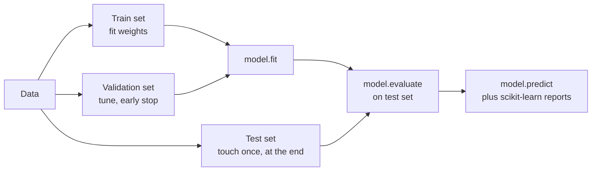
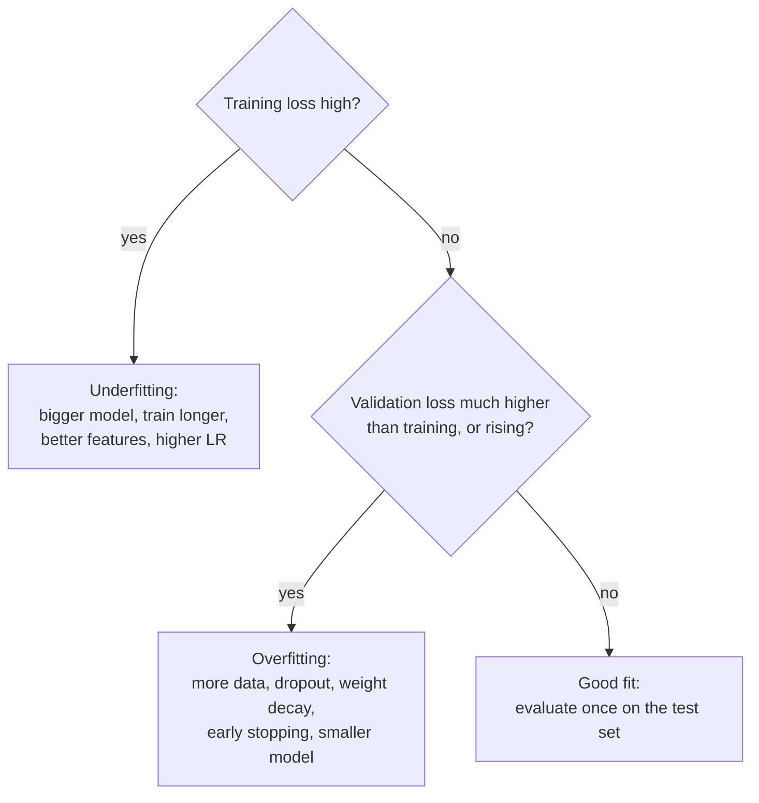

A falling training loss tells you the optimiser is working, not that the model is any good. Evaluation answers the question that matters: how well does the model do on data it has never seen, measured in the terms the problem cares about? The metrics themselves (accuracy, precision, recall, ROC-AUC, confusion matrices) were covered in the [model evaluation module](/learn/model-evaluation/accuracy). This lesson shows how to compute them for Keras models: with `evaluate` and Keras metric objects, with `predict` plus scikit-learn, and with the training history to diagnose over- and underfitting.

## The evaluation workflow



The rule from earlier modules still holds: every decision you make by looking at a dataset (number of epochs, architecture, threshold) leaks a little of that dataset into the model. Make those decisions with the validation set, and look at the test set only once, to report the final number.

## Setting up: a binary classifier

The breast cancer dataset in scikit-learn has 569 tumours, 30 features each, labelled malignant (0) or benign (1).

```python
import numpy as np
import keras
from keras import layers
from sklearn.datasets import load_breast_cancer
from sklearn.model_selection import train_test_split
from sklearn.preprocessing import StandardScaler

keras.utils.set_random_seed(7)

X, y = load_breast_cancer(return_X_y=True)
X_tmp, X_test, y_tmp, y_test = train_test_split(X, y, test_size=0.2, stratify=y, random_state=7)
X_train, X_val, y_train, y_val = train_test_split(X_tmp, y_tmp, test_size=0.2, stratify=y_tmp, random_state=7)

scaler = StandardScaler().fit(X_train)
X_train, X_val, X_test = (scaler.transform(a).astype("float32") for a in (X_train, X_val, X_test))

model = keras.Sequential([
    keras.Input(shape=(30,)),
    layers.Dense(16, activation="relu"),
    layers.Dropout(0.2),
    layers.Dense(1, activation="sigmoid"),
])
model.compile(
    optimizer="adam",
    loss="binary_crossentropy",
    metrics=[
        "accuracy",
        keras.metrics.Precision(name="precision"),
        keras.metrics.Recall(name="recall"),
        keras.metrics.AUC(name="auc"),
    ],
)
history = model.fit(X_train, y_train, validation_data=(X_val, y_val),
                    epochs=40, batch_size=32, verbose=0)
print(len(X_train), len(X_val), len(X_test))
```

```output
364 91 114
```

## model.evaluate

`evaluate` runs the model over a dataset in inference mode (dropout off) and returns the loss and every compiled metric. With `return_dict=True` you get named values instead of a list in compile order:

```python
results = model.evaluate(X_test, y_test, verbose=0, return_dict=True)
for name, value in results.items():
    print(f"{name:>9}: {value:.3f}")
```

```output
 accuracy: 0.982
      auc: 0.999
     loss: 0.048
precision: 0.986
   recall: 0.986
```

Your values may differ slightly on other systems. Each metric is computed over the **whole** test set, not averaged per batch: Keras metrics are **stateful** objects that accumulate counts across batches and compute the final value at the end. That matters for metrics like precision, where the average of per-batch precisions is not the precision of the whole set.

You can use a metric object directly to see the mechanism:

```python
m = keras.metrics.Precision()
m.update_state([1, 0, 1, 1], [1, 1, 1, 0])   # batch 1: 2 TP, 1 FP
m.update_state([0, 1], [1, 1])               # batch 2: 1 TP, 1 FP
print(round(float(m.result()), 4))          # 3 TP / (3 TP + 2 FP)
m.reset_state()
```

```output
0.6
```

Precision is

$$
\text{precision} = \frac{TP}{TP + FP},
$$

where $TP$ counts true positives and $FP$ false positives across both batches. The metric keeps the running counts, so the result, $3/5$, is correct for the whole set. Binary metrics such as `Precision` and `Recall` threshold predicted probabilities at 0.5 by default; pass `thresholds=0.3` to change it.

| Keras metric | Measures | Note |
| --- | --- | --- |
| `"accuracy"` | Fraction correct | Keras picks binary or categorical accuracy from the loss |
| `keras.metrics.Precision()` | $TP / (TP + FP)$ | Binary; threshold 0.5 by default |
| `keras.metrics.Recall()` | $TP / (TP + FN)$ | Binary; threshold 0.5 by default |
| `keras.metrics.AUC()` | Area under the ROC curve | Threshold-free; `curve="PR"` for precision-recall AUC |
| `keras.metrics.F1Score()` | Harmonic mean of precision and recall | Expects 2D inputs; check its `average` and `threshold` arguments |
| `keras.metrics.MeanAbsoluteError()` | Regression error | Also `RootMeanSquaredError` |

## predict plus scikit-learn

For a full report, get the predicted probabilities with `predict` and use the scikit-learn tools you already know. `predict` returns a NumPy array, also with dropout off:

```python
from sklearn.metrics import confusion_matrix, classification_report

probs = model.predict(X_test, verbose=0).ravel()   # shape (n,) of P(benign)
preds = (probs >= 0.5).astype(int)

print(confusion_matrix(y_test, preds))
print(classification_report(y_test, preds, target_names=["malignant", "benign"], digits=3))
```

```output
[[41  1]
 [ 1 71]]
              precision    recall  f1-score   support

   malignant      0.976     0.976     0.976        42
      benign      0.986     0.986     0.986        72

    accuracy                          0.982       114
   macro avg      0.981     0.981     0.981       114
weighted avg      0.982     0.982     0.982       114
```

The [confusion matrix](/learn/model-evaluation/confusion-matrix) has true classes as rows and predictions as columns. In a medical setting the costly error is calling a malignant tumour benign: the top-right cell, malignant cases predicted as benign. That is a statement about the **threshold** as much as the model. Moving the threshold trades one error type for the other without retraining:

```python
for t in [0.5, 0.7, 0.9]:
    cm = confusion_matrix(y_test, (probs >= t).astype(int))
    print(f"threshold {t}: malignant called benign = {cm[0, 1]}, benign called malignant = {cm[1, 0]}")
```

```output
threshold 0.5: malignant called benign = 1, benign called malignant = 1
threshold 0.7: malignant called benign = 1, benign called malignant = 4
threshold 0.9: malignant called benign = 0, benign called malignant = 6
```

Raising the threshold for "benign" means the model must be more confident before it clears a tumour, so fewer malignant cases slip through, at the cost of more false alarms. Choose the threshold on the **validation** set, then report test performance at that threshold.

> [!TIP]
> For multi-class models, `predict` returns one row of probabilities per example. Take `probs.argmax(axis=1)` for class labels, then use the same scikit-learn functions. For a model that outputs logits, apply `keras.ops.softmax` (or `keras.ops.sigmoid`) first if you need probabilities.

## Learning curves from the history

The `History` from `fit` is your main diagnostic. Compare training and validation curves:

```python
h = history.history
for epoch in [0, 9, 19, 39]:
    print(f"epoch {epoch + 1:2d}  loss={h['loss'][epoch]:.3f}  val_loss={h['val_loss'][epoch]:.3f}")
```

```output
epoch  1  loss=0.399  val_loss=0.306
epoch 10  loss=0.138  val_loss=0.119
epoch 20  loss=0.086  val_loss=0.089
epoch 40  loss=0.052  val_loss=0.075
```

The two losses stay close and validation loss is still edging down, so this small model is not overfitting. In general:



Plot the curves with matplotlib, as in the [data visualisation](/learn/data-visualization/matplotlib) module, by passing `h["loss"]` and `h["val_loss"]` to `plt.plot`. See [underfitting and overfitting](/learn/machine-learning-fundamentals/underfitting-and-overfitting) for the theory.

> [!WARNING]
> Training metrics in the history are averaged over the epoch while the weights were changing, and computed with dropout on. Validation metrics are computed at the end of the epoch with dropout off. That is why validation loss is sometimes lower than training loss early on; it is not a bug.

## Evaluating more carefully

A single test score on a small test set is noisy. With 114 test examples, one extra mistake moves accuracy by almost a percentage point. Some habits that make evaluation trustworthy:

- **Report against a baseline.** Predicting the majority class already gives a certain accuracy; compare with it, and with a simple scikit-learn model such as logistic regression.
- **Repeat with different seeds.** Train a few times with different `keras.utils.set_random_seed` values and report the spread, not the best run.
- **Use [cross-validation](/learn/model-evaluation/cross-validation)** on small datasets: build a fresh model inside each fold.
- **Evaluate slices.** Overall accuracy can hide poor performance on an important subgroup.

> [!KEY]
> `evaluate` gives you the compiled metrics over a whole dataset; `predict` gives you raw outputs that you can feed to any scikit-learn metric and threshold as the problem requires. Make every choice on validation data and touch the test set once.

## Exercises

**1.** Evaluate the model on the validation set instead of the test set and print only the AUC.

<details>
<summary>Show solution</summary>

```python
print(model.evaluate(X_val, y_val, verbose=0, return_dict=True)["auc"])
```

</details>

**2.** Compute ROC-AUC with scikit-learn from `probs` and compare it with the Keras `auc` value. Why might they differ slightly?

<details>
<summary>Show solution</summary>

```python
from sklearn.metrics import roc_auc_score
print(roc_auc_score(y_test, probs))
```

Keras's `AUC` approximates the curve using a fixed set of thresholds (200 by default), while scikit-learn computes it exactly from the sorted scores. The values are usually very close.

</details>

**3.** Choose the smallest threshold on the **validation** set at which no malignant case is predicted benign. Then report the test confusion matrix at that threshold.

<details>
<summary>Show solution</summary>

```python
val_probs = model.predict(X_val, verbose=0).ravel()
# every malignant validation case must score below the threshold
t = val_probs[y_val == 0].max() + 1e-6
print(f"threshold: {t:.3f}")
print(confusion_matrix(y_test, (probs >= t).astype(int)))
```

There is no guarantee the test set will also have zero such errors: the threshold was fitted to validation data, which is exactly why you report the test result separately.

</details>

```quiz
[
  {
    "q": "How does `model.evaluate` compute precision over a test set that is processed in 4 batches?",
    "options": [
      "Averages the four per-batch precision values",
      "Uses only the last batch",
      "Accumulates true and false positive counts across batches, then computes precision once",
      "Computes precision on a random sample"
    ],
    "answer": 2,
    "why": "Keras metrics are stateful: `update_state` accumulates counts, `result` computes the value for everything seen."
  },
  {
    "q": "Is dropout active during `model.evaluate` and `model.predict`?",
    "options": [
      "Yes, in both",
      "Only in `evaluate`",
      "Only in `predict`",
      "No, both run in inference mode"
    ],
    "answer": 3,
    "why": "Both call the model with `training=False`, so dropout passes inputs through unchanged."
  },
  {
    "q": "Training loss keeps falling, but validation loss has been rising for 15 epochs. What is the diagnosis?",
    "options": ["Underfitting", "Overfitting", "A learning rate that is too low", "A good fit"],
    "answer": 1,
    "why": "The model is fitting the training data ever better while generalising worse."
  },
  {
    "q": "On which dataset should you choose the classification threshold?",
    "options": ["The training set", "The validation set", "The test set", "Whichever gives the best number"],
    "answer": 1,
    "why": "The threshold is a modelling decision; choosing it on the test set would leak test information into the reported score."
  }
]
```
