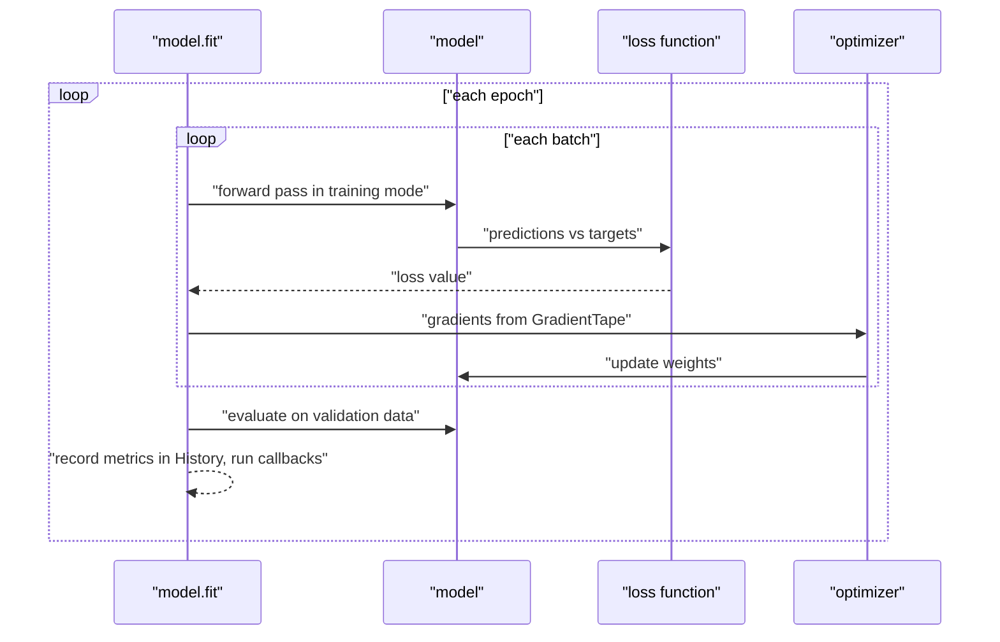

In the PyTorch module you wrote [training loops](/learn/pytorch/training-loops) by hand: zero the gradients, run the forward pass, compute the loss, call `backward`, step the optimiser, and repeat for every batch and epoch. Keras packages that loop into two calls. `compile` says *how* to learn (which optimiser, which loss, which metrics) and `fit` runs the loop. This lesson explains exactly what those two calls do, how to feed them data and validation sets, how to read the training history, and how to write the loop yourself when `fit` is not flexible enough.

## compile: optimiser, loss and metrics

```python
import numpy as np
import keras
from keras import layers
from sklearn.datasets import make_classification
from sklearn.model_selection import train_test_split

keras.utils.set_random_seed(1)

X, y = make_classification(n_samples=1000, n_features=20, n_informative=8,
                           random_state=1)
X = X.astype("float32")
y = y.astype("float32")
X_train, X_val, y_train, y_val = train_test_split(X, y, test_size=0.2, random_state=1)

model = keras.Sequential([
    keras.Input(shape=(20,)),
    layers.Dense(32, activation="relu"),
    layers.Dense(1),                      # raw logit, no activation
])

model.compile(
    optimizer=keras.optimizers.Adam(learning_rate=1e-3),
    loss=keras.losses.BinaryCrossentropy(from_logits=True),
    metrics=[keras.metrics.BinaryAccuracy(threshold=0.0)],
)
```

Each argument accepts either a string shortcut (`"adam"`, `"binary_crossentropy"`, `"accuracy"`) or an object. Strings are convenient; objects let you set options such as the learning rate. The [optimizers](/learn/neural-network-fundamentals/optimizers) and [loss functions](/learn/neural-network-fundamentals/loss-functions) are the ones you already know:

| Task | Last layer | Loss | PyTorch equivalent |
| --- | --- | --- | --- |
| Regression | `Dense(1)` | `"mse"` or `"mae"` | `nn.MSELoss`, `nn.L1Loss` |
| Binary classification | `Dense(1, activation="sigmoid")` | `"binary_crossentropy"` | `nn.BCELoss` |
| Binary, logits | `Dense(1)` | `BinaryCrossentropy(from_logits=True)` | `nn.BCEWithLogitsLoss` |
| Multi-class, integer labels | `Dense(k, activation="softmax")` | `"sparse_categorical_crossentropy"` | `nn.CrossEntropyLoss` (but that one expects logits) |
| Multi-class, one-hot labels | `Dense(k, activation="softmax")` | `"categorical_crossentropy"` | `nn.CrossEntropyLoss` with probability targets |

### Logits and from_logits

PyTorch's `CrossEntropyLoss` and `BCEWithLogitsLoss` expect **logits**, the raw scores before softmax or sigmoid, because combining the activation with the log inside the loss is more numerically stable. Keras defaults the other way: its losses expect **probabilities** unless you pass `from_logits=True`.

Both conventions work, as long as the last layer and the loss agree. The model above outputs logits, so the loss sets `from_logits=True`, and the accuracy metric uses a threshold of 0 (a logit of 0 is a probability of 0.5).

> [!WARNING]
> A mismatch does not crash. A sigmoid output with `from_logits=True` applies sigmoid twice; a linear output with the default loss treats logits as probabilities. Either way training runs, the loss looks plausible, and the model learns badly. Check this pairing first when a Keras model trains poorly.

## fit: the training loop

`fit` splits the data into batches and, for each batch, does exactly what your PyTorch loop did:



```python
history = model.fit(
    X_train, y_train,
    batch_size=32,
    epochs=10,
    validation_data=(X_val, y_val),
    verbose=0,
)

for epoch in [0, 4, 9]:
    h = history.history
    print(f"epoch {epoch + 1:2d}  loss={h['loss'][epoch]:.3f}  "
          f"val_loss={h['val_loss'][epoch]:.3f}  "
          f"val_acc={h['val_binary_accuracy'][epoch]:.3f}")
```

```output
epoch  1  loss=0.734  val_loss=0.662  val_acc=0.635
epoch  5  loss=0.435  val_loss=0.446  val_acc=0.790
epoch 10  loss=0.342  val_loss=0.376  val_acc=0.820
```

Your numbers may differ slightly on other hardware or versions, but the pattern should match: both losses falling and validation accuracy rising. With the default `verbose=1` you would instead see a progress bar per epoch showing the running loss and metrics.

| Argument | Meaning |
| --- | --- |
| `batch_size` | Examples per gradient step (default 32). See [batch size](/learn/neural-network-fundamentals/batch-size) |
| `epochs` | Full passes over the training data |
| `validation_data` | A held-out `(X, y)` tuple or dataset, evaluated at the end of each epoch |
| `validation_split` | Alternative: hold out this fraction of the training arrays |
| `shuffle` | Reshuffle the training arrays each epoch (default `True`) |
| `class_weight` | Dictionary such as `{0: 1.0, 1: 5.0}` to weight the loss for imbalanced classes |
| `callbacks` | Hooks for early stopping, checkpoints and more, covered in the [next lesson](/learn/tensorflow-and-keras/callbacks) |
| `verbose` | 0 silent, 1 progress bar, 2 one line per epoch |

`fit` returns a `History` object whose `history` attribute is a dictionary of per-epoch lists. Validation metrics have a `val_` prefix. Plotting `loss` against `val_loss` is the standard first check for [overfitting](/learn/machine-learning-fundamentals/underfitting-and-overfitting), as the evaluation lesson shows.

> [!NOTE]
> `validation_split=0.2` takes the **last** 20% of the arrays as validation data, before any shuffling. If your data is sorted, by date or by class, that validation set will be unrepresentative. Shuffle first, or split explicitly with `train_test_split` and pass `validation_data`.

Calling `fit` again continues training from the current weights and optimiser state; it does not start over. To start over, rebuild the model. Recompiling keeps the weights but gives you a fresh optimiser.

## Feeding data with tf.data

`fit` accepts NumPy arrays, as above, or a `tf.data.Dataset` that yields `(features, labels)` batches. For data that does not fit in memory, or needs per-example preprocessing, a dataset is the right choice:

```python
import tensorflow as tf

train_ds = (tf.data.Dataset.from_tensor_slices((X_train, y_train))
            .shuffle(len(X_train), seed=1)
            .batch(32)
            .prefetch(tf.data.AUTOTUNE))
val_ds = tf.data.Dataset.from_tensor_slices((X_val, y_val)).batch(32)

history = model.fit(train_ds, validation_data=val_ds, epochs=2, verbose=0)
print(len(history.history["loss"]))
```

```output
2
```

When you pass a dataset, do not also pass `batch_size`: the dataset is already batched, and it controls its own shuffling.

## Writing the loop yourself

Sometimes `fit` is not enough: a GAN alternates two optimisers, a research idea needs gradient clipping per layer, or you simply want to see every step. Then you write the loop with `tf.GradientTape`, which will look very familiar:

```python
model = keras.Sequential([keras.Input(shape=(20,)),
                          layers.Dense(32, activation="relu"),
                          layers.Dense(1)])
optimizer = keras.optimizers.Adam(learning_rate=1e-3)
loss_fn = keras.losses.BinaryCrossentropy(from_logits=True)
acc = keras.metrics.BinaryAccuracy(threshold=0.0)

@tf.function                                         # compile the step into a graph
def train_step(xb, yb):
    with tf.GradientTape() as tape:
        logits = model(xb, training=True)            # forward
        loss = loss_fn(yb[:, None], logits)          # loss
    grads = tape.gradient(loss, model.trainable_variables)          # backward
    optimizer.apply_gradients(zip(grads, model.trainable_variables))  # step
    return loss

for epoch in range(3):
    for xb, yb in train_ds:
        loss = train_step(xb, yb)
    acc.reset_state()
    acc.update_state(y_val[:, None], model(X_val, training=False))
    print(f"epoch {epoch + 1}: last batch loss={float(loss):.3f}  val_acc={float(acc.result()):.3f}")
```

```output
epoch 1: last batch loss=0.724  val_acc=0.620
epoch 2: last batch loss=0.499  val_acc=0.745
epoch 3: last batch loss=0.445  val_acc=0.805
```

| Step | PyTorch | TensorFlow / Keras |
| --- | --- | --- |
| Clear old gradients | `optimizer.zero_grad()` | Not needed: each tape starts fresh |
| Forward | `model(xb)` after `model.train()` | `model(xb, training=True)` inside a tape |
| Backward | `loss.backward()` | `tape.gradient(loss, model.trainable_variables)` |
| Update | `optimizer.step()` | `optimizer.apply_gradients(zip(grads, vars))` |
| Speed-up | `torch.compile` | `@tf.function` on the step |

Note the `yb[:, None]`: the model outputs shape `(batch, 1)` while the labels have shape `(batch,)`, and reshaping makes them match. `fit` does this kind of adjustment for you, one of many small conveniences you take on yourself in a custom loop.

> [!KEY]
> `fit` is a well-tested version of the loop you already know. Use it by default, customise it with arguments and callbacks, and drop to a hand-written `GradientTape` loop only when the training step itself must change.

## Exercises

**1.** A 4-class model ends with `layers.Dense(4)` and no activation, and the labels are integers. Write the `compile` call.

<details>
<summary>Show solution</summary>

```python
four_class = keras.Sequential([keras.Input(shape=(20,)),
                               layers.Dense(32, activation="relu"),
                               layers.Dense(4)])
four_class.compile(
    optimizer="adam",
    loss=keras.losses.SparseCategoricalCrossentropy(from_logits=True),
    metrics=["accuracy"],
)
```

The last layer outputs logits, so the loss must be told `from_logits=True`.

</details>

**2.** Your dataset has 950 negatives and 50 positives. Train the binary model from this lesson so that each positive counts 19 times as much as a negative in the loss.

<details>
<summary>Show solution</summary>

```python
model.compile(optimizer="adam",
              loss=keras.losses.BinaryCrossentropy(from_logits=True))
model.fit(X_train, y_train, epochs=10, class_weight={0: 1.0, 1: 19.0}, verbose=0)
```

950 / 50 = 19, so this balances the total weight of the two classes. The [imbalanced-learn](/learn/machine-learning-libraries/imbalanced-learn) lesson covers resampling alternatives.

</details>

**3.** Add gradient clipping to the custom `train_step` so that the global norm of the gradients never exceeds 1.0.

<details>
<summary>Show solution</summary>

```python
@tf.function
def train_step_clipped(xb, yb):
    with tf.GradientTape() as tape:
        loss = loss_fn(yb[:, None], model(xb, training=True))
    grads = tape.gradient(loss, model.trainable_variables)
    grads, _ = tf.clip_by_global_norm(grads, 1.0)
    optimizer.apply_gradients(zip(grads, model.trainable_variables))
    return loss
```

With `fit` you could get the same effect by creating the optimiser with `keras.optimizers.Adam(global_clipnorm=1.0)`.

</details>

```quiz
[
  {
    "q": "The last layer is `Dense(1, activation=\"sigmoid\")`. Which loss configuration is correct?",
    "options": [
      "`BinaryCrossentropy(from_logits=True)`",
      "`BinaryCrossentropy()` (the default, `from_logits=False`)",
      "`SparseCategoricalCrossentropy()`",
      "`CategoricalCrossentropy(from_logits=True)`"
    ],
    "answer": 1,
    "why": "A sigmoid already produces probabilities, which is what the default expects. `from_logits=True` would apply sigmoid a second time."
  },
  {
    "q": "What does `validation_split=0.1` do in `model.fit`?",
    "options": [
      "Randomly samples 10% of the data each epoch",
      "Uses the last 10% of the arrays, before shuffling, as a fixed validation set",
      "Uses the first 10% of the data",
      "Splits each batch into training and validation parts"
    ],
    "answer": 1,
    "why": "The split is taken from the end of the arrays before shuffling, which is why sorted data gives a misleading validation set."
  },
  {
    "q": "In a custom TensorFlow training loop, what replaces PyTorch's `optimizer.zero_grad()`?",
    "options": [
      "`optimizer.reset()`",
      "`tape.reset()`",
      "Nothing: gradients are returned by `tape.gradient` rather than accumulated on the variables",
      "`model.zero_grad()`"
    ],
    "answer": 2,
    "why": "TensorFlow does not accumulate gradients on variables; each tape computes them fresh."
  },
  {
    "q": "You call `model.fit(..., epochs=5)` twice in a row. What happens?",
    "options": [
      "The second call restarts from random weights",
      "Training continues from where the first call stopped, for 10 epochs in total",
      "The second call raises an error",
      "The second call only evaluates the model"
    ],
    "answer": 1,
    "why": "`fit` updates the existing weights and optimiser state. Rebuild the model to start again."
  }
]
```
