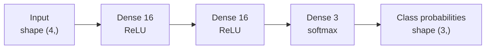

The Sequential API is the quickest way to build a neural network in Keras: you list the layers in order and Keras connects each one's output to the next one's input. A large share of everyday models, such as a multilayer perceptron for tabular data or a simple image classifier, are exactly this shape, and for them Sequential is the clearest code you can write. In this lesson you build one, read its summary, train it end to end on a real dataset, and learn where Sequential stops being the right tool.

## A stack of layers

A Sequential model is a list of layers with one input and one output. Data flows straight through:



In code you pass the layers as a list. The first entry, `keras.Input`, declares the shape of one example (without the batch dimension):

```python
import numpy as np
import keras
from keras import layers

keras.utils.set_random_seed(42)

model = keras.Sequential([
    keras.Input(shape=(4,)),
    layers.Dense(16, activation="relu"),
    layers.Dense(16, activation="relu"),
    layers.Dense(3, activation="softmax"),
], name="iris_mlp")

print(model.output_shape)
print(model.count_params())
```

```output
(None, 3)
403
```

`(None, 3)` means "any batch size, three outputs". The `None` is the batch dimension, which Keras leaves open so the same model can process one example or ten thousand.

The PyTorch equivalent is `nn.Sequential(nn.Linear(4, 16), nn.ReLU(), nn.Linear(16, 16), nn.ReLU(), nn.Linear(16, 3))`. Two differences: Keras layers take the activation as an argument rather than as a separate layer (though `layers.Activation("relu")` and `layers.ReLU()` exist too), and Keras only needs output sizes because input sizes are inferred.

You can also build the stack incrementally with `add`, which is handy when the number of layers comes from a configuration value:

```python
model2 = keras.Sequential(name="configurable")
model2.add(keras.Input(shape=(4,)))
for units in [32, 16]:
    model2.add(layers.Dense(units, activation="relu"))
model2.add(layers.Dense(3, activation="softmax"))
print([layer.name for layer in model2.layers])
```

```output
['dense_3', 'dense_4', 'dense_5']
```

## Reading the summary

`model.summary()` prints every layer with its output shape and parameter count. It is the fastest way to catch a wrong shape before training.

```python
model.summary()
```

```output
Model: "iris_mlp"
┏━━━━━━━━━━━━━━━━━━━━━━━━━━━━━━━━━┳━━━━━━━━━━━━━━━━━━━━━━━━┳━━━━━━━━━━━━━━━┓
┃ Layer (type)                    ┃ Output Shape           ┃       Param # ┃
┡━━━━━━━━━━━━━━━━━━━━━━━━━━━━━━━━━╇━━━━━━━━━━━━━━━━━━━━━━━━╇━━━━━━━━━━━━━━━┩
│ dense (Dense)                   │ (None, 16)             │            80 │
├─────────────────────────────────┼────────────────────────┼───────────────┤
│ dense_1 (Dense)                 │ (None, 16)             │           272 │
├─────────────────────────────────┼────────────────────────┼───────────────┤
│ dense_2 (Dense)                 │ (None, 3)              │            51 │
└─────────────────────────────────┴────────────────────────┴───────────────┘
 Total params: 403 (1.57 KB)
 Trainable params: 403 (1.57 KB)
 Non-trainable params: 0 (0.00 B)
```

Each `Dense` layer has $n_{\text{in}} \times n_{\text{out}} + n_{\text{out}}$ parameters, where $n_{\text{in}}$ is the number of inputs and $n_{\text{out}}$ the number of units: one weight per connection plus one bias per unit. Here that is $4 \cdot 16 + 16 = 80$, then $16 \cdot 16 + 16 = 272$, then $16 \cdot 3 + 3 = 51$, for 403 in total.

> [!TIP]
> Always start a Sequential model with `keras.Input(shape=...)`. Without it the model is not built until it first sees data, so `summary()` shows the layers as unbuilt with 0 parameters and shapes cannot be checked up front. Older code passes `input_shape=(4,)` to the first layer instead; Keras 3 prefers the explicit `Input`.

## Training end to end

Here is the full workflow on the iris flower dataset: 150 flowers, 4 measurements each, 3 species. The pieces of `compile` and `fit` are covered in depth in the [model training](/learn/tensorflow-and-keras/model-training) lesson; for now, read them as "use the Adam optimiser, measure cross-entropy loss and accuracy, train for 100 passes over the data".

```python
from sklearn.datasets import load_iris
from sklearn.model_selection import train_test_split
from sklearn.preprocessing import StandardScaler

X, y = load_iris(return_X_y=True)
X_train, X_test, y_train, y_test = train_test_split(
    X, y, test_size=0.2, stratify=y, random_state=0)

scaler = StandardScaler().fit(X_train)            # fit on training data only
X_train = scaler.transform(X_train).astype("float32")
X_test = scaler.transform(X_test).astype("float32")

model.compile(optimizer="adam",
              loss="sparse_categorical_crossentropy",
              metrics=["accuracy"])

history = model.fit(X_train, y_train, epochs=100, batch_size=16, verbose=0)
print(f"final training loss: {history.history['loss'][-1]:.3f}")

test_loss, test_acc = model.evaluate(X_test, y_test, verbose=0)
print(f"test accuracy: {test_acc:.3f}")
```

```output
final training loss: 0.087
test accuracy: 0.967
```

Your exact numbers may differ slightly on a different machine or TensorFlow version, but iris is easy and a small network should classify nearly all of the 30 test flowers correctly. `verbose=0` silences the per-epoch progress bars; leave it at its default to watch the loss fall as training runs.

The labels are plain integers 0, 1 and 2, which is why the loss is `sparse_categorical_crossentropy`. If your labels were one-hot vectors, you would use `categorical_crossentropy` instead.

### Making predictions

`predict` returns the softmax output: one probability per class, per row. `argmax` turns probabilities into class labels.

```python
probs = model.predict(X_test[:3], verbose=0)
print(probs.round(3))
print("predicted:", probs.argmax(axis=1), "actual:", y_test[:3])
```

```output
[[0.997 0.003 0.   ]
 [0.008 0.933 0.06 ]
 [0.995 0.005 0.   ]]
predicted: [0 1 0] actual: [0 1 0]
```

Each row sums to 1. The [model evaluation](/learn/tensorflow-and-keras/model-evaluation) lesson covers how to go from these probabilities to precision, recall and a confusion matrix.

## Working with the layers of a trained model

A Sequential model behaves like a list. You can index its layers, read their weights and even slice off the end to reuse the hidden representation:

```python
first = model.layers[0]
kernel, bias = first.get_weights()
print(first.name, kernel.shape, bias.shape)

feature_extractor = keras.Sequential(model.layers[:2])   # drop the classifier head
print(feature_extractor(X_test[:2]).shape)
```

```output
dense (4, 16) (16,)
(2, 16)
```

Note that `model.layers` does not include the `Input`, which is not a real layer. Reusing layers like this shares their weights: the feature extractor uses the same trained variables as the full model, not a copy.

## When Sequential is the wrong tool

Sequential models are deliberately limited. Reach for the [Functional API](/learn/tensorflow-and-keras/functional-api) when you need any of the following:

| Need | Example | Why Sequential cannot do it |
| --- | --- | --- |
| Several inputs | Image plus metadata | A Sequential model has exactly one input |
| Several outputs | Predict price and category at once | Exactly one output |
| Branches or skip connections | Residual blocks in ResNet | Each layer feeds only the next one |
| Sharing a layer between paths | A Siamese network comparing two inputs | No way to route two tensors through one layer |

> [!KEY]
> Sequential is a special case of the Functional API: a chain of layers with one input and one output. Anything you can write as a Sequential model you can also write functionally, but not the other way round.

### Common mistakes

- **Forgetting the output activation, or doubling it.** A softmax output plus a loss configured with `from_logits=True` applies softmax twice. Either output softmax probabilities with the default loss, or output raw logits (no activation) and set `from_logits=True`. The training lesson explains the trade-off.
- **Wrong number of output units.** Three classes need `Dense(3)` with softmax. Binary classification uses `Dense(1, activation="sigmoid")` with `binary_crossentropy`.
- **Unscaled inputs.** Features on very different scales slow training badly. Standardise them first, as above, or put a `layers.Normalization` layer at the start of the model.

## Exercises

**1.** Build a Sequential model for binary classification on 30 input features: two hidden layers of 64 and 32 ReLU units, a dropout of 0.3 between them, and the correct output layer. How many parameters does it have?

<details>
<summary>Show solution</summary>

```python
binary = keras.Sequential([
    keras.Input(shape=(30,)),
    layers.Dense(64, activation="relu"),
    layers.Dropout(0.3),
    layers.Dense(32, activation="relu"),
    layers.Dense(1, activation="sigmoid"),
])
print(binary.count_params())   # 30*64+64 + 64*32+32 + 32*1+1 = 4097
```

Dropout has no parameters. Compile it with `loss="binary_crossentropy"`.

</details>

**2.** Train the iris model again with only one hidden layer of 4 units and compare the test accuracy. What does the comparison suggest?

<details>
<summary>Show solution</summary>

```python
keras.utils.set_random_seed(42)
small = keras.Sequential([
    keras.Input(shape=(4,)),
    layers.Dense(4, activation="relu"),
    layers.Dense(3, activation="softmax"),
])
small.compile(optimizer="adam", loss="sparse_categorical_crossentropy", metrics=["accuracy"])
small.fit(X_train, y_train, epochs=100, batch_size=16, verbose=0)
print(small.evaluate(X_test, y_test, verbose=0)[1])
```

On a problem as easy as iris a tiny network often does nearly as well, though with only 4 hidden ReLU units it is more sensitive to the random initialisation. Bigger is not automatically better; match capacity to the problem.

</details>

**3.** Why does the summary show the output shape as `(None, 16)` rather than `(16,)` or `(120, 16)`?

<details>
<summary>Show solution</summary>

The first dimension is the batch dimension. Keras leaves it as `None` because the model accepts batches of any size; 120 is just the size of one particular training set, and `(16,)` would omit the batch axis that every Keras tensor carries.

</details>

```quiz
[
  {
    "q": "What is the parameter count of `layers.Dense(10)` receiving 5 input features?",
    "options": ["50", "60", "55", "15"],
    "answer": 1,
    "why": "One weight per connection (5 × 10 = 50) plus one bias per unit (10) gives 60."
  },
  {
    "q": "Your labels are integers 0 to 9 and the last layer is `Dense(10, activation=\"softmax\")`. Which loss should you use?",
    "options": [
      "`binary_crossentropy`",
      "`sparse_categorical_crossentropy`",
      "`categorical_crossentropy`",
      "`mse`"
    ],
    "answer": 1,
    "why": "Sparse categorical cross-entropy takes integer class labels. `categorical_crossentropy` expects one-hot vectors."
  },
  {
    "q": "Which model can NOT be built with `keras.Sequential`?",
    "options": [
      "A five-layer MLP",
      "A CNN of convolution, pooling and dense layers in a line",
      "A model with a residual connection that adds a block's input to its output",
      "A model with dropout between dense layers"
    ],
    "answer": 2,
    "why": "A skip connection means a tensor feeds two layers, which a single chain cannot express. Use the Functional API."
  },
  {
    "q": "Why start a Sequential model with `keras.Input(shape=(4,))`?",
    "options": [
      "It adds a trainable input layer with 4 weights",
      "It lets Keras build the model immediately, so `summary()` and shape checks work before training",
      "It is required to set the batch size",
      "It normalises the input features"
    ],
    "answer": 1,
    "why": "`Input` declares the per-example shape. It has no weights and leaves the batch size open."
  }
]
```
