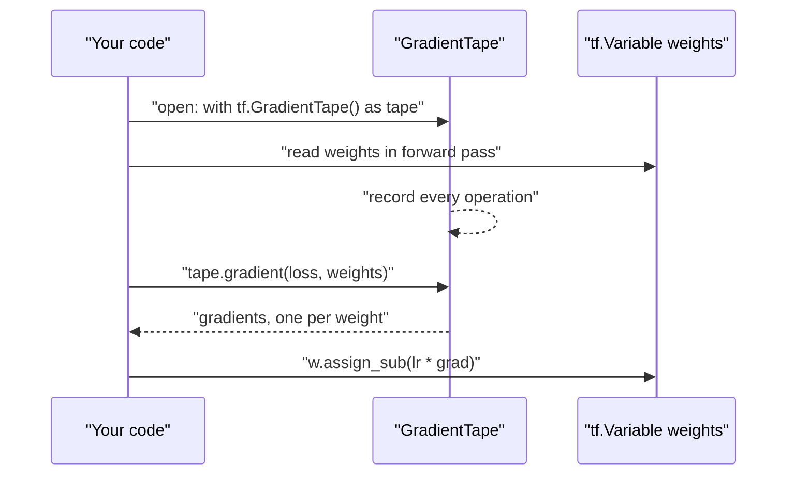
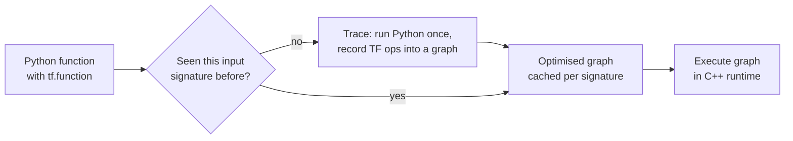
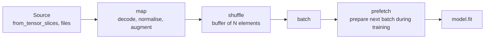

TensorFlow is Google's open-source deep learning framework, and Keras is the high-level API most people use on top of it. You already know [PyTorch](/learn/pytorch/tensors), so why learn a second framework? Because a large amount of production code, published models and deployment tooling (TensorFlow Serving for servers, TensorFlow Lite for phones, TensorFlow.js for browsers) lives in the TensorFlow world, and as an AI engineer you will be asked to read, fine-tune and ship models that were built with it. The good news is that the ideas carry over almost one to one. This lesson covers the four building blocks underneath Keras: tensors, variables, automatic differentiation with `tf.GradientTape`, compiled graphs with `tf.function`, and input pipelines with `tf.data`.

## TensorFlow and PyTorch side by side

Most of what you learnt in the PyTorch module has a direct TensorFlow equivalent. Keep this table in mind; the rest of the module fills it in.

| Concept | PyTorch | TensorFlow / Keras |
| --- | --- | --- |
| Immutable array | `torch.tensor` (mutable in place) | `tf.constant` (immutable) |
| Trainable parameter | `nn.Parameter` / `requires_grad=True` | `tf.Variable` |
| Gradients | `loss.backward()`, read `.grad` | `tf.GradientTape`, then `tape.gradient(loss, vars)` |
| Speed-up by compiling | `torch.compile` | `tf.function` |
| Input pipeline | `Dataset` + `DataLoader` | `tf.data.Dataset` |
| Model base class | `nn.Module` | `keras.Model` / `keras.layers.Layer` |
| Training loop | You write it | `model.fit`, or write your own |

The biggest cultural difference is the last row. In PyTorch you normally write the training loop yourself. In Keras you normally call `model.fit` and customise it through arguments and callbacks, dropping down to a hand-written loop only when you need to.

Install TensorFlow with `pip install tensorflow` inside a virtual environment. It is a large download. The import convention is `import tensorflow as tf`.

## Tensors

A TensorFlow tensor is a typed, n-dimensional array, just like a NumPy array or a PyTorch tensor.

```python
import numpy as np
import tensorflow as tf

x = tf.constant([[1.0, 2.0, 3.0],
                 [4.0, 5.0, 6.0]])

print(x.shape, x.dtype)
print(x * 10)            # elementwise, broadcasts the scalar
print(tf.reduce_sum(x, axis=0))
print(x @ tf.transpose(x))
```

```output
(2, 3) <dtype: 'float32'>
tf.Tensor(
[[10. 20. 30.]
 [40. 50. 60.]], shape=(2, 3), dtype=float32)
tf.Tensor([5. 7. 9.], shape=(3,), dtype=float32)
tf.Tensor(
[[14. 32.]
 [32. 77.]], shape=(2, 2), dtype=float32)
```

Most operations live in the `tf` namespace (`tf.reduce_mean`, `tf.matmul`, `tf.reshape`, `tf.concat`) or in `tf.math`. Where NumPy says `x.sum(axis=0)`, TensorFlow says `tf.reduce_sum(x, axis=0)`. Broadcasting follows the same rules you learnt for [NumPy](/learn/numpy/broadcasting).

Moving to and from NumPy is free and common:

```python
a = np.arange(6).reshape(2, 3)
t = tf.convert_to_tensor(a)
print(t.dtype)
print(t.numpy().sum())
```

```output
<dtype: 'int64'>
15
```

### Two differences that catch PyTorch users

**Tensors are immutable.** There is no `x[0, 0] = 99`. Every operation returns a new tensor. Values that must change over time, such as model weights, use `tf.Variable` instead.

**Dtypes are strict.** TensorFlow does not silently promote an integer to a float in an operation that mixes them:

```python
ints = tf.constant([1, 2, 3])        # int32
floats = tf.constant([0.5, 0.5, 0.5])  # float32
try:
    ints + floats
except Exception as e:
    print(type(e).__name__)
print(tf.cast(ints, tf.float32) + floats)
```

```output
InvalidArgumentError
tf.Tensor([1.5 2.5 3.5], shape=(3,), dtype=float32)
```

> [!TIP]
> Note that NumPy arrays default to `float64`, while TensorFlow and Keras default to `float32`. Convert your data with `X.astype("float32")` before feeding it in, and you avoid both dtype errors and wasted memory.

## Variables

A `tf.Variable` wraps a tensor whose value can be updated in place. Every weight in every Keras layer is a variable underneath.

```python
w = tf.Variable([1.0, 2.0])
w.assign([3.0, 4.0])        # replace the value
w.assign_sub([0.5, 0.5])    # in-place subtract, used for gradient steps
print(w.numpy(), w.trainable)
```

```output
[2.5 3.5] True
```

Variables are watched automatically by gradient tapes, which is how TensorFlow knows which values to differentiate with respect to. Pass `trainable=False` for values you want to store but never train, such as a step counter.

## Automatic differentiation with GradientTape

PyTorch records operations on tensors that have `requires_grad=True`, and `loss.backward()` fills in `.grad` attributes. TensorFlow makes the recording explicit: you open a `tf.GradientTape` context, run the forward computation inside it, then ask the tape for gradients. The mechanism is the same reverse-mode [backpropagation](/learn/neural-network-fundamentals/backpropagation).



For $y = x^2$ the derivative is $2x$, so at $x = 3$ the gradient should be 6:

```python
x = tf.Variable(3.0)
with tf.GradientTape() as tape:
    y = x ** 2
print(tape.gradient(y, x).numpy())
```

```output
6.0
```

Now a complete, if tiny, gradient descent: fit $\hat{y} = w x$ to data generated by $y = 2x$, minimising the mean squared error

$$
L(w) = \frac{1}{n}\sum_{i=1}^{n} (w x_i - y_i)^2,
$$

where $n$ is the number of examples, $x_i$ the inputs and $y_i$ the targets. Each step updates $w \leftarrow w - \eta \, \partial L / \partial w$ with learning rate $\eta = 0.05$.

```python
xs = tf.constant([1.0, 2.0, 3.0])
ys = tf.constant([2.0, 4.0, 6.0])
w = tf.Variable(0.0)

for step in range(3):
    with tf.GradientTape() as tape:
        loss = tf.reduce_mean((w * xs - ys) ** 2)
    grad = tape.gradient(loss, w)
    w.assign_sub(0.05 * grad)
    print(f"step {step}: loss={loss.numpy():.4f} grad={grad.numpy():.4f} w={w.numpy():.4f}")
```

```output
step 0: loss=18.6667 grad=-18.6667 w=0.9333
step 1: loss=5.3096 grad=-9.9556 w=1.4311
step 2: loss=1.5103 grad=-5.3096 w=1.6966
```

Step through the same loop and watch $w$ approach 2:

```trace
{
  "title": "gradient descent with GradientTape",
  "code": [
    "w = tf.Variable(0.0)",
    "for step in range(3):",
    "    with tf.GradientTape() as tape:",
    "        loss = tf.reduce_mean((w * xs - ys) ** 2)",
    "    grad = tape.gradient(loss, w)",
    "    w.assign_sub(0.05 * grad)"
  ],
  "steps": [
    { "line": 1, "vars": { "w": "0.0" }, "note": "The single trainable weight starts at zero. The data says the true value is 2." },
    { "line": 4, "vars": { "w": "0.0", "step": "0", "loss": "18.6667" }, "note": "Inside the tape, the forward pass is recorded. Every prediction is 0, so the loss is the mean of 4, 16 and 36." },
    { "line": 5, "vars": { "w": "0.0", "step": "0", "loss": "18.6667", "grad": "-18.6667" }, "note": "The tape replays the recorded operations backwards. A negative gradient means increasing w lowers the loss." },
    { "line": 6, "vars": { "w": "0.9333", "step": "0", "loss": "18.6667", "grad": "-18.6667" }, "note": "assign_sub updates the variable in place: 0 - 0.05 * (-18.6667)." },
    { "line": 4, "vars": { "w": "0.9333", "step": "1", "loss": "5.3096" }, "note": "A fresh tape for the next step. The loss has dropped sharply." },
    { "line": 6, "vars": { "w": "1.4311", "step": "1", "loss": "5.3096", "grad": "-9.9556" }, "note": "The gradient is smaller now, so the step is smaller." },
    { "line": 6, "vars": { "w": "1.6966", "step": "2", "loss": "1.5103", "grad": "-5.3096" }, "note": "After three steps w is 1.70 and still converging towards 2." }
  ]
}
```

A tape is consumed by its first `gradient` call. If you need several gradients from one forward pass, create it with `tf.GradientTape(persistent=True)`.

## Graphs and tf.function

By default TensorFlow runs **eagerly**: each line executes immediately, like Python and PyTorch. That is easy to debug, but each operation pays Python overhead. Decorating a function with `@tf.function` asks TensorFlow to **trace** it once into a dataflow graph, optimise that graph, and run the graph on later calls.



The Python body runs only while tracing. Ordinary Python side effects, like `print`, therefore happen once per trace, not once per call; use `tf.print` for output that should appear every time.

```python
@tf.function
def scaled_sum(t):
    print("tracing")              # Python: runs only when tracing
    tf.print("running")           # TensorFlow op: runs every call
    return tf.reduce_sum(t) * 2

scaled_sum(tf.constant([1.0, 2.0]))
scaled_sum(tf.constant([3.0, 4.0]))       # same shape and dtype: no retrace
scaled_sum(tf.constant([1.0, 2.0, 3.0]))  # new shape: traces again
```

```output
tracing
running
running
tracing
running
```

`tracing` appears on the first call and again when the shape changes; `running` appears on every call. A new trace happens whenever the input shape or dtype changes, or whenever you pass a different Python value (not a tensor) as an argument. Frequent retracing makes code slower, not faster, so pass tensors rather than changing Python numbers.

You rarely write `tf.function` yourself when using Keras: `model.fit` compiles its training step into a graph for you. It matters when you write a custom training loop, and when you export a model, because a deployed model is a saved graph.

> [!WARNING]
> Inside a `tf.function`, Python `if` and `for` on tensor values are converted to graph operations by a system called AutoGraph, but code that depends on Python state, such as appending to a Python list or calling `.numpy()`, will not behave as it does eagerly. If something works eagerly and breaks under `tf.function`, this is the first place to look. Calling `tf.config.run_functions_eagerly(True)` switches compilation off while you debug.

## Input pipelines with tf.data

`tf.data.Dataset` plays the role of PyTorch's `Dataset` and `DataLoader` combined. You build a pipeline by chaining transformations, and Keras's `fit` accepts the result directly.

```python
X = np.arange(10, dtype="float32").reshape(5, 2)
y = np.array([0, 1, 0, 1, 1])

ds = (
    tf.data.Dataset.from_tensor_slices((X, y))   # one element per row
    .map(lambda features, label: (features / 10.0, label))
    .shuffle(buffer_size=5, seed=0)
    .batch(2)
    .prefetch(tf.data.AUTOTUNE)
)

for features, labels in ds:
    print(features.shape, labels.numpy())
```

```output
(2, 2) [0 1]
(2, 2) [1 1]
(1, 2) [0]
```



| Method | Does | PyTorch analogue |
| --- | --- | --- |
| `from_tensor_slices` | Splits arrays along the first axis into elements | A `Dataset` over arrays |
| `map(fn, num_parallel_calls=...)` | Applies a function to every element | `__getitem__` transforms |
| `shuffle(buffer_size)` | Shuffles within a sliding buffer | `shuffle=True` |
| `batch(n)` | Groups elements into batches | `batch_size=n` |
| `prefetch(tf.data.AUTOTUNE)` | Overlaps data preparation with training | `num_workers`, `pin_memory` |
| `cache()` | Keeps elements in memory after the first pass | No direct equivalent |

The shuffle buffer is not a full shuffle: it fills a buffer of `buffer_size` elements and samples from it. For a full shuffle the buffer must be at least as large as the dataset. Shuffle before batching, or you will only shuffle the order of fixed batches.

> [!KEY]
> TensorFlow's low-level pieces map directly onto PyTorch's: tensors, variables as parameters, a tape instead of `.backward()`, `tf.function` for compilation and `tf.data` for loading. Keras, covered next, sits on top of all of them.

## Exercises

**1.** Use `tf.GradientTape` to compute the derivative of $f(x) = 3x^3 - 2x$ at $x = 2$. Check it against the analytical answer $9x^2 - 2$.

<details>
<summary>Show solution</summary>

```python
x = tf.Variable(2.0)
with tf.GradientTape() as tape:
    f = 3 * x ** 3 - 2 * x
print(tape.gradient(f, x).numpy())   # 9 * 4 - 2 = 34
```

</details>

**2.** The following raises an error. Explain why and fix it.

```python
t = tf.constant([1, 2, 3])
print(t / 2.5)
```

<details>
<summary>Show solution</summary>

`t` is `int32` and `2.5` is a float, and TensorFlow does not promote mixed dtypes automatically. Cast first: `tf.cast(t, tf.float32) / 2.5`, or create the tensor as floats with `tf.constant([1.0, 2.0, 3.0])`.

</details>

**3.** Build a `tf.data` pipeline from the numbers 0 to 99 that keeps only the even numbers, squares them, and yields batches of 8. Print the first batch.

<details>
<summary>Show solution</summary>

```python
ds = (tf.data.Dataset.range(100)
      .filter(lambda n: n % 2 == 0)
      .map(lambda n: n * n)
      .batch(8))
print(next(iter(ds)).numpy())   # [  0   4  16  36  64 100 144 196]
```

</details>

```quiz
[
  {
    "q": "What is the TensorFlow equivalent of a PyTorch tensor with `requires_grad=True` that an optimiser updates?",
    "options": ["`tf.constant`", "`tf.Variable`", "`tf.function`", "`tf.data.Dataset`"],
    "answer": 1,
    "why": "Trainable state lives in `tf.Variable`, which can be updated in place and is watched automatically by gradient tapes."
  },
  {
    "q": "A function decorated with `@tf.function` contains `print(\"hi\")`. You call it five times with tensors of the same shape and dtype. How many times is `hi` printed?",
    "options": ["Five", "Zero", "Once", "Twice"],
    "answer": 2,
    "why": "Python code runs only while the function is traced. With an unchanged input signature it is traced once and the cached graph is reused."
  },
  {
    "q": "Why should `shuffle` usually come before `batch` in a `tf.data` pipeline?",
    "options": [
      "`batch` fails on unshuffled data",
      "Shuffling after batching only reorders whole batches, so the same examples always appear together",
      "`shuffle` cannot be applied to batched data",
      "It makes no difference"
    ],
    "answer": 1,
    "why": "Shuffling individual elements and then batching produces different batch compositions each epoch."
  },
  {
    "q": "How do you obtain gradients in TensorFlow?",
    "options": [
      "Call `loss.backward()` and read `w.grad`",
      "Call `tf.gradients()` in eager mode",
      "Record the forward pass inside `tf.GradientTape` and call `tape.gradient(loss, variables)`",
      "Gradients are computed only by `model.fit`"
    ],
    "answer": 2,
    "why": "The tape records operations during the forward pass and computes gradients when asked."
  }
]
```
