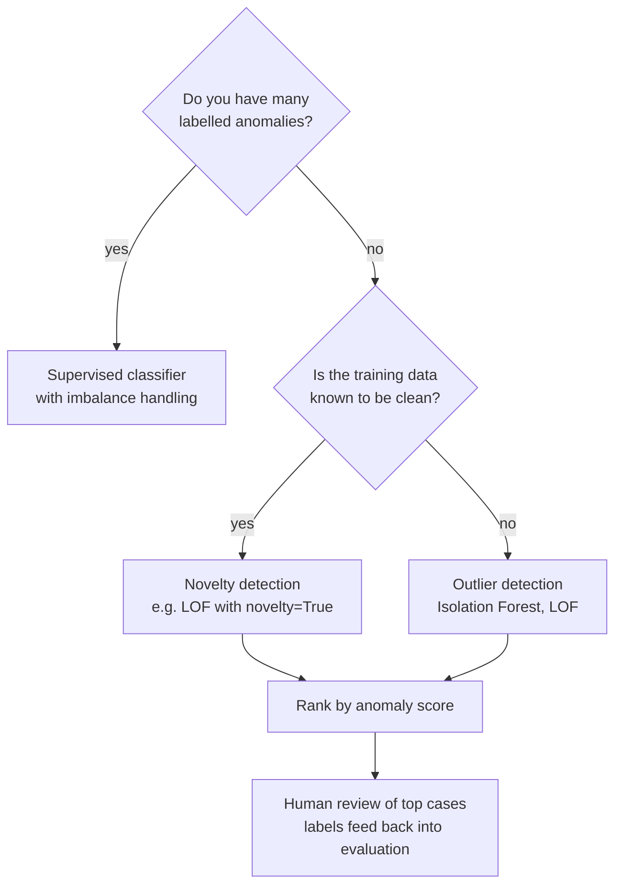
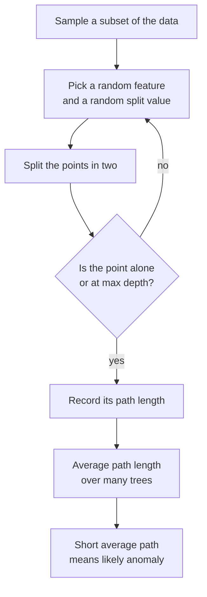

A card payment of 2,000 at 3am from a new country. A server whose memory use climbs in a pattern never seen before. A user query to your chatbot that looks nothing like the questions it was built for. In each case the interesting points are rare, and you seldom have enough labelled examples to train a classifier. **Anomaly detection** (also called outlier detection) learns what normal looks like from mostly unlabelled data and flags what deviates from it. This lesson moves from statistical rules to Isolation Forest, Local Outlier Factor and One-Class SVM, then tackles the hardest part: knowing whether a detector works.

## What counts as an anomaly

| Kind | Description | Example |
| --- | --- | --- |
| Point anomaly | A single record unusual on its own | A transaction 50 times larger than the customer's usual |
| Contextual anomaly | Normal in general, unusual in its context | 30 degrees is normal in July, anomalous in January |
| Collective anomaly | A sequence or group that is unusual together | Many small transfers in quick succession |

There are also two settings, and they change how you train:

- **Outlier detection.** The training data itself contains some anomalies, and you want to find them. This is the usual unsupervised case.
- **Novelty detection.** The training data is known to be clean, and you want to judge whether *new* points are unlike it.

With plenty of labelled anomalies, the problem becomes imbalanced supervised classification, which usually beats any unsupervised detector. Unsupervised methods shine when labels are scarce or new kinds of anomaly keep appearing.



## Statistical baselines: z-scores and the IQR rule

For a single numeric feature, the simplest test is the **z-score**: how many standard deviations a value lies from the mean.

$$
z_i = \frac{x_i - \bar{x}}{s}
$$

where $\bar{x}$ is the sample mean and $s$ the standard deviation. A common rule flags $\lvert z_i \rvert > 3$. The **IQR rule**, the one box plots use, flags values below $Q_1 - 1.5\,\text{IQR}$ or above $Q_3 + 1.5\,\text{IQR}$, where $Q_1$ and $Q_3$ are the 25th and 75th percentiles and $\text{IQR} = Q_3 - Q_1$.

The two rules behave very differently when anomalies are extreme:

```python
import numpy as np

amounts = np.array([12, 15, 14, 10, 13, 18, 11, 16, 14, 12, 950, 1200], dtype=float)

z = (amounts - amounts.mean()) / amounts.std()
print("z-scores:", z.round(2))
print("flagged by |z| > 3:", amounts[np.abs(z) > 3])

q1, q3 = np.percentile(amounts, [25, 75])
iqr = q3 - q1
low, high = q1 - 1.5 * iqr, q3 + 1.5 * iqr
print(f"Q1={q1}, Q3={q3}, IQR={iqr}, fences=({low}, {high})")
print("flagged by IQR rule:", amounts[(amounts < low) | (amounts > high)])
```

```output
z-scores: [-0.45 -0.44 -0.44 -0.45 -0.44 -0.43 -0.45 -0.44 -0.44 -0.45  1.9   2.53]
flagged by |z| > 3: []
Q1=12.0, Q3=16.5, IQR=4.5, fences=(5.25, 23.25)
flagged by IQR rule: [ 950. 1200.]
```

The z-score rule misses both obvious outliers. The outliers themselves inflate the mean and, even more, the standard deviation, so they no longer look extreme. This is called **masking**. Percentile-based rules are **robust**: two extreme values barely move $Q_1$ and $Q_3$. A robust version of the z-score replaces the mean with the median and the standard deviation with the median absolute deviation (MAD).

These rules are fast and explainable, so they remain the first line of defence in data validation. But they look at one feature at a time, and a transaction can have a normal amount and a normal hour yet be an unusual combination.

## Isolation Forest

**Isolation Forest** starts from a clever observation: anomalies are few and different, so they are easy to *isolate*. Build a tree by repeatedly picking a random feature and a random split value between that feature's minimum and maximum. A normal point in a dense region needs many splits before it sits alone in a leaf. An anomaly far from everything else is usually cut off after a few.



The anomaly score for a point $x$ is

$$
s(x, n) = 2^{-\,E[h(x)] / c(n)}
$$

where $h(x)$ is the path length in one tree, $E[h(x)]$ its average over the forest, $n$ the number of samples used per tree, and $c(n)$ the average path length of an unsuccessful search in a binary search tree of $n$ points, used to normalise. Scores near 1 indicate anomalies; scores well below 0.5 indicate normal points.

scikit-learn's `score_samples` returns the **negative** of this score, so lower means more anomalous:

```python
from sklearn.ensemble import IsolationForest

rng = np.random.default_rng(1)
normal = rng.normal(0, 1, size=(1000, 2))
iso = IsolationForest(n_estimators=200, random_state=0).fit(normal)

points = np.array([[0.0, 0.0], [2.0, 2.0], [6.0, -5.0]])
print("score_samples:", iso.score_samples(points).round(3))
print("predict:      ", iso.predict(points))
```

```output
score_samples: [-0.406 -0.627 -0.749]
predict:       [ 1 -1 -1]
```

`predict` returns `1` for inliers and `-1` for outliers. With the default `contamination="auto"`, the threshold is a score of 0.5 (here, `score_samples` below -0.5). Set `contamination` to the fraction of anomalies you expect, and the threshold is instead chosen so that this fraction of the training data is flagged. Isolation Forest is fast, scales well and needs no feature scaling, since each split looks at one feature, which makes it the usual first choice for tabular data.

## Local Outlier Factor

Global methods struggle when normal data has regions of different density. A point at distance 1 from a tight cluster may be anomalous, while a point at distance 1 inside a sparse cluster is perfectly normal. **Local Outlier Factor (LOF)** compares each point's local density, estimated from its `n_neighbors` nearest neighbours, with the local densities of those neighbours. The LOF is roughly the ratio of the neighbours' density to the point's own density: about 1 for a point as dense as its surroundings, and well above 1 for a point in a sparser spot than its neighbours.

By default, `LocalOutlierFactor` only scores the data it was fitted on (`fit_predict`). For novelty detection on new data, set `novelty=True`, fit on clean data, then call `predict` or `score_samples` on new points:

```python
from sklearn.neighbors import LocalOutlierFactor

X_train = rng.normal(0, 1, size=(500, 2))
lof = LocalOutlierFactor(n_neighbors=20, novelty=True).fit(X_train)
print(lof.predict(np.array([[0.1, -0.2], [4.0, 4.0]])))
```

```output
[ 1 -1]
```

LOF is distance-based, so scale your features first, and like k-NN it slows down on very large or very high-dimensional data.

## One-Class SVM

A **One-Class SVM** learns a boundary that encloses most of the training data in a kernel-induced feature space, using the same kernel ideas as [support vector machines](/learn/supervised-learning-algorithms/support-vector-machines). Points outside the boundary are anomalies. The `nu` parameter is an upper bound on the fraction of training points treated as outliers (and a lower bound on the fraction of support vectors), so it plays a similar role to `contamination`. With an RBF kernel, `gamma` controls how tightly the boundary wraps the data. It needs scaled features, is sensitive to `gamma` and scales poorly, so it suits small, clean training sets in a novelty-detection setting.

## Comparing detectors on labelled synthetic data

To compare methods you need ground truth, so build a dataset with a dense cluster, a sparse cluster and 25 points scattered uniformly over the whole area. The labels are used only for evaluation.

```python
from sklearn.svm import OneClassSVM
from sklearn.preprocessing import StandardScaler
from sklearn.metrics import average_precision_score, precision_score, recall_score

rng = np.random.default_rng(42)
dense = rng.normal(loc=[0, 0], scale=0.5, size=(300, 2))
sparse = rng.normal(loc=[5, 5], scale=1.5, size=(200, 2))
anomalies = rng.uniform(low=-4, high=10, size=(25, 2))
X = StandardScaler().fit_transform(np.vstack([dense, sparse, anomalies]))
y = np.r_[np.zeros(500), np.ones(25)]          # 1 = anomaly (used only for evaluation)

models = {
    "Isolation Forest": IsolationForest(n_estimators=200, contamination=0.05, random_state=0),
    "LOF": LocalOutlierFactor(n_neighbors=20, contamination=0.05),
    "One-Class SVM": OneClassSVM(kernel="rbf", gamma="scale", nu=0.05),
}
print(f"{'model':17s} precision  recall  avg_precision")
for name, model in models.items():
    pred = model.fit_predict(X)                # +1 inlier, -1 outlier
    flagged = (pred == -1).astype(int)
    if name == "LOF":
        score = -model.negative_outlier_factor_
    else:
        score = -model.decision_function(X)    # higher = more anomalous
    print(f"{name:17s} {precision_score(y, flagged):9.2f} {recall_score(y, flagged):7.2f} "
          f"{average_precision_score(y, score):14.2f}")
z_score = np.abs(X).max(axis=1)                # X is already standardised
print(f"{'max |z| baseline':17s} {'':9s} {'':7s} {average_precision_score(y, z_score):14.2f}")
```

```output
model             precision  recall  avg_precision
Isolation Forest       0.63    0.68           0.70
LOF                    0.52    0.56           0.60
One-Class SVM          0.59    0.64           0.64
max |z| baseline                              0.32
```

All three learned detectors comfortably beat the per-feature z-score baseline, which cannot see that a point between the two clusters is unusual. None is near perfect, and that is honest: a few of the uniformly scattered "anomalies" landed inside the normal clusters, where no method could, or should, flag them. Ground truth in anomaly detection is often fuzzy like this.

| Method | Idea | Scaling needed | Scales to large data | Main hyperparameters |
| --- | --- | --- | --- | --- |
| z-score / IQR | Distance from centre, per feature | No | Yes | Threshold |
| Isolation Forest | Anomalies are isolated in few random splits | No | Yes | `n_estimators`, `contamination` |
| LOF | Lower density than neighbours | Yes | Moderately | `n_neighbors`, `contamination` |
| One-Class SVM | Boundary around normal data | Yes | Poorly | `nu`, `gamma` |

## Why evaluation is hard

> [!WARNING]
> Never judge an anomaly detector by accuracy. If 0.5% of transactions are fraud, flagging nothing scores 99.5% accuracy.

- **Few or no labels.** Often you discover anomalies only by investigating flagged cases, so you only learn the labels of what you flagged. Missed anomalies stay invisible.
- **Extreme imbalance.** Use metrics that focus on the rare class: [precision](/learn/model-evaluation/precision), [recall](/learn/model-evaluation/recall), average precision (area under the precision-recall curve), and **precision at k**: of the top $k$ highest-scoring cases, how many were real. Precision at k matches reality when a team can review only $k$ cases a day.
- **Thresholds are business decisions.** `contamination` and `nu` set how many points are flagged. The right number depends on the cost of a missed anomaly versus the cost of reviewing a false alarm.
- **Normal changes.** Spending patterns shift with seasons and promotions; yesterday's anomaly becomes today's normal. Retrain regularly and monitor the rate of flags over time.

> [!KEY]
> Treat an anomaly detector as a ranking system that sends the most suspicious cases to a human or a downstream rule. Evaluate the top of the ranking, and feed reviewers' verdicts back in as labels.

## Anomaly detection in AI systems

- **Fraud detection.** Isolation Forest scores on transaction features are often combined with rules and a supervised model trained on the confirmed fraud cases that reviews produce.
- **Monitoring models in production.** Detectors on input features flag data drift and broken upstream pipelines before model quality visibly drops.
- **Out-of-distribution inputs for LLM applications.** Scoring query embeddings against embeddings of expected queries (for example with LOF in novelty mode) flags questions your RAG system was not designed for, so they can be routed elsewhere or logged for review.

## Exercises

**1.** Compute robust z-scores for the `amounts` array using $0.6745 (x_i - \text{median}) / \text{MAD}$, where MAD is the median of $\lvert x_i - \text{median} \rvert$. Which values exceed 3.5?

<details>
<summary>Show solution</summary>

```python
median = np.median(amounts)
mad = np.median(np.abs(amounts - median))
robust_z = 0.6745 * (amounts - median) / mad
print("median:", median, "MAD:", mad)
print("robust z:", [round(float(v), 1) for v in robust_z])
print("flagged:", amounts[np.abs(robust_z) > 3.5])
```

```output
median: 14.0 MAD: 2.0
robust z: [-0.7, 0.3, 0.0, -1.3, -0.3, 1.3, -1.0, 0.7, 0.0, -0.7, 315.7, 400.0]
flagged: [ 950. 1200.]
```

The median and MAD ignore the two extreme values, so they stand out clearly. The constant 0.6745 makes the score comparable to an ordinary z-score for normally distributed data.

</details>

**2.** Your fraud team can review 50 transactions a day out of 200,000. Which metric should you report for your detector, and how do you compute it?

<details>
<summary>Show solution</summary>

Precision at 50: sort transactions by anomaly score, take the top 50, and compute the fraction confirmed as fraud after review. It measures exactly the cases the team will see. Track it daily, alongside the number of confirmed frauds found by other means that the detector ranked outside the top 50, which estimates what you are missing.

</details>

**3.** Why does Isolation Forest not need feature scaling, while LOF and One-Class SVM do?

<details>
<summary>Show solution</summary>

Each Isolation Forest split uses one feature and a random threshold between that feature's minimum and maximum, so rescaling a feature rescales its thresholds in the same way and leaves the tree structure unchanged. LOF and One-Class SVM use distances or kernels computed across all features, which are dominated by features with large numeric ranges.

</details>

```quiz
[
  {
    "q": "A dataset of amounts contains two huge outliers, yet `|z| > 3` flags nothing. Why?",
    "options": [
      "z-scores only work for negative values",
      "The outliers inflate the mean and standard deviation, masking themselves",
      "The threshold 3 is too low",
      "z-scores need at least 1,000 values"
    ],
    "answer": 1,
    "why": "This is masking. Robust statistics such as the median, IQR and MAD are barely affected by a few extreme values."
  },
  {
    "q": "What is the core idea behind Isolation Forest?",
    "options": [
      "Anomalies lie far from the k-means centroids",
      "Anomalies have lower density than their neighbours",
      "Anomalies can be separated from the rest with few random splits",
      "Anomalies lie outside a kernel boundary"
    ],
    "answer": 2,
    "why": "Short average path length across random trees signals an easily isolated, and therefore unusual, point."
  },
  {
    "q": "Normal data contains a tight cluster and a diffuse cluster. Which method is designed for this situation?",
    "options": [
      "Local Outlier Factor",
      "Global z-scores",
      "The IQR rule",
      "Accuracy-based thresholding"
    ],
    "answer": 0,
    "why": "LOF compares each point's density with its neighbours' densities, so it adapts to regions of different density."
  },
  {
    "q": "In scikit-learn, what does `predict` return for a point an outlier detector considers anomalous?",
    "options": [
      "0",
      "1",
      "`True`",
      "-1"
    ],
    "answer": 3,
    "why": "Outlier detectors return 1 for inliers and -1 for outliers."
  }
]
```
