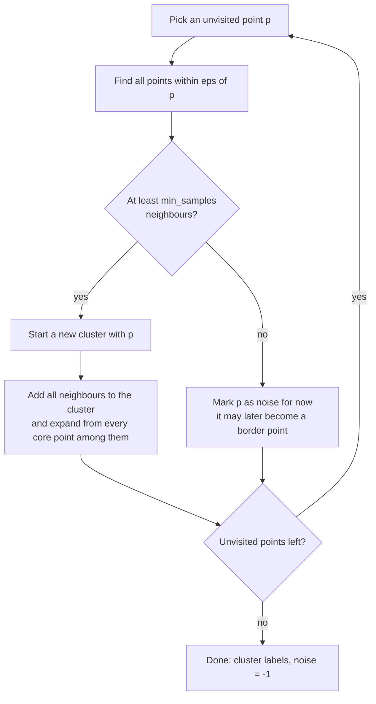

K-means and Ward clustering both assume clusters are round blobs, and both force every point into some cluster. Real data is less polite: clusters curve and branch, and some points belong to no group at all. **DBSCAN** (Density-Based Spatial Clustering of Applications with Noise) takes a different view: a cluster is a region where points are packed densely, separated from other clusters by sparse space. It finds clusters of any shape, works out how many there are by itself, and labels isolated points as **noise** rather than forcing them into a group. That last property makes it a natural fit for jobs such as finding near-duplicate documents in a RAG corpus, where most documents are unique and only a few form tight groups.

## Core, border and noise points

DBSCAN has two hyperparameters:

- `eps` ($\varepsilon$): the radius of a point's neighbourhood.
- `min_samples`: how many points (counting the point itself) must lie within `eps` for the neighbourhood to count as dense.

Every point then falls into one of three roles:

| Role | Definition |
| --- | --- |
| **Core point** | Has at least `min_samples` points, including itself, within distance `eps` |
| **Border point** | Not a core point, but lies within `eps` of some core point |
| **Noise point** | Neither: not dense itself and not near any dense point. Labelled `-1` |

Clusters grow from core points. Two core points within `eps` of each other belong to the same cluster, and so, by chaining, does every core point reachable through a sequence of such steps. Border points join the cluster of a nearby core point. Formally, the neighbourhood of a point $\mathbf{p}$ is

$$
N_\varepsilon(\mathbf{p}) = \{\, \mathbf{q} \in D : d(\mathbf{p}, \mathbf{q}) \le \varepsilon \,\}
$$

where $D$ is the dataset and $d$ the distance metric, and $\mathbf{p}$ is a core point when $\lvert N_\varepsilon(\mathbf{p}) \rvert \ge$ `min_samples`. Unlike k-means, DBSCAN has no objective function to minimise; it is defined directly by these rules.

## The algorithm



The expansion in the middle box is a breadth-first search over core points: each newly found core point adds its own neighbours, until the cluster stops growing. Then the algorithm moves on to the next unvisited point.

Work through a small example by hand. Take the 1-D points 1, 2, 3, 8, 9 and 20, with `eps = 1.5` and `min_samples = 3`:

- Point 2 has neighbours 1, 2 and 3 within 1.5: three points, so it is a **core** point.
- Points 1 and 3 have only two points within 1.5 each, so they are not core, but they are within 1.5 of the core point 2: **border** points. Cluster 0 is {1, 2, 3}.
- Points 8 and 9 have two points each in their neighbourhood and no core point nearby: **noise**. So is 20.

```python
import numpy as np
from sklearn.cluster import DBSCAN

X = np.array([1, 2, 3, 8, 9, 20], dtype=float).reshape(-1, 1)
for ms in [3, 2]:
    db = DBSCAN(eps=1.5, min_samples=ms).fit(X)
    print(ms, db.labels_, db.core_sample_indices_)
```

```output
3 [ 0  0  0 -1 -1 -1] [1]
2 [ 0  0  0  1  1 -1] [0 1 2 3 4]
```

Lowering `min_samples` to 2 makes 8 and 9 dense enough to form their own cluster, while 20 stays noise.

## DBSCAN on curved clusters

Here are two interleaving half-moons with 20 random noise points scattered around them. K-means with $k = 2$ is a natural comparison.

```python
from sklearn.datasets import make_moons
from sklearn.preprocessing import StandardScaler
from sklearn.cluster import KMeans
from sklearn.metrics import adjusted_rand_score

X, y = make_moons(n_samples=400, noise=0.07, random_state=3)
rng = np.random.default_rng(0)
outliers = rng.uniform(low=[-1.5, -1.0], high=[2.5, 1.5], size=(20, 2))
X = np.vstack([X, outliers])
y = np.concatenate([y, np.full(20, -1)])
X = StandardScaler().fit_transform(X)

db = DBSCAN(eps=0.3, min_samples=5).fit(X)
labels = db.labels_
print("clusters found:", len(set(labels)) - (1 if -1 in labels else 0))
print("noise points:  ", (labels == -1).sum())
print("core samples:  ", len(db.core_sample_indices_))
print("ARI DBSCAN:    ", round(adjusted_rand_score(y, labels), 3))
km = KMeans(n_clusters=2, n_init=10, random_state=0).fit_predict(X)
print("ARI k-means:   ", round(adjusted_rand_score(y, km), 3))
```

```output
clusters found: 2
noise points:   11
core samples:   405
ARI DBSCAN:     0.956
ARI k-means:    0.443
```

DBSCAN finds both moons without being told how many there are, and flags 11 points as noise. All 11 come from the 20 random points; the other 9 happened to land on or next to a moon, so it is reasonable that they were absorbed. K-means, which can only draw a straight boundary between two centroids, cuts each moon in half and scores less than half as well.

## Choosing eps and min_samples

**`min_samples`** is the easier one. A common rule of thumb is to start at twice the number of features, and at least 3 or 4. Larger values make the algorithm more conservative: more points become noise, and only genuinely dense regions form clusters.

**`eps`** is the sensitive one. The standard tool is the **k-distance plot**. For every point, compute the distance to its $k$-th nearest neighbour, with $k$ equal to `min_samples`, and sort these distances. Points inside clusters have small k-distances; noise points have large ones. The sorted curve is flat for a long stretch and then bends sharply upwards. The bend, or "knee", is a good value for `eps`.

```python
from sklearn.neighbors import NearestNeighbors

min_samples = 5
nn = NearestNeighbors(n_neighbors=min_samples).fit(X)
dist, _ = nn.kneighbors(X)          # column 0 is each point itself (distance 0)
k_dist = np.sort(dist[:, -1])
for q in [50, 80, 90, 95, 97, 99, 100]:
    print(f"{q:3d}th percentile: {np.percentile(k_dist, q):.3f}")
```

```output
 50th percentile: 0.105
 80th percentile: 0.141
 90th percentile: 0.183
 95th percentile: 0.249
 97th percentile: 0.335
 99th percentile: 0.935
100th percentile: 2.015
```

Querying the training set returns each point as its own nearest neighbour, which matches how DBSCAN counts the point itself in `min_samples`. The distances stay small up to about the 97th percentile and then jump, so the knee is somewhere around 0.25 to 0.35. In practice you would plot `k_dist` with Matplotlib and read the bend off the chart. Compare a sweep of `eps` values:

```python
print(" eps  clusters  noise")
for eps in [0.05, 0.1, 0.2, 0.3, 0.5, 1.0]:
    labels = DBSCAN(eps=eps, min_samples=5).fit_predict(X)
    n_clusters = len(set(labels)) - (1 if -1 in labels else 0)
    print(f"{eps:4.2f} {n_clusters:9d} {(labels == -1).sum():6d}")
```

```output
 eps  clusters  noise
0.05         0    420
0.10        27    119
0.20         2     20
0.30         2     11
0.50         1      6
1.00         1      4
```

Too small and everything is noise or shattered into dozens of fragments; too large and the two moons merge into one. Values near the knee give the right answer.

> [!WARNING]
> `eps` is a distance in feature units, so DBSCAN is meaningless on unscaled features. If one column is in metres and another in kilometres, the neighbourhood is a long thin ellipse. Standardise first, as in the example above, or use a metric that suits the data, such as cosine distance for embeddings.

## Strengths and failure modes

| Strength | Weakness |
| --- | --- |
| Finds clusters of arbitrary shape | One global `eps` struggles when clusters have very different densities |
| Determines the number of clusters itself | Results are sensitive to `eps` |
| Labels outliers as noise instead of distorting clusters | In high dimensions distances become similar, so density is hard to define |
| Deterministic for core and noise points | A border point within `eps` of two clusters goes to whichever reaches it first |

The varying-density problem is the important one. If one cluster is tight and another is diffuse, an `eps` small enough to separate the tight cluster from its neighbours shatters the diffuse one into noise, and an `eps` large enough for the diffuse one merges the tight cluster with whatever is nearby. **HDBSCAN** (available as `sklearn.cluster.HDBSCAN`) addresses this by effectively considering all values of `eps` at once and keeping the clusters that persist longest. Its main hyperparameter, `min_cluster_size`, is usually easier to set than `eps`. **OPTICS** (`sklearn.cluster.OPTICS`) is a related method that orders points by density so you can extract clusters at several density levels.

> [!KEY]
> Choose DBSCAN when you expect irregular shapes, an unknown number of groups and genuine noise. Choose k-means when you want a fixed number of compact groups that cover every point.

## Deduplicating documents for RAG

Retrieval-augmented generation systems often ingest the same content several times: copied FAQ answers, near-identical policy versions, boilerplate footers. Duplicates waste index space and, worse, fill the retrieved context with the same passage repeated. DBSCAN with cosine distance finds groups of near-duplicates while leaving unique chunks alone as noise. In production you would use embeddings from a text embedding model; this self-contained example uses TF-IDF vectors from scikit-learn.

```python
from sklearn.feature_extraction.text import TfidfVectorizer

chunks = [
    "Refunds are processed within 14 days of receiving the returned item.",
    "Refunds are processed within 14 days after we receive the returned item.",
    "Our support team is available Monday to Friday, 9am to 5pm.",
    "Support is available Monday to Friday from 9am to 5pm.",
    "Shipping to Europe usually takes 3 to 5 working days.",
    "Passwords must be at least 12 characters long.",
]
vectors = TfidfVectorizer().fit_transform(chunks)
labels = DBSCAN(eps=0.5, min_samples=2, metric="cosine").fit_predict(vectors)
print(labels)

keep = [i for i, lab in enumerate(labels) if lab == -1 or i == list(labels).index(lab)]
for i in keep:
    print(i, chunks[i])
```

```output
[ 0  0  1  1 -1 -1]
0 Refunds are processed within 14 days of receiving the returned item.
2 Our support team is available Monday to Friday, 9am to 5pm.
4 Shipping to Europe usually takes 3 to 5 working days.
5 Passwords must be at least 12 characters long.
```

With `min_samples=2`, any two chunks within cosine distance 0.5 form a group. Noise points (`-1`) are unique and kept; from each duplicate group, the code keeps the first member. In a real pipeline you would keep the most recent or most authoritative version instead, and you would tune `eps` by inspecting pairs near the threshold: too loose and you merge chunks that are merely on the same topic.

The same pattern detects clusters of near-identical spam messages, groups repeated user questions in chatbot logs, and removes duplicated examples from fine-tuning datasets.

## Exercises

**1.** Using the hand example (points 1, 2, 3, 8, 9, 20), predict the labels for `eps = 6` and `min_samples = 3`, then check with scikit-learn.

<details>
<summary>Show solution</summary>

With radius 6, point 3 reaches 8 (distance 5), and every point from 1 to 9 now has at least three neighbours, so 1, 2, 3, 8 and 9 are all core points chained into one cluster. Point 20 is 11 away from 9, so it is still noise.

```python
X = np.array([1, 2, 3, 8, 9, 20], dtype=float).reshape(-1, 1)
print(DBSCAN(eps=6, min_samples=3).fit_predict(X))
```

```output
[ 0  0  0  0  0 -1]
```

</details>

**2.** In the moons example, keep `eps=0.3` but drop the `StandardScaler` step. Then multiply the second feature by 100 before clustering. Explain what happens to the number of clusters.

<details>
<summary>Show solution</summary>

```python
X_raw, _ = make_moons(n_samples=400, noise=0.07, random_state=3)
X_raw[:, 1] *= 100
labels = DBSCAN(eps=0.3, min_samples=5).fit_predict(X_raw)
print(len(set(labels)) - (1 if -1 in labels else 0), (labels == -1).sum())
```

```output
1 394
```

394 of the 400 points become noise and the remaining 6 form one tiny cluster, because along the stretched axis neighbours are now tens of units apart, far beyond `eps = 0.3`. Distance-based density only makes sense when features are on comparable scales.

</details>

**3.** A colleague runs DBSCAN on 1,536-dimensional embeddings with Euclidean distance and gets either one giant cluster or all noise, depending on `eps`. Suggest two changes.

<details>
<summary>Show solution</summary>

Use `metric="cosine"` (or normalise vectors to unit length), since embedding similarity is usually measured by angle. Then reduce dimensionality first, for example with PCA to 50 dimensions, because in very high dimensions distances concentrate and density contrasts shrink. Choose `eps` from a k-distance plot on the reduced data, or switch to HDBSCAN.

</details>

```quiz
[
  {
    "q": "In DBSCAN, what is a border point?",
    "options": [
      "A point with at least `min_samples` neighbours within `eps`",
      "A point that is not core itself but lies within `eps` of a core point",
      "A point farther than `eps` from every other point",
      "The point closest to a cluster's centroid"
    ],
    "answer": 1,
    "why": "Border points belong to a cluster without being dense themselves; they cannot extend the cluster further."
  },
  {
    "q": "What label does scikit-learn's DBSCAN give to noise points?",
    "options": [
      "0",
      "`None`",
      "The label of the nearest cluster",
      "-1"
    ],
    "answer": 3,
    "why": "Noise points get the label -1; clusters are numbered from 0."
  },
  {
    "q": "How does a k-distance plot help you choose `eps`?",
    "options": [
      "The sharp bend in the sorted k-th neighbour distances separates dense points from sparse ones",
      "Its maximum value is the best `eps`",
      "Its minimum value is the best `eps`",
      "It shows the number of clusters for each `eps`"
    ],
    "answer": 0,
    "why": "Points inside clusters have small k-distances and noise points large ones; the knee marks the transition."
  },
  {
    "q": "Which situation is hardest for DBSCAN with a single `eps`?",
    "options": [
      "Two crescent-shaped clusters",
      "An unknown number of clusters",
      "Clusters with very different densities",
      "A dataset with a few outliers"
    ],
    "answer": 2,
    "why": "One radius cannot suit both tight and diffuse clusters. HDBSCAN was designed for this case."
  }
]
```
