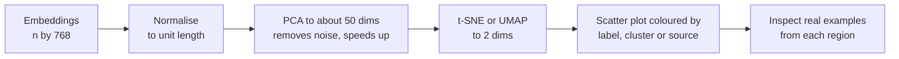

A sentence embedding might have 768 or more dimensions. An image has thousands of pixel values. Customer records carry hundreds of engineered features. You cannot look at any of these directly, many algorithms slow down or degrade as dimensions grow, and much of the dimensionality is redundant anyway. **Dimensionality reduction** maps data into fewer dimensions while keeping the structure you care about. The previous lesson covered [PCA](/learn/unsupervised-learning/principal-component-analysis-pca), the standard linear method. This lesson puts it alongside the non-linear methods, t-SNE and UMAP, explains what each one preserves and distorts, and shows how to visualise embeddings without fooling yourself.

## Why fewer dimensions help

Three practical reasons:

1. **Visualisation.** People can only look at two or three dimensions at once.
2. **Efficiency.** Storage, distance computations and model training all scale with the number of dimensions.
3. **Better learning.** Redundant and noisy features add variance; removing them can improve generalisation.

There is also a less obvious reason, called the **curse of dimensionality**. In high dimensions, distances between random points become nearly equal, so "nearest" neighbours are hardly nearer than anything else:

```python
import numpy as np

rng = np.random.default_rng(0)
for d in [2, 10, 100, 1000]:
    X = rng.uniform(size=(500, d))
    dist = np.linalg.norm(X[1:] - X[0], axis=1)
    print(f"d={d:4d}  nearest/farthest = {dist.min() / dist.max():.3f}")
```

```output
d=   2  nearest/farthest = 0.015
d=  10  nearest/farthest = 0.302
d= 100  nearest/farthest = 0.734
d=1000  nearest/farthest = 0.903
```

In two dimensions the nearest point is about 70 times closer than the farthest. In 1,000 uniformly random dimensions it is only about 10% closer. Distance-based methods such as k-NN, k-means and DBSCAN lose their grip when that happens. Real data is not uniform noise, which is why these methods still work on embeddings, but reducing dimensions first often makes them work better.

## Selection versus extraction

| Approach | What it does | Examples | Keeps original meaning? |
| --- | --- | --- | --- |
| Feature selection | Keeps a subset of the original columns | Variance threshold, mutual information, L1 regularisation | Yes |
| Linear extraction | Builds new features as linear combinations | PCA, Truncated SVD, random projection | Partly, via loadings |
| Non-linear extraction | Learns a curved mapping to few dimensions | t-SNE, UMAP, autoencoders | No |

[Feature selection](/learn/machine-learning-fundamentals/feature-selection) was covered earlier. This lesson is about extraction, which is unsupervised: it uses only $X$.

Two linear relatives of PCA are worth knowing. **Truncated SVD** (`sklearn.decomposition.TruncatedSVD`) works directly on sparse matrices such as TF-IDF text features, where centring would destroy sparsity; applied to text it is known as latent semantic analysis. **Random projection** (`sklearn.random_projection.GaussianRandomProjection`) multiplies data by a random matrix; it is very cheap and approximately preserves pairwise distances when the target dimension is large enough.

## Linear methods cannot unroll curves

PCA finds a flat subspace. If your data lies on a curved surface, such as a rolled-up sheet, the best flat projection squashes distant parts of the sheet on top of each other. Non-linear methods instead try to preserve **neighbourhoods**: points close together in the original space should stay close in the low-dimensional map. They give up on preserving large distances in exchange.

## t-SNE

**t-distributed Stochastic Neighbour Embedding** turns distances into probabilities and then arranges points in 2-D so the probabilities match.

In the original space, the similarity of point $j$ to point $i$ is a Gaussian kernel, normalised over all $k \ne i$:

$$
p_{j \mid i} = \frac{\exp\!\left(-\lVert \mathbf{x}_i - \mathbf{x}_j \rVert^2 / 2\sigma_i^2\right)}{\sum_{k \ne i} \exp\!\left(-\lVert \mathbf{x}_i - \mathbf{x}_k \rVert^2 / 2\sigma_i^2\right)}
$$

and these are symmetrised into $p_{ij} = (p_{j \mid i} + p_{i \mid j}) / 2n$, where $n$ is the number of points. Each bandwidth $\sigma_i$ is chosen so that point $i$ has a fixed effective number of neighbours, set by the **perplexity** hyperparameter. In the 2-D map, with positions $\mathbf{y}_i$, similarities use a heavy-tailed Student-t kernel:

$$
q_{ij} = \frac{\left(1 + \lVert \mathbf{y}_i - \mathbf{y}_j \rVert^2\right)^{-1}}{\sum_{k \ne l} \left(1 + \lVert \mathbf{y}_k - \mathbf{y}_l \rVert^2\right)^{-1}}
$$

t-SNE then moves the $\mathbf{y}_i$ by gradient descent to minimise the [KL divergence](/learn/essential-mathematics-for-machine-learning/kl-divergence) $\sum_{i \ne j} p_{ij} \log (p_{ij} / q_{ij})$. Because KL heavily penalises placing true neighbours far apart, local structure is preserved well. The heavy tails of the Student-t kernel let moderately distant points sit far apart in the map, which produces the well-separated islands t-SNE plots are known for.

## PCA and t-SNE on handwritten digits

The digits dataset has 1,797 images of size 8 by 8, so 64 dimensions. Reduce it to 2-D both ways, then measure two things: **trustworthiness** (scikit-learn's `trustworthiness`, between 0 and 1, penalising points that appear as neighbours in the map but were not neighbours originally) and how well a 5-nearest-neighbour classifier can recover the digit labels from the 2-D coordinates alone.

```python
from sklearn.datasets import load_digits
from sklearn.decomposition import PCA
from sklearn.manifold import TSNE, trustworthiness
from sklearn.neighbors import KNeighborsClassifier
from sklearn.model_selection import cross_val_score

X, y = load_digits(return_X_y=True)
print("data:", X.shape)

emb_pca = PCA(n_components=2, random_state=0).fit_transform(X)
emb_tsne = TSNE(n_components=2, perplexity=30, init="pca", random_state=0).fit_transform(X)

for name, emb in [("PCA", emb_pca), ("t-SNE", emb_tsne)]:
    trust = trustworthiness(X, emb, n_neighbors=10)
    knn = cross_val_score(KNeighborsClassifier(n_neighbors=5), emb, y, cv=5).mean()
    print(f"{name:6s} trustworthiness={trust:.3f}  5-NN accuracy in 2-D={knn:.3f}")
```

```output
data: (1797, 64)
PCA    trustworthiness=0.830  5-NN accuracy in 2-D=0.603
t-SNE  trustworthiness=0.993  5-NN accuracy in 2-D=0.976
```

Two linear directions can only separate some of the ten digits; the rest overlap. t-SNE's map keeps almost every point's neighbourhood intact, and the ten digits form distinct islands. t-SNE is stochastic: these numbers come from the fixed `random_state` with the library versions used here, and other seeds give a different-looking map with similar quality.

Perplexity controls the scale of structure t-SNE attends to:

```python
for perplexity in [5, 30, 100]:
    emb = TSNE(perplexity=perplexity, init="pca", random_state=0).fit_transform(X)
    t10 = trustworthiness(X, emb, n_neighbors=10)
    t100 = trustworthiness(X, emb, n_neighbors=100)
    print(f"perplexity={perplexity:3d}  trust@10={t10:.3f}  trust@100={t100:.3f}")
```

```output
perplexity=  5  trust@10=0.991  trust@100=0.932
perplexity= 30  trust@10=0.993  trust@100=0.963
perplexity=100  trust@10=0.990  trust@100=0.968
```

All three preserve the 10 nearest neighbours well, but low perplexity does worse on larger neighbourhoods: it focuses on very local structure. Values between 5 and 50 are typical; perplexity must be smaller than the number of points.

## UMAP

**UMAP** (Uniform Manifold Approximation and Projection) is a newer non-linear method that has largely become the default for visualising large embedding sets. It builds a weighted k-nearest-neighbour graph in the original space, then optimises a low-dimensional layout whose own neighbour graph matches it, using a cross-entropy objective. Compared with t-SNE it is usually faster on large datasets, tends to keep more of the global arrangement of clusters, and can `transform` new points after fitting, which t-SNE in scikit-learn cannot.

UMAP is not part of scikit-learn. It lives in the separate `umap-learn` package, which is not installed in this course's environment, so here is the usage without output:

```python
import umap  # pip install umap-learn

reducer = umap.UMAP(n_neighbors=15, min_dist=0.1, n_components=2, random_state=0)
emb_umap = reducer.fit_transform(X)
```

`n_neighbors` plays the role of perplexity (small values emphasise local detail, large values global shape), and `min_dist` controls how tightly points may pack together in the map.

## Choosing a method

| | PCA | t-SNE | UMAP |
| --- | --- | --- | --- |
| Type | Linear | Non-linear | Non-linear |
| Preserves | Global variance, large distances | Local neighbourhoods | Local neighbourhoods, some global layout |
| Deterministic | Yes (up to sign) | No | No |
| Transform new points | Yes | No (in scikit-learn) | Yes |
| Speed on large data | Very fast | Slow | Faster than t-SNE |
| Good for | Preprocessing, compression, denoising | Visualisation | Visualisation, sometimes preprocessing for clustering |
| Key hyperparameters | `n_components` | `perplexity` | `n_neighbors`, `min_dist` |

> [!KEY]
> Use PCA when the reduced data feeds another algorithm or must be reproducible. Use t-SNE or UMAP to look at data. Do not feed t-SNE output into a model.

## Visualising embeddings

A common AI task is looking at the embeddings of your documents, user queries or images to check whether they form sensible groups. A reliable workflow:



```python
import matplotlib.pyplot as plt

reduced = PCA(n_components=50, random_state=0).fit_transform(X)
emb = TSNE(perplexity=30, init="pca", random_state=0).fit_transform(reduced)

plt.scatter(emb[:, 0], emb[:, 1], c=y, cmap="tab10", s=5)
plt.colorbar(label="digit")
plt.title("t-SNE of digits")
plt.show()
```

Colouring by a known attribute is where most insight comes from: colour by topic label to see whether the embedding model separates topics, by data source to spot batch effects, or by retrieval success to see whether failed queries cluster in one region.

> [!WARNING]
> Read t-SNE and UMAP plots with care. **Cluster sizes** mean nothing: t-SNE expands dense clusters and contracts sparse ones. **Distances between clusters** are not reliable: two islands far apart may be close in the original space. **Apparent clusters** can appear in pure noise at low perplexity. Confirm any pattern with a second seed, a second perplexity and real examples before you act on it.

## Exercises

**1.** Repeat the curse-of-dimensionality experiment, but with 500 points from a standard normal distribution instead of a uniform one. Does the ratio still approach 1 as $d$ grows?

<details>
<summary>Show solution</summary>

```python
rng = np.random.default_rng(0)
for d in [2, 10, 100, 1000]:
    X_d = rng.normal(size=(500, d))
    dist = np.linalg.norm(X_d[1:] - X_d[0], axis=1)
    print(f"d={d:4d}  nearest/farthest = {dist.min() / dist.max():.3f}")
```

```output
d=   2  nearest/farthest = 0.030
d=  10  nearest/farthest = 0.270
d= 100  nearest/farthest = 0.698
d=1000  nearest/farthest = 0.907
```

Yes. The exact values differ, but the ratio climbs towards 1 as $d$ grows. Distance concentration is a property of high-dimensional spaces with independent noise in every coordinate, not of one distribution.

</details>

**2.** A colleague shows a UMAP plot where cluster A looks three times the size of cluster B and concludes that A contains three times as many documents. What would you check?

<details>
<summary>Show solution</summary>

Count the points in each cluster directly. Visual area in a t-SNE or UMAP plot reflects how the method spaced points out, not how many there are or how spread out they were originally. Also check whether the clusters are stable across seeds and `n_neighbors` values.

</details>

**3.** You need to reduce 200,000 TF-IDF vectors with 50,000 sparse columns to 100 dimensions before clustering. Which scikit-learn class should you use, and why not `PCA`?

<details>
<summary>Show solution</summary>

`TruncatedSVD(n_components=100)`. PCA centres the data by subtracting column means, which turns a sparse matrix into a dense one with 10 billion entries. Truncated SVD works on the uncentred sparse matrix directly and is the standard choice for text features.

</details>

```quiz
[
  {
    "q": "What does t-SNE primarily try to preserve?",
    "options": [
      "Global distances between all pairs of points",
      "The variance of each original feature",
      "Local neighbourhoods: which points are near each other",
      "The number of clusters"
    ],
    "answer": 2,
    "why": "t-SNE matches neighbour probabilities, with a KL divergence objective that strongly penalises separating true neighbours."
  },
  {
    "q": "Which method would you use to reduce features before training a classifier that must also process new data at prediction time?",
    "options": [
      "PCA",
      "t-SNE",
      "Either, they are interchangeable",
      "Neither, dimensionality reduction cannot be used before a classifier"
    ],
    "answer": 0,
    "why": "PCA is deterministic and has a `transform` method for new points. scikit-learn's t-SNE has no `transform` and is meant for visualisation."
  },
  {
    "q": "In a t-SNE plot, two clusters are far apart. What can you conclude?",
    "options": [
      "They are the most dissimilar pair of groups in the data",
      "They are separate groups, but their distance in the plot is not a reliable measure of how different they are",
      "The perplexity was set too high",
      "They have the same number of points"
    ],
    "answer": 1,
    "why": "t-SNE preserves local structure; distances between clusters and cluster sizes are distorted."
  },
  {
    "q": "What is the curse of dimensionality, as it affects nearest-neighbour methods?",
    "options": [
      "High-dimensional data cannot be stored in memory",
      "Models always overfit when there are more than 100 features",
      "Distances become similar, so the nearest neighbour is barely nearer than the farthest point",
      "Eigenvalues become negative"
    ],
    "answer": 2,
    "why": "As dimensions grow, the ratio of nearest to farthest distance approaches 1, which weakens distance-based reasoning."
  }
]
```
