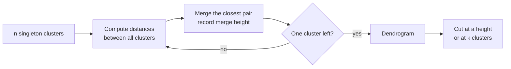
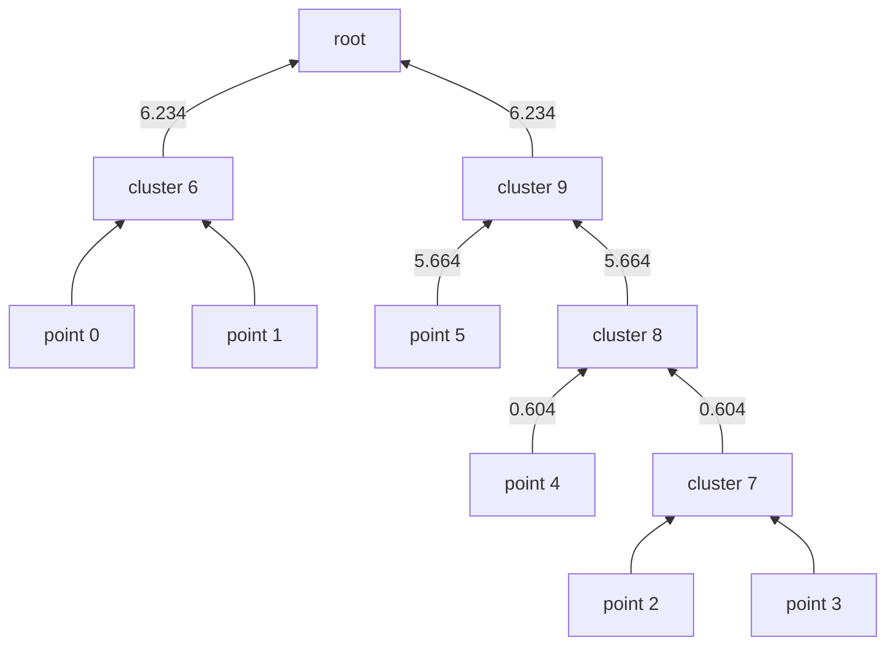

K-means forces you to pick the number of clusters before you start, and it hands back a single flat partition. Real groupings are often nested: support tickets split into "billing" and "technical", and "technical" splits again into "login", "API errors" and "mobile app". **Hierarchical clustering** builds that whole tree of groupings at once, and lets you decide afterwards where to cut it. For an AI engineer it is the natural tool for building topic taxonomies from embeddings, for small and medium datasets where you want to see structure at every scale, and for cases where you have no idea what $k$ should be.

## Agglomerative clustering: the bottom-up idea

The common form is **agglomerative** (bottom-up) clustering:

1. Start with every point as its own cluster: $n$ clusters.
2. Find the two clusters that are closest to each other.
3. Merge them into one cluster, and record the distance at which they merged.
4. Repeat until a single cluster contains everything.

After $n - 1$ merges you have a complete history of which groups joined and how far apart they were. That history, drawn as a tree, is a **dendrogram**. The opposite, **divisive** (top-down) clustering, starts with one cluster and splits recursively; it is less common in practice and scikit-learn does not provide it, so this lesson focuses on agglomerative clustering.



## Linkage: what "closest clusters" means

Distance between two points is clear. Distance between two *groups* of points is a choice, called the **linkage**. For clusters $A$ and $B$, with $d(a, b)$ the distance between points:

| Linkage | Cluster distance | Behaviour |
| --- | --- | --- |
| Single | $\min_{a \in A, b \in B} d(a, b)$ | Follows chains of nearby points; finds elongated shapes but one bridge of points can join two groups |
| Complete | $\max_{a \in A, b \in B} d(a, b)$ | Compact clusters of similar diameter; sensitive to outliers |
| Average | $\frac{1}{\lvert A \rvert \lvert B \rvert} \sum_{a \in A} \sum_{b \in B} d(a, b)$ | A compromise between single and complete |
| Ward | Increase in total within-cluster sum of squares caused by merging $A$ and $B$ | Compact, similar-sized clusters; the closest relative of k-means; Euclidean distance only |

Ward's criterion merges the pair that increases the k-means objective (inertia) the least. That is why Ward and k-means often agree on blob-shaped data, and why Ward is scikit-learn's default.

## A worked example with SciPy

SciPy's `linkage` function returns the full merge history as a matrix. Take six points: two near $(1, 1)$, three near $(5, 5)$ and one isolated at $(9, 1)$.

```python
import numpy as np
from scipy.cluster.hierarchy import linkage, fcluster

X = np.array([[1.0, 1.0], [1.5, 1.0], [5.0, 5.0], [5.0, 5.5], [5.5, 5.0], [9.0, 1.0]])
Z = linkage(X, method="average")
np.set_printoptions(suppress=True)
print(Z.round(3))
```

```output
[[0.    1.    0.5   2.   ]
 [2.    3.    0.5   2.   ]
 [4.    7.    0.604 3.   ]
 [5.    8.    5.664 4.   ]
 [6.    9.    6.234 6.   ]]
```

Each row is one merge: the two cluster IDs joined, the linkage distance at which they joined, and the size of the new cluster. Original points have IDs 0 to 5; each merge creates a new ID starting at $n = 6$. Reading the rows:

- Row 0: points 0 and 1 merge at distance 0.5, forming cluster 6.
- Row 1: points 2 and 3 merge at 0.5, forming cluster 7.
- Row 2: point 4 joins cluster 7 at 0.604 (the average of its distances 0.5 and 0.707 to points 2 and 3), forming cluster 8.
- Row 3: the isolated point 5 joins cluster 8 at 5.664, forming cluster 9.
- Row 4: clusters 6 and 9 merge at 6.234. Everything is now one cluster.

The same history as a tree, with merge heights on the edges:



In a plotted dendrogram (`scipy.cluster.hierarchy.dendrogram(Z)` with Matplotlib), each merge is a horizontal bar drawn at its height, so long vertical stretches show groups that stay separate over a wide range of distances.

## Cutting the dendrogram

To get flat cluster labels, you cut the tree. `fcluster` supports both ways of cutting:

```python
print(fcluster(Z, t=3, criterion="maxclust"))    # ask for at most 3 clusters
print(fcluster(Z, t=2.0, criterion="distance"))  # cut at height 2.0
print(fcluster(Z, t=6.0, criterion="distance"))  # cut at height 6.0
```

```output
[1 1 2 2 2 3]
[1 1 2 2 2 3]
[1 1 2 2 2 2]
```

Cutting at height 2.0 keeps every merge below 2.0 and undoes everything above it, leaving three clusters, with the isolated point on its own. Cutting at 6.0 lets the isolated point join the group of three at 5.664, leaving two.

The usual heuristic is to cut where there is a **large gap** between consecutive merge heights: a big jump means two well-separated groups were forced together. Here the jump from 0.604 to 5.664 is enormous, so any cut between them (three clusters) is well supported. Whether the lone point at $(9, 1)$ deserves its own cluster or is an outlier is a judgement the tree cannot make for you.

## Agglomerative clustering in scikit-learn

`AgglomerativeClustering` takes either `n_clusters` or a `distance_threshold` (with `n_clusters=None`). Setting the threshold to 0 builds the full tree and exposes the merge heights in `distances_`:

```python
import numpy as np
from sklearn.datasets import make_blobs
from sklearn.cluster import AgglomerativeClustering

X, _ = make_blobs(n_samples=300, centers=3, cluster_std=[1.0, 2.5, 0.5], random_state=170)

model = AgglomerativeClustering(n_clusters=None, distance_threshold=0, linkage="ward")
model.fit(X)
heights = np.sort(model.distances_)[::-1]
print("largest merge heights:", heights[:6].round(1))
print("gaps between them:   ", (-np.diff(heights[:6])).round(1))

for t in [40, 15, 8]:
    m = AgglomerativeClustering(n_clusters=None, distance_threshold=t, linkage="ward").fit(X)
    print(f"cut at {t:>2}: {m.n_clusters_} clusters")
```

```output
largest merge heights: [114.5  63.   27.   23.9  16.4  14.2]
gaps between them:    [51.5 36.   3.1  7.5  2.2]
cut at 40: 3 clusters
cut at 15: 6 clusters
cut at  8: 13 clusters
```

The two largest gaps are at the top of the tree: cutting between 63 and 114.5 gives two clusters, and cutting between 27 and 63 gives three, the true number here. Below 27 the heights decline smoothly with no clear gap. The gap heuristic narrows the choice to two or three; your knowledge of the problem decides between them.

### Which linkage should you use?

Linkage matters as much as the cut. Here is each linkage on two datasets with known labels: blobs of different spreads, and two interleaving half-moons. Scores are the adjusted Rand index (1 is perfect agreement with the truth, 0 is chance).

```python
from sklearn.datasets import make_moons
from sklearn.metrics import adjusted_rand_score

blobs, yb = make_blobs(n_samples=300, centers=3, cluster_std=[1.0, 2.5, 0.5], random_state=170)
moons, ym = make_moons(n_samples=300, noise=0.05, random_state=0)

print("linkage   blobs  moons")
for method in ["ward", "complete", "average", "single"]:
    scores = []
    for X, y in [(blobs, yb), (moons, ym)]:
        labels = AgglomerativeClustering(n_clusters=len(set(y)), linkage=method).fit_predict(X)
        scores.append(adjusted_rand_score(y, labels))
    print(f"{method:9s} {scores[0]:5.2f}  {scores[1]:5.2f}")
```

```output
linkage   blobs  moons
ward       0.81   0.24
complete   0.62   0.30
average    0.69   0.43
single     0.00   1.00
```

No linkage wins everywhere. Single linkage traces the curved moons perfectly but scores 0.00 on the blobs: the chaining effect joins 296 of the 300 points into one cluster and leaves two tiny groups of stragglers (3 points and 1 point) as the other "clusters". Ward is best on the blobs but, like k-means, cannot follow curves.

> [!TIP]
> Start with Ward on standardised numeric features. For text or other embeddings, use average linkage with `metric="cosine"`, because Ward is defined only for Euclidean distance.

## Practical limits and pitfalls

- **Cost.** The standard algorithm needs the pairwise distances between all points, so memory grows with $n^2$. Tens of thousands of points are workable; millions are not. A common pattern is to run k-means with a few hundred clusters first, then build a hierarchy over the centroids.
- **Merges are final.** A merge made early on, perhaps because of noise, is never undone, so errors propagate up the tree.
- **Scaling.** As with k-means, distance-based linkage is dominated by large-valued features. Standardise first.
- **Outliers.** Under single and average linkage, outliers tend to stay as singletons until the very top of the tree, which can be useful for spotting them. Under complete linkage they inflate cluster diameters.

## Hierarchies in AI work

The most common AI use is a **topic taxonomy**. Embed a few thousand documents, run average-linkage clustering with cosine distance, and cut at several heights: a high cut gives broad themes, a low cut gives fine-grained topics, and the tree shows which subtopics belong to which theme. Labelling each node by sampling a few member texts, or asking a language model to name the group, turns the tree into a browsable map of a corpus. The same structure is used to organise product catalogues and to group near-duplicate prompts in evaluation datasets.

> [!KEY]
> A dendrogram is one model with every value of $k$ inside it. Build it once, then choose the granularity that fits the decision you need to make.

## Exercises

**1.** For the six-point example, which cut height would leave four clusters? Check with `fcluster`.

<details>
<summary>Show solution</summary>

The merges happen at 0.5, 0.5, 0.604, 5.664 and 6.234. Four clusters exist after the first two merges and before the third, so any height from 0.5 up to just below 0.604 works, for example 0.55:

```python
print(fcluster(Z, t=0.55, criterion="distance"))
```

```output
[1 1 2 2 3 4]
```

Point 4 has not yet joined points 2 and 3, and point 5 is alone.

</details>

**2.** Print the merge heights (column 2 of `Z`) of the six-point example for single, average and complete linkage. Explain the third and last heights for single and complete.

<details>
<summary>Show solution</summary>

```python
X = np.array([[1.0, 1.0], [1.5, 1.0], [5.0, 5.0], [5.0, 5.5], [5.5, 5.0], [9.0, 1.0]])
for method in ["single", "average", "complete"]:
    print(f"{method:8s}", linkage(X, method=method)[:, 2].round(3))
```

```output
single   [0.5   0.5   0.5   5.315 5.315]
average  [0.5   0.5   0.604 5.664 6.234]
complete [0.5   0.5   0.707 6.021 8.   ]
```

Third merge: point $(5.5, 5)$ joins the pair $(5, 5)$, $(5, 5.5)$. Single linkage uses its nearest member (0.5); complete uses its farthest ($\sqrt{0.5^2 + 0.5^2} \approx 0.707$). Last merge: single linkage only needs the closest pair across the two groups, so the final heights stay low and even tie at 5.315. Complete linkage measures the farthest pair, $(1, 1)$ to $(9, 1)$, which is exactly 8. Single linkage trees are flat at the top; complete linkage trees are tall.

</details>

**3.** You have 2,000 support tickets embedded as 768-dimensional vectors. Write the scikit-learn call to build a hierarchy suitable for text embeddings and cut it into 20 groups.

<details>
<summary>Show solution</summary>

```python
from sklearn.cluster import AgglomerativeClustering

model = AgglomerativeClustering(n_clusters=20, metric="cosine", linkage="average")
labels = model.fit_predict(embeddings)
```

Ward would raise an error with `metric="cosine"`. Average linkage with cosine distance matches how embedding similarity is normally measured.

</details>

```quiz
[
  {
    "q": "In agglomerative clustering, what happens at each step?",
    "options": [
      "The largest cluster is split in two",
      "The two closest clusters are merged",
      "Each point moves to its nearest centroid",
      "Points with too few neighbours are marked as noise"
    ],
    "answer": 1,
    "why": "Agglomerative clustering is bottom-up: start with singletons and repeatedly merge the closest pair under the chosen linkage."
  },
  {
    "q": "Which linkage is most prone to chaining, where a thin bridge of points joins two separate groups?",
    "options": [
      "Ward",
      "Complete",
      "Average",
      "Single"
    ],
    "answer": 3,
    "why": "Single linkage uses the minimum pairwise distance, so one close pair of points is enough to merge two clusters."
  },
  {
    "q": "A dendrogram's merge heights, from the top, are 40.1, 38.7, 12.3, 11.8, 11.2. Where is the most natural cut?",
    "options": [
      "Between 38.7 and 12.3, giving three clusters",
      "Between 40.1 and 38.7, giving two clusters",
      "Below 11.2",
      "It is impossible to say without k-means"
    ],
    "answer": 0,
    "why": "The large gap between 38.7 and 12.3 means two well-separated groups were forced together at 38.7. Cutting in that gap leaves three clusters."
  },
  {
    "q": "Why can't you use `linkage=\"ward\"` with cosine distance in scikit-learn?",
    "options": [
      "Ward is too slow for cosine distance",
      "Ward is defined in terms of squared Euclidean distances and within-cluster variance",
      "Cosine distance cannot be computed between clusters",
      "Ward only works for one-dimensional data"
    ],
    "answer": 1,
    "why": "Ward merges the pair that least increases the within-cluster sum of squares, which is a Euclidean quantity."
  }
]
```
