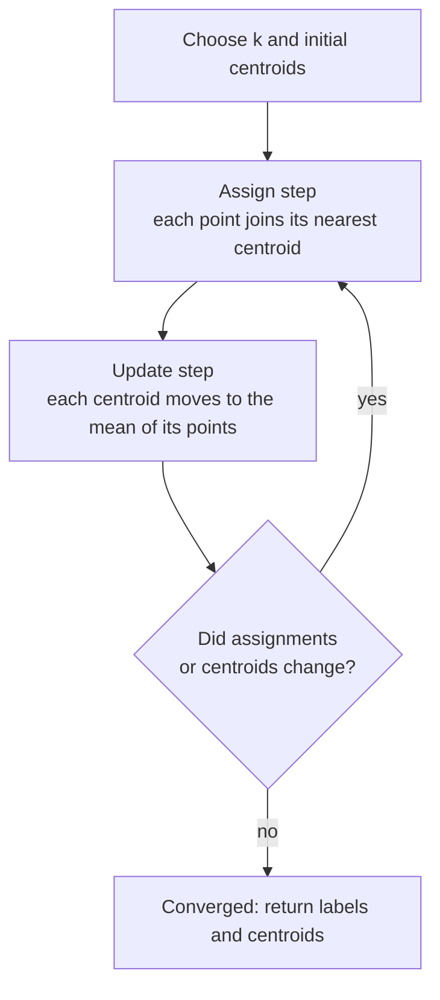

Every model in the previous module learned from labels: a price, a class, a yes or no. Most real data has no labels at all. You have a table of customers, a million support tickets, or a store of document embeddings, and the question is simply "what groups are in here?" **K-means** is the oldest and still the most widely used answer. It is fast, easy to explain to a non-specialist, and it sits inside more AI systems than you might expect, from customer segmentation to the indexes that make vector search fast.

## The intuition

Imagine dropping $k$ pins on a scatter plot and telling each data point to belong to its nearest pin. Then move every pin to the middle of the points that chose it. Points may now be closer to a different pin, so they switch. Repeat until nothing changes. That is the whole algorithm.

Each pin is a **centroid**: the mean of the points in its cluster. The result is $k$ groups where every point is closer to its own centroid than to any other, which carves the space into convex regions, like tiles.

## The objective: inertia

K-means minimises the total squared distance from each point to the centroid of its cluster. This quantity is called **inertia** or the within-cluster sum of squares (WCSS):

$$
J = \sum_{j=1}^{k} \sum_{\mathbf{x}_i \in S_j} \lVert \mathbf{x}_i - \boldsymbol{\mu}_j \rVert^2
$$

Here $S_j$ is the set of points assigned to cluster $j$, $\boldsymbol{\mu}_j$ is the centroid (mean) of that cluster, and $\lVert \cdot \rVert$ is the Euclidean distance you met in [norms and distances](/learn/linear-algebra/norms-and-distances). Lower $J$ means tighter clusters.

Finding the global minimum of $J$ is computationally hard, so k-means uses a greedy procedure that alternates between two easy sub-problems.

## Lloyd's algorithm, step by step



Both steps can only lower $J$ or leave it unchanged. The assign step picks the closest centroid for every point, which cannot increase any squared distance. The update step uses the mean, and the mean is exactly the point that minimises the sum of squared distances to a set. Because $J$ never increases and there are finitely many ways to assign points, the algorithm always stops. It stops at a **local** minimum, though, which is why initialisation matters.

Step through it on six 2-D points with $k = 2$. The starting centroids are deliberately poor: two points from the same corner.

```trace
{
  "title": "k-means on six points, k = 2",
  "code": [
    "X = [[1, 1], [2, 1], [1, 2], [6, 5], [7, 6], [2, 5]]",
    "C = [[1, 1], [2, 1]]                 # initial centroids",
    "for step in range(3):",
    "    labels = nearest_centroid(X, C)  # assign step",
    "    inertia = sum_sq_dist(X, C, labels)",
    "    C = cluster_means(X, labels)     # update step",
    "    print(step, labels, inertia)"
  ],
  "steps": [
    { "line": 2, "vars": { "C": "[[1, 1], [2, 1]]" }, "note": "Both starting centroids sit in the bottom-left corner, where three of the points live." },
    { "line": 4, "vars": { "step": "0", "C": "[[1, 1], [2, 1]]", "labels": "[0, 1, 0, 1, 1, 1]" }, "note": "(2, 1) is closest to centroid 1. So are the three far points: (6, 5) has squared distance 41 to centroid 0 and 32 to centroid 1, so it picks 1." },
    { "line": 5, "vars": { "step": "0", "labels": "[0, 1, 0, 1, 1, 1]", "inertia": "99.0" }, "note": "Squared distances 0 + 0 + 1 + 32 + 50 + 16 = 99. A poor clustering." },
    { "line": 7, "vars": { "step": "0", "C": "[[1.0, 1.5], [4.25, 4.25]]" }, "out": ["0 [0, 1, 0, 1, 1, 1] 99.0"], "note": "After the update step, centroid 0 moves to the mean of (1, 1) and (1, 2). Centroid 1 moves to the mean of its four points, landing between the two groups." },
    { "line": 4, "vars": { "step": "1", "C": "[[1.0, 1.5], [4.25, 4.25]]", "labels": "[0, 0, 0, 1, 1, 1]" }, "note": "(2, 1) is now much closer to centroid 0 (squared distance 1.25 against 15.6), so it switches." },
    { "line": 5, "vars": { "step": "1", "labels": "[0, 0, 0, 1, 1, 1]", "inertia": "21.625" }, "out": ["0 [0, 1, 0, 1, 1, 1] 99.0"], "note": "Inertia falls from 99 to 21.625." },
    { "line": 7, "vars": { "step": "1", "C": "[[1.333, 1.333], [5.0, 5.333]]" }, "out": ["0 [0, 1, 0, 1, 1, 1] 99.0", "1 [0, 0, 0, 1, 1, 1] 21.625"], "note": "Each centroid moves to the mean of three points." },
    { "line": 4, "vars": { "step": "2", "C": "[[1.333, 1.333], [5.0, 5.333]]", "labels": "[0, 0, 0, 1, 1, 1]" }, "note": "No point changes cluster. Note that (2, 5) joins the top-right group: it is 9.1 from that centroid in squared distance and 13.9 from the other." },
    { "line": 7, "vars": { "step": "2", "inertia": "16.0", "C": "[[1.333, 1.333], [5.0, 5.333]]" }, "out": ["0 [0, 1, 0, 1, 1, 1] 99.0", "1 [0, 0, 0, 1, 1, 1] 21.625", "2 [0, 0, 0, 1, 1, 1] 16.0"], "note": "The centroids no longer move, so the algorithm has converged with inertia 16.0." }
  ]
}
```

## K-means in scikit-learn

scikit-learn's `KMeans` follows the same `fit` / `predict` interface you used for supervised models, except `fit` takes no `y`.

```python
from sklearn.datasets import make_blobs
from sklearn.cluster import KMeans

X, y_true = make_blobs(n_samples=600, centers=4, cluster_std=1.0, random_state=42)

km = KMeans(n_clusters=4, n_init=10, random_state=0)
labels = km.fit_predict(X)
print("inertia:", round(km.inertia_, 1))
print("iterations:", km.n_iter_)
print("centroids:\n", km.cluster_centers_.round(2))
print("first 10 labels:", labels[:10])
```

```output
inertia: 1160.3
iterations: 2
centroids:
 [[-6.85 -6.76]
 [-2.53  9.04]
 [-8.64  7.34]
 [ 4.67  1.93]]
first 10 labels: [0 0 0 0 3 3 0 1 0 0]
```

Two settings protect you from bad local minima:

- **k-means++ initialisation** (the default `init="k-means++"`) picks the first centroid at random and each later one with probability proportional to its squared distance from the centroids already chosen, so the starting pins are spread out.
- **`n_init`** runs the whole algorithm several times from different starts and keeps the run with the lowest inertia.

Cluster numbers are arbitrary names; a re-run with another seed may swap them.

## Choosing k: elbow and silhouette

K-means needs $k$ up front, and inertia alone cannot choose it: adding clusters always lowers inertia, reaching zero when every point is its own cluster. Two standard diagnostics help.

The **elbow method** plots inertia against $k$ and looks for the point where adding a cluster stops buying much. The **silhouette score** measures, for each point $i$, how much closer it is to its own cluster than to the next nearest one:

$$
s(i) = \frac{b(i) - a(i)}{\max\{a(i),\, b(i)\}}
$$

where $a(i)$ is the mean distance from $i$ to the other points in its cluster and $b(i)$ is the mean distance from $i$ to the points of the nearest other cluster. $s(i)$ ranges from $-1$ (probably in the wrong cluster) to $1$ (well separated). The silhouette score is the mean over all points.

```python
from sklearn.metrics import silhouette_score

print(" k   inertia  silhouette")
for k in range(2, 8):
    km = KMeans(n_clusters=k, n_init=10, random_state=0).fit(X)
    sil = silhouette_score(X, km.labels_)
    print(f"{k:2d} {km.inertia_:9.1f} {sil:11.3f}")
```

```output
 k   inertia  silhouette
 2   18637.9       0.591
 3    4178.9       0.757
 4    1160.3       0.788
 5    1045.8       0.691
 6     938.4       0.559
 7     844.2       0.427
```

Inertia drops steeply up to $k = 4$ and then flattens: that is the elbow. The silhouette score peaks at $k = 4$ too. On real data the two rarely agree this neatly, and the best answer often comes from the use case: a marketing team may want five segments it can act on even if four is statistically tidier.

> [!WARNING]
> Silhouette scoring computes all pairwise distances, so it is quadratic in the number of points. On large datasets, pass `sample_size=` to `silhouette_score` to evaluate a random subset.

## Scale your features first

K-means uses Euclidean distance, so a feature measured in large units dominates every distance. Here three customer segments differ mainly in age and visit frequency, but annual spend, measured in hundreds or thousands, swamps them:

```python
import numpy as np
import pandas as pd
from sklearn.preprocessing import StandardScaler
from sklearn.pipeline import make_pipeline
from sklearn.metrics import adjusted_rand_score

rng = np.random.default_rng(7)
segments = [(25, 900, 12), (45, 2600, 3), (65, 1500, 6)]   # age, annual spend, visits per month
rows, truth = [], []
for s, (age, spend, visits) in enumerate(segments):
    n = 200
    rows.append(np.column_stack([rng.normal(age, 4, n), rng.normal(spend, 700, n),
                                 rng.normal(visits, 1.5, n)]))
    truth += [s] * n
X = pd.DataFrame(np.vstack(rows), columns=["age", "annual_spend", "visits"])

raw = KMeans(n_clusters=3, n_init=10, random_state=0).fit_predict(X)
scaled = make_pipeline(StandardScaler(), KMeans(n_clusters=3, n_init=10, random_state=0)).fit_predict(X)
print("ARI without scaling:", round(adjusted_rand_score(truth, raw), 3))
print("ARI with scaling:   ", round(adjusted_rand_score(truth, scaled), 3))
print(X.assign(segment=scaled).groupby("segment").mean().round(1))
```

```output
ARI without scaling: 0.259
ARI with scaling:    0.909
          age  annual_spend  visits
segment                            
0        45.9        2701.1     3.0
1        24.5         844.3    11.7
2        64.9        1428.7     5.7
```

The **adjusted Rand index** (ARI) compares two labelings: 1 means identical groupings, 0 means no better than chance. You only have true labels here because the data is synthetic, but the lesson holds generally: standardise first, then cluster. The final table, cluster means in original units, is how you would describe the segments to a business audience.

## When k-means fails

| Situation | What goes wrong | Alternative |
| --- | --- | --- |
| Non-convex shapes (rings, moons) | Centroids cut shapes with straight boundaries | [DBSCAN](/learn/unsupervised-learning/dbscan), single-linkage clustering |
| Clusters of very different spread or size | Large, diffuse clusters get split; small ones get absorbed | Gaussian mixture models, HDBSCAN |
| Outliers | One extreme point drags a centroid away from its group | Remove outliers first, or use a density method |
| Bad initialisation | Converges to a poor local minimum | k-means++ and `n_init` greater than 1 |
| Millions of points | Each iteration touches every point | `MiniBatchKMeans` |

> [!KEY]
> K-means always returns exactly $k$ clusters, whether or not the data has any structure. Uniform random noise will be split into $k$ tidy regions. Clustering output is a hypothesis to check, not a discovery.

## K-means in AI systems

- **Customer segmentation.** Cluster behavioural features (recency, frequency, spend), then profile each cluster as above. Segments feed targeted campaigns or become features for a supervised churn model.
- **Topic discovery over embeddings.** Embed documents or support tickets with a text embedding model, normalise each vector to unit length, and run k-means. On unit vectors, squared Euclidean distance equals $2 - 2\cos\theta$, so k-means effectively groups by cosine similarity. Reading a handful of texts closest to each centroid tells you what the topic is.
- **Vector search indexes.** Inverted-file (IVF) indexes in libraries such as FAISS run k-means over the stored vectors and, at query time, search only the few clusters whose centroids are nearest the query, which is much faster than comparing against everything.
## Exercises

**1.** Without running code, perform one assign and one update step of k-means on the 1-D points `[1, 2, 3, 10, 11, 12]` with starting centroids `2` and `3`. What are the new centroids?

<details>
<summary>Show solution</summary>

Assign: 1 and 2 are closer to centroid 2; 3, 10, 11 and 12 are closer to centroid 3. Update: centroid A becomes $(1 + 2) / 2 = 1.5$; centroid B becomes $(3 + 10 + 11 + 12) / 4 = 9$. On the next assign step, 3 is closer to 1.5 than to 9 and switches, after which the centroids settle at 2 and 11.

</details>

**2.** Generate 500 points uniformly at random in a square with `np.random.default_rng(0).uniform(size=(500, 2))`, and compute silhouette scores for $k = 2$ to $6$. What do the scores tell you, and what do they fail to tell you?

<details>
<summary>Show solution</summary>

With this seed the scores range from about 0.36 to 0.41 across $k = 2$ to $6$: moderate for every $k$, with no clear winner. K-means happily partitions uniform noise into tidy regions. The scores do not tell you there is no cluster structure at all; for that you need to compare against a baseline, such as the scores you get on random data with the same range, or simply look at the data.

</details>

```quiz
[
  {
    "q": "What quantity does k-means minimise?",
    "options": [
      "The number of points per cluster",
      "The sum of squared distances from each point to its cluster centroid",
      "The distance between centroids",
      "The silhouette score"
    ],
    "answer": 1,
    "why": "This is inertia, the within-cluster sum of squares. Both the assign and update steps can only lower it."
  },
  {
    "q": "Why does scikit-learn's `KMeans` run several initialisations (`n_init`)?",
    "options": [
      "To estimate the best value of k",
      "Because each run uses a different distance metric",
      "Because the algorithm converges to a local minimum that depends on the starting centroids",
      "To make the labels consistent between runs"
    ],
    "answer": 2,
    "why": "Lloyd's algorithm only guarantees a local minimum. Several starts, keeping the lowest inertia, reduce the risk of a bad one."
  },
  {
    "q": "You cluster customers on `age` (20 to 80) and `income` (20,000 to 200,000) without scaling. What happens?",
    "options": [
      "The clusters are driven almost entirely by income",
      "The clusters are driven almost entirely by age",
      "Both features contribute equally",
      "k-means raises an error"
    ],
    "answer": 0,
    "why": "Euclidean distance is dominated by the feature with the largest numeric range. Standardise first."
  },
  {
    "q": "Inertia keeps falling as k rises from 2 to 10. What should you conclude?",
    "options": [
      "k = 10 is the best choice",
      "The data has at least 10 clusters",
      "Nothing on its own: inertia always falls as k grows, so look for an elbow or use silhouette",
      "The algorithm has not converged"
    ],
    "answer": 2,
    "why": "More centroids can only reduce distances to the nearest centroid, so inertia is monotone in k."
  }
]
```
