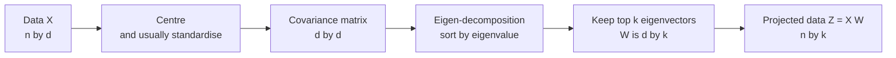

Real datasets have many columns, and many of those columns say nearly the same thing. A wine's phenol content and its flavanoid content move together; neighbouring pixels in an image are almost always similar; the hundreds of dimensions of a text embedding are far from independent. **Principal Component Analysis (PCA)** finds the few directions in which the data actually varies and re-expresses every point in terms of them. You use it to compress features before a model, to speed up clustering and nearest-neighbour search, to remove noise, and to get a first 2-D picture of high-dimensional data. It is also the cleanest example of linear algebra doing real work in machine learning: the whole method is an eigen-decomposition of the covariance matrix.

## The intuition

Picture a cloud of 2-D points stretched along a diagonal, like a cigar. Measured along the x and y axes, both coordinates vary a lot. But if you rotate the axes so the first one runs along the cigar, almost all the variation lies along that one new axis, and the second axis carries only a little sideways scatter. You could drop the second coordinate and lose very little.

PCA does exactly this rotation, in any number of dimensions:

1. The **first principal component** (PC1) is the direction along which the data has the greatest variance.
2. The **second** is the direction of greatest remaining variance that is perpendicular to the first.
3. And so on, each new component perpendicular to all previous ones.

Keeping the first few components gives you a lower-dimensional version of the data that preserves as much variance as any linear projection can.

## Deriving PCA from the covariance matrix

Let $X$ be the $n \times d$ data matrix, already **centred** so every column has mean zero. Its covariance matrix (see [correlation and covariance](/learn/probability-and-statistics/correlation-and-covariance)) is

$$
\Sigma = \frac{1}{n - 1} X^\top X
$$

a $d \times d$ symmetric matrix whose entry $\Sigma_{jk}$ is the covariance between features $j$ and $k$.

Project every point onto a unit vector $\mathbf{w}$ (so $\lVert \mathbf{w} \rVert = 1$). The projected values are $X\mathbf{w}$, and their variance is

$$
\operatorname{Var}(X\mathbf{w}) = \frac{1}{n - 1} (X\mathbf{w})^\top (X\mathbf{w}) = \mathbf{w}^\top \Sigma \, \mathbf{w}
$$

PCA chooses $\mathbf{w}$ to maximise this subject to $\mathbf{w}^\top \mathbf{w} = 1$. Using a Lagrange multiplier $\lambda$ for the constraint and setting the gradient of $\mathbf{w}^\top \Sigma \mathbf{w} - \lambda(\mathbf{w}^\top \mathbf{w} - 1)$ to zero gives

$$
\Sigma \mathbf{w} = \lambda \mathbf{w}
$$

That is the eigenvector equation from [eigenvalues and eigenvectors](/learn/linear-algebra/eigenvalues-and-eigenvectors). Multiplying both sides by $\mathbf{w}^\top$ shows the variance along an eigenvector equals its eigenvalue: $\mathbf{w}^\top \Sigma \mathbf{w} = \lambda$. So:

- The principal components are the **eigenvectors** of the covariance matrix.
- The variance captured by each component is its **eigenvalue**.
- Sorting eigenvalues from largest to smallest orders the components by importance.

Because $\Sigma$ is symmetric, its eigenvectors are orthogonal, which is why the components are perpendicular. The **explained variance ratio** of component $j$ is its share of the total:

$$
\text{EVR}_j = \frac{\lambda_j}{\sum_{i=1}^{d} \lambda_i}
$$



## PCA from scratch in NumPy

Build a correlated 2-D dataset and follow the diagram exactly:

```python
import numpy as np

rng = np.random.default_rng(0)
x = rng.normal(0, 2, 200)
X = np.column_stack([x, 0.5 * x + rng.normal(0, 0.5, 200)])

Xc = X - X.mean(axis=0)                  # 1. centre
C = Xc.T @ Xc / (len(X) - 1)             # 2. covariance matrix
eigvals, eigvecs = np.linalg.eigh(C)     # 3. eigen-decomposition (ascending order)
order = np.argsort(eigvals)[::-1]        # 4. sort largest first
eigvals, eigvecs = eigvals[order], eigvecs[:, order]

print("covariance:\n", C.round(3))
print("eigenvalues:", eigvals.round(3))
print("PC1 direction:", eigvecs[:, 0].round(3))
print("explained variance ratio:", (eigvals / eigvals.sum()).round(3))
Z = Xc @ eigvecs                          # 5. project
print("variance of projected columns:", Z.var(axis=0, ddof=1).round(3))
```

```output
covariance:
 [[3.714 1.793]
 [1.793 1.128]]
eigenvalues: [4.631 0.211]
PC1 direction: [-0.89  -0.456]
explained variance ratio: [0.956 0.044]
variance of projected columns: [4.631 0.211]
```

PC1 points along the cigar (roughly two units of x for every unit of y) and holds 95.6% of the variance. The variances of the projected columns equal the eigenvalues, exactly as the derivation predicted. `np.linalg.eigh` is the right function for symmetric matrices: it is faster and more stable than `eig`, and returns real values in ascending order.

## PCA in scikit-learn

```python
from sklearn.decomposition import PCA

pca = PCA(n_components=2).fit(X)
print("components:\n", pca.components_.round(3))
print("explained_variance_:", pca.explained_variance_.round(3))
print("explained_variance_ratio_:", pca.explained_variance_ratio_.round(3))
```

```output
components:
 [[ 0.89   0.456]
 [-0.456  0.89 ]]
explained_variance_: [4.631 0.211]
explained_variance_ratio_: [0.956 0.044]
```

The numbers match, except that PC1 has the opposite sign. An eigenvector multiplied by $-1$ is still an eigenvector with the same eigenvalue, so the sign of a component is arbitrary. Never attach meaning to it, and do not compare signs across different libraries or runs. Internally scikit-learn uses the singular value decomposition (SVD) of the centred data rather than forming the covariance matrix; the right singular vectors of $X$ are the eigenvectors of $X^\top X$, so the result is the same and the computation is more numerically stable.

| Attribute | Meaning |
| --- | --- |
| `components_` | The principal directions, one per row (shape `k` by `d`) |
| `explained_variance_` | The eigenvalues: variance along each component |
| `explained_variance_ratio_` | Each component's share of total variance |
| `transform(X)` | Project data onto the components |
| `inverse_transform(Z)` | Map projected data back to the original space |

## Scale first, then decide how many components

The wine dataset has 13 chemical measurements of 178 wines. One feature, proline, has a standard deviation of about 314; another is around 0.12. Watch what that does to PCA:

```python
from sklearn.datasets import load_wine
from sklearn.preprocessing import StandardScaler

X, y = load_wine(return_X_y=True)
print("shape:", X.shape)
print("largest feature std:", X.std(axis=0).max().round(1), "smallest:", X.std(axis=0).min().round(3))

raw = PCA().fit(X)
print("unscaled ratio, first 3:", raw.explained_variance_ratio_[:3].round(3))

Xs = StandardScaler().fit_transform(X)
pca = PCA().fit(Xs)
print("scaled ratio, first 5:  ", pca.explained_variance_ratio_[:5].round(3))
print("cumulative, first 8:    ", np.cumsum(pca.explained_variance_ratio_)[:8].round(3))

pca95 = PCA(n_components=0.95).fit(Xs)
print("components for 95%:", pca95.n_components_)
```

```output
shape: (178, 13)
largest feature std: 314.0 smallest: 0.124
unscaled ratio, first 3: [0.998 0.002 0.   ]
scaled ratio, first 5:   [0.362 0.192 0.111 0.071 0.066]
cumulative, first 8:     [0.362 0.554 0.665 0.736 0.802 0.851 0.893 0.92 ]
components for 95%: 10
```

Unscaled, PC1 "explains" 99.8% of the variance, but only because it is essentially the proline column; PCA has discovered the units, not the structure. After standardising, the variance spreads across several components. Unless all features share the same units and their raw variances are meaningful (pixel intensities, for example), standardise before PCA.

To choose the number of components $k$:

- **Variance threshold.** Keep enough components for a target such as 90% or 95% of variance. Passing a float to `n_components` does this for you.
- **Scree plot.** Plot `explained_variance_ratio_` against component number and look for an elbow, just as with k-means inertia.
- **Downstream performance.** If PCA feeds a model, treat $k$ as a hyperparameter and pick it by cross-validation.

```python
from sklearn.pipeline import make_pipeline
from sklearn.linear_model import LogisticRegression
from sklearn.model_selection import cross_val_score

for k in [1, 2, 5, 13]:
    pipe = make_pipeline(StandardScaler(), PCA(n_components=k), LogisticRegression(max_iter=1000))
    print(f"{k:2d} components: accuracy {cross_val_score(pipe, X, y, cv=5).mean():.3f}")
```

```output
 1 components: accuracy 0.849
 2 components: accuracy 0.955
 5 components: accuracy 0.978
13 components: accuracy 0.983
```

Five components give almost the accuracy of all thirteen. Putting the scaler and PCA inside the pipeline matters: they are refitted on each training fold, so no information leaks from the validation fold.

> [!WARNING]
> Fit PCA on training data only, then `transform` validation and test data with the same fitted object. Fitting on the full dataset before splitting is a form of data leakage.

## Interpreting components and reconstruction

Each component is a weighted mix of the original features. The weights, called **loadings**, tell you what a component means:

```python
import pandas as pd
from sklearn.datasets import load_wine

data = load_wine()
pca = PCA(n_components=2).fit(Xs)
loadings = pd.Series(pca.components_[0], index=data.feature_names)
print(loadings.sort_values(key=abs, ascending=False).head(4).round(3))

for k in [2, 5, 10, 13]:
    p = PCA(n_components=k).fit(Xs)
    X_back = p.inverse_transform(p.transform(Xs))
    print(f"k={k:2d}  reconstruction MSE={np.mean((Xs - X_back) ** 2):.3f}")
```

```output
flavanoids                      0.423
total_phenols                   0.395
od280/od315_of_diluted_wines    0.376
proanthocyanins                 0.313
dtype: float64
k= 2  reconstruction MSE=0.446
k= 5  reconstruction MSE=0.198
k=10  reconstruction MSE=0.038
k=13  reconstruction MSE=0.000
```

PC1 is driven by phenolic compounds, so it is roughly a "phenol richness" axis. The reconstruction error is exactly the variance you threw away: with two components the error is 0.446, which is $1 - 0.554$, one minus the cumulative explained variance. PCA is the linear projection with the smallest possible reconstruction error for a given $k$, which is an equivalent way to define it.

> [!KEY]
> Maximising the variance kept and minimising the reconstruction error are the same problem. Both are solved by the top eigenvectors of the covariance matrix.

## Limits and uses in AI

PCA is linear: it can rotate and drop axes, but it cannot unroll a curved surface. It is sensitive to outliers, since one extreme point can dominate the variance. And components mix all features together, which makes them harder to explain than original columns.

Within those limits it is everywhere in AI work:

- **Compressing embeddings.** Reducing large embedding vectors to fewer dimensions cuts storage and speeds up similarity search, at a measurable cost in retrieval quality that you should check on your own data.
- **Preprocessing for clustering and t-SNE.** Reducing to 50 or so components first removes noise and makes later steps faster, as the [dimensionality reduction](/learn/unsupervised-learning/dimensionality-reduction) lesson shows.
- **Noise removal.** Projecting onto the top components and reconstructing discards low-variance directions, which often hold mostly noise.
- **Diagnostics.** A 2-D PCA plot of embeddings or activations is a quick check for obvious structure, batch effects or bugs.

## Exercises

**1.** A centred dataset has covariance matrix $\begin{pmatrix} 5.2 & 3.6 \\ 3.6 & 5.2 \end{pmatrix}$. Find the principal components and the explained variance ratio of PC1 by hand, then check with NumPy.

<details>
<summary>Show solution</summary>

For a matrix of the form $\begin{pmatrix} a & b \\ b & a \end{pmatrix}$ the eigenvectors are $(1, 1)/\sqrt{2}$ with eigenvalue $a + b = 8.8$ and $(1, -1)/\sqrt{2}$ with eigenvalue $a - b = 1.6$. PC1 is the diagonal direction, and its explained variance ratio is $8.8 / (8.8 + 1.6) \approx 0.846$.

```python
import numpy as np
vals, vecs = np.linalg.eigh(np.array([[5.2, 3.6], [3.6, 5.2]]))
print(vals, vals[-1] / vals.sum())
```

```output
[1.6 8.8] 0.8461538461538461
```

</details>

**2.** Show that the explained variance ratios of the standardised wine data equal the eigenvalues of its correlation matrix divided by 13.

<details>
<summary>Show solution</summary>

Standardised features have variance 1, so the covariance matrix of standardised data is the correlation matrix and its eigenvalues sum to 13 (its trace).

```python
corr = np.corrcoef(X, rowvar=False)
vals = np.sort(np.linalg.eigvalsh(corr))[::-1]
print(np.allclose(vals / 13, PCA().fit(Xs).explained_variance_ratio_))
```

```output
True
```

</details>

**3.** Why is it wrong to call `PCA().fit(X_all)` and then split `X_all` into training and test sets?

<details>
<summary>Show solution</summary>

The components and the centring mean would be computed using the test rows, so the test set influences the features the model is trained on. This leaks information and makes test scores optimistic. Fit the scaler and PCA on the training split only, ideally inside a `Pipeline` so cross-validation handles it automatically.

</details>

```quiz
[
  {
    "q": "The principal components of a dataset are:",
    "options": [
      "The original features with the highest variance",
      "The eigenvectors of the data's covariance matrix",
      "The cluster centroids found by k-means",
      "The rows of the data matrix with the largest norm"
    ],
    "answer": 1,
    "why": "Maximising projected variance under a unit-length constraint leads to the eigenvector equation for the covariance matrix."
  },
  {
    "q": "Eigenvalues of a covariance matrix are 6, 3 and 1. What is the explained variance ratio of the first two components together?",
    "options": [
      "0.6",
      "0.9",
      "0.3",
      "9"
    ],
    "answer": 1,
    "why": "(6 + 3) / (6 + 3 + 1) = 0.9."
  },
  {
    "q": "On unscaled data, PC1 explains 99% of the variance and is almost identical to one feature. The most likely explanation is:",
    "options": [
      "The data is genuinely one-dimensional",
      "PCA has failed to converge",
      "That feature is measured in much larger units than the rest",
      "The dataset has too few rows"
    ],
    "answer": 2,
    "why": "PCA maximises variance, and variance depends on units. Standardise first unless the raw scales are meaningful."
  },
  {
    "q": "Two libraries return PC1 as `[0.89, 0.456]` and `[-0.89, -0.456]`. What does this mean?",
    "options": [
      "Nothing: eigenvectors are defined only up to sign",
      "One library has a bug",
      "The data was not centred in one of them",
      "The second one explains negative variance"
    ],
    "answer": 0,
    "why": "If w is an eigenvector, so is -w, with the same eigenvalue and the same explained variance."
  }
]
```
