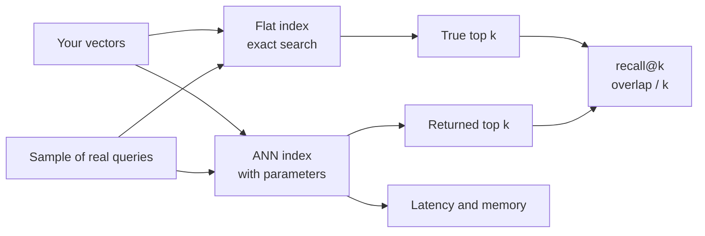
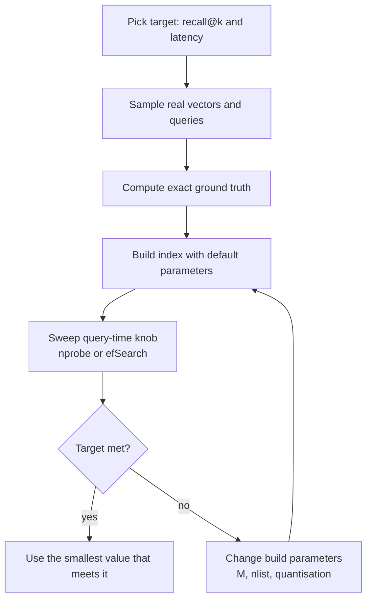

Exact search compares the query with every stored vector. At a few million vectors and hundreds of queries per second that becomes too slow and too expensive, and there is no clever exact shortcut: in high dimensions, the tree structures that speed up search in two or three dimensions degrade to scanning almost everything. **Approximate nearest neighbour (ANN)** search gives up the guarantee of finding the exact top $k$ in exchange for touching only a small fraction of the data. This lesson defines how approximation is measured, runs an experiment that measures it for two index types, and shows how to tune an index for your own recall target.

## Why exact search does not scale, and why approximation is acceptable

A brute-force query costs about $n \times d$ multiply-adds. With $n = 10^7$ and $d = 768$ that is billions of operations per query, every query. Classic spatial indexes such as k-d trees prune regions of space that cannot contain a closer point, but as the dimension grows, almost every region is "close enough" to need checking, a symptom of the **curse of dimensionality** you met in [dimensionality reduction](/learn/unsupervised-learning/dimensionality-reduction).

Approximation is acceptable because embeddings are themselves approximate. The difference between the 9th and the 11th nearest chunk is usually far smaller than the noise in the embedding model, and in RAG the retrieved set is often reranked afterwards anyway. Missing one true neighbour out of ten rarely changes the answer; a tenfold drop in latency often changes whether the product is usable.

## Measuring approximation: recall@k

The standard metric is **recall@k**: for each query, the fraction of the true top $k$ (from exact search) that the ANN index returns in its top $k$, averaged over a set of queries.

$$
\text{recall@}k = \frac{1}{|Q|} \sum_{\mathbf{q} \in Q} \frac{|\,\text{ANN}_k(\mathbf{q}) \cap \text{Exact}_k(\mathbf{q})\,|}{k}
$$

Here $Q$ is the set of evaluation queries, $\text{ANN}_k$ the index's top $k$ and $\text{Exact}_k$ the brute-force top $k$. Recall@10 of 0.95 means that, on average, 9.5 of the 10 true neighbours are found.



Use real or realistic queries. Random vectors behave differently from real embeddings, which cluster by topic, so an index tuned on random data can be badly tuned for production.

## Experiment: IVF recall against brute force

The experiment below builds clustered synthetic "embeddings" (points scattered around 50 topic centres, so they behave more like real data than uniform noise), computes exact ground truth, then implements a small IVF index in NumPy: k-means into 100 lists, and at query time scan only the `nprobe` lists whose centroids are closest.

```python
import numpy as np

rng = np.random.default_rng(0)
n, d, k = 20_000, 32, 10
centres = rng.normal(size=(50, d))
X = (centres[rng.integers(50, size=n)] + 1.5 * rng.normal(size=(n, d))).astype(np.float32)
X /= np.linalg.norm(X, axis=1, keepdims=True)
Q = (centres[rng.integers(50, size=200)] + 1.5 * rng.normal(size=(200, d))).astype(np.float32)
Q /= np.linalg.norm(Q, axis=1, keepdims=True)

truth = np.argsort(-(Q @ X.T), axis=1)[:, :k]          # exact top 10 per query

def recall(found, true):
    return np.mean([len(set(f) & set(t)) / k for f, t in zip(found, true)])

def kmeans(X, c, iters=10, seed=0):
    C = X[np.random.default_rng(seed).choice(len(X), c, replace=False)]
    for _ in range(iters):
        assign = np.argmax(X @ C.T, axis=1)
        for j in range(c):
            members = X[assign == j]
            if len(members):
                C[j] = members.mean(axis=0)
        C /= np.linalg.norm(C, axis=1, keepdims=True)
    return C, np.argmax(X @ C.T, axis=1)

nlist = 100
C, assign = kmeans(X, nlist)
lists = [np.flatnonzero(assign == j) for j in range(nlist)]

def ivf_search(q, nprobe):
    probe = np.argsort(-(C @ q))[:nprobe]
    cand = np.concatenate([lists[j] for j in probe])
    return cand[np.argsort(-(X[cand] @ q))[:k]], len(cand)

print("nprobe  recall@10  scanned")
for nprobe in [1, 2, 4, 8, 16, 32]:
    results = [ivf_search(q, nprobe) for q in Q]
    found = [r[0] for r in results]
    scanned = np.mean([r[1] for r in results]) / n
    print(f"{nprobe:>6}  {recall(found, truth):9.3f}  {scanned:7.1%}")
```

```output
nprobe  recall@10  scanned
     1      0.518     1.3%
     2      0.664     2.2%
     4      0.779     4.1%
     8      0.883     8.1%
    16      0.947    15.8%
    32      0.990    31.7%
```

Read the table as a trade-off curve. Probing one list scans about 1% of the data and finds about half the true neighbours. Probing 16 lists scans about a sixth of the data and finds about 95%. The last few percent of recall are the most expensive: going from 0.95 to 0.99 doubles the work. The vectors scanned are a good proxy for latency on a single machine; in a real benchmark you would also time the queries.

## Experiment: HNSW with FAISS

The same ground truth can evaluate a real HNSW index from the FAISS library (covered fully in [FAISS](/learn/vector-databases/faiss)). The inner-product metric on unit vectors is cosine similarity. Building with a single thread keeps the graph, and therefore the output, reproducible.

```python
import faiss

faiss.omp_set_num_threads(1)
hnsw = faiss.IndexHNSWFlat(d, 16, faiss.METRIC_INNER_PRODUCT)   # M = 16
hnsw.hnsw.efConstruction = 40
hnsw.add(X)

print("efSearch  recall@10")
for ef in [10, 20, 40, 80, 160]:
    hnsw.hnsw.efSearch = ef
    _, I = hnsw.search(Q, k)
    print(f"{ef:>8}  {recall(I, truth):9.3f}")
```

```output
efSearch  recall@10
      10      0.673
      20      0.818
      40      0.914
      80      0.969
     160      0.994
```

`efSearch` is the size of the candidate list the search keeps while walking the graph. Small values stop early and miss neighbours; large values explore more of the graph. As with `nprobe`, recall rises steeply at first and then flattens, and it can be changed per query without rebuilding.

> [!NOTE]
> Results on synthetic data only show the *shape* of the trade-off. The exact recall you get for a given `nprobe` or `efSearch` depends on your data, dimension and index parameters, so always repeat this experiment on a sample of your own vectors and queries.

## Families of ANN algorithms

| Family | Idea | Examples |
| --- | --- | --- |
| Partitioning (clustering) | Search only the nearest clusters | IVF, ScaNN's partitioning stage |
| Graph-based | Greedy walk on a proximity graph | HNSW, DiskANN (Vamana) |
| Quantisation | Compress vectors, compare compressed codes | PQ, scalar and binary quantisation |
| Hashing | Hash similar vectors into the same bucket | Locality-sensitive hashing (LSH) |
| Trees | Recursively split space | Annoy (random projection trees) |

Graph-based indexes dominate general-purpose vector databases today, typically combined with quantisation to save memory. LSH has strong theoretical guarantees but usually needs much more memory for the same recall, so it is rarely the default.

## Tuning in practice



- **Tune query-time knobs first.** They are cheap to change. Rebuild only if no query-time setting meets the target.
- **Measure at the right $k$.** Recall@10 and recall@100 can differ substantially; measure at the $k$ your application retrieves.
- **Measure filtered queries separately**, because filters change the effective index (see [metadata filtering](/learn/vector-databases/metadata-filtering)).
- **Re-measure after big data changes.** Recall drifts as data is added, especially for IVF indexes trained on an older sample.

> [!KEY]
> ANN indexes trade recall for speed through knobs such as `nprobe` and `efSearch`. Recall@k against brute force on real queries is the only trustworthy measure; the curve always flattens, so pick the cheapest setting that meets your target rather than chasing 1.0.

## Exercises

**1.** Using the IVF code above, find the smallest `nprobe` that reaches recall@10 of at least 0.98.

<details>
<summary>Show solution</summary>

```python
for nprobe in range(16, 41, 4):
    found = [ivf_search(q, nprobe)[0] for q in Q]
    r = recall(found, truth)
    if r >= 0.98:
        print(nprobe, round(r, 3))
        break
```

```output
24 0.981
```

</details>

**2.** Measure recall@1 (is the single nearest neighbour found?) for the HNSW index with `efSearch = 10`. Is it higher or lower than recall@10 at the same setting? Why might that be?

<details>
<summary>Show solution</summary>

```python
hnsw.hnsw.efSearch = 10
_, I1 = hnsw.search(Q, 1)
print(np.mean(I1[:, 0] == truth[:, 0]))
```

```output
0.795
```

It is higher. The very nearest neighbour is usually the easiest to reach because the greedy walk converges towards it; the 9th and 10th neighbours are further away and more often missed when the candidate list is small.

</details>

**3.** Why should you not evaluate ANN recall using uniformly random query vectors when your real queries are embeddings of user questions?

<details>
<summary>Show solution</summary>

Real embeddings are concentrated in clusters and lower-dimensional regions of the space, while uniform random vectors are spread everywhere. Indexes behave differently on the two: cluster boundaries, graph connectivity and the distances between neighbours all differ. Parameters tuned on random queries can give misleading recall for real ones.

</details>

```quiz
[
  {
    "q": "What does recall@10 = 0.9 mean for an ANN index?",
    "options": [
      "90% of queries return results",
      "On average, 9 of the true 10 nearest neighbours are returned",
      "The index is 90% faster than brute force",
      "Results are 90% similar to the query"
    ],
    "answer": 1,
    "why": "Recall@k is the average overlap between the ANN top k and the exact top k, divided by k."
  },
  {
    "q": "In the IVF experiment, what happens as `nprobe` increases?",
    "options": [
      "Recall and the fraction scanned both rise, with diminishing recall gains",
      "Recall falls",
      "Memory use increases",
      "The index must be retrained"
    ],
    "answer": 0,
    "why": "Probing more lists scans more vectors and finds more true neighbours, but the last few percent of recall cost the most."
  },
  {
    "q": "Why are approximate results usually acceptable for RAG retrieval?",
    "options": [
      "LLMs ignore retrieved context",
      "Embeddings are noisy approximations anyway, and results are often reranked",
      "ANN indexes are always exact for k = 10",
      "Exact search returns worse results"
    ],
    "answer": 1,
    "why": "The difference between the 9th and 11th neighbour is often within the embedding's own noise."
  },
  {
    "q": "Which tuning step should you try first if recall is below target?",
    "options": [
      "Switch databases",
      "Rebuild with a larger `M`",
      "Increase a query-time parameter such as `efSearch` or `nprobe`",
      "Reduce the embedding dimension"
    ],
    "answer": 2,
    "why": "Query-time parameters can be changed instantly without rebuilding; change build parameters only if they cannot meet the target."
  }
]
```
