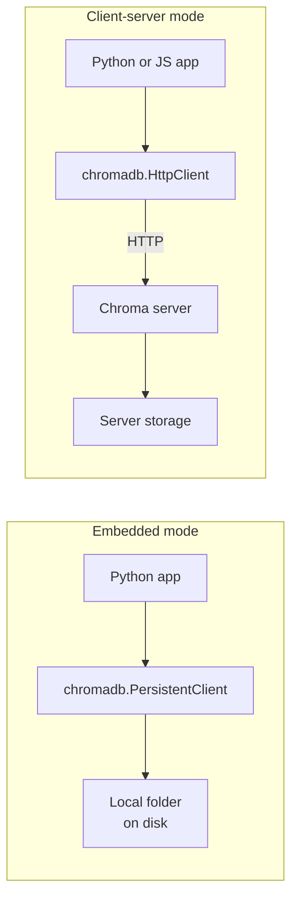

**ChromaDB** (usually just Chroma) is an open-source vector database designed to be the quickest route from "I have some documents" to "I can search them by meaning". It runs **embedded** in your Python process with a single `pip install`, stores data in a local folder, and can optionally embed your text for you. The same API also talks to a Chroma server or a hosted service when you outgrow a single process. That makes it the most common choice for prototypes, notebooks, tests and small to medium RAG applications, and a good place to see the database concepts of this module in working code.

## What Chroma is

| Aspect | Chroma |
| --- | --- |
| Kind | Open-source vector database; embedded, client-server, or hosted |
| Data model | Collections of records: ID, embedding, document text, metadata |
| Index | HNSW for vector search |
| Filtering | `where` on metadata, `where_document` on document text |
| Embeddings | Supply your own, or let a collection's embedding function compute them |
| Strengths | Minimal setup, Pythonic API, good for development and moderate scale |



The examples below were run with Chroma 1.5. Chroma's API has changed between major versions (notably around 0.4 and 1.0), so if something here does not match your installed version, check the [official documentation](https://docs.trychroma.com/).

```bash
pip install chromadb
```

## Clients and collections

A **client** is your connection to Chroma; a **collection** is a named set of records with one embedding dimension and one distance metric, roughly a table.

| Client | Use |
| --- | --- |
| `chromadb.Client()` | In memory only; data is lost when the process ends. Good for tests |
| `chromadb.PersistentClient(path="./chroma_db")` | Embedded, persisted to a folder |
| `chromadb.HttpClient(host="localhost", port=8000)` | Connect to a Chroma server, for example one started with `chroma run --path ./chroma_db` |

The distance metric is fixed when a collection is created. The default is squared L2; for most text embedding models you want cosine, which you can request through the collection metadata:

```python
import chromadb

client = chromadb.Client()
collection = client.get_or_create_collection(
    name="support_articles",
    metadata={"hnsw:space": "cosine"},     # "l2" (default), "cosine" or "ip"
)
```

Newer releases also accept a `configuration` argument for index settings; both forms are described in the documentation.

## Adding and querying records

Here the embeddings are tiny hand-made 3-dimensional vectors so the example runs without downloading a model. In a real application they come from your embedding model and have hundreds of dimensions.

```python
collection.add(
    ids=["a1", "a2", "a3", "a4"],
    embeddings=[[0.9, 0.1, 0.0], [0.1, 0.9, 0.1], [0.0, 0.8, 0.3], [0.1, 0.1, 0.9]],
    documents=["Cannot log in after password reset", "Charged twice for one order",
               "Refund still not received", "Package stuck in transit"],
    metadatas=[{"topic": "account", "year": 2023}, {"topic": "billing", "year": 2024},
               {"topic": "billing", "year": 2023}, {"topic": "shipping", "year": 2024}],
)
print(collection.count())

res = collection.query(query_embeddings=[[0.0, 0.9, 0.2]], n_results=3)
print(res["ids"])
print([[round(x, 4) for x in row] for row in res["distances"]])
print(res["documents"])
```

```output
4
[['a3', 'a2', 'a4']]
[[0.0098, 0.0118, 0.6785]]
[['Refund still not received', 'Charged twice for one order', 'Package stuck in transit']]
```

These are cosine **distances**, $1 - \cos\theta$, so smaller is closer; they match the NumPy calculation in the [PostgreSQL lesson](/learn/sql-and-databases/postgresql), which used the same vectors. The result is a dictionary of lists of lists: one inner list per query, because `query_embeddings` accepts a batch.

## Filtering with `where`

Metadata filters use a small operator language: equality by default, plus `$eq`, `$ne`, `$gt`, `$gte`, `$lt`, `$lte`, `$in`, `$nin`, combined with `$and` and `$or`.

```python
res = collection.query(
    query_embeddings=[[0.0, 0.9, 0.2]],
    n_results=2,
    where={"$and": [{"topic": "billing"}, {"year": {"$gte": 2024}}]},
    include=["documents", "metadatas", "distances"],
)
print(res["ids"], res["metadatas"])
```

```output
[['a2']] [[{'topic': 'billing', 'year': 2024}]]
```

Only one record matches the filter, so only one is returned even though `n_results=2`. `include` controls which fields come back; returning only what you need keeps responses small. A separate `where_document` argument filters on the document text, for example `{"$contains": "refund"}`.

## Updating, deleting and reading back

```python
collection.upsert(
    ids=["a3"],
    embeddings=[[0.0, 0.7, 0.4]],
    documents=["Refund received late"],
    metadatas=[{"topic": "billing", "year": 2024}],
)
print(collection.get(ids=["a3"])["documents"])

collection.delete(ids=["a4"])
print(collection.count())
print(collection.get(where={"topic": "billing"}, include=["metadatas"])["ids"])
```

```output
['Refund received late']
3
['a2', 'a3']
```

`upsert` inserts or replaces by ID, which is what an ingestion pipeline should use so that re-running it does not create duplicates. `get` retrieves by ID or filter without any vector search, and `delete` also accepts a `where` filter, which is handy for removing every chunk of one source document.

## Persistence

Switching to disk is one line. Data written through a `PersistentClient` is there when a new client opens the same folder:

```python
import tempfile

path = tempfile.mkdtemp()
pc = chromadb.PersistentClient(path=path)
notes = pc.get_or_create_collection("notes")
notes.add(ids=["n1"], embeddings=[[1.0, 0.0, 0.0]], documents=["hello"])

reopened = chromadb.PersistentClient(path=path)
print(reopened.get_collection("notes").count())
```

```output
1
```

## Letting Chroma embed for you

If you create a collection without supplying embeddings, Chroma uses the collection's **embedding function** to embed `documents` on `add` and `query_texts` on `query`. The default is a small sentence-embedding model that is downloaded on first use; you can pass a different embedding function when creating the collection. The first run downloads the model:

```python
docs = client.get_or_create_collection("faq")
docs.add(ids=["q1", "q2"], documents=["How do I reset my password?",
                                      "Where is my parcel?"])
print(docs.query(query_texts=["I forgot my login"], n_results=1)["documents"])
```

```output
[['How do I reset my password?']]
```

Convenient as this is, many teams prefer to compute embeddings themselves so that the model and its version are explicit and the same embeddings can be reused elsewhere. Either way, the collection must always be queried with the same model it was populated with.

> [!WARNING]
> Mixing modes is a common bug: a collection populated with your own 768-dimensional embeddings, then queried with `query_texts`, embeds the query with the default model, which produces vectors of a different size and meaning. Query with `query_embeddings` from the same model you used for ingestion.

## When to choose Chroma

| Good fit | Consider something else when |
| --- | --- |
| Prototypes, notebooks and tests | You need large-scale distributed deployments with fine-grained tuning |
| Small to medium RAG apps in one service | You need advanced hybrid search or quantisation controls |
| Local-first or desktop tools | You must reuse an existing PostgreSQL database (pgvector) |
| Teams wanting the simplest API | You want a fully managed service with no operations (or use Chroma's hosted offering) |

> [!KEY]
> Chroma gives you a real vector database (collections, IDs, metadata filters, upserts, persistence) in a few lines of Python. Fix the distance metric when creating the collection, use stable IDs with `upsert`, and keep ingestion and query embeddings from the same model.

## Exercises

**1.** Write the `where` filter for "topic is billing or account, and year is not 2023".

<details>
<summary>Show solution</summary>

```python
where = {"$and": [
    {"topic": {"$in": ["billing", "account"]}},
    {"year": {"$ne": 2023}},
]}
```

</details>

**2.** An ingestion script calls `collection.add` with the same IDs every night and starts failing or skipping records. What should it use instead, and why?

<details>
<summary>Show solution</summary>

Use `collection.upsert`. `add` is for new IDs only, while `upsert` replaces existing records with the same ID and inserts new ones, so re-running the pipeline updates changed chunks without duplicates or errors.

</details>

**3.** A source document `handbook.pdf` was split into 40 chunks, each with metadata `{"source": "handbook.pdf"}`. The document has been withdrawn. Remove all its chunks in one call.

<details>
<summary>Show solution</summary>

```python
collection.delete(where={"source": "handbook.pdf"})
```

Storing the source in every chunk's metadata is what makes this possible, which is a good reason to always include it.

</details>

```quiz
[
  {
    "q": "Which Chroma client stores data in a local folder that survives restarts?",
    "options": [
      "`chromadb.Client()`",
      "`chromadb.PersistentClient(path=...)`",
      "`chromadb.MemoryClient()`",
      "`chromadb.TempClient()`"
    ],
    "answer": 1,
    "why": "`PersistentClient` writes to the given path; `Client()` is in-memory only."
  },
  {
    "q": "A Chroma query returns `distances` of 0.01 and 0.68 in a cosine collection. Which result is more similar?",
    "options": [
      "The one with 0.68",
      "They are equally similar",
      "The one with 0.01",
      "It depends on the embedding dimension"
    ],
    "answer": 2,
    "why": "Chroma reports cosine distance, 1 minus cosine similarity, so smaller means closer."
  },
  {
    "q": "Why might a query with `n_results=5` return only 2 results?",
    "options": [
      "The collection uses cosine distance",
      "The `where` filter matched only 2 records",
      "`n_results` is a minimum, not a maximum",
      "Chroma always returns 2 results"
    ],
    "answer": 1,
    "why": "Results are limited to records matching the filter; if only 2 match, only 2 come back."
  },
  {
    "q": "What is the risk of calling `query_texts` on a collection populated with your own embeddings?",
    "options": [
      "None; Chroma converts between models",
      "It is slower but gives identical results",
      "It deletes the stored embeddings",
      "The query is embedded by the collection's embedding function, which may be a different model"
    ],
    "answer": 3,
    "why": "Vectors from a different model have unrelated coordinates and possibly a different dimension, so results are meaningless or the query fails."
  }
]
```
