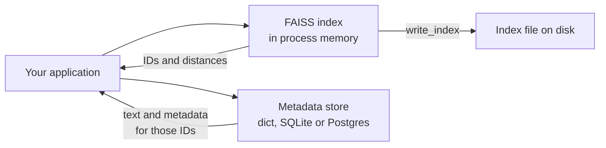

**FAISS** (Facebook AI Similarity Search) is an open-source library from Meta's research team for similarity search over dense vectors. It is not a database: there is no server, no metadata, no query language and no built-in durability beyond writing an index to a file. What it offers is a very fast, carefully engineered implementation of every index type in this module (flat, IVF, HNSW, PQ and their combinations) on CPU and, in the GPU build, on graphics cards. Many vector databases and research systems build on it or are benchmarked against it. Knowing FAISS teaches you the index concepts concretely, and it is the right tool when you want maximum control inside a single Python process.

## Where FAISS fits



FAISS returns integer IDs and distances; everything else (the chunk text, metadata, filters) is your job. A typical setup keeps the index in memory and a small database mapping IDs to records.

Install the CPU build with pip. GPU builds are distributed separately; check the project's install guide for the current options.

```bash
pip install faiss-cpu
```

## Core concepts

| Concept | Meaning |
| --- | --- |
| `index.d` | Dimension, fixed at construction |
| `index.ntotal` | Number of vectors stored |
| `index.is_trained` | Whether the index needs `train()` before `add()` (IVF and PQ do; flat and HNSW do not) |
| `index.add(x)` | Add vectors; IDs are assigned sequentially from 0 |
| `index.search(q, k)` | Returns `(D, I)`: distances and IDs, each of shape `(n_queries, k)` |
| `-1` in `I` | Fewer than `k` results were found |

FAISS expects **float32**, C-contiguous NumPy arrays of shape `(n, d)`. Passing float64 is the most common beginner error.

## A flat index

```python
import numpy as np
import faiss

rng = np.random.default_rng(0)
d = 64
xb = rng.normal(size=(10_000, d)).astype(np.float32)   # database vectors
xq = rng.normal(size=(3, d)).astype(np.float32)        # queries

index = faiss.IndexFlatL2(d)
print(index.is_trained, index.ntotal)
index.add(xb)
print(index.ntotal)

D, I = index.search(xq, 4)
print(I)
print(D.round(2))
```

```output
True 0
10000
[[1447 9390  581 3197]
 [6490 2874 8097 3766]
 [2362 9820 9312 3412]]
[[59.95 62.73 63.7  64.75]
 [58.99 74.31 76.21 76.47]
 [69.73 70.38 71.25 72.22]]
```

`IndexFlatL2` returns **squared** L2 distances, smallest first. For cosine similarity, normalise the vectors to unit length and use an inner-product index; scores are then cosine similarities, largest first:

```python
xb_n, xq_n = xb.copy(), xq.copy()
faiss.normalize_L2(xb_n)          # in place
faiss.normalize_L2(xq_n)

cos_index = faiss.IndexFlatIP(d)
cos_index.add(xb_n)
D, I = cos_index.search(xq_n, 4)
print(I[0], D[0].round(3))
```

```output
[3197 1447 3683 8556] [0.43  0.425 0.411 0.399]
```

## Your own IDs, and deleting

Sequential IDs are awkward once records are deleted or come from a database. Wrapping an index in `IndexIDMap` lets you supply 64-bit IDs, and `remove_ids` deletes by ID:

```python
id_index = faiss.IndexIDMap(faiss.IndexFlatIP(d))
doc_ids = np.arange(1000, 1000 + len(xb_n), dtype=np.int64)
id_index.add_with_ids(xb_n, doc_ids)

_, I = id_index.search(xq_n[:1], 3)
print(I)
removed = id_index.remove_ids(np.array([I[0, 0]], dtype=np.int64))
_, I = id_index.search(xq_n[:1], 3)
print(removed, I, id_index.ntotal)
```

```output
[[4197 2447 4683]]
1 [[2447 4683 9556]] 9999
```

The removed record disappears and the next best moves up. Not every index type supports removal efficiently (HNSW in FAISS does not support `remove_ids`), which is one reason databases built on graph indexes handle deletes with markers and periodic rebuilds.

## IVF: train, add, tune nprobe

An IVF index needs a coarse quantiser (itself an index, used to find the nearest centroids) and a training step:

```python
nlist = 100
quantizer = faiss.IndexFlatIP(d)
ivf = faiss.IndexIVFFlat(quantizer, d, nlist, faiss.METRIC_INNER_PRODUCT)
print(ivf.is_trained)
ivf.train(xb_n)                     # k-means on the data (or a sample of it)
ivf.add(xb_n)
print(ivf.is_trained, ivf.ntotal)

_, truth = cos_index.search(xq_n, 10)
for nprobe in [1, 10, 100]:
    ivf.nprobe = nprobe
    _, I = ivf.search(xq_n, 10)
    hits = np.mean([len(set(a) & set(b)) / 10 for a, b in zip(I, truth)])
    print(f"nprobe={nprobe:<3} recall@10={hits:.2f}")
```

```output
False
True 10000
nprobe=1   recall@10=0.03
nprobe=10  recall@10=0.37
nprobe=100 recall@10=1.00
```

With `nprobe` equal to `nlist`, every list is scanned and the result is exact. These random vectors have no cluster structure, which is the worst case for IVF; real embeddings reach high recall at much smaller `nprobe`, as the [approximate nearest neighbours](/learn/vector-databases/approximate-nearest-neighbors) experiment showed.

## The index factory

Composite indexes are easiest to build from a **factory string**, which describes the index in a compact notation:

| Factory string | Index |
| --- | --- |
| `"Flat"` | Exact search |
| `"HNSW32"` | HNSW with `M = 32` |
| `"IVF256,Flat"` | IVF with 256 lists, full vectors |
| `"IVF256,PQ16"` | IVF with 256 lists, vectors compressed to 16 one-byte codes |
| `"PCA32,IVF256,Flat"` | Reduce to 32 dimensions with PCA first, then IVF |

```python
faiss.omp_set_num_threads(1)      # single thread for reproducible output
for spec in ["Flat", "HNSW32", "IVF100,Flat", "IVF100,PQ8"]:
    idx = faiss.index_factory(d, spec, faiss.METRIC_INNER_PRODUCT)
    idx.train(xb_n)
    idx.add(xb_n)
    size = faiss.serialize_index(idx).nbytes
    print(f"{spec:<12} {size / len(xb_n):7.1f} bytes/vector")
```

```output
Flat           256.0 bytes/vector
HNSW32         527.8 bytes/vector
IVF100,Flat    266.7 bytes/vector
IVF100,PQ8      25.2 bytes/vector
```

These serialised sizes match the [memory arithmetic](/learn/vector-databases/vector-indexing) from earlier: 256 bytes per vector for 64 float32 values, about twice that for HNSW with `M = 32` because of the links, slightly more than flat for IVF (list IDs and centroids), and about 25 bytes for IVF-PQ, mostly the 8-byte ID plus 8 code bytes, with the codebooks spread over only 10,000 vectors.

## Saving and loading

```python
import os, tempfile

path = os.path.join(tempfile.mkdtemp(), "docs.faiss")
faiss.write_index(id_index, path)
loaded = faiss.read_index(path)
print(loaded.ntotal, loaded.search(xq_n[:1], 2)[1])
```

```output
9999 [[2447 4683]]
```

That is the whole persistence story. Concurrency, crash safety, backups and keeping the metadata store in sync with the index file are up to you.

## When to choose FAISS

| Choose FAISS when | Choose a database when |
| --- | --- |
| Data fits on one machine and changes in batches | Data changes continuously with many writers |
| You need precise control of index types and parameters | You need metadata filtering, access control, an API |
| Offline jobs: deduplication, clustering, evaluation, research | Multiple services query the same collection |
| You want GPU-accelerated search | You want durability and backups handled for you |

> [!TIP]
> Even if production uses a vector database, FAISS is an excellent evaluation tool. A flat FAISS index gives you exact ground truth quickly, so you can measure the recall of whatever index your database uses.

> [!KEY]
> FAISS is a library of fast index implementations, not a database. You get `add`, `search`, `train` and `write_index`; IDs, metadata, filtering and durability are yours to manage.

## Exercises

**1.** `index.search` raises an error or gives wrong results when you pass `np.random.rand(5, 64)`. What is the problem, and how do you fix it?

<details>
<summary>Show solution</summary>

`np.random.rand` produces float64, and FAISS requires float32. Convert with `.astype(np.float32)`, and make sure the array is C-contiguous (`np.ascontiguousarray`) if it came from slicing or transposing.

</details>

**2.** Build an `"HNSW32"` index over `xb_n`, then measure recall@10 against `truth` for `efSearch` values 16 and 128. The HNSW parameters are reached through `faiss.downcast_index(idx).hnsw` or directly as `idx.hnsw` on an `IndexHNSWFlat`.

<details>
<summary>Show solution</summary>

```python
h = faiss.IndexHNSWFlat(d, 32, faiss.METRIC_INNER_PRODUCT)
h.add(xb_n)
for ef in [16, 128]:
    h.hnsw.efSearch = ef
    _, I = h.search(xq_n, 10)
    print(ef, round(float(np.mean([len(set(a) & set(b)) / 10 for a, b in zip(I, truth)])), 3))
```

```output
16 0.767
128 1.0
```

</details>

**3.** Sketch how you would store chunk text alongside a FAISS index so that a search returns text, not just IDs.

<details>
<summary>Show solution</summary>

Use `IndexIDMap` with IDs that are primary keys in a table (for example SQLite: `chunks(id INTEGER PRIMARY KEY, text TEXT, source TEXT)`). After `search`, run `SELECT id, text, source FROM chunks WHERE id IN (...)` with the returned IDs, skip any `-1`, and reorder the rows to match the search order. Write the index file and commit the table together so the two stay consistent.

</details>

```quiz
[
  {
    "q": "What does FAISS NOT provide on its own?",
    "options": [
      "IVF and HNSW indexes",
      "Metadata storage and filtering by arbitrary fields",
      "Saving an index to a file",
      "GPU-accelerated search"
    ],
    "answer": 1,
    "why": "FAISS stores vectors and integer IDs; metadata and arbitrary filtering must be handled outside it."
  },
  {
    "q": "How do you get cosine similarity search in FAISS?",
    "options": [
      "Use `IndexFlatL2` directly",
      "Pass `metric=\"cosine\"` to `IndexFlat`",
      "Normalise vectors with `faiss.normalize_L2` and use an inner-product index",
      "Call `index.cosine()`"
    ],
    "answer": 2,
    "why": "On unit vectors, inner product equals cosine similarity."
  },
  {
    "q": "Which index requires `train()` before vectors can be added?",
    "options": ["`IndexFlatL2`", "`IndexHNSWFlat`", "`IndexFlatIP`", "`IndexIVFFlat`"],
    "answer": 3,
    "why": "IVF must run k-means to learn its centroids before it can assign vectors to lists."
  },
  {
    "q": "What does the factory string `\"IVF256,PQ16\"` describe?",
    "options": [
      "An IVF index with 256 lists storing vectors as 16-byte PQ codes",
      "An HNSW graph with 256 links",
      "A flat index over 256 dimensions",
      "16 IVF indexes of 256 vectors each"
    ],
    "answer": 0,
    "why": "IVF256 sets 256 inverted lists; PQ16 compresses each vector to 16 sub-quantiser codes of one byte each."
  }
]
```
