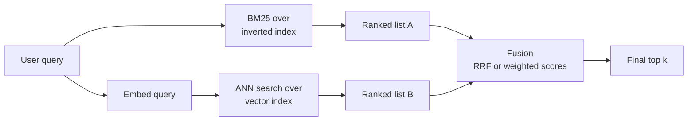

Dense vector search is good at meaning: it matches "my card was charged twice" to a document titled "duplicate payments". It is surprisingly bad at exact tokens: product codes, error numbers, names, rare jargon. A user who searches for `E1102` wants the one page that mentions `E1102`, and an embedding model may place it no closer than pages about other error codes. Keyword search has the opposite profile. **Hybrid search** runs both and fuses the results, and it is one of the most reliable improvements you can make to a retrieval system. This lesson implements BM25 keyword scoring, fuses it with dense scores by reciprocal rank fusion and by score normalisation, and explains how vector databases support it.

## Sparse and dense retrieval

| | Sparse (keyword) | Dense (embedding) |
| --- | --- | --- |
| Representation | One dimension per vocabulary term, mostly zeros | A few hundred to a few thousand floats, all non-zero |
| Typical scorer | BM25 | Cosine or dot product |
| Strong at | Exact terms, IDs, names, rare words | Paraphrases, synonyms, cross-lingual meaning |
| Weak at | Synonyms ("car" vs "automobile") | Exact codes, unseen jargon, negation details |
| Index | Inverted index | ANN index |

The two make different mistakes, which is exactly why combining them works: a relevant document missed by one is often found by the other.



## BM25 in a few lines

**BM25** extends [TF-IDF](/learn/nlp-fundamentals/tf-idf) with two refinements: term frequency saturates (the tenth occurrence of a word adds little), and long documents are penalised so they do not win just by containing more words. For a query with terms $t$ and a document $D$:

$$
\text{BM25}(D, q) = \sum_{t \in q} \text{IDF}(t) \cdot \frac{f(t, D)\,(k_1 + 1)}{f(t, D) + k_1 \left(1 - b + b \frac{|D|}{\text{avgdl}}\right)}
$$

where $f(t, D)$ is the count of $t$ in $D$, $|D|$ the document length in tokens, $\text{avgdl}$ the average document length, $k_1$ (typically 1.2 to 2) controls saturation, and $b$ (typically 0.75) controls length normalisation. A common form of the inverse document frequency is $\text{IDF}(t) = \ln\!\left(\frac{N - n_t + 0.5}{n_t + 0.5} + 1\right)$, with $N$ documents of which $n_t$ contain $t$.

```python
import math
import re
from collections import Counter

docs = {
    "d1": "Error E1102 means the payment gateway timed out. Retry the payment.",
    "d2": "If a payment fails, check your card details and try again.",
    "d3": "Duplicate charges are refunded automatically within five days.",
    "d4": "Error E1205 means the account is locked after failed logins.",
    "d5": "Gateway timeouts are usually temporary network problems.",
    "d6": "You can update your card in the billing settings page.",
}

def tokenize(text):
    return re.findall(r"[a-z0-9]+", text.lower())

toks = {i: tokenize(t) for i, t in docs.items()}
N = len(toks)
avgdl = sum(len(t) for t in toks.values()) / N
df = Counter(term for t in toks.values() for term in set(t))

def bm25(query, k1=1.5, b=0.75):
    scores = {}
    for i, t in toks.items():
        tf = Counter(t)
        s = 0.0
        for term in tokenize(query):
            if term in tf:
                idf = math.log((N - df[term] + 0.5) / (df[term] + 0.5) + 1)
                s += idf * tf[term] * (k1 + 1) / (tf[term] + k1 * (1 - b + b * len(t) / avgdl))
        scores[i] = s
    return scores

query = "payment failed with error E1102"
sparse = bm25(query)
for i, s in sorted(sparse.items(), key=lambda x: -x[1]):
    print(i, round(s, 3))
```

```output
d1 3.799
d4 2.511
d2 0.961
d3 0.0
d5 0.0
d6 0.0
```

`d1` wins clearly because it contains the rare token `e1102`, which has a high IDF. `d4` scores because it contains "error" and "failed", and `d2` only because of "payment": its "fails" does not match "failed", since this tokeniser does no stemming. Production keyword engines usually stem or lemmatise for exactly this reason.

## The dense side

For the same query, suppose an embedding model gives these cosine similarities. They are illustrative values, not the output of a specific model, but they show the typical pattern: dense search rewards documents about failing payments and gateway timeouts, and does not single out the exact error code.

```python
dense = {"d1": 0.71, "d2": 0.78, "d3": 0.52, "d4": 0.63, "d5": 0.69, "d6": 0.48}

def ranking(scores):
    return [i for i, _ in sorted(scores.items(), key=lambda x: -x[1])]

print("sparse:", ranking(sparse))
print("dense: ", ranking(dense))
```

```output
sparse: ['d1', 'd4', 'd2', 'd3', 'd5', 'd6']
dense:  ['d2', 'd1', 'd5', 'd4', 'd3', 'd6']
```

The rankings disagree. Fusion has to combine them without knowing which one is right for this query.

## Reciprocal rank fusion

**Reciprocal rank fusion (RRF)** ignores the raw scores entirely and uses only ranks. Each document's fused score is

$$
\text{RRF}(D) = \sum_{r \in \text{rankers}} \frac{1}{c + \text{rank}_r(D)}
$$

where $\text{rank}_r(D)$ is the document's 1-based position in ranker $r$'s list (documents a ranker did not return contribute nothing for that ranker) and $c$ is a constant, conventionally 60, that dampens the dominance of the very top ranks.

```python
def rrf(rankings, c=60):
    fused = Counter()
    for ranked in rankings:
        for rank, doc_id in enumerate(ranked, start=1):
            fused[doc_id] += 1 / (c + rank)
    return fused.most_common()

for doc_id, score in rrf([ranking(sparse), ranking(dense)]):
    print(doc_id, round(score, 5))
```

```output
d1 0.03252
d2 0.03227
d4 0.03175
d5 0.03126
d3 0.03101
d6 0.0303
```

`d1`, first in keyword search and third in dense search, comes out on top; `d2`, which both rankers placed high, is second. Because RRF uses ranks, it needs no tuning, is unaffected by the two scorers having completely different scales, and works for any number of rankers. That robustness makes it the default fusion method in many systems.

> [!TIP]
> Apply fusion to reasonably deep lists, such as the top 50 to 100 from each retriever, not just the top 5. A document ranked 30th by both retrievers can be more relevant than one ranked 1st by one and absent from the other, and RRF can only find it if both lists include it.

## Score normalisation and weighted fusion

The alternative keeps the scores but puts them on a common scale, then takes a weighted average. BM25 scores are unbounded and depend on the query; cosine scores sit in a narrow band. **Min-max normalisation** maps each list to the range 0 to 1:

$$
\tilde{s}(D) = \frac{s(D) - \min s}{\max s - \min s}, \qquad \text{hybrid}(D) = \alpha\,\tilde{s}_{\text{dense}}(D) + (1 - \alpha)\,\tilde{s}_{\text{sparse}}(D)
$$

where $\alpha$ between 0 and 1 sets the weight on dense search.

```python
def min_max(scores):
    lo, hi = min(scores.values()), max(scores.values())
    return {i: (s - lo) / (hi - lo) for i, s in scores.items()}

def weighted(sparse, dense, alpha):
    ns, nd = min_max(sparse), min_max(dense)
    return {i: alpha * nd[i] + (1 - alpha) * ns[i] for i in sparse}

for alpha in [0.2, 0.5, 0.8]:
    fused = weighted(sparse, dense, alpha)
    print(alpha, [(i, round(s, 2)) for i, s in sorted(fused.items(), key=lambda x: -x[1])[:3]])
```

```output
0.2 [('d1', 0.95), ('d4', 0.63), ('d2', 0.4)]
0.5 [('d1', 0.88), ('d2', 0.63), ('d4', 0.58)]
0.8 [('d2', 0.85), ('d1', 0.81), ('d5', 0.56)]
```

With little weight on dense search, the exact-match document dominates; with heavy weight, the paraphrase-friendly `d2` takes over. Weighted fusion can beat RRF when $\alpha$ is tuned on labelled queries, but it is sensitive to outliers (one huge BM25 score squashes the rest) and the best $\alpha$ varies between query types. Code-like queries favour sparse; conversational ones favour dense.

| Method | Uses | Needs tuning | Main risk |
| --- | --- | --- | --- |
| RRF | Ranks only | Hardly (constant $c$) | Ignores how confident each ranker was |
| Weighted, min-max | Normalised scores | $\alpha$ on labelled data | Outliers and per-query scale changes |

## Hybrid search in vector databases

You do not usually implement BM25 yourself in production. The options:

- **Built-in hybrid queries.** Weaviate offers a hybrid query that combines its keyword index with vector search, weighted by an `alpha` parameter. Qdrant supports sparse vectors alongside dense ones and can fuse results, including with RRF. Pinecone supports sparse-dense vectors.
- **Learned sparse vectors.** Models such as SPLADE produce sparse vectors with learned term weights, stored in the same sparse-vector fields as BM25.
- **Two systems.** A search engine such as Elasticsearch or OpenSearch for keywords, a vector database for dense search, and fusion in your application.
- **PostgreSQL.** Full-text search (`tsvector`) plus pgvector in one database, fused in SQL or in Python.

Check each product's documentation for the exact fusion methods it supports, as these features evolve quickly.

> [!KEY]
> Keyword and dense retrieval fail on different queries, so fusing them is more robust than either alone. Reciprocal rank fusion is the safe default because it needs only ranks; weighted score fusion can do better with tuning but needs normalisation and labelled queries.

## Exercises

**1.** Run `rrf` with `c=1` instead of 60. How does the ranking change, and what does that tell you about the role of $c$?

<details>
<summary>Show solution</summary>

```python
for doc_id, score in rrf([ranking(sparse), ranking(dense)], c=1):
    print(doc_id, round(score, 3))
```

```output
d1 0.833
d2 0.75
d4 0.533
d5 0.417
d3 0.367
d6 0.286
```

With a small $c$, rank 1 is worth far more than rank 2 ($1/2$ against $1/3$), so being top in one list dominates; `d1`'s lead grows. A larger $c$ flattens the differences between ranks and rewards agreement between rankers.

</details>

**2.** Compute BM25 scores for the query `"card"`. Why do `d2` and `d6` get different scores even though each contains "card" once?

<details>
<summary>Show solution</summary>

```python
print({i: round(s, 3) for i, s in bm25("card").items() if s > 0})
print(len(toks["d2"]), len(toks["d6"]), round(avgdl, 2))
```

```output
{'d2': 0.961, 'd6': 1.006}
11 10 9.5
```

The term frequency and IDF are identical, so the difference comes from length normalisation: `d6` is shorter than `d2`, so its single "card" counts for more.

</details>

**3.** A legal search system serves two kinds of query: exact citations such as "Section 12(3)(b)" and natural-language questions. How would you set up fusion?

<details>
<summary>Show solution</summary>

Start with RRF over deep lists from both retrievers, which handles both query types reasonably without tuning. If you have labelled queries, you can go further: route citation-like queries (detected with a regular expression) to a sparse-heavy weighting and natural-language questions to a dense-heavy one, and tune $\alpha$ separately for each group.

</details>

```quiz
[
  {
    "q": "Which kind of query is dense retrieval most likely to get wrong?",
    "options": [
      "A paraphrased question",
      "An exact product code such as `XR-4410`",
      "A question in a different language from the documents",
      "A query using a synonym"
    ],
    "answer": 1,
    "why": "Embeddings capture meaning; rare exact tokens such as codes are better matched by keyword search."
  },
  {
    "q": "In reciprocal rank fusion, what is a document's contribution from a ranker that placed it 3rd, with c = 60?",
    "options": ["3/60", "1/3", "1/63", "60/63"],
    "answer": 2,
    "why": "Each ranker contributes 1 / (c + rank) = 1 / 63."
  },
  {
    "q": "Why is RRF robust to the different score scales of BM25 and cosine similarity?",
    "options": [
      "It uses only ranks, not raw scores",
      "It normalises scores with min-max",
      "It converts BM25 scores to cosine",
      "It requires scores in the range 0 to 1"
    ],
    "answer": 0,
    "why": "Ranks are comparable across any scorer, so no normalisation is needed."
  },
  {
    "q": "What does the parameter b control in BM25?",
    "options": [
      "The weight of dense scores",
      "How quickly term frequency saturates",
      "The number of results",
      "How strongly long documents are penalised"
    ],
    "answer": 3,
    "why": "b controls length normalisation; k1 controls term-frequency saturation."
  }
]
```
