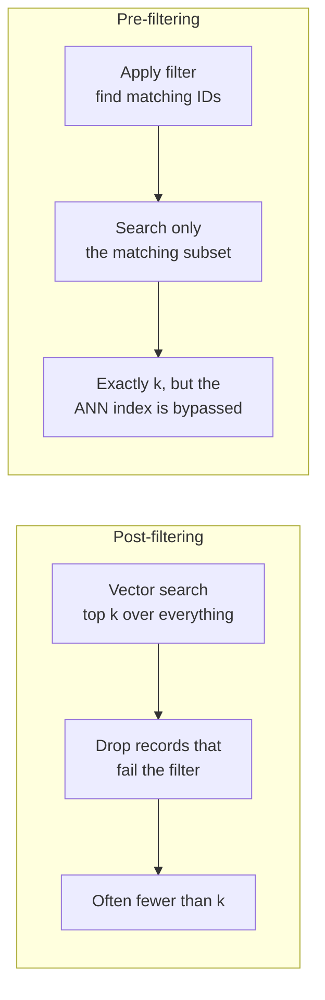
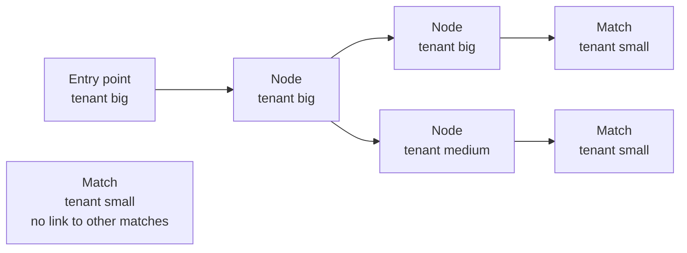

Pure similarity search rarely matches what an application needs. A support bot must only retrieve articles for the product the user owns; a legal assistant must only search documents the user is allowed to see; a news search must favour the last month. Each of these is a **metadata filter** combined with a vector query: "the 10 nearest neighbours *among records where* `tenant = 'acme'` and `year >= 2024`". It sounds like a `WHERE` clause bolted onto a search, and in a flat scan it is. With an approximate index it becomes one of the hardest problems a vector database has to solve, and understanding why will help you choose a database and design your metadata.

## Filters are part of the query

A filtered query has two parts, and the database must satisfy both:

$$
\text{result} = \operatorname{top}_k \{\, \mathbf{x}_i : f(\text{meta}_i) = \text{true} \,\} \text{ ranked by } s(\mathbf{q}, \mathbf{x}_i)
$$

where $f$ is the filter predicate, $s$ the similarity and $\operatorname{top}_k$ keeps the $k$ best. The correct answer is the $k$ nearest *matching* records. Returning three results when ten matching records exist is a bug, even if those three are correct.

Typical filter predicates:

| Kind | Example |
| --- | --- |
| Equality | `lang == "en"`, `tenant_id == 42` |
| Set membership | `category in ["billing", "refunds"]` |
| Range | `published >= 2024-01-01`, `price < 50` |
| Boolean combination | `(lang == "en" and year >= 2023) or pinned == true` |
| Access control | `allowed_groups` contains any of the user's groups |

The **selectivity** of a filter is the fraction of records that match. It is the single most important number for how a filtered query should be executed.

## Post-filtering and pre-filtering

There are two naive strategies.



**Post-filtering** runs the normal vector search and then discards non-matching results. It uses the fast index unchanged, but with a selective filter most of the top $k$ are discarded. **Pre-filtering** finds the matching records first and searches only among them. It is always correct, but if it is done by brute force over the subset, it gives up the index's speed when the subset is large.

You can see both behaviours on synthetic data. Here 20,000 records belong to tenants, and the tenant we query owns only 1% of them:

```python
import numpy as np

rng = np.random.default_rng(7)
n, d, k = 20_000, 64, 10
X = rng.normal(size=(n, d)).astype(np.float32)
X /= np.linalg.norm(X, axis=1, keepdims=True)
tenant = rng.choice(["big", "medium", "small"], size=n, p=[0.79, 0.20, 0.01])
q = rng.normal(size=d).astype(np.float32)
q /= np.linalg.norm(q)
scores = X @ q

def post_filter(fetch):
    top = np.argsort(-scores)[:fetch]
    return [i for i in top if tenant[i] == "small"][:k]

def pre_filter():
    ids = np.flatnonzero(tenant == "small")
    return list(ids[np.argsort(-scores[ids])[:k]])

truth = pre_filter()
print("matching records:", (tenant == "small").sum())
for fetch in [10, 100, 1000, 5000]:
    got = post_filter(fetch)
    print(f"post-filter, fetch {fetch:>4}: {len(got):>2} results,"
          f" {len(set(got) & set(truth))} correct")
```

```output
matching records: 196
post-filter, fetch   10:  0 results, 0 correct
post-filter, fetch  100:  0 results, 0 correct
post-filter, fetch 1000:  5 results, 5 correct
post-filter, fetch 5000: 10 results, 10 correct
```

Fetching 10, or even 100, candidates and filtering returns nothing at all. **Over-fetching** helps, but slowly: $k / \text{selectivity}$ candidates (here 1,000) gives $k$ survivors only *on average*, and this query got 5. Here it took 5,000 candidates, a quarter of the collection, to return the correct 10. For a 0.01% filter you would need the whole collection. Post-filtering only works well for permissive filters.

## Why filtered ANN is hard

With exact search, pre-filtering is trivial: scan only the matching rows. The difficulty is combining a filter with an approximate index.

**HNSW.** If the search simply skips nodes that fail the filter, the graph falls apart. The greedy walk relies on links through *all* nodes; remove 99% of them and the matching nodes become islands that the walk cannot reach. If instead the search traverses non-matching nodes but only collects matching ones, it may wander through thousands of irrelevant nodes before finding $k$ matches, and latency explodes.



If the walk may not pass through non-matching nodes, it cannot even leave the entry point, and some matches, like the isolated one on the right, are unreachable whatever you do.

**IVF.** The `nprobe` closest clusters may contain few or no matching records, so the search returns fewer than $k$ results unless it probes many more lists.

## How real databases handle it

Production vector databases combine several techniques, and much of their engineering effort goes here:

| Technique | Idea | Good for |
| --- | --- | --- |
| Query planning | Estimate selectivity first; use brute force over the subset when it is small, the filtered index when it is large | Every workload; this is why filter fields need indexes |
| Filter-aware traversal | Traverse the graph through all nodes but only return matches, with a larger candidate list | Moderately selective filters |
| Extra graph links | Build additional links among records sharing an indexed value, so matching subgraphs stay connected | Frequent filters on known fields |
| Partitioning | Separate collections, namespaces or shards per tenant | Hard isolation, such as multi-tenant SaaS |
| Over-fetch and post-filter | Ask the index for more than $k$ | Permissive filters only |

The practical consequences for you:

- **Declare indexes on fields you filter on.** Most databases need a payload or metadata index to plan filtered queries efficiently; without one, the filter may be evaluated record by record.
- **Prefer partitions for hard boundaries.** If tenants must never see each other's data, a namespace or collection per tenant (or a tenant field the database treats specially) is both faster and safer than an ordinary filter.
- **Store filterable values in typed fields.** Dates as numbers or timestamps, not strings, so range filters work.
- **Test filtered recall separately.** An index can have excellent unfiltered recall and poor recall on your most selective filter.

> [!WARNING]
> Never rely on post-filtering for access control. If a permission filter is applied after a top-$k$ search, a user may get zero results, and if it is applied in your application code after retrieval, a bug can leak documents straight into an LLM prompt. Enforce permissions inside the database query.

## Filter syntax across tools

Each tool expresses the same predicate differently. These are shown only for orientation; the tool lessons give complete examples.

| Tool | `lang == "en"` and `year >= 2024` |
| --- | --- |
| ChromaDB | `where={"$and": [{"lang": "en"}, {"year": {"$gte": 2024}}]}` |
| Pinecone | `filter={"lang": {"$eq": "en"}, "year": {"$gte": 2024}}` |
| Qdrant | `models.Filter(must=[...FieldCondition...])` with `MatchValue` and `Range` |
| Weaviate (v4) | `Filter.by_property("lang").equal("en") & Filter.by_property("year").greater_or_equal(2024)` |
| pgvector | `WHERE lang = 'en' AND year >= 2024` |

> [!KEY]
> The correct result of a filtered query is the $k$ nearest *matching* records. Post-filtering is fast but returns too few results for selective filters; pre-filtering is correct but can bypass the index. Good databases plan between these based on selectivity, so index your filter fields and measure recall on your real filters.

## Exercises

**1.** Using the data above, how many candidates would you expect to need to fetch with post-filtering to get 10 results from a tenant that owns 0.1% of the records? What does that tell you?

<details>
<summary>Show solution</summary>

About $10 / 0.001 = 10{,}000$ candidates, half of this 20,000-record collection, and you would still often get fewer than 10. At that point post-filtering costs more than brute force over the matching subset (about 20 records). A query planner would choose pre-filtering here.

</details>

**2.** Write `adaptive_search(predicate_mask, k)` that pre-filters with brute force when fewer than 2,000 records match, and otherwise post-filters with an over-fetch of `4 * k / selectivity`. Check it returns the true top 10 for the small tenant.

<details>
<summary>Show solution</summary>

```python
def adaptive_search(mask, k):
    ids = np.flatnonzero(mask)
    if len(ids) < 2_000:
        return list(ids[np.argsort(-scores[ids])[:k]]), "pre-filter"
    fetch = int(4 * k / (len(ids) / n))
    top = np.argsort(-scores)[:fetch]
    return [i for i in top if mask[i]][:k], f"post-filter, fetch {fetch}"

got, plan = adaptive_search(tenant == "small", 10)
print(plan, got == truth)
got, plan = adaptive_search(tenant == "big", 10)
print(plan, len(got))
```

```output
pre-filter True
post-filter, fetch 50 10
```

</details>

**3.** A SaaS product stores all customers' documents in one collection with a `customer_id` field and post-filters results in Python after retrieving the top 20. List two problems with this design.

<details>
<summary>Show solution</summary>

First, small customers will often get few or no results, because the global top 20 is dominated by large customers. Second, it is a security risk: other customers' documents are retrieved into application memory, and a single bug in the Python filter leaks them. Filter inside the database (ideally with a per-customer namespace, collection or tenant feature) instead.

</details>

```quiz
[
  {
    "q": "Why does post-filtering often return fewer than k results?",
    "options": [
      "The database limits filtered queries",
      "Most of the global top k fail a selective filter and are discarded",
      "Filters change the distance metric",
      "The index must be rebuilt after filtering"
    ],
    "answer": 1,
    "why": "With a filter matching 1% of records, about 99% of an unfiltered top k is thrown away."
  },
  {
    "q": "What makes filtered search with HNSW difficult?",
    "options": [
      "HNSW cannot store metadata",
      "Skipping non-matching nodes can disconnect the graph, so matches become unreachable",
      "HNSW only supports L2 distance",
      "Filters require retraining the graph"
    ],
    "answer": 1,
    "why": "The greedy walk depends on links through all nodes; removing most of them breaks navigation."
  },
  {
    "q": "A filter matches only 50 of 10 million records. What is the best execution strategy?",
    "options": [
      "Post-filter with k = 10",
      "Increase `efSearch` to its maximum",
      "Retrain the index",
      "Pre-filter: find the 50 records and compare the query with each exactly"
    ],
    "answer": 3,
    "why": "Brute force over 50 vectors is trivial and exact; any ANN-based approach would struggle to find them."
  },
  {
    "q": "Where should document-level access control be enforced in a RAG system?",
    "options": [
      "In the LLM prompt, by asking the model to ignore restricted text",
      "Inside the database query, as a filter or partition",
      "After retrieval, in application code",
      "It is unnecessary if embeddings are used"
    ],
    "answer": 1,
    "why": "Filtering in the database guarantees restricted documents are never retrieved, so they cannot leak into prompts."
  }
]
```
