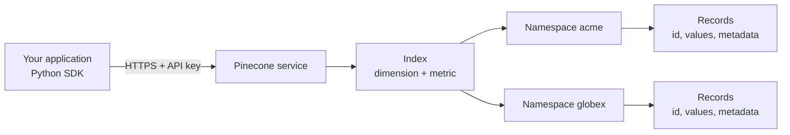
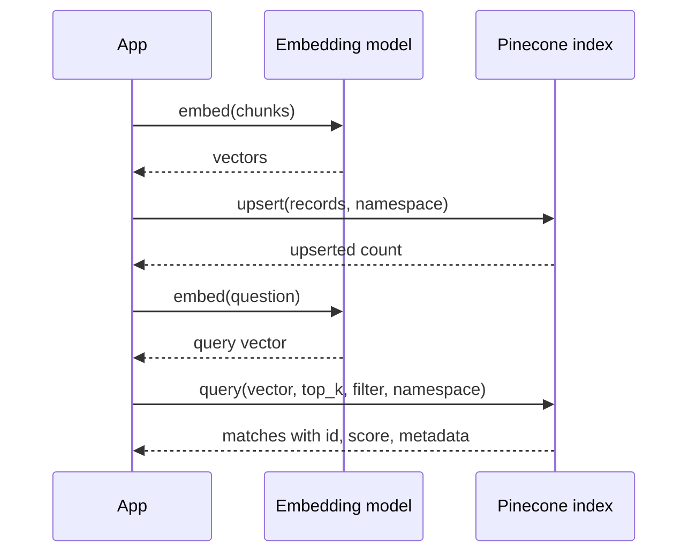

**Pinecone** is a fully managed vector database offered as a cloud service. You never install, run or upgrade a server: you create an index through an API, send vectors to it over HTTPS, and query it from anywhere. Capacity, replication, index building and backups are the provider's problem. That makes it a common choice for teams who want production vector search without running database infrastructure, at the cost of depending on an external service and its pricing model. Because it is a hosted service, none of the code in this lesson can run in this course's environment; outputs are described rather than shown.

## What Pinecone is

| Aspect | Pinecone |
| --- | --- |
| Kind | Managed cloud service (proprietary), accessed through an API and SDKs |
| Data model | Indexes containing namespaces of records: ID, dense values, optional sparse values, metadata |
| Deployment | Serverless indexes (capacity managed for you); older pod-based indexes where you choose hardware |
| Filtering | Metadata filters with MongoDB-style operators |
| Hybrid | Sparse-dense vectors in one record |
| Strengths | No operations, scales without capacity planning, simple API |



## Core concepts

- **Index.** The top-level container, created with a fixed **dimension** and **metric** (`cosine`, `euclidean` or `dotproduct`). As with every vector database, these must match your embedding model and cannot be changed later.
- **Namespace.** A partition inside an index. Queries search one namespace, so namespaces are the natural way to separate tenants, environments or document sets. Writing to a namespace that does not exist creates it.
- **Record.** An `id` (string), `values` (the dense vector), optional `sparse_values` for hybrid search, and optional `metadata` (a flat dictionary of strings, numbers, booleans and lists of strings).
- **Serverless versus pod-based.** Serverless indexes separate storage from compute and scale automatically; you pick a cloud and region. Pod-based indexes run on provisioned hardware you size yourself. New projects are generally steered towards serverless; check the current documentation for what is available on your plan.

## Connecting and creating an index

The examples use the Python SDK from version 5 onwards, where the package is called `pinecone` (earlier versions were `pinecone-client` with a different, module-level API). SDK details change between major versions, so check the [official documentation](https://docs.pinecone.io/) for your version.

```bash
pip install pinecone
export PINECONE_API_KEY="..."      # from the Pinecone console; never commit it
```

```python
import os
from pinecone import Pinecone, ServerlessSpec

pc = Pinecone(api_key=os.environ["PINECONE_API_KEY"])

index_name = "support-articles"
if index_name not in pc.list_indexes().names():
    pc.create_index(
        name=index_name,
        dimension=384,                 # must equal your embedding model's output size
        metric="cosine",
        spec=ServerlessSpec(cloud="aws", region="us-east-1"),
    )

index = pc.Index(index_name)
```

Creating an index is a control-plane operation that can take a short while to complete, so make sure the index reports itself ready (the console and `pc.describe_index(index_name)` show its status) before writing to it. `pc.Index(name)` returns a handle for data operations; it does not create anything.

## Upserting records

Data is written with `upsert`, which inserts new IDs and overwrites existing ones. Records are sent as dictionaries:

```python
records = [
    {"id": "handbook#0", "values": emb[0],
     "metadata": {"source": "handbook.pdf", "topic": "billing", "year": 2024,
                  "text": "Duplicate charges are refunded automatically."}},
    {"id": "handbook#1", "values": emb[1],
     "metadata": {"source": "handbook.pdf", "topic": "shipping", "year": 2023,
                  "text": "Parcels usually arrive within five working days."}},
]
index.upsert(vectors=records, namespace="acme")
```

Here `emb` stands for the embedding vectors you computed for each chunk. Storing the chunk text in metadata is a common pattern so that a query returns everything needed to build a prompt, but metadata size per record is limited, so very long chunks are often stored elsewhere and looked up by ID.

Large ingestions should be sent in batches, because each request has a size limit. A small helper that you can test locally without any service:

```python
from itertools import islice

def batched(iterable, size):
    it = iter(iterable)
    while batch := list(islice(it, size)):
        yield batch

records = [{"id": f"doc#{i}", "values": [0.0] * 4, "metadata": {"n": i}} for i in range(250)]
for batch in batched(records, 100):
    print(len(batch), batch[0]["id"], "->", batch[-1]["id"])
    # index.upsert(vectors=batch, namespace="acme")
```

```output
100 doc#0 -> doc#99
100 doc#100 -> doc#199
50 doc#200 -> doc#249
```

Python 3.12 also has `itertools.batched`, which does the same job and yields tuples.

## Querying

```python
query_vector = embed("I was billed twice")      # your embedding function

res = index.query(
    namespace="acme",
    vector=query_vector,
    top_k=3,
    include_metadata=True,
    filter={"topic": {"$eq": "billing"}, "year": {"$gte": 2024}},
)

for match in res.matches:
    print(match.id, round(match.score, 3), match.metadata["text"])
```

Each match has an `id`, a `score` and, if requested, `metadata`. With the `cosine` metric, the score is a similarity, so higher is better (unlike Chroma's distances). Filters use operators such as `$eq`, `$ne`, `$gt`, `$gte`, `$lt`, `$lte`, `$in` and `$nin`, combined with `$and` and `$or`; several conditions in one dictionary are combined with AND.

## Other operations

| Task | Call |
| --- | --- |
| Fetch records by ID | `index.fetch(ids=["handbook#0"], namespace="acme")` |
| Delete by ID | `index.delete(ids=["handbook#1"], namespace="acme")` |
| Delete a whole namespace | `index.delete(delete_all=True, namespace="acme")` |
| Collection statistics | `index.describe_index_stats()` |
| Remove the index | `pc.delete_index(index_name)` |

## The request flow



> [!NOTE]
> A managed service is **eventually consistent**: a record you have just upserted may take a short moment before it appears in query results. Tests that upsert and immediately query can fail intermittently. Poll `describe_index_stats` or retry, rather than assuming instant visibility.

## Strengths and trade-offs

| Strengths | Trade-offs |
| --- | --- |
| No servers, upgrades or capacity planning | Data leaves your infrastructure; check compliance and data residency requirements |
| Scales to large collections without re-architecture | Usage-based costs that you must monitor as traffic grows |
| Namespaces make multi-tenancy simple | Network latency on every call; no offline or local mode for production |
| Integrated features such as sparse-dense hybrid search and hosted inference | Less control over index internals than FAISS or self-hosted databases |

Choose Pinecone when your team wants vector search as a service, has no appetite for operating databases, and is comfortable with a hosted dependency. Prefer a self-hosted option such as Qdrant, Weaviate or pgvector when data must stay in your own environment, when you need fine control of indexes, or when you want to run everything locally in development and tests.

> [!KEY]
> Pinecone is a managed vector database: indexes with a fixed dimension and metric, namespaces for partitioning, and records with IDs, vectors and metadata. You trade control and locality for zero operations. Batch your upserts, use namespaces for tenants, and remember that writes become visible after a short delay.

## Exercises

**1.** A SaaS application has 300 customers whose documents must never mix. Would you use one index per customer, one namespace per customer, or a `customer_id` metadata filter? Explain.

<details>
<summary>Show solution</summary>

One namespace per customer in a single index is usually the best fit. Every query is scoped to one namespace, so other customers' records are never searched and cannot leak, and small customers are not crowded out of the results. One index per customer multiplies management overhead, and a metadata filter is weaker isolation: a missing filter in one code path would search everyone's data.

</details>

**2.** Use `batched` to split 1,050 records into batches of 200. How many requests will be made, and how large is the last one?

<details>
<summary>Show solution</summary>

```python
sizes = [len(b) for b in batched(range(1050), 200)]
print(len(sizes), sizes[-1])
```

```output
6 50
```

Six requests; the last has 50 records.

</details>

**3.** An integration test upserts a record and immediately queries for it, and fails about one run in five. What is the likely cause, and how do you fix the test?

<details>
<summary>Show solution</summary>

Eventual consistency: the record is not always visible to queries the instant `upsert` returns. Make the test wait until the record is visible, for example by retrying `fetch` or the query a few times with a short delay and a timeout, rather than asserting immediately.

</details>

```quiz
[
  {
    "q": "What is a Pinecone namespace?",
    "options": [
      "A separate account",
      "A partition within an index that queries are scoped to",
      "A metadata field",
      "A type of embedding model"
    ],
    "answer": 1,
    "why": "Namespaces divide one index into partitions; each query searches a single namespace."
  },
  {
    "q": "Which properties of a Pinecone index are fixed at creation?",
    "options": [
      "Dimension and metric",
      "The number of records",
      "The metadata fields",
      "The namespaces"
    ],
    "answer": 0,
    "why": "Dimension and metric must match the embedding model and cannot be changed; namespaces and metadata are created as you write."
  },
  {
    "q": "With `metric=\"cosine\"`, how should you read a match's `score`?",
    "options": [
      "Lower is more similar",
      "It is a distance in metres",
      "Higher is more similar",
      "It is always between 0 and 0.5"
    ],
    "answer": 2,
    "why": "Pinecone returns a similarity score for cosine, so larger values are better matches."
  },
  {
    "q": "Why can a query fail to return a record upserted a moment earlier?",
    "options": [
      "Upserts are rejected silently",
      "The record went to the wrong metric",
      "Pinecone deletes records older than a minute",
      "The service is eventually consistent, so new writes take a short time to become searchable"
    ],
    "answer": 3,
    "why": "Freshly written data may not be visible to queries immediately; tests should retry or wait."
  }
]
```
