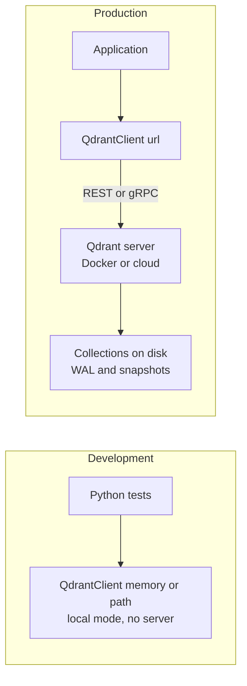

**Qdrant** is an open-source vector database written in Rust. You can run it yourself as a server (usually a Docker container), use the company's managed cloud, or, for development and tests, run it **in-process** from the Python client with no server at all. It is built around rich filtering: every record carries a JSON payload, and the engine is designed to combine payload filters with HNSW search efficiently. That, together with its quantisation options and support for several vectors per record, makes it a popular self-hosted choice for production RAG systems.

## What Qdrant is

| Aspect | Qdrant |
| --- | --- |
| Kind | Open-source database server (Rust); self-hosted, managed cloud, or local mode in the Python client |
| Data model | Collections of points: ID, one or more vectors, JSON payload |
| Index | HNSW, with optional scalar, product or binary quantisation |
| Filtering | Boolean `must` / `should` / `must_not` conditions on payload fields, with payload indexes |
| Hybrid | Sparse vectors alongside dense vectors, with result fusion |
| APIs | REST and gRPC, with official clients for several languages |



## Core concepts

- **Collection.** A named set of points with a vector configuration: size (dimension) and distance (`COSINE`, `DOT`, `EUCLID` or `MANHATTAN`).
- **Point.** The record: an `id` (unsigned integer or UUID string), a `vector`, and a `payload` (any JSON object).
- **Payload index.** An index on one payload field. Without it, filters on that field still work but are slower, and the query planner cannot estimate selectivity well. Create indexes for the fields you filter on.
- **Named vectors.** A collection can store several vectors per point, such as a title embedding and a body embedding, or a dense and a sparse vector; queries say which one to use.

## Running Qdrant

For a local server, the official Docker image is the usual route (Docker is covered in [Docker and containers](/learn/docker-and-containers)):

```bash
docker run -p 6333:6333 -v "$(pwd)/qdrant_storage:/qdrant/storage" qdrant/qdrant
pip install qdrant-client
```

Then `QdrantClient(url="http://localhost:6333")` connects to it. For the examples here, the client's local mode stands in for the server: `QdrantClient(":memory:")` keeps everything in memory, and `QdrantClient(path="./qdrant_local")` persists to a folder. Local mode implements the same API in Python, which makes it ideal for unit tests, but it is not meant for production load. The examples were run with `qdrant-client` 1.20; the client API has evolved (for example, `query_points` superseded the older `search` method), so check the [official documentation](https://qdrant.tech/documentation/) for your version.

## Creating a collection and upserting points

```python
from qdrant_client import QdrantClient, models

client = QdrantClient(":memory:")

client.create_collection(
    collection_name="support_articles",
    vectors_config=models.VectorParams(size=3, distance=models.Distance.COSINE),
)

client.upsert(
    collection_name="support_articles",
    points=[
        models.PointStruct(id=1, vector=[0.9, 0.1, 0.0],
                           payload={"text": "Cannot log in after password reset", "topic": "account", "year": 2023}),
        models.PointStruct(id=2, vector=[0.1, 0.9, 0.1],
                           payload={"text": "Charged twice for one order", "topic": "billing", "year": 2024}),
        models.PointStruct(id=3, vector=[0.0, 0.8, 0.3],
                           payload={"text": "Refund still not received", "topic": "billing", "year": 2023}),
        models.PointStruct(id=4, vector=[0.1, 0.1, 0.9],
                           payload={"text": "Package stuck in transit", "topic": "shipping", "year": 2024}),
    ],
)
print(client.count(collection_name="support_articles").count)
```

```output
4
```

`create_collection` fails if the collection already exists; scripts that may run twice should check with `client.collection_exists("support_articles")` first. In a real system the vectors come from your embedding model, and string chunk IDs are usually turned into UUIDs (for example with `uuid.uuid5`) because Qdrant IDs must be integers or UUIDs.

## Querying

```python
res = client.query_points(
    collection_name="support_articles",
    query=[0.0, 0.9, 0.2],
    limit=3,
)
for point in res.points:
    print(point.id, round(point.score, 4), point.payload["text"])
```

```output
3 0.9902 Refund still not received
2 0.9882 Charged twice for one order
4 0.3215 Package stuck in transit
```

With cosine distance, Qdrant returns a **similarity** score, so higher is better. These are $1 -$ the cosine distances that Chroma reported for the same vectors in the [ChromaDB lesson](/learn/vector-databases/chromadb).

## Filtering

Filters are built from conditions grouped into `must` (all must hold), `should` (at least one) and `must_not` (none may hold):

```python
billing_2024 = models.Filter(
    must=[
        models.FieldCondition(key="topic", match=models.MatchValue(value="billing")),
        models.FieldCondition(key="year", range=models.Range(gte=2024)),
    ]
)
res = client.query_points(
    collection_name="support_articles",
    query=[0.0, 0.9, 0.2],
    query_filter=billing_2024,
    limit=3,
    with_payload=["text"],
)
print([(p.id, p.payload) for p in res.points])
```

```output
[(2, {'text': 'Charged twice for one order'})]
```

`with_payload` can be `True`, `False` or a list of fields, so you only transfer what you need. On a server, create a payload index for each filtered field so that the planner can choose between filtered HNSW traversal and a direct scan of the matching points, the strategies described in [metadata filtering](/learn/vector-databases/metadata-filtering):

```python
client.create_payload_index(
    collection_name="support_articles",
    field_name="topic",
    field_schema=models.PayloadSchemaType.KEYWORD,
)
```

Local mode accepts this call but warns that payload indexes have no effect there; they matter on a real server.

## Retrieving and deleting

```python
client.delete(
    collection_name="support_articles",
    points_selector=models.PointIdsList(points=[4]),
)
print(client.count(collection_name="support_articles").count)
print(client.retrieve(collection_name="support_articles", ids=[2])[0].payload)
```

```output
3
{'text': 'Charged twice for one order', 'topic': 'billing', 'year': 2024}
```

`points_selector` also accepts a `models.FilterSelector(filter=...)`, which deletes every point matching a filter, for example all chunks of one source document.

## Production features worth knowing

| Feature | What it gives you |
| --- | --- |
| Quantisation (scalar, product, binary) | Smaller in-memory vectors, optionally re-scoring with originals |
| On-disk vectors and payloads | Collections larger than RAM |
| HNSW configuration per collection | Control of `m` and `ef_construct`, and search-time `hnsw_ef` |
| Sparse vectors and fusion | Hybrid search, including reciprocal rank fusion |
| Snapshots | Backups and migration of collections |
| Sharding and replication | Distributed deployments for scale and availability |
| Multi-tenancy guidance | Patterns for many tenants in one collection using an indexed tenant field |

> [!TIP]
> Use the same code path in tests and production by making the client a parameter: `QdrantClient(":memory:")` in unit tests, `QdrantClient(url=...)` in production. The test suite then needs no running server.

## When to choose Qdrant

Choose Qdrant when you want an open-source, self-hostable database built for production, when filtering on payloads is central to your queries, when you need quantisation or on-disk storage to fit large collections, or when you want the option of a managed cloud later without changing your code. If you only need a quick prototype in a notebook, Chroma is simpler; if your data already lives in PostgreSQL, pgvector may avoid a second system.

> [!KEY]
> Qdrant stores points (ID, vectors, JSON payload) in collections and combines HNSW search with payload filters. Use local mode for tests, a Docker container or the cloud for production, create payload indexes for filtered fields, and remember that scores are similarities for cosine.

## Exercises

**1.** Write a filter for points whose topic is `billing` or `account`, excluding anything from 2023.

<details>
<summary>Show solution</summary>

```python
flt = models.Filter(
    should=[
        models.FieldCondition(key="topic", match=models.MatchValue(value="billing")),
        models.FieldCondition(key="topic", match=models.MatchValue(value="account")),
    ],
    must_not=[
        models.FieldCondition(key="year", match=models.MatchValue(value=2023)),
    ],
)
res = client.query_points(collection_name="support_articles", query=[0.0, 0.9, 0.2],
                          query_filter=flt, limit=5)
print([p.id for p in res.points])
```

```output
[2]
```

`models.MatchAny(any=["billing", "account"])` in a single `must` condition is an equivalent, shorter form for the topic part.

</details>

**2.** Your chunk IDs are strings such as `"handbook.pdf#12"`. Qdrant rejects them as point IDs. How do you produce stable valid IDs?

<details>
<summary>Show solution</summary>

Derive a UUID deterministically from the string, and keep the original in the payload:

```python
import uuid
point_id = str(uuid.uuid5(uuid.NAMESPACE_URL, "handbook.pdf#12"))
```

The same string always gives the same UUID, so re-ingesting overwrites rather than duplicates.

</details>

**3.** A team's filtered queries on `tenant_id` are much slower in production than in their local-mode tests. What is the most likely missing step?

<details>
<summary>Show solution</summary>

They have not created a payload index on `tenant_id` on the server. Local mode ignores payload indexes, so tests never revealed the difference. Create a keyword (or integer) index on the field.

</details>

```quiz
[
  {
    "q": "What does `QdrantClient(\":memory:\")` give you?",
    "options": [
      "A connection to Qdrant Cloud",
      "An in-process local mode with no server, useful for tests",
      "A Redis cache in front of Qdrant",
      "A read-only client"
    ],
    "answer": 1,
    "why": "Local mode implements the API inside the Python client, so tests run without a server."
  },
  {
    "q": "In a Qdrant filter, what does `should` mean?",
    "options": [
      "All conditions must hold",
      "No condition may hold",
      "At least one condition must hold",
      "The conditions are ignored if no results match"
    ],
    "answer": 2,
    "why": "`should` is a logical OR over its conditions; `must` is AND and `must_not` is NOT."
  },
  {
    "q": "Why create a payload index on a field you filter by?",
    "options": [
      "Filters on unindexed fields are not allowed",
      "It lets the server evaluate the filter efficiently and plan filtered search",
      "It changes the distance metric",
      "It compresses the vectors"
    ],
    "answer": 1,
    "why": "Payload indexes speed up filter evaluation and let the planner estimate selectivity."
  },
  {
    "q": "Which values are valid Qdrant point IDs?",
    "options": [
      "Any string",
      "Floats",
      "Unsigned integers or UUIDs",
      "Only UUIDs"
    ],
    "answer": 2,
    "why": "Point IDs are unsigned integers or UUIDs; arbitrary strings must be mapped to UUIDs."
  }
]
```
