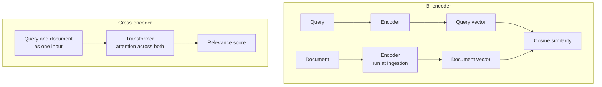
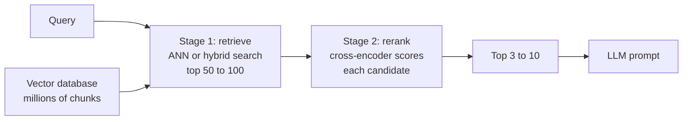

Vector search is fast because each document's embedding is computed once, in advance, without knowing the query. That same property limits its accuracy: the model never sees the query and the document together, so it cannot weigh how a specific word in one relates to a specific phrase in the other. **Reranking** adds a second, slower, more accurate stage that looks at each query-document pair jointly, but only for a short list of candidates. It is one of the highest-value additions to a RAG pipeline, and it shapes how you configure the vector database in front of it: the first stage no longer needs to put the best document first, only somewhere in the top 50 or 100.

## Bi-encoders and cross-encoders

The embedding models used for vector search are **bi-encoders**: the query and the document are encoded separately into vectors, and relevance is their similarity.

$$
\text{score}_{\text{bi}}(q, D) = \cos\big(E(q), E(D)\big)
$$

where $E$ is the encoder. Because $E(D)$ does not depend on $q$, every document can be embedded at ingestion time and indexed.

A **cross-encoder** feeds the query and the document into one transformer together, so attention runs across both texts, and outputs a single relevance score:

$$
\text{score}_{\text{cross}}(q, D) = f\big([q;\, D]\big)
$$

where $[q;\, D]$ is the concatenated pair and $f$ the model. Nothing can be precomputed: scoring 1,000 documents means 1,000 full forward passes for every query.



| | Bi-encoder | Cross-encoder |
| --- | --- | --- |
| Input | One text at a time | Query and document together |
| Precomputable | Yes, document vectors are indexed | No, runs per pair at query time |
| Cost per query | One encoding plus an ANN search | One forward pass per candidate |
| Accuracy | Good | Usually clearly better at fine-grained relevance |
| Role | First-stage retrieval over millions | Second-stage reranking of tens to hundreds |

Between the two sit **late-interaction** models such as ColBERT, which store one vector per token and compare query and document tokens at search time. They are more accurate than single-vector bi-encoders and cheaper than cross-encoders, at the cost of much more storage.

## Two-stage retrieval



Each stage has a different job. Stage 1 is optimised for **recall**: the relevant documents must be somewhere in the candidate list, because the reranker cannot recover a document that was never retrieved. Stage 2 is optimised for **precision** at the top: the few chunks that reach the LLM must be the best ones. This split lets you use a cheap retriever with a generous candidate count, and spend the expensive model only where it matters.

## A reranking pipeline in code

The `sentence-transformers` library provides a `CrossEncoder` class for this. The model below is one publicly available reranker trained on search data; treat the name as an example and check the current model hub for alternatives. This code needs the library and a model download, so no output is shown.

```python
from sentence_transformers import CrossEncoder

reranker = CrossEncoder("cross-encoder/ms-marco-MiniLM-L-6-v2")

def rerank(query, candidates, top_n=5):
    """candidates: list of (doc_id, text) from the first-stage search."""
    pairs = [(query, text) for _, text in candidates]
    scores = reranker.predict(pairs)          # one score per pair, batched internally
    ranked = sorted(zip(candidates, scores), key=lambda x: -x[1])
    return [(doc_id, float(score)) for (doc_id, _), score in ranked[:top_n]]
```

Hosted reranking APIs from several model providers do the same job behind an HTTP call, and an LLM can also be prompted to score or order candidates, which is flexible but slower and more expensive per query.

## What reranking can and cannot fix

A simulation makes the two-stage logic concrete. Each simulated query has 1,000 candidate documents, 5 of which are relevant. The first-stage score is relevance plus a lot of noise (a cheap, imprecise model); the reranker score is relevance plus a little noise (an accurate model). The question is how many relevant documents end up in the final top 5.

```python
import numpy as np

rng = np.random.default_rng(3)
n_queries, n_docs, n_relevant = 300, 1000, 5

def simulate(depth, top_n=5):
    hits_stage1, hits_rerank, recall_at_depth = [], [], []
    for _ in range(n_queries):
        rel = np.zeros(n_docs)
        rel[:n_relevant] = 1
        stage1 = rel + rng.normal(scale=0.5, size=n_docs)      # noisy retriever
        cross = rel + rng.normal(scale=0.15, size=n_docs)      # accurate reranker
        cand = np.argsort(-stage1)[:depth]                      # stage 1 shortlist
        final = cand[np.argsort(-cross[cand])[:top_n]]          # stage 2 reorder
        hits_stage1.append(rel[np.argsort(-stage1)[:top_n]].sum())
        hits_rerank.append(rel[final].sum())
        recall_at_depth.append(rel[cand].sum() / n_relevant)
    return np.mean(hits_stage1), np.mean(hits_rerank), np.mean(recall_at_depth)

print("depth  stage-1 hits@5  reranked hits@5  stage-1 recall@depth")
for depth in [5, 20, 50, 100, 200, 500]:
    s1, rr, rec = simulate(depth)
    print(f"{depth:>5}  {s1:14.2f}  {rr:15.2f}  {rec:20.2f}")
```

```output
depth  stage-1 hits@5  reranked hits@5  stage-1 recall@depth
    5            1.29             1.29                  0.26
   20            1.35             2.39                  0.48
   50            1.28             3.20                  0.64
  100            1.20             3.70                  0.74
  200            1.24             4.29                  0.86
  500            1.27             4.86                  0.97
```

Three things to read from this:

- Reranking the top 5 only reorders them, so it adds nothing to hits@5. The gain comes from reranking a **deeper** list.
- Reranked hits@5 can never exceed what the shortlist contains: it tracks the recall at that depth. Missing documents are a first-stage problem.
- Each increase in depth buys less than the one before, while the reranking cost grows in proportion to the depth. The right depth is a trade-off you find by measuring on your own data, as here.

> [!KEY]
> The retriever's job is recall at depth; the reranker's job is precision at the top. Tune them separately: increase first-stage depth until recall@depth is high enough, then let the reranker choose the few chunks that reach the LLM.

## Latency budgets

Reranking cost is roughly linear in the number of candidates. A quick budget, with assumed per-batch timings that you must replace with measurements on your own hardware and model:

```python
budget_ms = 300                     # end-to-end retrieval budget (assumed target)
ann_ms = 15                         # stage 1 search (assumed)
rerank_ms_per_batch = 40            # one batch of 32 pairs on the reranker (assumed)
batch = 32

for depth in [25, 50, 100, 200]:
    batches = -(-depth // batch)    # ceiling division
    total = ann_ms + batches * rerank_ms_per_batch
    print(f"depth {depth:>3}: {batches} batches, {total:>3} ms,"
          f" {'within' if total <= budget_ms else 'over'} budget")
```

```output
depth  25: 1 batches,  55 ms, within budget
depth  50: 2 batches,  95 ms, within budget
depth 100: 4 batches, 175 ms, within budget
depth 200: 7 batches, 295 ms, within budget
```

Practical levers when reranking is too slow: rerank fewer candidates, use a smaller reranker, run it on a GPU, truncate long chunks to the reranker's maximum input length, cache results for repeated queries, and run the reranker in parallel batches.

> [!WARNING]
> Cross-encoders have a maximum input length. Text beyond it is silently truncated, so a long chunk is judged only on its beginning. Keep chunks within the reranker's limit, or rerank on a shorter passage.

## Exercises

**1.** In the simulation, change the first-stage noise from 0.5 to 0.8 (a worse retriever). How does recall at depth 50 change, and how does the reranked hits@5 respond?

<details>
<summary>Show solution</summary>

Edit the `scale=0.5` line to `scale=0.8` in a copy of `simulate`, or parameterise it:

```python
def simulate_noise(depth, noise, top_n=5):
    hits, recalls = [], []
    for _ in range(n_queries):
        rel = np.zeros(n_docs)
        rel[:n_relevant] = 1
        stage1 = rel + rng.normal(scale=noise, size=n_docs)
        cross = rel + rng.normal(scale=0.15, size=n_docs)
        cand = np.argsort(-stage1)[:depth]
        hits.append(rel[cand[np.argsort(-cross[cand])[:top_n]]].sum())
        recalls.append(rel[cand].sum() / n_relevant)
    return round(float(np.mean(hits)), 2), round(float(np.mean(recalls)), 2)

print(simulate_noise(50, 0.5), simulate_noise(50, 0.8))
```

```output
(3.1, 0.62) (1.73, 0.35)
```

Recall at depth 50 falls, and reranked hits@5 falls with it. A good reranker cannot compensate for a retriever that does not surface the relevant documents.

</details>

**2.** Why can you not build an ANN index over cross-encoder scores, the way you index bi-encoder embeddings?

<details>
<summary>Show solution</summary>

A cross-encoder score is a function of the query and the document together. There is no per-document vector to store, so nothing can be computed before the query arrives. ANN indexes require each document to be represented independently of the query.

</details>

**3.** With the assumed timings above, what is the deepest candidate list you can rerank within 300 ms?

<details>
<summary>Show solution</summary>

300 - 15 = 285 ms for reranking, which allows 7 batches of 40 ms (280 ms), so 7 x 32 = 224 candidates. In practice you would leave headroom for network calls and the LLM, so a much smaller depth is more realistic.

</details>

```quiz
[
  {
    "q": "Why is a cross-encoder more accurate than a bi-encoder for relevance?",
    "options": [
      "It uses larger vectors",
      "It reads the query and document together, so attention can relate their words directly",
      "It uses BM25 internally",
      "It is trained on more data"
    ],
    "answer": 1,
    "why": "Joint encoding lets the model compare specific parts of the query and document, which separate encoding cannot."
  },
  {
    "q": "In two-stage retrieval, what should the first stage be optimised for?",
    "options": [
      "Precision at rank 1",
      "Lowest memory",
      "Recall within the candidate list passed to the reranker",
      "Matching the reranker's scores"
    ],
    "answer": 2,
    "why": "The reranker can only reorder what it receives, so relevant documents must be in the shortlist."
  },
  {
    "q": "A team reranks only the top 5 results and sees no improvement in which documents reach the LLM. Why?",
    "options": [
      "Reranking only reorders the same 5 documents, so the set is unchanged",
      "The reranker is broken",
      "Cross-encoders need at least 1,000 candidates",
      "Reranking only works with hybrid search"
    ],
    "answer": 0,
    "why": "To change which documents reach the top 5, the reranker must see a deeper candidate list."
  },
  {
    "q": "How does reranking cost scale with the number of candidates?",
    "options": [
      "Constant",
      "Logarithmically",
      "Roughly linearly",
      "Quadratically"
    ],
    "answer": 2,
    "why": "Each candidate needs its own forward pass, so cost grows roughly in proportion to the number of candidates."
  }
]
```
