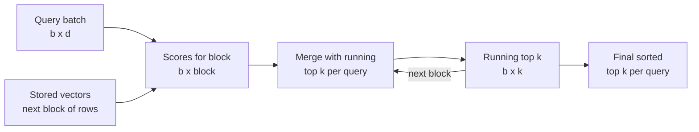

Similarity search is the core operation of every vector database: given a query vector, return the $k$ stored vectors closest to it. [Vector similarity](/learn/rag-fundamentals/vector-similarity) introduced the similarity measures from the RAG side; this lesson looks at the search itself as a database would run it. You will implement exact brute-force search in NumPy, make it fast with matrix operations and partial sorting, handle batches of queries without running out of memory, and see the pitfalls that make results look wrong. Exact search is also the yardstick for everything that follows, because approximate indexes are judged by how closely they match it.

## The k-nearest-neighbour problem

Given $n$ stored vectors $\mathbf{x}_1, \dots, \mathbf{x}_n \in \mathbb{R}^d$, a query $\mathbf{q} \in \mathbb{R}^d$ and a similarity function $s$, **k-nearest-neighbour (k-NN) search** returns the indices of the $k$ vectors with the highest $s(\mathbf{q}, \mathbf{x}_i)$ (or the lowest distance). The three common choices:

| Measure | Formula | Higher means | Notes |
| --- | --- | --- | --- |
| Dot product | $\mathbf{q}^\top \mathbf{x}$ | More similar | Sensitive to vector length |
| Cosine similarity | $\dfrac{\mathbf{q}^\top \mathbf{x}}{\lVert \mathbf{q} \rVert\,\lVert \mathbf{x} \rVert}$ | More similar | Ignores length; equals the dot product for unit vectors |
| Euclidean (L2) distance | $\lVert \mathbf{q} - \mathbf{x} \rVert$ | Less similar | Many libraries return the squared distance |

Here $\lVert \cdot \rVert$ is the Euclidean norm. Databases differ in whether they report a similarity (higher is better) or a distance (lower is better), and some report cosine *distance*, $1 - \cos$. Always check which before you write a threshold.

## Brute force in NumPy

Exact search is one matrix-vector product followed by a top-$k$ selection. Here is a toy collection of six "documents" with hand-made 4-dimensional embeddings, so that you can see the result is sensible:

```python
import numpy as np

titles = ["Reset your password", "Two-factor login codes", "Refund policy",
          "Charged twice", "Shipping times", "Track a parcel"]
X = np.array([[0.9, 0.2, 0.0, 0.1],
              [0.8, 0.3, 0.1, 0.0],
              [0.1, 0.9, 0.3, 0.0],
              [0.0, 0.8, 0.5, 0.1],
              [0.1, 0.0, 0.2, 0.9],
              [0.0, 0.1, 0.3, 0.9]], dtype=np.float32)
X /= np.linalg.norm(X, axis=1, keepdims=True)    # normalise once, at ingestion

def search(X, q, k):
    q = q / np.linalg.norm(q)
    scores = X @ q                                # cosine, since rows are unit length
    top = np.argpartition(-scores, k - 1)[:k]     # unordered top k, O(n)
    top = top[np.argsort(-scores[top])]           # sort only those k
    return top, scores[top]

query = np.array([0.1, 0.85, 0.4, 0.0])          # "I was billed two times"
idx, sc = search(X, query, k=3)
for i, s in zip(idx, sc):
    print(f"{s:.3f}  {titles[i]}")
```

```output
0.993  Refund policy
0.982  Charged twice
0.461  Two-factor login codes
```

`np.argpartition` finds the $k$ largest scores in linear time without sorting all $n$; only the $k$ winners are then sorted. For large $n$ and small $k$ that is noticeably cheaper than `np.argsort` on everything. A quick check on random data confirms it returns exactly the same neighbours as a full sort:

```python
rng = np.random.default_rng(42)
big = rng.normal(size=(50_000, 64)).astype(np.float32)
big /= np.linalg.norm(big, axis=1, keepdims=True)
q = rng.normal(size=64).astype(np.float32)

fast, _ = search(big, q, k=10)
full = np.argsort(-(big @ (q / np.linalg.norm(q))))[:10]
print(np.array_equal(fast, full), fast[:5])
```

```output
True [31168 34199   789 18213  3081]
```

## Top-k selection, step by step

Databases that scan vectors one at a time keep the running top $k$ in a small min-heap: the smallest of the current best scores sits at the root, and a new candidate only gets in if it beats that root. Step through it with $k = 2$:

```trace
{
  "title": "streaming top-2 with a min-heap",
  "code": [
    "import heapq",
    "scores = [0.2, 0.9, 0.4, 0.95, 0.1]",
    "heap = []",
    "for i, s in enumerate(scores):",
    "    if len(heap) < 2:",
    "        heapq.heappush(heap, (s, i))",
    "    elif s > heap[0][0]:",
    "        heapq.heapreplace(heap, (s, i))",
    "print(sorted(heap, reverse=True))"
  ],
  "steps": [
    { "line": 3, "vars": { "heap": "[]" }, "note": "The heap will hold at most k = 2 (score, index) pairs." },
    { "line": 6, "vars": { "i": "0", "s": "0.2", "heap": "[(0.2, 0)]" }, "note": "Fewer than k items, so the first candidate goes straight in." },
    { "line": 6, "vars": { "i": "1", "s": "0.9", "heap": "[(0.2, 0), (0.9, 1)]" }, "note": "Still filling. The root heap[0] is now the weakest of the two, 0.2." },
    { "line": 8, "vars": { "i": "2", "s": "0.4", "heap": "[(0.4, 2), (0.9, 1)]" }, "note": "0.4 beats the root 0.2, so it replaces it. The heap is full, and each check costs one comparison." },
    { "line": 8, "vars": { "i": "3", "s": "0.95", "heap": "[(0.9, 1), (0.95, 3)]" }, "note": "0.95 beats the root 0.4, which is evicted. 0.9 becomes the new root." },
    { "line": 7, "vars": { "i": "4", "s": "0.1", "heap": "[(0.9, 1), (0.95, 3)]" }, "note": "0.1 does not beat 0.9, so it is discarded with a single comparison." },
    { "line": 9, "vars": { "heap": "[(0.9, 1), (0.95, 3)]" }, "out": ["[(0.95, 3), (0.9, 1)]"], "note": "The final top 2, best first. Memory stayed at k items however long the scan." }
  ]
}
```

The heap keeps memory at $O(k)$ and costs $O(\log k)$ per accepted candidate, so a single pass over $n$ vectors is $O(nd + n \log k)$.

## Many queries at once

Real systems answer queries in batches. With a query matrix $Q$ of shape $(b, d)$, all scores come from one matrix product $Q X^\top$ of shape $(b, n)$, which BLAS libraries compute far faster than $b$ separate loops. The catch is memory: 1,000 queries against 10 million vectors is a 40 GB score matrix. The fix is to scan the collection in blocks and merge the per-block winners:



```python
def batch_search(X, Q, k, block=20_000):
    Q = Q / np.linalg.norm(Q, axis=1, keepdims=True)
    best_s = np.full((len(Q), k), -np.inf, dtype=np.float32)
    best_i = np.zeros((len(Q), k), dtype=np.int64)
    for start in range(0, len(X), block):
        s = Q @ X[start:start + block].T                       # (b, block)
        s = np.concatenate([best_s, s], axis=1)
        i = np.concatenate([best_i, np.arange(start, start + s.shape[1] - k)
                            + np.zeros((len(Q), 1), dtype=np.int64)], axis=1)
        keep = np.argpartition(-s, k - 1, axis=1)[:, :k]
        best_s = np.take_along_axis(s, keep, axis=1)
        best_i = np.take_along_axis(i, keep, axis=1)
    order = np.argsort(-best_s, axis=1)
    return np.take_along_axis(best_i, order, axis=1)

Qs = rng.normal(size=(5, 64)).astype(np.float32)
blocked = batch_search(big, Qs, k=10)
direct = np.argsort(-(Qs / np.linalg.norm(Qs, axis=1, keepdims=True)) @ big.T, axis=1)[:, :10]
print(blocked.shape, np.array_equal(blocked, direct))
```

```output
(5, 10) True
```

Peak memory is now $b \times$ `block` scores instead of $b \times n$, and the answer is identical. Exact search libraries use essentially this block-and-merge pattern internally.

## Euclidean distance without a loop

If your metric is L2 and the vectors are not normalised, expand the square so that the expensive part is still a matrix product:

$$
\lVert \mathbf{q} - \mathbf{x} \rVert^2 = \lVert \mathbf{q} \rVert^2 - 2\,\mathbf{q}^\top \mathbf{x} + \lVert \mathbf{x} \rVert^2
$$

Precompute $\lVert \mathbf{x}_i \rVert^2$ once at ingestion. For ranking a single query, $\lVert \mathbf{q} \rVert^2$ is the same for every candidate and can be dropped.

```python
sq_norms = (X ** 2).sum(axis=1)                    # stored once
q = query.astype(np.float32)
d2 = sq_norms - 2 * X @ q + q @ q
print(np.allclose(d2, ((X - q) ** 2).sum(axis=1), atol=1e-6), np.argsort(d2)[:3])
```

```output
True [2 3 1]
```

## Pitfalls

> [!WARNING]
> With an unnormalised **dot product**, long vectors win regardless of direction. If your model expects cosine similarity, either normalise the vectors or configure the database for cosine. Mixing them up does not raise an error; it just quietly returns worse neighbours.

- **Fixed score thresholds** ("only return results above 0.8") do not transfer between models, because each model spreads its scores differently. Calibrate thresholds on labelled examples per model.
- **The nearest neighbour always exists.** Similarity search returns $k$ results even when nothing relevant is stored. Your application must decide what to do with weak matches.
- **Queries and documents may need different prefixes.** Some embedding models expect an instruction such as "query:" before search queries. Check the model card.
- **Brute force is $O(nd)$ per query.** That is fine for small collections and for measuring recall, but at millions of vectors and many queries per second you need an [approximate index](/learn/vector-databases/approximate-nearest-neighbors).

> [!KEY]
> Exact search is a matrix product plus a top-$k$ selection. Normalise once, partial-sort instead of fully sorting, and process big batches in blocks. Keep an exact implementation around: it is your ground truth.

## Exercises

**1.** Modify `search` so that it uses dot product *without* normalising the stored vectors. Add a seventh document whose vector is `[0.0, 5.0, 0.0, 0.0]` (a very long vector) to the unnormalised matrix and query again. What happens?

<details>
<summary>Show solution</summary>

```python
X_raw = np.vstack([X, [[0.0, 5.0, 0.0, 0.0]]])
scores = X_raw @ query
print(np.argsort(-scores)[:3], scores.max().round(3))
```

```output
[6 2 3] 4.25
```

Index 6, the long vector, ranks first purely because of its length. With cosine similarity its score would be about 0.90, in the same range as the genuine matches.

</details>

**2.** Write a function `recall_at_k(true_ids, found_ids)` that returns the fraction of the true top-$k$ that appear in the found list, and check it returns 1.0 for `fast` and `full` above.

<details>
<summary>Show solution</summary>

```python
def recall_at_k(true_ids, found_ids):
    return len(set(true_ids) & set(found_ids)) / len(true_ids)

print(recall_at_k(full, fast), recall_at_k(full, fast[:5]))
```

```output
1.0 0.5
```

You will use this function to evaluate approximate indexes.

</details>

```quiz
[
  {
    "q": "Why use `np.argpartition` before `np.argsort` for top-k?",
    "options": [
      "It finds the k best in linear time, so only k items need sorting",
      "It returns results in sorted order",
      "It is required for cosine similarity",
      "It avoids computing the scores"
    ],
    "answer": 0,
    "why": "Partitioning isolates the k largest scores without ordering the rest; sorting k items afterwards is cheap."
  },
  {
    "q": "A batch of 1,000 queries against 10 million vectors runs out of memory. What is the standard fix?",
    "options": [
      "Use a larger k",
      "Switch from cosine to dot product",
      "Scan the collection in blocks and merge per-block top-k results",
      "Sort all scores with `np.sort`"
    ],
    "answer": 2,
    "why": "Block-wise scanning bounds the score matrix to queries x block size while giving exactly the same result."
  },
  {
    "q": "In the expansion of squared L2 distance, which term can be dropped when ranking candidates for one query?",
    "options": [
      "The dot product term",
      "The squared norm of the query",
      "The squared norm of each stored vector",
      "None of them"
    ],
    "answer": 1,
    "why": "The query's norm is identical for every candidate, so it shifts all distances equally and does not change the order."
  },
  {
    "q": "Why should fixed similarity thresholds be calibrated per embedding model?",
    "options": [
      "Thresholds only work with L2 distance",
      "Models spread their similarity scores over different ranges",
      "Vector databases ignore thresholds",
      "Cosine similarity can exceed 1"
    ],
    "answer": 1,
    "why": "A score of 0.8 can be a strong match for one model and a weak one for another, so thresholds must be set from labelled data."
  }
]
```
