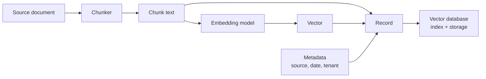

An embedding model turns a piece of text, an image or a product into a fixed-length list of numbers, and [embedding generation](/learn/rag-fundamentals/embedding-generation) showed how to produce them for a RAG pipeline. This module is about what happens next: where those vectors live, how you find the closest ones among millions in a few milliseconds, and how you keep them in sync with the documents they describe. That is the job of a **vector database**. Before looking at indexes and products, you need a precise picture of the data a vector database stores and the properties of embeddings that decide how it must be stored and searched.

## What is stored: the vector record

A vector database does not store "embeddings" on their own. It stores **records**, and every product uses some variant of the same shape:

| Field | Example | Purpose |
| --- | --- | --- |
| ID | `"doc-42#chunk-3"` | Stable key for updates and deletes |
| Vector | 384 or 1,536 floats | What similarity search runs on |
| Metadata (payload) | `{"source": "handbook.pdf", "lang": "en", "year": 2024}` | Filtering, display, access control |
| Document (optional) | The chunk text | Returned to the application or the LLM |



The ID matters more than beginners expect. If you derive IDs deterministically from the source (file path plus chunk number, or a hash of both), re-ingesting a document overwrites its old chunks instead of duplicating them. Random IDs make updates and deletes painful.

## Properties of embeddings that affect storage

Three properties of an embedding model fix how the database must be configured. Get any of them wrong and search silently returns poor results rather than failing.

**Dimension.** Every vector from a given model has the same length $d$. A collection is created with a fixed dimension, and inserting a vector of a different length is an error. Changing models therefore means creating a new collection and re-embedding everything; you cannot mix vectors from two models in one index, because their coordinates mean different things.

**Distance metric.** The model was trained so that a particular similarity function is meaningful, usually cosine similarity or dot product. The database must use the same one. The model card normally says which.

**Normalisation.** Many models output unit-length vectors, $\lVert \mathbf{x} \rVert = 1$, where $\lVert \mathbf{x} \rVert = \sqrt{\sum_i x_i^2}$ is the Euclidean norm. For unit vectors, cosine similarity equals the dot product, and Euclidean distance is a simple function of it:

$$
\lVert \mathbf{a} - \mathbf{b} \rVert^2 = 2 - 2\,\mathbf{a}^\top \mathbf{b} \quad \text{when } \lVert \mathbf{a} \rVert = \lVert \mathbf{b} \rVert = 1
$$

So on normalised data, cosine, dot product and L2 all rank neighbours identically. That is why it is common to normalise once at ingestion and then use the cheapest metric.

```python
import numpy as np

rng = np.random.default_rng(0)
a, b = rng.normal(size=(2, 8))
a /= np.linalg.norm(a)
b /= np.linalg.norm(b)

print(round(float(np.sum((a - b) ** 2)), 6))
print(round(float(2 - 2 * a @ b), 6))
```

```output
2.497731
2.497731
```

## How much memory do vectors take?

Vectors are stored as 32-bit floats (4 bytes each) unless you choose otherwise, so raw storage is simply $n \times d \times 4$ bytes for $n$ vectors of dimension $d$. This arithmetic drives most architecture decisions in this module, so do it before choosing a database.

```python
def raw_gib(n, d, bytes_per_value=4):
    return n * d * bytes_per_value / 2**30

for n, d in [(100_000, 384), (1_000_000, 768), (10_000_000, 1536)]:
    print(f"{n:>11,} x {d:>4}: {raw_gib(n, d):7.2f} GiB as float32,"
          f" {raw_gib(n, d, 2):7.2f} GiB as float16")
```

```output
    100,000 x  384:    0.14 GiB as float32,    0.07 GiB as float16
  1,000,000 x  768:    2.86 GiB as float32,    1.43 GiB as float16
 10,000,000 x 1536:   57.22 GiB as float32,   28.61 GiB as float16
```

A hundred thousand chunks fit comfortably in a laptop's memory. Ten million high-dimensional vectors need tens of gigabytes before any index overhead, which is when compression ([vector indexing](/learn/vector-databases/vector-indexing) covers product quantisation) or a distributed service starts to matter.

> [!NOTE]
> Lower precision is a real option. Many databases support float16 or 8-bit scalar quantisation, and some models are trained so that their vectors can be truncated to fewer dimensions. Both trade a little accuracy for a large memory saving; measure the effect on your own queries before adopting either.

## Why not just a NumPy array?

For a few thousand vectors, a NumPy matrix and a dot product are a perfectly good vector store. Here is a minimal one, which also makes clear what a real database has to add:

```python
class TinyVectorStore:
    def __init__(self, dim):
        self.dim = dim
        self.ids, self.meta = [], []
        self.vectors = np.empty((0, dim), dtype=np.float32)

    def add(self, ids, vectors, metadata):
        vectors = np.asarray(vectors, dtype=np.float32)
        assert vectors.shape[1] == self.dim, "dimension mismatch"
        vectors /= np.linalg.norm(vectors, axis=1, keepdims=True)
        self.vectors = np.vstack([self.vectors, vectors])
        self.ids += list(ids)
        self.meta += list(metadata)

    def delete(self, doc_id):
        i = self.ids.index(doc_id)
        self.vectors = np.delete(self.vectors, i, axis=0)
        del self.ids[i], self.meta[i]

    def query(self, vector, k=2):
        q = np.asarray(vector, dtype=np.float32)
        scores = self.vectors @ (q / np.linalg.norm(q))
        top = np.argsort(-scores)[:k]
        return [(self.ids[i], round(float(scores[i]), 3)) for i in top]

store = TinyVectorStore(dim=3)
store.add(["a", "b", "c"],
          [[0.9, 0.1, 0.0], [0.1, 0.9, 0.1], [0.0, 0.8, 0.3]],
          [{"lang": "en"}, {"lang": "en"}, {"lang": "de"}])
print(store.query([0.0, 0.9, 0.2]))
store.delete("c")
print(store.query([0.0, 0.9, 0.2]))
```

```output
[('c', 0.99), ('b', 0.988)]
[('b', 0.988), ('a', 0.108)]
```

It works, but look at what is missing. Each gap is a feature a vector database provides:

| Gap in the NumPy version | What a vector database adds |
| --- | --- |
| Lost when the process exits | **Persistence**: data on disk, write-ahead logs, snapshots, backups |
| `np.vstack` and `np.delete` copy the whole matrix | Efficient **CRUD**: inserts, upserts and deletes without rebuilding |
| Metadata is ignored by `query` | **Metadata filtering** combined with similarity search |
| Every query scans every vector | **Approximate nearest neighbour (ANN) indexes** that touch a small fraction |
| One process, one machine's memory | **Scale**: sharding, replication, concurrent clients over an API |
| No access control | Multi-tenancy, authentication, namespaces |

The rest of this module takes these in turn: indexes, exact and approximate search, filtering and hybrid retrieval, then five concrete tools.

> [!KEY]
> A vector database is a database first: it stores records with IDs and metadata durably and lets many clients read and write them. The ANN index is what makes it fast, but persistence, updates and filtering are what make it usable in production.

## Choosing where vectors live

You have more options than dedicated vector databases:

- **A library in your process**, such as FAISS: fastest to start, but you handle persistence and metadata yourself.
- **An embedded database**, such as ChromaDB in local mode: a real database in your Python process, stored in a folder.
- **A vector extension to a database you already run**, such as pgvector for PostgreSQL, introduced in [PostgreSQL](/learn/sql-and-databases/postgresql). Vectors sit next to your relational data, and filters are ordinary `WHERE` clauses.
- **A dedicated server or managed service**, such as Qdrant, Weaviate or Pinecone, built for large collections and many concurrent users.

The right choice depends mostly on scale, how much operational work you can take on, and whether your vectors need to be joined with other data.

## Exercises

**1.** Calculate the raw float32 memory for 2 million vectors of dimension 1,024, in GiB. Then calculate it if each vector were truncated to 256 dimensions.

<details>
<summary>Show solution</summary>

```python
print(raw_gib(2_000_000, 1024), raw_gib(2_000_000, 256))
```

```output
7.62939453125 1.9073486328125
```

About 7.6 GiB at full dimension, and a quarter of that, about 1.9 GiB, at 256 dimensions.

</details>

**2.** Add an `upsert` method to `TinyVectorStore` that replaces the vector and metadata of an existing ID, or adds the record if the ID is new.

<details>
<summary>Show solution</summary>

```python
def upsert(self, doc_id, vector, metadata):
    if doc_id in self.ids:
        self.delete(doc_id)
    self.add([doc_id], [vector], [metadata])

TinyVectorStore.upsert = upsert
store.upsert("a", [0.0, 1.0, 0.0], {"lang": "fr"})
print(store.ids, store.meta)
print(store.query([0.0, 0.9, 0.2]))
```

```output
['b', 'a'] [{'lang': 'en'}, {'lang': 'fr'}]
[('b', 0.988), ('a', 0.976)]
```

Deleting then re-adding moves the record to the end; a real database updates in place, but the observable result is the same.

</details>

**3.** A colleague switches the embedding model from one with 768 dimensions to one with 1,024 and plans to insert the new vectors into the existing collection. What will happen, and what should they do instead?

<details>
<summary>Show solution</summary>

The insert fails because the collection was created with dimension 768. Even if the dimensions matched, mixing models would be wrong: the two models' coordinates are unrelated, so distances between old and new vectors are meaningless. Create a new collection, re-embed every document with the new model, switch queries over, then delete the old collection.

</details>

```quiz
[
  {
    "q": "Why should vector record IDs usually be derived deterministically from the source?",
    "options": [
      "Databases reject random IDs",
      "So that re-ingesting a document overwrites its chunks instead of duplicating them",
      "Deterministic IDs make similarity search faster",
      "The embedding model needs the ID as input"
    ],
    "answer": 1,
    "why": "Stable IDs let an upsert replace the old version of a chunk, keeping the collection free of duplicates."
  },
  {
    "q": "For unit-length vectors, which statement is true?",
    "options": [
      "Cosine similarity and Euclidean distance can give different nearest neighbours",
      "Dot product is always zero",
      "Cosine similarity equals the dot product, and L2 distance ranks neighbours the same way",
      "Euclidean distance is undefined"
    ],
    "answer": 2,
    "why": "With unit norms, cosine equals the dot product and the squared L2 distance is 2 minus twice the dot product, so all three rank identically."
  },
  {
    "q": "Roughly how much raw memory do 1 million float32 vectors of dimension 768 need?",
    "options": ["About 2.9 GiB", "About 290 MiB", "About 29 GiB", "About 768 MiB"],
    "answer": 0,
    "why": "1,000,000 x 768 x 4 bytes is about 3.07 billion bytes, which is about 2.86 GiB."
  },
  {
    "q": "Which of these is NOT something a vector database typically adds over a NumPy matrix?",
    "options": [
      "Persistence to disk",
      "Metadata filtering",
      "Approximate nearest neighbour indexes",
      "Producing the embeddings from raw text without any model"
    ],
    "answer": 3,
    "why": "Embeddings always come from a model. Some databases can call a model for you, but none create embeddings without one."
  }
]
```
