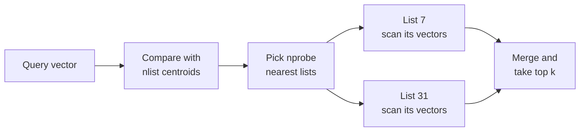
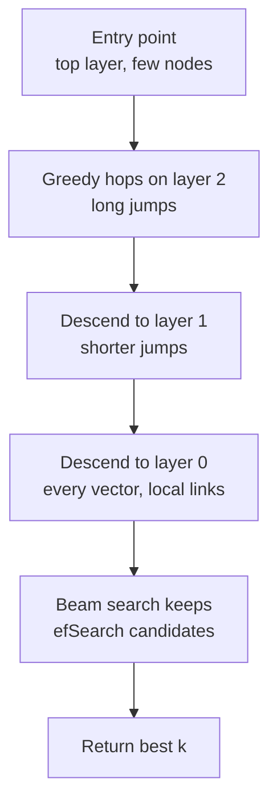
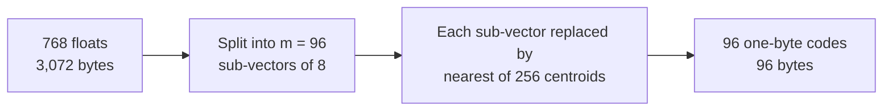
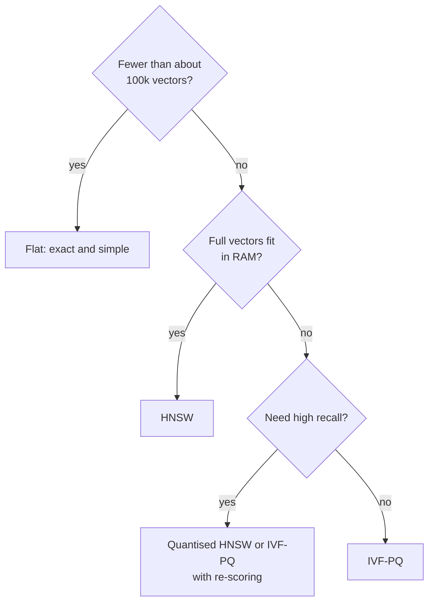

A vector index is a data structure that answers "which stored vectors are closest to this query?" without necessarily comparing the query with every one of them. It plays the same role as a B-tree index in [SQL indexing](/learn/sql-and-databases/indexing), but the problem is harder: there is no sort order for points in 768-dimensional space, so the tricks that make B-trees work do not apply. Instead, vector databases use a small family of index types, each with a different bargain between recall, speed, memory and build time. Almost every product you will meet is built from the four in this lesson: flat, IVF, HNSW and PQ.

## The three-way trade-off

Every index choice is a position on three axes:

- **Recall**: the fraction of the true nearest neighbours the index returns. Exact search has recall 1.0; approximate indexes trade some of it away.
- **Latency** (and throughput): how long one query takes, and how many queries per second a machine can serve.
- **Memory**: the bytes per vector, including the index's own structures.

A fourth cost, **build time**, matters when data changes often. You cannot maximise all of them at once. A useful habit is to fix the recall you need (say 0.95 at k = 10, measured on your own queries) and then find the cheapest index that reaches it.

## Flat: no index at all

A **flat** index stores the vectors in one contiguous array and compares the query with all of them. It is exact, has no build step, supports any number of inserts, and costs exactly $n \times d \times 4$ bytes for float32. Query time grows linearly with $n$.

Flat is not a toy. Up to roughly hundreds of thousands of vectors, a well-vectorised brute-force scan is often fast enough, and it is the ground truth against which every approximate index is measured. [Similarity search](/learn/vector-databases/similarity-search) implements it.

## IVF: cluster first, then search a few clusters

An **inverted file index (IVF)** runs k-means (see [k-means clustering](/learn/unsupervised-learning/k-means-clustering)) on the vectors to find `nlist` centroids, then assigns every vector to its nearest centroid's list. At query time it compares the query with the centroids, picks the `nprobe` closest lists, and scans only those.



With `nlist = 1000` and `nprobe = 10`, each query scans about 1% of the data plus the centroids. The approximation comes from the boundaries: a true neighbour that sits just across the edge of an unprobed cluster is missed. Raising `nprobe` recovers it at the cost of more scanning, which is a knob you can turn per query without rebuilding.

IVF needs a **training** step (the k-means) on a representative sample before you add data. If the data distribution drifts a long way from the training sample, the lists become unbalanced and the index should be retrained.

## HNSW: a navigable graph

**Hierarchical Navigable Small World (HNSW)** builds a graph in which each vector is linked to a handful of near neighbours. Search starts at an entry point and greedily walks to whichever neighbour is closer to the query, until no neighbour improves. To avoid long walks, the graph has layers: the top layers contain few nodes with long-range links, like motorways, and the bottom layer contains every node with short local links.



Three parameters control it:

| Parameter | Meaning | Raising it |
| --- | --- | --- |
| `M` | Links per node | Better recall, more memory, slower build |
| `efConstruction` | Candidate list size while building | Better graph quality, slower build |
| `efSearch` (often `ef`) | Candidate list size while querying | Better recall, slower queries |

HNSW gives excellent recall at low latency and handles inserts incrementally, which is why it is the default index in most vector databases. Its costs are memory (the links are stored on top of the full vectors) and deletes, which are usually handled by marking nodes as deleted and cleaning up later.

## PQ: compress the vectors themselves

**Product quantisation (PQ)** attacks memory rather than speed. It splits each $d$-dimensional vector into $m$ sub-vectors of $d/m$ dimensions, runs k-means with 256 centroids in each subspace, and replaces every sub-vector by the one-byte ID of its nearest centroid. A 768-dimensional float32 vector (3,072 bytes) with $m = 96$ becomes 96 bytes, a 32-fold reduction.



Distances are computed approximately from the codes using small lookup tables, so PQ loses some accuracy. It is usually combined with IVF (**IVF-PQ**) so that only a few lists are scanned, and the best candidates are often **re-scored** with the full vectors kept on disk. Simpler **scalar quantisation** (each float stored as one byte) gives a 4-fold saving with smaller accuracy loss.

## Memory arithmetic

Index memory is predictable enough to calculate before you build anything. The estimates below cover the dominant terms: float32 vectors, 8-byte IDs for IVF lists, 4-byte neighbour IDs for HNSW's bottom layer (which stores about $2M$ links per node), and PQ codes plus codebooks.

```python
n, d = 1_000_000, 768
MiB = 2**20

flat = n * d * 4
nlist = 4096
ivf_flat = n * d * 4 + n * 8 + nlist * d * 4
M = 32
hnsw = n * d * 4 + n * 2 * M * 4
m = 96
ivf_pq = n * (m + 8) + nlist * d * 4 + 256 * d * 4

for name, size in [("Flat", flat), ("IVF-Flat", ivf_flat),
                   ("HNSW, M=32", hnsw), ("IVF-PQ, m=96", ivf_pq)]:
    print(f"{name:<13} {size / MiB:8.0f} MiB  {size / n:7.0f} bytes/vector")
```

```output
Flat              2930 MiB     3072 bytes/vector
IVF-Flat          2949 MiB     3093 bytes/vector
HNSW, M=32        3174 MiB     3328 bytes/vector
IVF-PQ, m=96       112 MiB      117 bytes/vector
```

HNSW adds about 256 bytes of links per vector, a modest overhead at this dimension but a large one for small vectors. IVF-PQ shrinks the whole collection to roughly a twenty-fifth of the flat size. The [FAISS lesson](/learn/vector-databases/faiss) checks estimates like these against real serialised indexes.

> [!TIP]
> Do this arithmetic early. If the flat size of your collection fits comfortably in the RAM you can afford, HNSW over full vectors is usually the simplest good choice. If it does not, you need quantisation, disk-based indexes, or more machines.

## Choosing an index

| Index | Recall | Query speed | Memory | Build | Inserts and deletes |
| --- | --- | --- | --- | --- | --- |
| Flat | Exact | Slow at scale, linear in $n$ | Vectors only | None | Trivial |
| IVF-Flat | High, tunable by `nprobe` | Fast | Vectors plus small overhead | k-means training | Inserts easy, retrain on drift |
| HNSW | Very high, tunable by `efSearch` | Very fast | Vectors plus links | Slowest | Incremental inserts, lazy deletes |
| IVF-PQ | Lower, improved by re-scoring | Fast | Very small | Training for IVF and PQ | Inserts easy, retrain on drift |



The thresholds in this diagram are rules of thumb, not laws. Your query latency target, dimension and hardware move them.

> [!KEY]
> Flat is exact, IVF partitions, HNSW navigates a graph, and PQ compresses. Production indexes are usually combinations, such as IVF-PQ or HNSW over scalar-quantised vectors, and every one of them should be validated by measuring recall against a flat index on real queries.

## Exercises

**1.** Estimate the HNSW memory for 5 million vectors of dimension 384 with `M = 16`, using the same formula. What fraction of it is links?

<details>
<summary>Show solution</summary>

```python
n, d, M = 5_000_000, 384, 16
vectors = n * d * 4
links = n * 2 * M * 4
print(f"{(vectors + links) / 2**30:.2f} GiB, links {links / (vectors + links):.1%}")
```

```output
7.75 GiB, links 7.7%
```

</details>

**2.** An IVF index has `nlist = 1024` and `nprobe = 8`, with roughly equal list sizes. Approximately what fraction of the vectors does one query scan, and what happens to recall and latency if you set `nprobe = 1024`?

<details>
<summary>Show solution</summary>

8 / 1024, about 0.8% of the vectors (plus the 1,024 centroid comparisons). With `nprobe = 1024` every list is scanned, so the search becomes exact (recall 1.0) but slightly slower than a flat index, because it also compares with the centroids.

</details>

**3.** With PQ, a 1,536-dimensional float32 vector is encoded with $m = 64$ sub-quantisers of 8 bits each. What is the compression ratio?

<details>
<summary>Show solution</summary>

The original is 1,536 x 4 = 6,144 bytes; the code is 64 bytes. The ratio is 6,144 / 64 = 96. Each sub-vector has 1,536 / 64 = 24 dimensions, so each byte summarises 24 floats, which is why accuracy drops noticeably at such high compression.

</details>

```quiz
[
  {
    "q": "In an IVF index, what does increasing `nprobe` do?",
    "options": [
      "Rebuilds the index with more clusters",
      "Scans more lists per query, raising recall and latency",
      "Compresses vectors further",
      "Adds more links per node"
    ],
    "answer": 1,
    "why": "`nprobe` is the number of clusters searched at query time. It can be changed per query without retraining."
  },
  {
    "q": "Which HNSW parameter can be changed at query time to trade latency for recall?",
    "options": ["`M`", "`efConstruction`", "`nlist`", "`efSearch`"],
    "answer": 3,
    "why": "`M` and `efConstruction` are fixed when the graph is built; `efSearch` sets the candidate list size for each query."
  },
  {
    "q": "What is the main benefit of product quantisation?",
    "options": [
      "Exact search results",
      "No training step",
      "Much smaller memory per vector",
      "Faster inserts than a flat index"
    ],
    "answer": 2,
    "why": "PQ replaces each sub-vector with a one-byte centroid ID, shrinking vectors many-fold at some cost in accuracy."
  },
  {
    "q": "Why is a flat index still important when you use HNSW in production?",
    "options": [
      "It provides the exact ground truth for measuring recall",
      "HNSW needs a flat index to start its search",
      "It is required for metadata filtering",
      "It stores the metadata"
    ],
    "answer": 0,
    "why": "Recall of any approximate index is measured against exact brute-force results, which a flat index provides."
  }
]
```
