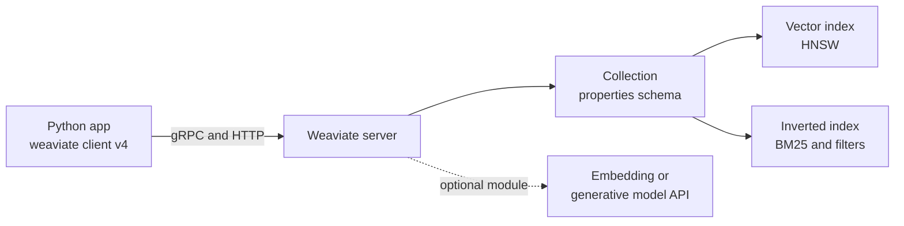
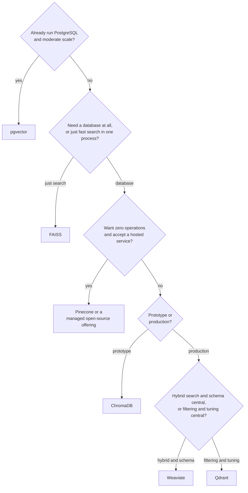

**Weaviate** is an open-source vector database, written in Go, that you can self-host or use as a managed cloud service. Where Qdrant centres on filtering and Pinecone on zero operations, Weaviate's distinctive features are a **schema of typed properties**, built-in **hybrid search** that combines BM25 keyword scoring with vector search in one query, and optional **modules** that call embedding and generative models from inside the database, so it can embed your text on insert and even run a RAG generation step. This lesson covers its concepts and the version 4 Python client, then closes the module with a comparison of every option you have met.

## What Weaviate is

| Aspect | Weaviate |
| --- | --- |
| Kind | Open-source database server (Go); self-hosted or managed cloud |
| Data model | Collections of objects: UUID, typed properties, one or more vectors, cross-references |
| Index | HNSW by default, with flat and dynamic options and quantisation |
| Filtering | Typed property filters, combined with `&` and `\|` in the Python client |
| Hybrid | Native BM25 plus vector search, weighted by `alpha` |
| Modules | Optional vectorizers, rerankers and generative models called by the server |



Every collection maintains both a vector index and an inverted index over its properties. The inverted index serves filters and BM25, which is why hybrid search is a first-class operation rather than an add-on.

## Core concepts

- **Collection.** A named set of objects with a schema of properties, each with a data type such as `TEXT`, `INT`, `NUMBER`, `BOOL` or `DATE`. Collection names conventionally start with a capital letter.
- **Object.** The record: a UUID, its properties, and its vector (or several named vectors).
- **Vectorizer.** Configuration that says where vectors come from. You can bring your own vectors (*self-provided*), or configure a module that calls an embedding model when objects are inserted and when you query by text.
- **Multi-tenancy.** A collection can be split into tenants, each stored separately, which suits SaaS applications with strict isolation.

## Connecting and creating a collection

Run Weaviate locally with Docker following the quickstart in the [official documentation](https://weaviate.io/developers/weaviate); a local instance listens on port 8080 for HTTP and 50051 for gRPC, which is what `connect_to_local()` expects. The code below uses the version 4 Python client (`pip install weaviate-client`), which is a complete redesign of the version 3 client: older tutorials using `weaviate.Client(...)` and GraphQL-style query builders will not work with it. Even within version 4, configuration helpers have been renamed over time, so check the documentation for your client version. These examples need a running server, so no outputs are shown.

```python
import weaviate
from weaviate.classes.config import Configure, Property, DataType

client = weaviate.connect_to_local()

articles = client.collections.create(
    name="SupportArticle",
    properties=[
        Property(name="text", data_type=DataType.TEXT),
        Property(name="topic", data_type=DataType.TEXT),
        Property(name="year", data_type=DataType.INT),
    ],
    vector_config=Configure.Vectors.self_provided(),   # we supply our own vectors
)
```

Recent 4.x clients use `vector_config=Configure.Vectors.self_provided()`; earlier 4.x releases expressed the same thing as `vectorizer_config=Configure.Vectorizer.none()`. Weaviate's default distance for the vector index is cosine. Calling `client.collections.get("SupportArticle")` returns a handle to an existing collection.

## Inserting objects

```python
from weaviate.classes.data import DataObject

articles.data.insert_many([
    DataObject(properties={"text": "Cannot log in after password reset", "topic": "account", "year": 2023},
               vector=[0.9, 0.1, 0.0]),
    DataObject(properties={"text": "Charged twice for one order", "topic": "billing", "year": 2024},
               vector=[0.1, 0.9, 0.1]),
    DataObject(properties={"text": "Refund still not received", "topic": "billing", "year": 2023},
               vector=[0.0, 0.8, 0.3]),
    DataObject(properties={"text": "Package stuck in transit", "topic": "shipping", "year": 2024},
               vector=[0.1, 0.1, 0.9]),
])
```

Each object gets a random UUID unless you pass `uuid=...`. As with every database, deterministic IDs (the client provides `weaviate.util.generate_uuid5` for deriving a UUID from a string) make re-ingestion idempotent. For large imports, the client's batching interface (`collection.batch`) sends objects efficiently in the background.

## Vector, filtered and hybrid queries

```python
from weaviate.classes.query import Filter, MetadataQuery

res = articles.query.near_vector(
    near_vector=[0.0, 0.9, 0.2],
    limit=3,
    return_metadata=MetadataQuery(distance=True),
)
for obj in res.objects:
    print(obj.properties["text"], obj.metadata.distance)
```

Weaviate reports a **distance** (cosine distance, smaller is closer). With the same vectors as the Chroma and Qdrant lessons, you would expect the same order: the refund article, then the double-charge article, then the parcel article.

Filters are built with `Filter.by_property` and combined with `&` (and) and `|` (or):

```python
res = articles.query.near_vector(
    near_vector=[0.0, 0.9, 0.2],
    limit=3,
    filters=Filter.by_property("topic").equal("billing")
            & Filter.by_property("year").greater_or_equal(2024),
)
```

A **hybrid** query runs BM25 on the text properties and vector search together, then fuses the two result lists, as described in [hybrid search](/learn/vector-databases/hybrid-search):

```python
res = articles.query.hybrid(
    query="charged twice",          # keyword side (BM25)
    vector=[0.1, 0.85, 0.2],        # vector side; omit it if a vectorizer module embeds the query
    alpha=0.5,                      # 1.0 = pure vector, 0.0 = pure keyword
    limit=3,
    return_metadata=MetadataQuery(score=True),
)
for obj in res.objects:
    print(obj.properties["text"], obj.metadata.score)

client.close()
```

`alpha` is exactly the weight from the weighted-fusion formula in the hybrid search lesson. Weaviate supports more than one fusion algorithm (a rank-based one and a score-based one, selectable with `fusion_type`); the documentation describes which is the default in your version. Always call `client.close()`, or use the client as a context manager (`with weaviate.connect_to_local() as client:`), so connections are released.

> [!TIP]
> Server-side vectorizer modules are convenient, but they put an external model call inside every insert and text query. Many teams start with self-provided vectors, so the embedding model is explicit in their own code, and adopt modules later if the convenience is worth it.

## When to choose Weaviate

Choose Weaviate when hybrid keyword and vector search is central to your application, when you want a typed schema and an inverted index alongside vectors, when native multi-tenancy fits your product, or when you like the idea of the database calling embedding and generative models for you. It is a heavier system to operate than Chroma, and if you only need vectors next to relational data, pgvector may be simpler.

## Comparing the options

This table summarises the tools from this module, plus pgvector from [PostgreSQL](/learn/sql-and-databases/postgresql). Features evolve quickly, so treat it as a starting point and check current documentation before deciding.

| | FAISS | ChromaDB | Pinecone | Qdrant | Weaviate | pgvector |
| --- | --- | --- | --- | --- | --- | --- |
| What it is | Library | Embedded or server database | Managed service | Database server | Database server | PostgreSQL extension |
| Open source | Yes | Yes | No | Yes | Yes | Yes |
| Runs locally | In process | In process or server | No | Server or client local mode | Server | Wherever Postgres runs |
| Managed option | No | Yes | Only managed | Yes | Yes | Via managed Postgres providers |
| Metadata filtering | Do it yourself | `where` filters | Metadata filters | Rich payload filters with indexes | Typed property filters | Full SQL `WHERE` and joins |
| Hybrid search | Do it yourself | Limited; check docs | Sparse-dense vectors | Sparse vectors and fusion | Native BM25 plus vector | Postgres full-text search plus vectors |
| Index control | Full | Limited | Minimal | Extensive | Extensive | HNSW and IVFFlat options |
| Best for | Research, offline jobs, custom systems | Prototypes, small to medium apps | Teams wanting no operations | Self-hosted production, heavy filtering | Hybrid search, schema, modules | Apps already on PostgreSQL |



> [!KEY]
> No vector database is best in general. Decide on operations (library, embedded, self-hosted or managed), on where your other data lives, and on whether filtering or hybrid search dominates your queries; then validate the choice by measuring recall and latency on your own data.

## Exercises

**1.** Write a Weaviate filter for objects whose topic is `billing` or `account` and whose year is at least 2024.

<details>
<summary>Show solution</summary>

```python
flt = (
    (Filter.by_property("topic").equal("billing") | Filter.by_property("topic").equal("account"))
    & Filter.by_property("year").greater_or_equal(2024)
)
```

The client also offers `Filter.by_property("topic").contains_any(["billing", "account"])` for the topic part.

</details>

**2.** A hybrid query with `alpha=0.9` fails to find a document containing the exact error code a user typed. What would you change first?

<details>
<summary>Show solution</summary>

Lower `alpha` so the keyword side has more weight, for example to 0.5 or below, since `alpha=0.9` is almost pure vector search and exact codes are where BM25 is strong. Better still, tune `alpha` on a set of labelled queries that includes code-like queries.

</details>

**3.** For each scenario, pick a tool from the comparison table and justify it in one sentence: (a) a nightly batch job that deduplicates 50 million image embeddings on a GPU machine; (b) a startup's first RAG prototype in a notebook; (c) an internal tool whose documents and permissions already live in PostgreSQL.

<details>
<summary>Show solution</summary>

(a) FAISS: an offline, single-machine job that benefits from GPU indexes and needs no database features. (b) ChromaDB: a `pip install` and a few lines give a persistent collection with filters. (c) pgvector: vectors live next to the documents and permission tables, so access control is an ordinary SQL join and there is no second system to run.

</details>

```quiz
[
  {
    "q": "In a Weaviate hybrid query, what does `alpha=1.0` mean?",
    "options": [
      "Pure keyword (BM25) search",
      "Equal weight to keyword and vector",
      "Pure vector search",
      "Reranking is enabled"
    ],
    "answer": 2,
    "why": "Alpha weights the vector side; 1.0 is pure vector search and 0.0 is pure BM25."
  },
  {
    "q": "Why does Weaviate support hybrid search natively?",
    "options": [
      "Every collection keeps an inverted index over its properties alongside the vector index",
      "It converts all text to sparse vectors with a model",
      "It calls an external search engine",
      "It only supports keyword search"
    ],
    "answer": 0,
    "why": "The inverted index serves both filters and BM25, so keyword and vector results come from the same database."
  },
  {
    "q": "Which tool from this module is a library rather than a database?",
    "options": ["Qdrant", "Pinecone", "Weaviate", "FAISS"],
    "answer": 3,
    "why": "FAISS provides index implementations in your process; it has no server, metadata store or query API."
  },
  {
    "q": "Your documents, users and permissions already live in PostgreSQL and you have a moderate number of vectors. Which option avoids running a second system?",
    "options": ["Pinecone", "pgvector", "ChromaDB server", "Weaviate"],
    "answer": 1,
    "why": "pgvector stores vectors in Postgres tables, so filters and permission joins are plain SQL."
  }
]
```
