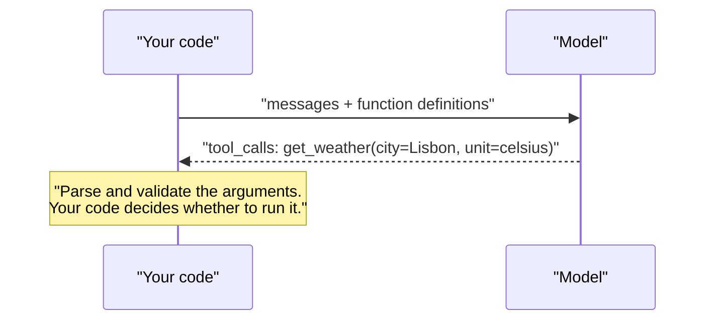

A language model can only produce text. It cannot look up today's exchange rate, query your database or send an email. **Function calling** is the mechanism that bridges that gap: you describe some functions to the model, and instead of replying in prose, the model can reply with a structured request to call one of them, naming the function and supplying arguments as JSON. Your code decides whether and how to run it. This lesson is about that mechanism itself: how to describe functions, what the model sends back, and how to parse and validate it safely. The next lesson, [Tool calling](/learn/working-with-llms/tool-calling), builds the full loop around it: executing the call, returning results, handling several calls, and letting the model continue.

## The key idea: the model never runs anything

It is easy to imagine that the model "calls" the function. It does not. It generates tokens, exactly as always, but it has been trained to produce, in the right circumstances, a specially formatted message that the API returns to you as a structured `tool_calls` field.



Function calling is therefore a form of [structured output](/learn/working-with-llms/structured-outputs) with one extra choice: the model decides **whether** to call a function, **which** one, and **with what arguments**. Everything that happens after that is ordinary code that you write and control.

> [!KEY]
> Function calling turns the model into a router and argument extractor. It emits an intent in a machine-readable form; it does not execute anything. That separation is what lets you validate, authorise and log every action before it happens.

## Describing a function

A function is described with a name, a description and a JSON Schema for its parameters. In the OpenAI Chat Completions format the list is passed as `tools`, each entry of type `"function"`:

```python
tools = [
    {
        "type": "function",
        "function": {
            "name": "get_weather",
            "description": "Get the current weather for a city. Use when the user asks about weather now.",
            "parameters": {
                "type": "object",
                "properties": {
                    "city": {"type": "string", "description": "City name, for example 'Lisbon'"},
                    "unit": {"type": "string", "enum": ["celsius", "fahrenheit"]},
                },
                "required": ["city", "unit"],
                "additionalProperties": False,
            },
            "strict": True,
        },
    }
]
```

The model sees the name, description and schema, typically converted into special text inside its prompt, and uses them to decide when the function is relevant. That makes descriptions instructions in their own right:

| Part | Good practice |
| --- | --- |
| `name` | A clear verb phrase in `snake_case`: `get_weather`, `search_orders`, `create_ticket` |
| `description` | What it does, **when** to use it, and when not to |
| Parameter descriptions | Format and examples, such as "ISO date, YYYY-MM-DD" |
| `enum` | For any parameter with a fixed set of values |
| `required` | Everything the function cannot work without |
| `strict: true` | Ask the API to constrain arguments to the schema, where supported |

Rather than writing schemas by hand, you can generate them from a Pydantic model, which also gives you a validator for the arguments that come back:

```python
import json
from typing import Literal
from pydantic import BaseModel, Field

class GetWeather(BaseModel):
    """Get the current weather for a city. Use when the user asks about weather now."""
    city: str = Field(description="City name, for example 'Lisbon'")
    unit: Literal["celsius", "fahrenheit"]

def to_tool(model_cls):
    schema = model_cls.model_json_schema()
    return {
        "type": "function",
        "function": {
            "name": "get_weather",
            "description": schema.pop("description"),
            "parameters": {
                "type": "object",
                "properties": schema["properties"],
                "required": schema["required"],
                "additionalProperties": False,
            },
        },
    }

print(json.dumps(to_tool(GetWeather)["function"]["parameters"]["properties"], indent=1))
```

```output
{
 "city": {
  "description": "City name, for example 'Lisbon'",
  "title": "City",
  "type": "string"
 },
 "unit": {
  "enum": [
   "celsius",
   "fahrenheit"
  ],
  "title": "Unit",
  "type": "string"
 }
}
```

## Making the request

```python
from openai import OpenAI
client = OpenAI()

response = client.chat.completions.create(
    model=MODEL,
    messages=[{"role": "user", "content": "Is it warm in Lisbon right now? I use Celsius."}],
    tools=tools,
    tool_choice="auto",
)
message = response.choices[0].message
print(response.choices[0].finish_reason)        # "tool_calls" when the model wants a function
for call in message.tool_calls or []:
    print(call.id, call.function.name, call.function.arguments)
```

An illustrative example of the output:

```output
tool_calls
call_8fJ2kQ get_weather {"city": "Lisbon", "unit": "celsius"}
```

Note that `call.function.arguments` is a **JSON string**, not a dictionary. You must parse it, and you must be prepared for it to be wrong.

`tool_choice` controls whether the model may, must or must not call a function:

| `tool_choice` | Behaviour |
| --- | --- |
| `"auto"` (default when tools are given) | The model decides: reply in text or call a function |
| `"none"` | Never call a function; reply in text |
| `"required"` | Must call at least one function |
| `{"type": "function", "function": {"name": "get_weather"}}` | Must call this specific function |

Forcing a specific function is a common way to get structured output from providers that lack a dedicated JSON-schema mode: define one function whose parameters are the structure you want, and require it.

## Parsing and validating the call

Treat the arguments exactly like any other untrusted input. Here a stand-in object mimics the shape the SDK returns, so the validation code can run:

```python
from types import SimpleNamespace
from pydantic import ValidationError

def fake_call(name, arguments):
    return SimpleNamespace(id="call_1", function=SimpleNamespace(name=name, arguments=arguments))

registry = {"get_weather": GetWeather}

def parse_call(call):
    model_cls = registry.get(call.function.name)
    if model_cls is None:
        return None, f"unknown function {call.function.name!r}"
    try:
        return model_cls.model_validate_json(call.function.arguments), None
    except ValidationError as e:
        return None, "; ".join(f"{'.'.join(map(str, x['loc'])) or 'json'}: {x['type']}" for x in e.errors())

for call in [
    fake_call("get_weather", '{"city": "Lisbon", "unit": "celsius"}'),
    fake_call("get_weather", '{"city": "Lisbon", "unit": "kelvin"}'),
    fake_call("get_weather", '{"city": "Lisbon"'),
    fake_call("get_wether", '{"city": "Lisbon", "unit": "celsius"}'),
]:
    args, error = parse_call(call)
    print(args if args else f"ERROR: {error}")
```

```output
city='Lisbon' unit='celsius'
ERROR: unit: literal_error
ERROR: json: json_invalid
ERROR: unknown function 'get_wether'
```

The four cases are the realistic failures: a good call, a value outside the enum, truncated JSON, and a misspelt function name. Strict mode makes the middle two rare, but your code should handle all of them, typically by sending the error back to the model so it can try again, as the next lesson shows.

> [!WARNING]
> Validation checks the **shape** of arguments, not whether the action is allowed. A perfectly valid `delete_account(user_id="42")` is still dangerous if user 42 is not the person asking. Authorisation belongs in your code, using the real identity of the user, never in arguments the model produced.

## The same mechanism across providers

All the major APIs implement function calling with the same three ingredients (name, description, JSON Schema) but different field names:

| | OpenAI Chat Completions | Anthropic Messages | Google Gemini |
| --- | --- | --- | --- |
| Definition | `{"type": "function", "function": {name, description, parameters}}` | `{name, description, input_schema}` | Function declarations with name, description, parameters |
| Model's call | `message.tool_calls[i].function.arguments` (JSON string) | Content block of type `tool_use` with `input` (already a dict) | A `function_call` part with `args` |
| Stop signal | `finish_reason == "tool_calls"` | `stop_reason == "tool_use"` | Presence of a function call part |

For example, the Anthropic equivalent of the definition above is:

```python
weather_tool = {
    "name": "get_weather",
    "description": "Get the current weather for a city.",
    "input_schema": GetWeather.model_json_schema(),
}
# response = claude.messages.create(model=..., max_tokens=500, tools=[weather_tool], messages=...)
# for block in response.content:
#     if block.type == "tool_use":
#         args = GetWeather.model_validate(block.input)
```

Open models support function calling when they were fine-tuned for it, and their chat templates contain the tool-formatting logic. Servers such as vLLM and Ollama expose it through their OpenAI-compatible endpoints, though support and reliability vary by model; test before relying on it.

## Where function calling is useful on its own

Even without a full agent loop, a single function call is a powerful pattern:

- **Extraction**: force a `record_invoice(vendor, date, total, line_items)` call to pull structured data from text.
- **Routing**: describe one function per intent (`track_order`, `request_refund`, `talk_to_human`) and let the model choose, replacing a hand-built intent classifier.
- **Natural language to API parameters**: turn "red dresses under 50 pounds, size 12" into `search_products(colour="red", category="dress", max_price=50, size="12")`.

## Exercises

**1.** Write a Pydantic model and tool definition for `search_orders(customer_email, status, since)` where `status` is one of `pending`, `shipped`, `delivered` and `since` is an optional ISO date.

<details>
<summary>Show solution</summary>

```python
from datetime import date
from typing import Optional

class SearchOrders(BaseModel):
    """Search a customer's orders. Use when the user asks about their orders or deliveries."""
    customer_email: str = Field(description="The customer's email address")
    status: Literal["pending", "shipped", "delivered"]
    since: Optional[date] = Field(default=None, description="Only orders on or after this date, YYYY-MM-DD")

print(SearchOrders.model_validate_json('{"customer_email": "a@b.example", "status": "shipped", "since": "2025-01-31"}'))
```

```output
customer_email='a@b.example' status='shipped' since=datetime.date(2025, 1, 31)
```

For OpenAI strict mode, every property must be listed in `required`; an optional value is then expressed as a type that also allows `null`. Without strict mode, leaving `since` out of `required` is enough.

</details>

**2.** The model returns `get_weather` with arguments `{"city": "Lisbon", "unit": "celsius", "country": "PT"}`. What does `GetWeather.model_validate_json` do with the extra field by default, and how would you make it an error?

<details>
<summary>Show solution</summary>

By default Pydantic ignores unknown fields, so validation succeeds and `country` is dropped. To reject them, configure the model with `model_config = ConfigDict(extra="forbid")` (import `ConfigDict` from `pydantic`). The JSON Schema then also gets `"additionalProperties": false`.

</details>

**3.** A user asks a support bot "cancel my last order". Which parts of the resulting `cancel_order(order_id)` call can you trust, and what must your code check before running it?

<details>
<summary>Show solution</summary>

Only that the model *intends* to cancel some order. The `order_id` was produced by the model, possibly from text the user typed, so your code must verify that the order exists, belongs to the authenticated user (from your session, not from the model), and is in a cancellable state. For an irreversible action, ask the user to confirm before executing, an idea developed in [Human approval workflows](/learn/advanced-agent-systems/human-approval-workflows).

</details>

```quiz
[
  {
    "q": "In function calling, who executes the function?",
    "options": [
      "The model, inside the provider's servers",
      "Your application code, after reading the model's structured request",
      "The SDK automatically",
      "The user's browser"
    ],
    "answer": 1,
    "why": "The model only emits a structured call. Your code validates it, decides whether to run it, and runs it."
  },
  {
    "q": "What type is `tool_call.function.arguments` in the OpenAI Chat Completions response?",
    "options": [
      "A Python dictionary",
      "A Pydantic model",
      "A JSON-encoded string that you must parse",
      "A list of positional arguments"
    ],
    "answer": 2,
    "why": "It is a string, which may occasionally be malformed, so parse and validate it."
  },
  {
    "q": "Which `tool_choice` forces the model to call one particular function?",
    "options": [
      "`\"auto\"`",
      "`\"none\"`",
      "`\"required\"`",
      "`{\"type\": \"function\", \"function\": {\"name\": \"get_weather\"}}`"
    ],
    "answer": 3,
    "why": "`required` forces some call but lets the model choose which; naming the function forces that one."
  },
  {
    "q": "Arguments for `delete_file(path)` pass schema validation. What else is essential before running it?",
    "options": [
      "Nothing, validation is sufficient",
      "Re-asking the model whether it is sure",
      "An authorisation check in code that the current user may delete that path",
      "Converting the path to upper case"
    ],
    "answer": 2,
    "why": "Validation checks shape, not permission. Model-produced arguments must be authorised like any untrusted input."
  }
]
```
