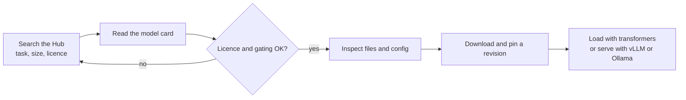

If you want to run an open model, you will almost certainly get it from **Hugging Face**. The Hugging Face Hub is to model weights roughly what GitHub is to source code: a hosting service with hundreds of thousands of models, datasets and demo apps, each in a versioned Git repository with a documentation page. Around it sit the Python libraries that load those models, chiefly `transformers` and `huggingface_hub`. This lesson teaches you to find a model, judge whether it suits you, and download exactly the files you need, safely and reproducibly. The next lesson loads the model and generates text with it.

The whole ecosystem gets a dedicated module later ([Hugging Face Ecosystem](/learn/hugging-face-ecosystem/transformers)), covering datasets, pipelines and fine-tuning in depth. Here the focus is narrow: getting an LLM from the Hub into your program.

## The Hub: repositories, not just files

Every model lives in a repository named `organisation/model-name`, for example `Qwen/Qwen2.5-0.5B-Instruct` or `mistralai/Mistral-7B-Instruct-v0.3`. A repository has:

- **Files**: weights, configuration and tokeniser files.
- **A model card** (`README.md`): what the model is, how it was trained, intended uses, limitations, licence and example code.
- **Commits and revisions**: every change is a Git commit, so you can pin an exact version.
- **Metadata**: licence, task tags such as `text-generation`, library, language and download counts.



## Reading a model card critically

A model card is written by the model's authors, so treat it as a starting point rather than an independent review. Check:

| Look for | Why it matters |
| --- | --- |
| Licence | Whether you may use it at all, see [Open-source LLMs](/learn/working-with-llms/open-source-llms) |
| Base or instruct | Chat applications need an instruct model |
| Parameter count and dtype | Tells you the memory needed |
| Context length | The longest input it was trained to handle |
| Chat template / prompt format | How conversations must be formatted |
| Intended use and limitations | Languages covered, known weaknesses, safety notes |
| Evaluation claims | Useful hints, but run your own evaluation on your own task |

Leaderboards and benchmark tables on model cards are a reasonable way to shortlist candidates. They are not a substitute for testing the model on examples from your actual application, which is the subject of [Model evaluation](/learn/working-with-llms/model-evaluation).

## What is inside a model repository

A typical causal language model repository contains:

| File | Contents |
| --- | --- |
| `config.json` | Architecture: number of layers, hidden size, attention heads, vocabulary size, context length |
| `model.safetensors` or `model-00001-of-00004.safetensors` ... | The weights, often split into shards, with an index JSON listing which tensor is in which shard |
| `tokenizer.json`, `tokenizer_config.json` | The tokeniser, its special tokens and usually the **chat template** |
| `generation_config.json` | Default generation settings such as `temperature`, `top_p` and end-of-sequence token ids |
| `README.md` | The model card |

The `config.json` is small and very informative. You can estimate a model's parameter count from it before downloading gigabytes of weights. Here is a configuration with the shape of a typical 8B Llama-style model:

```python
config = {
    "hidden_size": 4096,            # d: width of each token vector
    "intermediate_size": 14336,     # width of the feed-forward layer
    "num_hidden_layers": 32,
    "num_attention_heads": 32,
    "num_key_value_heads": 8,       # grouped-query attention: fewer K/V heads
    "vocab_size": 128256,
    "tie_word_embeddings": False,
}

d = config["hidden_size"]
head_dim = d // config["num_attention_heads"]
kv_dim = config["num_key_value_heads"] * head_dim

attention = d * d + 2 * d * kv_dim + d * d          # Q, K, V and output projections
mlp = 3 * d * config["intermediate_size"]           # gate, up and down projections
norms = 2 * d
per_layer = attention + mlp + norms

embeddings = config["vocab_size"] * d
lm_head = 0 if config["tie_word_embeddings"] else embeddings
total = config["num_hidden_layers"] * per_layer + embeddings + lm_head + d

print(f"per layer: {per_layer:,}")
print(f"total:     {total:,}  (about {total / 1e9:.2f}B)")
print(f"bfloat16 weights: {total * 2 / 1e9:.1f} GB")
```

```output
per layer: 218,112,000
total:     8,030,261,248  (about 8.03B)
bfloat16 weights: 16.1 GB
```

The estimate lands on about 8 billion parameters, which matches the name. The same arithmetic works for any decoder-only model whose layers follow this pattern, and it tells you immediately whether the download is worth starting.

## Downloading with huggingface_hub

The `transformers` library downloads files automatically the first time you load a model, but the `huggingface_hub` library gives you direct control:

```python
from huggingface_hub import hf_hub_download, snapshot_download

# One file
config_path = hf_hub_download(repo_id="Qwen/Qwen2.5-0.5B-Instruct", filename="config.json")

# A whole repository, skipping files you do not need
local_dir = snapshot_download(
    repo_id="Qwen/Qwen2.5-0.5B-Instruct",
    allow_patterns=["*.json", "*.safetensors", "*.txt"],
    revision="main",     # pin a commit hash in production
)
print(local_dir)
```

Files go into a shared cache, by default under `~/.cache/huggingface/hub`, so a second download of the same file is instant and several projects share one copy. Set the `HF_HOME` environment variable to move the cache, for example onto a large data disk on a server.

### Authentication and gated models

Public models need no account. **Gated** models require you to accept the licence on the model's web page while logged in, and then authenticate in your code with an access token:

```bash
pip install -U huggingface_hub
hf auth login                 # newer CLI; older versions use: huggingface-cli login
# or, in scripts and CI:
export HF_TOKEN="hf_..."
```

The same rules as for API keys apply: keep the token out of your repository, and prefer read-only tokens for machines that only download.

### Pin a revision

`revision="main"` means "whatever is latest", and repositories do get updated: a fixed chat template, new weights, a changed default. For anything you deploy, pin the exact commit hash shown in the repository's history so the model you tested is the model you ship.

## Safety: safetensors and remote code

Two settings deserve care.

**Weight format.** Older repositories store weights as PyTorch `.bin` files, which use Python's `pickle` format. Unpickling can execute arbitrary code, so a malicious `.bin` file can run code on your machine when loaded. The **safetensors** format stores only raw tensors and metadata and cannot execute code. Prefer repositories that provide `.safetensors` files; current `transformers` versions load them by default when present.

**`trust_remote_code=True`.** Some models need custom Python code stored in the repository. Passing `trust_remote_code=True` downloads and runs that code. Only do this for repositories you trust, and pin the revision so the code cannot change under you.

> [!WARNING]
> Loading a model is running someone else's artefact on your machine. Prefer safetensors, avoid `trust_remote_code` unless necessary, and pin revisions. Treat model downloads with the same caution as installing a package from an unknown author.

## Running a model without downloading it

You do not always have to host a model yourself. Hugging Face offers hosted inference for many popular models, and the `huggingface_hub` library includes an `InferenceClient` with a chat interface similar to the OpenAI one:

```python
from huggingface_hub import InferenceClient

client = InferenceClient()   # uses HF_TOKEN
reply = client.chat_completion(
    messages=[{"role": "user", "content": "Give me one tip for clean Python code."}],
    model="Qwen/Qwen2.5-7B-Instruct",
    max_tokens=100,
)
print(reply.choices[0].message.content)
```

Which models are available this way, and on what terms, changes over time, so check the current documentation. For experiments, it is a convenient way to try a model before committing to download and host it.

> [!TIP]
> Hugging Face **Spaces** host interactive demos, often for new models. Trying a model in its Space for five minutes can save you an hour of downloading and setting up something that turns out not to suit your task.

## Exercises

**1.** Modify the parameter-count code for a configuration with `hidden_size` 2048, `intermediate_size` 8192, 16 layers, 32 attention heads, 8 key/value heads, a vocabulary of 128,256 and `tie_word_embeddings` set to `True`. Roughly how many parameters is that?

<details>
<summary>Show solution</summary>

```python
config = {"hidden_size": 2048, "intermediate_size": 8192, "num_hidden_layers": 16,
          "num_attention_heads": 32, "num_key_value_heads": 8,
          "vocab_size": 128256, "tie_word_embeddings": True}
d = config["hidden_size"]
head_dim = d // config["num_attention_heads"]
kv_dim = config["num_key_value_heads"] * head_dim
per_layer = 2 * d * d + 2 * d * kv_dim + 3 * d * config["intermediate_size"] + 2 * d
embeddings = config["vocab_size"] * d
total = config["num_hidden_layers"] * per_layer + embeddings + d
print(f"{total:,}")
```

```output
1,235,814,400
```

About 1.2 billion parameters: a "1B-class" model. Because the embeddings are tied, the output layer reuses the embedding matrix and adds no parameters. Notice how large a share of a small model the 263 million embedding parameters are.

</details>

**2.** A colleague's script downloads `revision="main"` of a model every time a container starts. Name two problems this can cause and the fixes.

<details>
<summary>Show solution</summary>

First, reproducibility: if the repository is updated, the container silently starts using different weights or a different chat template. Fix it by pinning the commit hash. Second, start-up time and reliability: downloading gigabytes on every start is slow and fails if the Hub is unreachable. Fix it by baking the files into the image or a mounted volume and pointing `HF_HOME` at a persistent cache.

</details>

**3.** Why is a `.safetensors` file safer to load than a `.bin` file from an unknown author?

<details>
<summary>Show solution</summary>

`.bin` files are usually pickled Python objects, and unpickling can execute arbitrary code embedded in the file. safetensors stores only tensor data and a JSON header, so loading it cannot run code.

</details>

```quiz
[
  {
    "q": "Which file in a model repository describes the number of layers, hidden size and vocabulary size?",
    "options": [
      "`generation_config.json`",
      "`config.json`",
      "`tokenizer.json`",
      "`README.md`"
    ],
    "answer": 1,
    "why": "`config.json` holds the architecture hyperparameters, which is why you can estimate memory and parameter count from it."
  },
  {
    "q": "What must you do before downloading a gated model?",
    "options": [
      "Pass `trust_remote_code=True`",
      "Convert it to GGUF",
      "Accept its terms on the Hub while logged in, then authenticate with a token",
      "Nothing, gating only applies to the website"
    ],
    "answer": 2,
    "why": "Gated repositories require you to accept the licence, and downloads must then be authenticated with your access token."
  },
  {
    "q": "Why pin a model revision to a commit hash in production?",
    "options": [
      "It makes downloads faster",
      "So later updates to the repository cannot silently change the model you deployed",
      "Hugging Face requires it for private models",
      "Commit hashes reduce memory usage"
    ],
    "answer": 1,
    "why": "`main` moves when authors push changes. A commit hash always refers to the exact files you tested."
  },
  {
    "q": "What does `trust_remote_code=True` allow?",
    "options": [
      "Downloading without a token",
      "Running Python code stored in the model repository on your machine",
      "Using the model commercially",
      "Loading pickle files safely"
    ],
    "answer": 1,
    "why": "It executes the repository's custom modelling code, so only use it with repositories you trust and pin the revision."
  }
]
```
