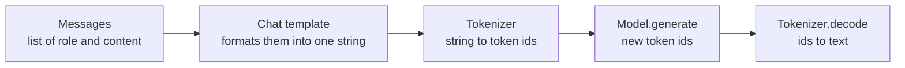

Knowing where a model lives is half the job; the other half is getting it into memory in the right numeric format, on the right device, and talking to it in the exact conversation format it was trained on. Get any of these wrong and the symptoms are confusing: an out-of-memory crash, painfully slow generation on the CPU, or a model that rambles, repeats your question, or answers in the wrong voice because the prompt was not formatted the way it expects. This lesson walks through loading a causal language model with Hugging Face `transformers` and generating a reply, step by step, and explains each choice.

The code needs PyTorch and `transformers` (`pip install torch transformers accelerate`), and a GPU for anything beyond small models, so the outputs shown are illustrative. Basics of PyTorch tensors and devices are in the [PyTorch](/learn/pytorch/tensors) module.

## The three objects

Loading an LLM involves three pieces that must match each other:



| Object | Class | Responsibility |
| --- | --- | --- |
| Tokenizer | `AutoTokenizer` | Text to ids and back, special tokens, the chat template |
| Model | `AutoModelForCausalLM` | The network weights and the `generate` method |
| Generation settings | `generation_config` or arguments to `generate` | Sampling, length, stop tokens |

The `Auto` classes read `config.json` from the repository and construct the right concrete class (a Llama, Qwen or Mistral model, for example), so the same code loads many architectures.

## Loading the tokenizer and model

```python
import torch
from transformers import AutoTokenizer, AutoModelForCausalLM

model_id = "Qwen/Qwen2.5-0.5B-Instruct"   # small enough for a laptop

tokenizer = AutoTokenizer.from_pretrained(model_id)
model = AutoModelForCausalLM.from_pretrained(
    model_id,
    torch_dtype=torch.bfloat16,   # recent releases also accept dtype=...
    device_map="auto",            # place layers on available GPUs, then CPU
)
model.eval()
print(model.device, model.dtype)
```

Each argument matters:

- **`torch_dtype`** chooses the numeric format of the weights in memory. Without it, many models load in float32, doubling memory compared with bfloat16 for no quality benefit at inference time. Recent `transformers` versions accept `dtype=` and treat `torch_dtype` as an older alias; `"auto"` uses the dtype recorded in the config.
- **`device_map="auto"`** (it needs the `accelerate` package) places the model on the GPU if there is one, and splits it across several GPUs, or spills to CPU memory, if it does not fit on one. Spilling to CPU works but is slow.
- **`model.eval()`** switches off training-only behaviour such as dropout. Models from `from_pretrained` are already in eval mode, but saying so explicitly costs nothing.

| dtype | When to use |
| --- | --- |
| `torch.bfloat16` | Default on modern NVIDIA GPUs (Ampere and later) and many other accelerators |
| `torch.float16` | Older GPUs without bfloat16 support; slightly higher risk of overflow |
| `torch.float32` | CPU-only experiments; twice the memory of 16-bit formats |
| 4-bit or 8-bit quantised | Large models on limited memory, see below |

On an Apple-silicon Mac, PyTorch uses the `mps` device; `device_map="auto"` handles that too in recent versions.

## Chat templates: speaking the model's language

An instruct model was fine-tuned on conversations written in a particular format, with special tokens marking who is speaking. Different families use different formats. The tokenizer stores the right one as a **chat template**, and `apply_chat_template` turns your list of messages into the exact string the model expects.

To see what that does, here is a hand-written version of the ChatML format, which Qwen models (among others) use:

```python
def chatml(messages, add_generation_prompt=True):
    text = ""
    for m in messages:
        text += f"<|im_start|>{m['role']}\n{m['content']}<|im_end|>\n"
    if add_generation_prompt:
        text += "<|im_start|>assistant\n"     # cue the model to answer
    return text

messages = [
    {"role": "system", "content": "You are a concise assistant."},
    {"role": "user", "content": "Name three Python web frameworks."},
]
print(chatml(messages))
```

```output
<|im_start|>system
You are a concise assistant.<|im_end|>
<|im_start|>user
Name three Python web frameworks.<|im_end|>
<|im_start|>assistant
```

The final `<|im_start|>assistant` line is the **generation prompt**: it tells the model that it is now the assistant's turn. Forget it, and the model may continue the user's message instead of answering.

In real code, never write the template by hand. Use the tokenizer's own:

```python
prompt = tokenizer.apply_chat_template(
    messages,
    tokenize=False,               # return the formatted string
    add_generation_prompt=True,
)
inputs = tokenizer(prompt, return_tensors="pt", add_special_tokens=False).to(model.device)
```

`add_special_tokens=False` matters: the template usually inserts any beginning-of-sequence token itself, and letting the tokenizer add a second one can quietly degrade output for some models.

> [!KEY]
> Always format conversations with `tokenizer.apply_chat_template`, from the same repository as the weights. A wrong or missing template is the most common reason a correctly loaded instruct model gives strange answers.

## Generating and decoding

```python
with torch.inference_mode():
    output_ids = model.generate(
        **inputs,
        max_new_tokens=128,
        do_sample=True,
        temperature=0.7,
        top_p=0.9,
    )

new_tokens = output_ids[0, inputs["input_ids"].shape[1]:]   # drop the prompt
answer = tokenizer.decode(new_tokens, skip_special_tokens=True)
print(answer)
```

An illustrative example response (yours will differ):

```output
Three popular Python web frameworks are Django, Flask and FastAPI.
```

Points to notice:

- `generate` returns the prompt **and** the continuation. Slice off the first `input_ids.shape[1]` tokens, otherwise you print the whole prompt back.
- `max_new_tokens` limits only the generated tokens. (The older `max_length` counts the prompt too, which is a frequent source of empty replies.)
- `do_sample=False` gives greedy decoding, which is deterministic for a given setup. With `do_sample=True`, `temperature` and `top_p` behave as described in [Top-k and top-p sampling](/learn/generative-ai-fundamentals/top-k-and-top-p-sampling).
- `torch.inference_mode()` turns off gradient tracking, saving memory and time.
- Generation stops at the model's end-of-sequence token, which the repository's `generation_config.json` usually sets for you.

## The pipeline shortcut

For quick experiments, `pipeline` wraps all of the above in one object. Text-generation pipelines accept a list of chat messages directly and apply the chat template for you:

```python
from transformers import pipeline

chat = pipeline("text-generation", model=model_id, torch_dtype=torch.bfloat16, device_map="auto")
result = chat(messages, max_new_tokens=128)
print(result[0]["generated_text"][-1]["content"])   # the new assistant message
```

When given messages, the pipeline returns the conversation with the assistant's reply appended, so the last element is the answer. Pipelines are ideal for exploring; for a service, the explicit tokenizer-and-model version gives you more control, and dedicated servers such as vLLM give much higher throughput. [Pipelines](/learn/hugging-face-ecosystem/pipelines) are covered fully in the Hugging Face module.

## Quantised loading: a preview

When a model does not fit in memory at 16 bits, you can load it quantised, storing weights in 8 or 4 bits. With the `bitsandbytes` library on a CUDA GPU:

```python
from transformers import BitsAndBytesConfig

bnb = BitsAndBytesConfig(
    load_in_4bit=True,
    bnb_4bit_quant_type="nf4",
    bnb_4bit_compute_dtype=torch.bfloat16,   # matrix maths still runs in bfloat16
)
model_4bit = AutoModelForCausalLM.from_pretrained(
    "some-org/some-7b-instruct", quantization_config=bnb, device_map="auto"
)
```

This cuts weight memory to roughly a quarter of bfloat16, at some cost in quality and often in speed. Other routes use pre-quantised files: GPTQ and AWQ checkpoints for GPUs, or GGUF files for llama.cpp and Ollama. How quantisation works, and how to judge the quality loss, is the subject of [Quantization](/learn/hugging-face-ecosystem/quantization).

## Troubleshooting loading problems

| Symptom | Likely cause | Fix |
| --- | --- | --- |
| `CUDA out of memory` while loading | Weights too big for the GPU at this dtype | Use bfloat16, quantise, or choose a smaller model |
| Out of memory during generation only | KV cache for long inputs or large batches | Shorter context, smaller batch, fewer `max_new_tokens` |
| Generation extremely slow | Model on CPU, or partly offloaded | Check `model.device` and `model.hf_device_map` |
| Output repeats the prompt | Did not slice off the input tokens | Decode only `output_ids[0, prompt_length:]` |
| Rambling, role confusion, odd tokens | Wrong or missing chat template, base model instead of instruct | Use `apply_chat_template` and an instruct model |
| Warning about `pad_token_id` | Model has no pad token defined | Pass `pad_token_id=tokenizer.eos_token_id` to `generate` |

> [!TIP]
> Before blaming a model's quality, print the exact formatted prompt with `tokenize=False`. Seeing the special tokens and role markers makes most template bugs obvious immediately.

## Exercises

**1.** Your output contains the system prompt and the user question before the answer. What went wrong, and how do you fix it?

<details>
<summary>Show solution</summary>

`generate` returns the prompt tokens followed by the new ones, and the code decoded all of them. Decode only the new tokens:

```python
prompt_length = inputs["input_ids"].shape[1]
answer = tokenizer.decode(output_ids[0, prompt_length:], skip_special_tokens=True)
```

</details>

**2.** Extend the `chatml` function so that it raises a `ValueError` if a message has a role other than `system`, `user` or `assistant`, and check that it rejects `{"role": "bot", "content": "hi"}`.

<details>
<summary>Show solution</summary>

```python
def chatml(messages, add_generation_prompt=True):
    allowed = {"system", "user", "assistant"}
    text = ""
    for m in messages:
        if m["role"] not in allowed:
            raise ValueError(f"unknown role: {m['role']}")
        text += f"<|im_start|>{m['role']}\n{m['content']}<|im_end|>\n"
    if add_generation_prompt:
        text += "<|im_start|>assistant\n"
    return text

try:
    chatml([{"role": "bot", "content": "hi"}])
except ValueError as e:
    print(e)
```

```output
unknown role: bot
```

Real chat templates do similar validation; some, for example, raise an error if roles do not alternate between user and assistant.

</details>

**3.** A 7B model loads fine but takes many seconds per token on a machine with a 24 GB GPU. `model.hf_device_map` shows some layers on `"cpu"`. Explain and fix.

<details>
<summary>Show solution</summary>

The model was probably loaded in float32 (about 28 GB), which does not fit, so `device_map="auto"` offloaded some layers to CPU memory, and every token now waits for slow CPU computation and transfers. Loading with `torch_dtype=torch.bfloat16` (about 14 GB) fits the whole model on the GPU.

</details>

```quiz
[
  {
    "q": "What does `add_generation_prompt=True` add to a formatted conversation?",
    "options": [
      "A system prompt",
      "The start of an assistant turn, cueing the model to reply",
      "An end-of-sequence token",
      "A random seed"
    ],
    "answer": 1,
    "why": "It appends the assistant header from the chat template so the model generates the assistant's reply rather than continuing the user's message."
  },
  {
    "q": "Why should you slice `output_ids[0, prompt_length:]` before decoding?",
    "options": [
      "`generate` returns the prompt tokens followed by the new tokens",
      "To remove padding",
      "Because decoding fails on long sequences",
      "To apply the chat template"
    ],
    "answer": 0,
    "why": "Causal language models continue the input sequence, and `generate` returns the full sequence including the prompt."
  },
  {
    "q": "What does `device_map=\"auto\"` do when a model is larger than the GPU?",
    "options": [
      "Raises an error immediately",
      "Quantises the model automatically",
      "Places as much as possible on the GPU and offloads the rest to CPU memory",
      "Downloads a smaller model"
    ],
    "answer": 2,
    "why": "Offloading lets the model run, but layers on the CPU make generation much slower."
  },
  {
    "q": "A correctly loaded instruct model gives rambling, role-confused answers. What is the first thing to check?",
    "options": [
      "The learning rate",
      "Whether the prompt was built with the tokenizer's chat template",
      "The GPU driver version",
      "Whether the weights are safetensors"
    ],
    "answer": 1,
    "why": "Instruct models expect the exact special-token format they were fine-tuned on. Printing the formatted prompt usually reveals the problem."
  }
]
```
