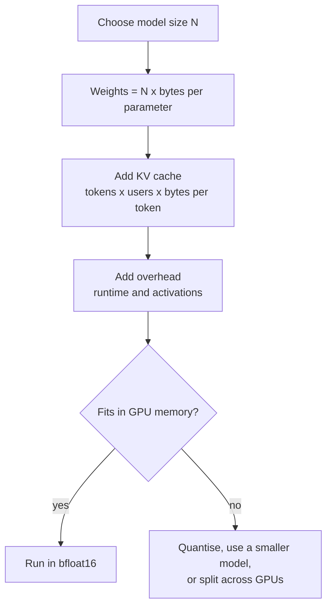

Hosted APIs are the quickest way to use a strong model, but they are not the only way. A large and growing set of models publish their **weights**, the trained parameters themselves, so you can download them and run them on your own hardware. That changes the trade-offs completely: your data never leaves your machines, there is no per-token bill, you can fine-tune the model, and you are not exposed to a provider deprecating the version your product depends on. In exchange, you take on the hardware, the serving and the responsibility for choosing a model whose licence permits what you want to do.

This lesson gives you the vocabulary and the arithmetic to make that choice sensibly. The next two lessons show how to actually download and load these models.

## "Open source", "open weights" and what you actually get

The phrase "open-source LLM" is used loosely. It helps to separate what is released:

| Released | What it lets you do |
| --- | --- |
| **Weights** | Run the model and fine-tune it |
| **Inference code and config** | Load the weights correctly (architecture, tokeniser, chat template) |
| **Training code** | Reproduce or extend the training recipe |
| **Training data** | Audit what the model learned from, or train from scratch |

Most popular models release the first two only. Strictly they are **open-weight** models: you can use and modify them, but you could not rebuild them from scratch. A small number of research projects release everything. When this module says "open model" it means open weights, which is what matters for running one.

## Licences: read them before you build

The licence is the first thing to check, not the last. Open models are released under very different terms:

| Licence type | Examples of the terms you will see | Typical implication |
| --- | --- | --- |
| Permissive (Apache 2.0, MIT) | Use, modify, redistribute, including commercially, with attribution | Safest for products |
| Custom community licences | Commercial use allowed with conditions: an acceptable-use policy, attribution or naming rules, sometimes a clause requiring very large companies to obtain a separate licence | Usually fine for most companies, but read the conditions |
| Research or non-commercial | Use for research and evaluation only | Not for a product |

Licences can also attach conditions to **derivatives**: a model you fine-tune from a base may inherit its licence. Some licences restrict using the model's outputs to train other models. The model card on the Hugging Face Hub links the licence, and some models are **gated**, meaning you must accept the terms on the website before you can download them.

> [!WARNING]
> "Downloadable" does not mean "free to use commercially". Before a model goes into a product, have the licence checked the same way you would check any third-party software dependency.

## Model families and sizes

Open models come in families, usually released in several sizes, often described by parameter count: 1B, 3B, 7B or 8B, 13B, 30B-class, 70B-class and larger, where B means billion parameters. Families you will meet include Llama (Meta), Mistral and Mixtral (Mistral AI), Qwen (Alibaba), Gemma (Google), Phi (Microsoft) and DeepSeek. Their licences differ, and each family releases new versions frequently, so check the current model cards rather than trusting any ranking you read today.

Each size is usually published in two flavours:

- **Base** models are pure next-token predictors trained on raw text. They continue text; they do not follow instructions well.
- **Instruct** (or chat) models have been further trained to follow instructions and hold a conversation. These are almost always what you want for an application.

Some families also use a **mixture-of-experts** (MoE) design, where only a subset of the parameters is used for each token. An MoE model is faster per token than a dense model with the same total parameter count, but you still need memory for all of its parameters.

## How much memory does a model need?

The first practical question is whether a model fits on your GPU. The weights alone need:

$$
\text{memory}_{\text{weights}} = N \times b
$$

where $N$ is the number of parameters and $b$ is the bytes per parameter, set by the numeric format (dtype):

| dtype | Bits | Bytes per parameter $b$ |
| --- | --- | --- |
| float32 | 32 | 4 |
| float16 / bfloat16 | 16 | 2 |
| int8 | 8 | 1 |
| 4-bit (for example NF4, GPTQ, AWQ, GGUF Q4) | 4 | 0.5 |

Real 4-bit formats store a small amount of extra scaling data per block of weights, so actual files are a little larger than half a byte per parameter.

```python
sizes = {"1B": 1e9, "8B": 8e9, "70B": 70e9}
dtypes = {"float32": 4, "bfloat16": 2, "int8": 1, "4-bit": 0.5}

print(f"{'model':>6}" + "".join(f"{d:>10}" for d in dtypes))
for name, n_params in sizes.items():
    row = "".join(f"{n_params * b / 1e9:>8.1f}GB" for b in dtypes.values())
    print(f"{name:>6}{row}")
```

```output
 model   float32  bfloat16      int8     4-bit
    1B     4.0GB     2.0GB     1.0GB     0.5GB
    8B    32.0GB    16.0GB     8.0GB     4.0GB
   70B   280.0GB   140.0GB    70.0GB    35.0GB
```

(GB here means $10^9$ bytes. GPU memory is often quoted in GiB, $2^{30}$ bytes, which is about 7% larger, so 16 GB is about 14.9 GiB.)

### The KV cache and overhead

Weights are not the whole story. During generation the model stores the attention keys and values for every token in the context, the **KV cache** (covered in depth in [KV caching](/learn/advanced-llm-engineering/kv-caching)). Its size per token is

$$
\text{bytes per token} = 2 \times L \times H_{kv} \times d_{\text{head}} \times b
$$

where $L$ is the number of layers, $H_{kv}$ the number of key/value heads, $d_{\text{head}}$ the dimension of each head, $b$ bytes per value, and the factor 2 counts keys and values. For an illustrative 8B-class configuration with 32 layers, 8 KV heads and a head dimension of 128 in bfloat16:

```python
L, H_kv, d_head, b = 32, 8, 128, 2
per_token = 2 * L * H_kv * d_head * b
print(per_token, "bytes per token =", per_token / 1024, "KiB")
for tokens in [4_096, 32_768]:
    print(f"{tokens:>6} tokens: {per_token * tokens / 2**30:.1f} GiB per sequence")
```

```output
131072 bytes per token = 128.0 KiB
  4096 tokens: 0.5 GiB per sequence
 32768 tokens: 4.0 GiB per sequence
```

So a long context, or many users served at once, can need as much memory as the weights themselves. Add framework overhead and activations, and a practical rule is to budget roughly 20% or more above the weights for short contexts, and to compute the KV cache explicitly for long ones.



> [!KEY]
> Memory is roughly parameters times bytes per parameter. An 8B model needs about 16 GB in bfloat16 and about 4 to 5 GB in 4-bit. That one multiplication tells you whether a laptop, a single GPU or a cluster is needed.

## Ways to run an open model

| Tool | Good for |
| --- | --- |
| Hugging Face `transformers` | Experiments, research, fine-tuning, full control in Python |
| Ollama | One-command local use on a laptop; serves an OpenAI-compatible API |
| llama.cpp | Efficient CPU and Apple-silicon inference with quantised GGUF files |
| vLLM | High-throughput production serving on GPUs, OpenAI-compatible API |
| Managed inference endpoints | Someone else runs the open model for you, billed per token or per hour |

A practical consequence of OpenAI-compatible servers is that you can prototype against a hosted model, then switch to a self-hosted open model by changing the base URL, as the [OpenAI API](/learn/working-with-llms/openai-api) lesson showed.

## Open or hosted?

| Consideration | Hosted API | Self-hosted open model |
| --- | --- | --- |
| Peak capability | Usually the strongest available | Strong and improving, often a step behind at the top end |
| Data privacy | Data goes to the provider (subject to its terms) | Data stays on your infrastructure |
| Cost shape | Per token, no fixed cost | Fixed hardware cost, cheap per token at high utilisation |
| Operations | None | You run, scale and monitor GPUs |
| Customisation | Limited fine-tuning options | Full fine-tuning, LoRA, quantisation |
| Stability | Provider may retire versions | You pin the exact weights forever |

Many teams use both: a hosted frontier model for hard, low-volume tasks, and a small open model for high-volume simple tasks such as classification or extraction.

## Exercises

**1.** How much memory do the weights of a 13B-parameter model need in bfloat16 and in 4-bit? Will the bfloat16 version fit on a 24 GB GPU?

<details>
<summary>Show solution</summary>

bfloat16: $13 \times 10^9 \times 2 = 26 \times 10^9$ bytes, 26 GB. 4-bit: $13 \times 10^9 \times 0.5 = 6.5$ GB (a little more in practice). The bfloat16 weights alone exceed 24 GB, so it does not fit without quantisation or a second GPU. The 4-bit version fits comfortably with room for the KV cache.

</details>

**2.** Using the KV cache formula, how many GiB does the 8B-class configuration in this lesson need to serve 16 simultaneous users, each with a 4,096-token context?

<details>
<summary>Show solution</summary>

Per token it is 128 KiB, so one 4,096-token sequence is 0.5 GiB. Sixteen of them need $16 \times 0.5 = 8$ GiB, on top of about 15 GiB of bfloat16 weights. This is why serving engines such as vLLM manage the KV cache so carefully.

</details>

**3.** A startup wants to use an open model in a paid product. Its model card says the licence is "research only". What should it do?

<details>
<summary>Show solution</summary>

Not use that model in the product. It should choose a model whose licence permits commercial use (for example Apache 2.0 or MIT, or a community licence whose conditions it meets), and check whether fine-tuned derivatives inherit any restrictions. Licence review belongs at the start of model selection, not after the product is built.

</details>

```quiz
[
  {
    "q": "What do most so-called open-source LLMs actually release?",
    "options": [
      "Training data and training code only",
      "Weights and the code and configuration to load them",
      "Only an API endpoint",
      "The full pretraining dataset and weights"
    ],
    "answer": 1,
    "why": "Most are open-weight models: you can run and fine-tune them, but the training data and full recipe are usually not published."
  },
  {
    "q": "Roughly how much memory do the weights of a 70B model need in int8?",
    "options": [
      "7 GB",
      "35 GB",
      "70 GB",
      "280 GB"
    ],
    "answer": 2,
    "why": "int8 uses 1 byte per parameter: 70 billion parameters times 1 byte is 70 GB. 35 GB would be 4-bit and 280 GB float32."
  },
  {
    "q": "Why can a long context window need a lot of extra GPU memory beyond the weights?",
    "options": [
      "The tokenizer grows with the context",
      "The KV cache stores keys and values for every token in every layer",
      "Weights are duplicated for each token",
      "Long prompts are stored in float64"
    ],
    "answer": 1,
    "why": "The KV cache grows linearly with the number of tokens and with the number of concurrent sequences."
  },
  {
    "q": "For a chat application, which variant of an open model should you normally load?",
    "options": [
      "The base model",
      "The instruct or chat model",
      "The tokenizer only",
      "Whichever has the most parameters"
    ],
    "answer": 1,
    "why": "Base models only continue text. Instruct models are trained to follow instructions and use a chat format."
  }
]
```
