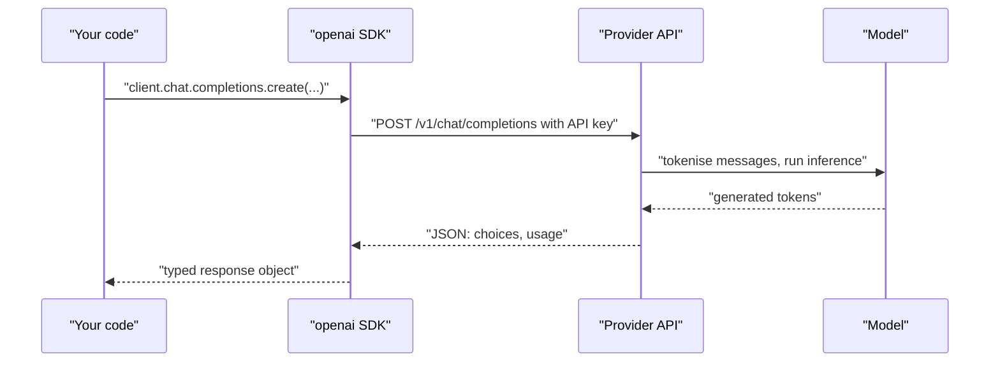

The previous module explained what a large language model is and how it produces text one token at a time. This module is about the practical side: calling a model from your own code, controlling what it does, getting reliable machine-readable answers back, and keeping the bill under control. The most common way to do that is through a hosted HTTP API, and the OpenAI API is the reference point most others copy. Learn its request and response shape well and you can pick up almost any other provider, or a local model server, in an afternoon.

Nothing in this module calls a real model, because that needs an account and an API key. API code is shown either without output or with output that is clearly labelled as an illustrative example response.

## What an LLM API call actually is

An API call is an ordinary HTTPS request, exactly like the ones you made in [Working with APIs](/learn/python-programming/working-with-apis). You send a JSON body describing the conversation so far and some settings; the server runs the model and sends back JSON containing the generated text and a count of the tokens used.



Two facts shape everything else in this module:

- **The model is stateless.** It remembers nothing between calls. If you want a conversation, you resend the whole history every time.
- **You pay per token**, for both the tokens you send (input) and the tokens it generates (output). Long histories cost money on every turn.

## Setting up the SDK

OpenAI publishes an official Python package, `openai`. Version 1 and later use a client object:

```bash
pip install openai
export OPENAI_API_KEY="sk-..."      # never hard-code keys in source files
```

```python
from openai import OpenAI

client = OpenAI()   # reads OPENAI_API_KEY from the environment
```

The client reads the key from the `OPENAI_API_KEY` environment variable. You can pass `api_key=...` explicitly, but loading it from the environment (or a secrets manager) keeps it out of Git. A `.env` file plus `python-dotenv` is a common pattern in development; make sure `.env` is in `.gitignore`.

> [!WARNING]
> An API key is a credential that spends money. Never commit it, never put it in front-end JavaScript, and never paste it into a notebook you will share. If one leaks, revoke it in the provider dashboard immediately.

## Your first chat completion

The Chat Completions endpoint takes a list of **messages**, each with a `role` and `content`:

```python
MODEL = "your-chat-model"   # put a current model name from the provider's docs here

response = client.chat.completions.create(
    model=MODEL,
    messages=[
        {"role": "system", "content": "You are a concise assistant for data engineers."},
        {"role": "user", "content": "In one sentence, what is a Parquet file?"},
    ],
    temperature=0.2,
    max_tokens=100,
)

print(response.choices[0].message.content)
print(response.choices[0].finish_reason)
print(response.usage.prompt_tokens, response.usage.completion_tokens, response.usage.total_tokens)
```

An illustrative example of what this prints (your text and counts will differ):

```output
A Parquet file is a columnar, compressed file format designed for efficient analytical queries over large datasets.
stop
31 21 52
```

Model names change often, so this module uses a placeholder. Look up the current list in the provider's documentation and keep the name in configuration rather than scattered through your code.

### The response object

| Field | Meaning |
| --- | --- |
| `response.choices` | A list of generated alternatives; normally one (you can ask for more with `n`) |
| `choices[0].message.content` | The generated text |
| `choices[0].message.role` | Always `"assistant"` |
| `choices[0].finish_reason` | Why generation stopped: `"stop"` (natural end), `"length"` (hit `max_tokens`), `"tool_calls"` (the model wants to call a tool), `"content_filter"` |
| `response.usage` | `prompt_tokens`, `completion_tokens`, `total_tokens` |
| `response.model` | The exact model version that served the request |

Always check `finish_reason`. A value of `"length"` means the answer was cut off mid-sentence, which is easy to miss if you only look at the text.

### Common parameters

| Parameter | Effect |
| --- | --- |
| `model` | Which model to run |
| `messages` | The conversation so far |
| `temperature` | Randomness of sampling, see [Temperature](/learn/generative-ai-fundamentals/temperature) |
| `top_p` | Nucleus sampling, see [Top-k and top-p sampling](/learn/generative-ai-fundamentals/top-k-and-top-p-sampling) |
| `max_tokens` | Upper limit on generated tokens (some newer models use `max_completion_tokens` instead) |
| `stop` | Strings that end generation when produced |
| `seed` | Best-effort reproducibility; not a guarantee |
| `stream` | Return tokens as they are generated, see [Streaming responses](/learn/working-with-llms/streaming-responses) |
| `tools`, `response_format` | Function calling and structured outputs, covered later in this module |

Not every model accepts every parameter. Reasoning-focused models, for example, may reject `temperature` or require `max_completion_tokens`. When a call fails with a 400 error, read the message: it usually names the offending parameter.

## Multi-turn conversations

Because the model is stateless, a chat application keeps the history itself and appends each turn:

```python
history = [{"role": "system", "content": "You are a helpful tutor."}]

def ask(question):
    history.append({"role": "user", "content": question})
    response = client.chat.completions.create(model=MODEL, messages=history)
    answer = response.choices[0].message.content
    history.append({"role": "assistant", "content": answer})
    return answer

ask("What is overfitting?")
ask("How do I detect it?")     # "it" only makes sense because history is resent
```

Every call sends the full `history`, so the input token count grows with each turn. Lesson [Prompt construction](/learn/working-with-llms/prompt-construction) shows how to trim it to a budget.

## Errors, retries and timeouts

Network calls fail. The SDK raises typed exceptions you can catch:

| Exception | Typical cause | What to do |
| --- | --- | --- |
| `openai.AuthenticationError` (401) | Missing or wrong key | Fix configuration; do not retry |
| `openai.BadRequestError` (400) | Invalid parameter, prompt too long for the context window | Fix the request; do not retry |
| `openai.RateLimitError` (429) | Too many requests or tokens per minute, or quota exhausted | Retry with exponential backoff |
| `openai.APITimeoutError` | The request took too long | Retry |
| `openai.InternalServerError` (5xx) | Provider-side problem | Retry with backoff |

The client already retries some failures automatically. You can tune this and set a timeout when you create it:

```python
import openai

client = OpenAI(max_retries=3, timeout=30.0)

try:
    response = client.chat.completions.create(model=MODEL, messages=history)
except openai.RateLimitError:
    ...   # back off, queue the job, or fall back to another model
except openai.APIError as e:
    ...   # log e and surface a friendly error to the user
```

Backoff means waiting longer after each failed attempt (for example 1, 2, 4, 8 seconds, plus a little random jitter) so that many clients do not all retry at the same instant.

## The Responses API

OpenAI also offers a newer endpoint, the **Responses API**, which it recommends for new projects. It accepts either a plain string or a list of messages as `input`, can keep conversation state on the server if you ask it to, and has built-in tools such as web search. At a high level:

```python
response = client.responses.create(
    model=MODEL,
    input="In one sentence, what is a Parquet file?",
)
print(response.output_text)
```

The concepts in this module (messages, roles, tools, structured outputs, streaming, token usage) apply to both endpoints; only field names differ. The examples use Chat Completions because it is the format that other providers and local servers copy, which makes it the most transferable thing to learn.

## Other providers and local servers

Most providers follow the same pattern: a client, a list of role-tagged messages, a generated reply and a usage count. Two differences you will meet immediately:

```python
# Anthropic Messages API: system prompt is a separate parameter; max_tokens is required
import anthropic
claude = anthropic.Anthropic()          # reads ANTHROPIC_API_KEY
msg = claude.messages.create(
    model="your-claude-model",
    max_tokens=200,
    system="You are a concise assistant.",
    messages=[{"role": "user", "content": "What is a Parquet file?"}],
)
print(msg.content[0].text, msg.usage.input_tokens, msg.usage.output_tokens)

# Google Gemini via the google-genai SDK
from google import genai
gemini = genai.Client()                 # reads GEMINI_API_KEY
reply = gemini.models.generate_content(model="your-gemini-model", contents="What is a Parquet file?")
print(reply.text)
```

Many open-source servers, including **vLLM** and **Ollama**, expose an **OpenAI-compatible endpoint**. You reuse the same `openai` SDK and just change the base URL:

```python
local = OpenAI(base_url="http://localhost:11434/v1", api_key="unused")  # Ollama's default port
local.chat.completions.create(model="llama3.2", messages=[{"role": "user", "content": "Hi"}])
```

> [!KEY]
> Write your application against a small interface of your own, such as `generate(messages) -> text`, and keep provider-specific code behind it. Then switching providers, adding a fallback, or testing with a fake model touches one file instead of fifty.

## Exercises

**1.** A call returns text that stops mid-sentence. Which field tells you why, what value do you expect it to have, and what are two ways to fix it?

<details>
<summary>Show solution</summary>

`response.choices[0].finish_reason` will be `"length"`: the model hit the `max_tokens` limit. Either raise `max_tokens` (accepting higher cost), or ask for a shorter answer in the prompt ("answer in at most three sentences"). For very long outputs you can also continue generation in a follow-up call by appending the partial answer as an assistant message and asking it to continue.

</details>

**2.** Write a function `ask_with_backoff(messages, attempts=4)` that retries on `openai.RateLimitError` with exponential backoff and jitter, and re-raises after the last attempt.

<details>
<summary>Show solution</summary>

```python
import random
import time
import openai

def ask_with_backoff(messages, attempts=4):
    for attempt in range(attempts):
        try:
            return client.chat.completions.create(model=MODEL, messages=messages)
        except openai.RateLimitError:
            if attempt == attempts - 1:
                raise
            time.sleep(2 ** attempt + random.uniform(0, 0.5))
```

Only rate limits (and, in a fuller version, timeouts and 5xx errors) are retried. Authentication and bad-request errors are never retried, because the same request will fail the same way.

</details>

**3.** You have an app built on the OpenAI SDK and want to try a model served locally by vLLM on port 8000. What is the smallest change?

<details>
<summary>Show solution</summary>

Create the client with `OpenAI(base_url="http://localhost:8000/v1", api_key="unused")` and change `model` to the name the server was started with. Because vLLM implements the OpenAI-compatible Chat Completions endpoint, the rest of the code stays the same. Check features individually, though: support for tools, structured outputs and usage reporting varies between servers and models.

</details>

```quiz
[
  {
    "q": "Why does a chat application resend the whole conversation on every call?",
    "options": [
      "To let the provider cache it",
      "Because the model keeps no memory between calls",
      "Because the API requires at least ten messages",
      "To reduce the number of tokens billed"
    ],
    "answer": 1,
    "why": "Chat Completions is stateless: the only context the model sees is what you send in that request. Resending history increases input tokens, which is why trimming matters."
  },
  {
    "q": "`finish_reason` is `\"length\"`. What happened?",
    "options": [
      "The model wants to call a tool",
      "The prompt exceeded the context window",
      "Generation stopped because it reached the `max_tokens` limit",
      "The content filter blocked the reply"
    ],
    "answer": 2,
    "why": "`length` means the output token cap was reached, so the text is probably truncated. A prompt that is too long fails with a 400 error instead."
  },
  {
    "q": "Which error should you retry with exponential backoff?",
    "options": [
      "`RateLimitError` (429)",
      "`AuthenticationError` (401)",
      "`BadRequestError` (400)",
      "All of them, five times each"
    ],
    "answer": 0,
    "why": "Rate limits and server errors are transient. Authentication and bad requests fail identically on every retry, so retrying only wastes time."
  },
  {
    "q": "What makes it easy to point the `openai` SDK at Ollama or vLLM?",
    "options": [
      "They are owned by OpenAI",
      "They expose OpenAI-compatible endpoints, so you only change `base_url` and `model`",
      "The SDK automatically detects local servers",
      "They accept the same API keys as OpenAI"
    ],
    "answer": 1,
    "why": "Both implement the Chat Completions request and response format. The SDK just sends HTTP to whatever base URL you give it."
  }
]
```
