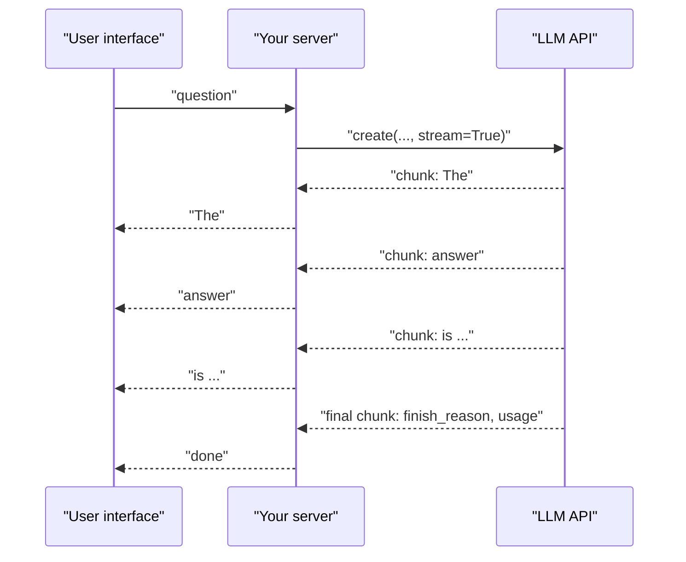

A model generates its reply one token at a time, but a normal API call waits until the very last token before returning anything. For a long answer that can mean many seconds of a blank screen. **Streaming** sends each piece of text to you as soon as it is generated, so the user sees the answer start almost immediately and watches it grow, which is why every chat interface you have used types its answers out. Streaming changes very little about what the model does, but quite a lot about your code: you receive a sequence of small fragments instead of one object, and you have to assemble text, tool calls and usage information from them. This lesson shows how.

## Why stream

Two latencies matter for a generated response:

| Metric | Meaning | Depends on |
| --- | --- | --- |
| **Time to first token** (TTFT) | Delay before anything appears | Queueing, prompt length (the model must process the whole prompt first) |
| **Total time** | Delay until the answer is complete | TTFT plus number of output tokens divided by generation speed |

Without streaming, the user waits for the total time. With streaming, they wait only for the first token, and they can start reading while the rest arrives. The total time, and the cost, are unchanged: the same tokens are generated and billed.



Streaming is worth it whenever a person is waiting and reading. It brings little benefit for batch jobs, for outputs you must validate as a whole before using (such as JSON for a pipeline), or for very short replies.

## What arrives on the wire

Under the hood, providers stream with **server-sent events** (SSE): an HTTP response that stays open and delivers lines of the form `data: ...`, each followed by a blank line. For the OpenAI Chat Completions API each event's data is a JSON **chunk**, and the stream ends with `data: [DONE]`. A shortened, illustrative stream looks like this:

```python
raw_stream = """data: {"choices": [{"index": 0, "delta": {"role": "assistant", "content": ""}, "finish_reason": null}]}

data: {"choices": [{"index": 0, "delta": {"content": "Paris"}, "finish_reason": null}]}

data: {"choices": [{"index": 0, "delta": {"content": " is the"}, "finish_reason": null}]}

data: {"choices": [{"index": 0, "delta": {"content": " capital."}, "finish_reason": null}]}

data: {"choices": [{"index": 0, "delta": {}, "finish_reason": "stop"}]}

data: [DONE]
"""

import json

text = ""
for line in raw_stream.splitlines():
    if not line.startswith("data: "):
        continue                          # blank separator lines
    payload = line[len("data: "):]
    if payload == "[DONE]":
        break
    choice = json.loads(payload)["choices"][0]
    text += choice["delta"].get("content") or ""
    if choice["finish_reason"]:
        print("finish_reason:", choice["finish_reason"])
print(repr(text))
```

```output
finish_reason: stop
'Paris is the capital.'
```

Each chunk carries a **delta**, the new piece only, not the text so far. Your code concatenates them. The SDK parses SSE for you, so you rarely write this parser, but knowing the format helps when you debug a proxy or call an API from a language without an SDK.

## Streaming with the OpenAI SDK

Pass `stream=True` and iterate:

```python
from openai import OpenAI
client = OpenAI()

stream = client.chat.completions.create(
    model=MODEL,
    messages=[{"role": "user", "content": "Explain recursion in two sentences."}],
    stream=True,
    stream_options={"include_usage": True},
)

parts = []
for chunk in stream:
    if chunk.choices:                                  # the usage chunk has no choices
        delta = chunk.choices[0].delta.content
        if delta:
            print(delta, end="", flush=True)           # show it immediately
            parts.append(delta)
    if chunk.usage:                                    # only on the final chunk
        print("\n", chunk.usage.prompt_tokens, chunk.usage.completion_tokens)

answer = "".join(parts)
```

Details that trip people up:

- `delta.content` can be `None` (on the first and last chunks, and during tool calls), so check before using it.
- Usage is not included by default when streaming. With `stream_options={"include_usage": True}`, an extra final chunk arrives with `usage` set and an **empty** `choices` list, hence the `if chunk.choices` guard.
- `print(..., end="", flush=True)` stops Python buffering the output so it appears token by token.
- Collect parts in a list and `"".join` them at the end; it is the idiomatic, efficient way to build the full string.

Other providers follow the same idea with different event shapes. Anthropic's SDK, for example, offers a `messages.stream(...)` context manager with a `text_stream` iterator, and Gemini has `generate_content_stream`. OpenAI-compatible local servers (vLLM, Ollama) support `stream=True` exactly as above.

## Streaming tool calls

When the model calls a function while streaming, the call arrives in fragments too: the first fragment for a call has its `id` and function `name`, and later fragments each carry a piece of the `arguments` string. Fragments are tagged with an `index` so that parallel calls can be told apart. You accumulate them by index and parse the arguments only when the stream ends.

Here a list of stand-in chunks with the same attribute shape as the SDK's objects shows the accumulation:

```python
from types import SimpleNamespace as NS

def tc(index, id=None, name=None, args=""):
    return NS(index=index, id=id, function=NS(name=name, arguments=args))

def chunk(tool_calls=None, finish=None):
    return NS(choices=[NS(delta=NS(content=None, tool_calls=tool_calls), finish_reason=finish)], usage=None)

chunks = [
    chunk([tc(0, "call_a", "get_weather")]),
    chunk([tc(0, args='{"city": "Li')]),
    chunk([tc(1, "call_b", "get_weather")]),
    chunk([tc(0, args='sbon"}')]),
    chunk([tc(1, args='{"city": "Oslo"}')]),
    chunk(finish="tool_calls"),
]

calls = {}
for c in chunks:
    choice = c.choices[0]
    for frag in choice.delta.tool_calls or []:
        entry = calls.setdefault(frag.index, {"id": None, "name": None, "arguments": ""})
        if frag.id:
            entry["id"] = frag.id
        if frag.function.name:
            entry["name"] = frag.function.name
        entry["arguments"] += frag.function.arguments or ""
    if choice.finish_reason:
        print("finish_reason:", choice.finish_reason)

for index, entry in sorted(calls.items()):
    print(index, entry["id"], entry["name"], json.loads(entry["arguments"]))
```

```output
finish_reason: tool_calls
0 call_a get_weather {'city': 'Lisbon'}
1 call_b get_weather {'city': 'Oslo'}
```

Notice that the Lisbon arguments were split across two fragments with a fragment for the other call in between. Trying to `json.loads` a fragment before the stream finishes would fail. The same applies to streamed JSON output in general: you can display it as it arrives, but you can only validate it once it is complete.

> [!KEY]
> A stream is a sequence of deltas. Accumulate text by concatenation and tool-call arguments by index, and only parse, validate or act on them once the stream signals that it has finished.

## Async streaming and relaying to a browser

Servers handling many users at once should not block a thread per stream. The SDK has an async client, `AsyncOpenAI`, whose streams are consumed with `async for` (see [Asynchronous programming](/learn/python-programming/asynchronous-programming)):

```python
from openai import AsyncOpenAI
aclient = AsyncOpenAI()

async def stream_answer(messages):
    stream = await aclient.chat.completions.create(model=MODEL, messages=messages, stream=True)
    async for chunk in stream:
        if chunk.choices and chunk.choices[0].delta.content:
            yield chunk.choices[0].delta.content
```

`stream_answer` is an async generator, so a web framework can forward its pieces to the browser as they arrive, typically as server-sent events or over a WebSocket. With FastAPI, for example, you can wrap such a generator in a `StreamingResponse`; building these endpoints is covered in [Async endpoints](/learn/fastapi/async-endpoints) and [WebSockets](/learn/backend-development/websockets).

## Pitfalls and good practice

| Problem | What to do |
| --- | --- |
| The user closes the page mid-answer | Stop iterating and close the stream (the SDK's stream objects have `close()`), so you stop paying for tokens nobody will read |
| The connection drops mid-stream | Treat a stream without a `finish_reason` as failed; decide whether to retry or show the partial text with a warning |
| Errors arrive after some text was shown | Your interface needs a way to show "the answer was interrupted" |
| Markdown or code renders oddly while incomplete | Re-render the accumulated text on each update rather than appending raw HTML fragments |
| Moderation or validation of the full answer | Some checks need the complete text; either check incrementally or delay display |
| Logging | Log the assembled answer and the final usage, not every chunk |

> [!WARNING]
> Once text has been shown to a user, you cannot take it back. If an output must pass a check (a content policy, a factuality check, a JSON schema) before anyone sees it, either do not stream it, or stream into a buffer and release it only after the check passes.

## Exercises

**1.** Write a function `collect(chunks)` that takes OpenAI-style text chunks (as in the SSE example, already parsed to dictionaries) and returns the full text and the `finish_reason`. Test it with chunks whose deltas are `"Hel"`, `"lo"`, and an empty final delta with `finish_reason` `"length"`.

<details>
<summary>Show solution</summary>

```python
def collect(chunks):
    parts, finish = [], None
    for c in chunks:
        choice = c["choices"][0]
        parts.append(choice["delta"].get("content") or "")
        finish = choice["finish_reason"] or finish
    return "".join(parts), finish

test = [
    {"choices": [{"delta": {"content": "Hel"}, "finish_reason": None}]},
    {"choices": [{"delta": {"content": "lo"}, "finish_reason": None}]},
    {"choices": [{"delta": {}, "finish_reason": "length"}]},
]
print(collect(test))
```

```output
('Hello', 'length')
```

A `finish_reason` of `"length"` means the text was cut off by `max_tokens`, just as in a non-streamed call.

</details>

**2.** A model takes 0.5 seconds to produce its first token and then generates 50 tokens per second. For a 400-token answer, how long does the user wait to see something with and without streaming?

<details>
<summary>Show solution</summary>

Generating 400 tokens takes $400 / 50 = 8$ seconds after the first token, so the answer is complete at about $0.5 + 8 = 8.5$ seconds. Without streaming the user sees nothing for about 8.5 seconds; with streaming the first words appear after about 0.5 seconds. The total time and the cost are the same either way.

</details>

**3.** Why should you not stream the output of a step that extracts JSON for a downstream program?

<details>
<summary>Show solution</summary>

The downstream program cannot use partial JSON: it must wait for the complete object and validate it anyway, so streaming adds code complexity with no latency benefit for that consumer. Streaming helps when a human reads output progressively. (An exception is very long structured outputs where incremental parsers process complete items as they arrive, but that is an optimisation for specific cases.)

</details>

```quiz
[
  {
    "q": "What does streaming improve?",
    "options": [
      "The total cost of the request",
      "The number of output tokens",
      "The time until the user sees the first part of the answer",
      "The accuracy of the model"
    ],
    "answer": 2,
    "why": "The same tokens are generated and billed. Streaming reduces perceived latency by showing text from the first token onwards."
  },
  {
    "q": "In an OpenAI streaming response, what does `chunk.choices[0].delta.content` contain?",
    "options": [
      "The full answer so far",
      "Only the newly generated piece of text, or `None`",
      "The token ids",
      "The usage statistics"
    ],
    "answer": 1,
    "why": "Each chunk carries a delta: the new fragment only. You concatenate fragments yourself, and must handle `None`."
  },
  {
    "q": "With `stream_options={\"include_usage\": True}`, why do you need `if chunk.choices:` in the loop?",
    "options": [
      "The final usage chunk has an empty `choices` list",
      "Every other chunk is empty",
      "`choices` is a generator",
      "Usage is sent before any text"
    ],
    "answer": 0,
    "why": "The extra chunk carrying `usage` has no choices, so indexing `choices[0]` would raise an `IndexError`."
  },
  {
    "q": "How are streamed tool-call fragments for parallel calls kept apart?",
    "options": [
      "By the order of arrival only",
      "By the function name in every fragment",
      "By an `index` field on each fragment",
      "They cannot be streamed"
    ],
    "answer": 2,
    "why": "Fragments carry an index; the id and name come only in a call's first fragment, and argument pieces are concatenated per index."
  }
]
```
