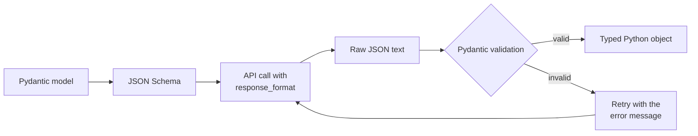

Most LLM features in real software are not chat. They are steps in a pipeline: extract the fields from an invoice, classify a support ticket, turn a question into a database filter. The next step in that pipeline is ordinary code, and ordinary code needs data with a known shape, not a friendly paragraph that happens to contain the answer. **Structured outputs** are the techniques for getting a model to return machine-readable data, usually JSON matching a schema, and for verifying that it actually did. This lesson works up from asking nicely to schema-constrained generation, and shows how to validate with Pydantic and recover when validation fails.

## Why free text is not enough

Ask a model "What is the sentiment of this review, and which product is it about?" and you might get any of:

```text
The sentiment is positive, and the review is about the X200 headphones.
Sentiment: Positive | Product: X200 headphones
{"sentiment": "positive", "product": "X200 headphones"}
Sure! Here's the JSON you asked for: {"sentiment": "Positive", "product": "X200"}
```

Parsing that with regular expressions is fragile. Even when the model returns JSON, it may wrap it in a code fence, add a sentence before it, use a different capitalisation for a label, or leave out a field. You need guarantees at two levels: **syntax** (it is valid JSON) and **schema** (it has the right fields, types and allowed values).

## Four levels of control

| Level | How | Guarantees |
| --- | --- | --- |
| 1. Prompt only | Describe the JSON in the instructions, with an example | None; usually works, sometimes does not |
| 2. JSON mode | `response_format={"type": "json_object"}` | Syntactically valid JSON; any shape |
| 3. Schema-constrained | `response_format` with a JSON Schema and `strict` mode, or a tool definition | Valid JSON matching the schema (within the supported subset of JSON Schema) |
| 4. Validate in code | Parse and validate with Pydantic, retry on failure | Whatever your validator checks, including business rules |

Level 4 is not an alternative to the others; it goes on top of them. Even with schema-constrained generation you should validate, because the schema cannot express every rule (an end date after a start date, a total equal to the sum of line items) and because the model can still choose wrong values that are perfectly well typed.



## Defining the schema with Pydantic

Pydantic (introduced for APIs in the [FastAPI Pydantic](/learn/fastapi/pydantic) lesson) lets you describe the shape once, as a Python class, and get both a JSON Schema to send to the model and a validator for what comes back.

```python
from typing import Literal
from pydantic import BaseModel, Field

class ReviewAnalysis(BaseModel):
    sentiment: Literal["positive", "negative", "neutral"]
    product: str = Field(description="Product name as written in the review")
    rating: int = Field(ge=1, le=5, description="Estimated star rating")
    issues: list[str] = Field(description="Problems mentioned; empty if none")

import json
print(json.dumps(ReviewAnalysis.model_json_schema(), indent=2))
```

```output
{
  "properties": {
    "sentiment": {
      "enum": [
        "positive",
        "negative",
        "neutral"
      ],
      "title": "Sentiment",
      "type": "string"
    },
    "product": {
      "description": "Product name as written in the review",
      "title": "Product",
      "type": "string"
    },
    "rating": {
      "description": "Estimated star rating",
      "maximum": 5,
      "minimum": 1,
      "title": "Rating",
      "type": "integer"
    },
    "issues": {
      "description": "Problems mentioned; empty if none",
      "items": {
        "type": "string"
      },
      "title": "Issues",
      "type": "array"
    }
  },
  "required": [
    "sentiment",
    "product",
    "rating",
    "issues"
  ],
  "title": "ReviewAnalysis",
  "type": "object"
}
```

`Literal` becomes an `enum`, so the model is told the exact allowed labels. `Field(description=...)` text is sent to the model too, so write descriptions as instructions. The `minimum` and `maximum` constraints come from `ge` and `le`.

## JSON mode and schema-constrained output with the OpenAI SDK

The simplest option, **JSON mode**, guarantees syntactically valid JSON but not its shape. The API requires that your messages mention JSON, and you should still describe the fields:

```python
from openai import OpenAI
client = OpenAI()

response = client.chat.completions.create(
    model=MODEL,
    messages=[
        {"role": "system", "content": "Analyse the review. Reply in JSON with keys "
                                      "sentiment, product, rating (1-5) and issues (list)."},
        {"role": "user", "content": review_text},
    ],
    response_format={"type": "json_object"},
)
raw = response.choices[0].message.content
```

**Schema-constrained** output (OpenAI calls it Structured Outputs) sends the schema itself. In strict mode, generation is constrained so the result conforms to the schema. Strict mode supports a subset of JSON Schema and has some rules of its own: every property must be listed in `required` and objects must set `additionalProperties` to false. Support for individual keywords (numeric ranges such as `minimum` and `maximum`, string formats, and so on) differs between providers and changes over time; anything the provider does not enforce must be checked when you validate.

```python
schema = ReviewAnalysis.model_json_schema()
schema["additionalProperties"] = False   # required by strict mode

response = client.chat.completions.create(
    model=MODEL,
    messages=[{"role": "system", "content": "Analyse the product review."},
              {"role": "user", "content": review_text}],
    response_format={
        "type": "json_schema",
        "json_schema": {"name": "review_analysis", "schema": schema, "strict": True},
    },
)
message = response.choices[0].message
if message.refusal:                      # the model declined, for example for safety reasons
    print("Refused:", message.refusal)
else:
    analysis = ReviewAnalysis.model_validate_json(message.content)
```

The SDK also has a `parse` helper that accepts a Pydantic class directly as `response_format` and returns the parsed object; its exact location has moved between SDK versions (it started under `client.beta`), so check the documentation for the version you install.

Other providers reach the same goal by different routes. With Anthropic and others, a common technique is to define a tool whose input schema is the structure you want and require the model to call it, which is the subject of [Function calling](/learn/working-with-llms/function-calling). Gemini accepts a response schema in its generation config. For open models, servers such as vLLM and libraries such as Outlines offer **constrained decoding**: at each step, tokens that would break the schema or grammar are masked out before sampling, so invalid output is impossible by construction.

## Validating what comes back

Whatever produced the JSON, validate it before you trust it. Here are three raw outputs a model might return:

```python
from pydantic import ValidationError

outputs = [
    '{"sentiment": "positive", "product": "X200", "rating": 5, "issues": []}',
    '{"sentiment": "Positive", "product": "X200", "rating": 7, "issues": []}',
    '{"sentiment": "negative", "product": "X200", "issues": "battery"',
]

for raw in outputs:
    try:
        result = ReviewAnalysis.model_validate_json(raw)
        print("OK     ", result)
    except ValidationError as e:
        problems = [f"{'.'.join(map(str, err['loc'])) or 'json'}: {err['type']}" for err in e.errors()]
        print("INVALID", problems)
```

```output
OK      sentiment='positive' product='X200' rating=5 issues=[]
INVALID ['sentiment: literal_error', 'rating: less_than_equal']
INVALID ['json: json_invalid']
```

The first passes and becomes a typed object. The second is valid JSON but breaks two rules: the label has the wrong case and the rating is out of range. The third is not even complete JSON. Pydantic reports each problem with its location, which is exactly what you need for the next step.

## Retrying with the error message

When validation fails, the most effective recovery is usually to show the model its own output and the validation errors, and ask it to fix them. Below, a fake model stands in for the API so the loop can run here: it first returns a flawed answer, then a corrected one.

```python
def fake_model(messages):
    # First attempt has errors; once it sees feedback, it corrects them.
    if any("failed validation" in m["content"] for m in messages):
        return '{"sentiment": "positive", "product": "X200", "rating": 5, "issues": []}'
    return 'Here you go: {"sentiment": "Positive", "product": "X200", "rating": 7, "issues": []}'

def extract_json(text):
    start, end = text.find("{"), text.rfind("}")
    return text[start:end + 1] if start != -1 and end != -1 else text

def structured_call(messages, model_cls, call=fake_model, max_attempts=3):
    messages = list(messages)
    for attempt in range(1, max_attempts + 1):
        raw = call(messages)
        try:
            return model_cls.model_validate_json(extract_json(raw)), attempt
        except ValidationError as e:
            errors = "; ".join(f"{'.'.join(map(str, x['loc']))}: {x['msg']}" for x in e.errors())
            print(f"attempt {attempt} failed: {errors}")
            messages += [
                {"role": "assistant", "content": raw},
                {"role": "user", "content": f"Your reply failed validation: {errors}. "
                                            "Return only corrected JSON."},
            ]
    raise RuntimeError(f"no valid output after {max_attempts} attempts")

result, attempts = structured_call(
    [{"role": "user", "content": "Analyse: 'The X200 headphones are brilliant.'"}], ReviewAnalysis)
print(attempts, result)
```

```output
attempt 1 failed: sentiment: Input should be 'positive', 'negative' or 'neutral'; rating: Input should be less than or equal to 5
2 sentiment='positive' product='X200' rating=5 issues=[]
```

Three details make this robust. `extract_json` strips chatter or code fences around the object, a common failure without JSON mode. The error text is specific, so the model knows what to change. And the attempts are capped: if the model cannot produce valid output in a few tries, more tries rarely help, and you should log the case and fall back (a default value, a human review queue, or a stronger model).

> [!KEY]
> Constrain where you can, validate always. Schema-constrained generation removes most syntax and shape failures; Pydantic validation catches the rest and business-rule violations; a capped retry with the error message repairs most of what is left.

## Designing schemas models fill well

| Practice | Reason |
| --- | --- |
| Use enums (`Literal`) for categories | The model cannot invent a new label or vary capitalisation |
| Describe each field | Descriptions act as per-field instructions |
| Allow "unknown" explicitly (`Optional` or an `"unknown"` enum value) | Otherwise the model is pushed to invent a value |
| Keep nesting shallow | Deep, complex schemas are filled less reliably |
| Put a reasoning field first if you need one | Generation is left to right, so a `reasoning` field before `answer` lets the model work before committing |
| Validate business rules in code | Schemas cannot express cross-field constraints |

> [!WARNING]
> Valid is not the same as correct. A perfectly typed `{"rating": 5}` can still be the wrong rating. Structured outputs solve parsing; they do not replace evaluating whether the values are right.

## Exercises

**1.** Add a `confidence` field to `ReviewAnalysis`, a float between 0 and 1, and validate `'{"sentiment": "neutral", "product": "Z1", "rating": 3, "issues": [], "confidence": 1.4}'`. What error do you get?

<details>
<summary>Show solution</summary>

```python
class ReviewAnalysis2(ReviewAnalysis):
    confidence: float = Field(ge=0, le=1)

try:
    ReviewAnalysis2.model_validate_json(
        '{"sentiment": "neutral", "product": "Z1", "rating": 3, "issues": [], "confidence": 1.4}')
except ValidationError as e:
    print([(err["loc"], err["type"]) for err in e.errors()])
```

```output
[(('confidence',), 'less_than_equal')]
```

`less_than_equal` tells you the value exceeded the `le=1` limit.

</details>

**2.** Write a Pydantic model `Booking` with `start` and `end` dates and a validator that rejects an end date before the start date. (Hint: `model_validator(mode="after")`.)

<details>
<summary>Show solution</summary>

```python
from datetime import date
from pydantic import model_validator

class Booking(BaseModel):
    start: date
    end: date

    @model_validator(mode="after")
    def end_after_start(self):
        if self.end < self.start:
            raise ValueError("end must not be before start")
        return self

print(Booking.model_validate_json('{"start": "2025-03-01", "end": "2025-03-04"}'))
try:
    Booking.model_validate_json('{"start": "2025-03-04", "end": "2025-03-01"}')
except ValidationError as e:
    print(e.errors()[0]["msg"])
```

```output
start=datetime.date(2025, 3, 1) end=datetime.date(2025, 3, 4)
Value error, end must not be before start
```

This kind of cross-field rule cannot be expressed in the JSON Schema sent to the model, which is why validation in code remains necessary.

</details>

**3.** Your pipeline uses JSON mode, and roughly one response in fifty fails Pydantic validation because a required field is missing. List two changes, in order of preference.

<details>
<summary>Show solution</summary>

First, switch from JSON mode to schema-constrained output (strict JSON Schema, or a forced tool call) if the provider supports it, so missing required fields become impossible. Second, add the validate-and-retry loop with the error message, plus logging of failures so you can see whether a prompt or schema change would remove them. Making the field optional only if "unknown" is a genuinely acceptable value is a third option, not a fix.

</details>

```quiz
[
  {
    "q": "What does JSON mode (`{\"type\": \"json_object\"}`) guarantee?",
    "options": [
      "The output matches your Pydantic model",
      "The output is syntactically valid JSON, but not any particular shape",
      "The values are factually correct",
      "The output contains no more than 100 tokens"
    ],
    "answer": 1,
    "why": "JSON mode only guarantees valid JSON. Schema-constrained output or validation is needed to enforce fields and types."
  },
  {
    "q": "Why use `Literal[\"positive\", \"negative\", \"neutral\"]` instead of `str` for a sentiment field?",
    "options": [
      "It uses fewer tokens",
      "It becomes an enum in the schema, so the model and validator only accept those exact labels",
      "Pydantic cannot validate plain strings",
      "It makes the model more confident"
    ],
    "answer": 1,
    "why": "An enum prevents invented labels and capitalisation variants, both at generation time and at validation time."
  },
  {
    "q": "When validation fails, what is usually the most effective retry?",
    "options": [
      "Send the identical request again",
      "Raise the temperature",
      "Send the model its previous output plus the specific validation errors and ask for corrected JSON",
      "Switch off validation"
    ],
    "answer": 2,
    "why": "Specific feedback tells the model what to change. Capping attempts prevents endless loops."
  },
  {
    "q": "Strict schema-constrained output is enabled. Do you still need Pydantic validation?",
    "options": [
      "No, the schema guarantees correctness",
      "Yes, for rules the schema cannot express and as a safety net, though shape errors become rare",
      "Only for streaming responses",
      "Only for open-source models"
    ],
    "answer": 1,
    "why": "Cross-field rules, business logic and unexpected provider behaviour still need checking in code."
  }
]
```
