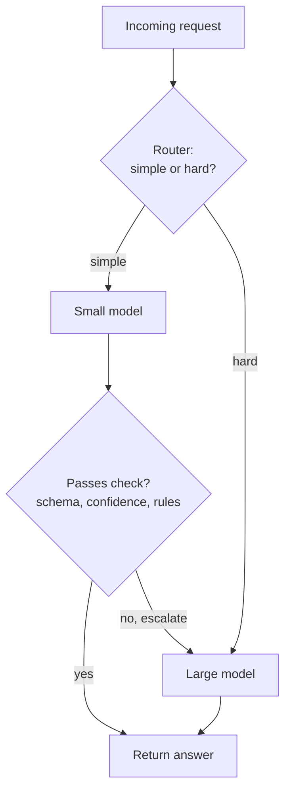

A single LLM call costs a fraction of a cent, which makes it easy to ignore cost while prototyping. Then the feature launches, traffic grows, someone adds a long document to every prompt, and the monthly bill becomes a line item that management asks about. Token usage is to LLM applications what query efficiency is to databases: invisible at small scale, decisive at large scale. This lesson shows how to measure and estimate tokens, how to turn them into money, and the main levers for reducing cost without hurting quality: shorter prompts, output limits, prompt caching, batching and model routing.

Prices in this lesson are **illustrative variables**, not real prices. Real prices differ widely between models and providers and change often; always take them from the provider's current pricing page.

## What you pay for

Providers bill per token, with separate rates for input and output, usually quoted in USD per million tokens. For one request:

$$
\text{cost} = \frac{T_{\text{in}} \cdot p_{\text{in}} + T_{\text{out}} \cdot p_{\text{out}}}{10^6}
$$

where $T_{\text{in}}$ and $T_{\text{out}}$ are the input and output token counts and $p_{\text{in}}$ and $p_{\text{out}}$ the prices per million tokens. Output tokens typically cost several times more than input tokens, because each one needs a full sequential pass through the model, whereas input tokens are processed in parallel.

Things that count as **input**, and are easy to forget:

- The system prompt and few-shot examples, resent on every call.
- The entire conversation history, resent on every turn.
- Tool definitions, which are converted into prompt text.
- Retrieved documents and tool results.
- Images and other media, converted to tokens by provider-specific rules.

Things that count as **output**: the visible reply, tool-call arguments, and for reasoning models the hidden **reasoning tokens**, which are billed as output even though you do not see them. The OpenAI usage object reports them under `usage.completion_tokens_details.reasoning_tokens`.

## Measuring and estimating tokens

The authoritative count is the `usage` object returned with every response (see [OpenAI API](/learn/working-with-llms/openai-api)). Log it for every call: it is the raw material of every cost analysis.

Before calling, you can estimate with the right tokeniser. For OpenAI models, `tiktoken` provides the encodings (introduced in [Tokenization](/learn/generative-ai-fundamentals/tokenization)); open models ship their tokeniser on the Hub; some providers offer a token-counting endpoint.

```python
import tiktoken

enc = tiktoken.get_encoding("o200k_base")

samples = {
    "english": "Please summarise the following customer complaint in two sentences.",
    "code": "def add(a: int, b: int) -> int:\n    return a + b",
    "json": '{"order_id": 18342, "status": "shipped", "items": [{"sku": "A-17", "qty": 2}]}',
}
for name, text in samples.items():
    n = len(enc.encode(text))
    print(f"{name:>8}: {len(text):>3} chars, {n:>2} tokens, {len(text) / n:.1f} chars/token")
```

```output
 english:  67 chars, 11 tokens, 6.1 chars/token
    code:  48 chars, 18 tokens, 2.7 chars/token
    json:  78 chars, 33 tokens, 2.4 chars/token
```

The common rule of thumb, about four characters per token for English prose, is fine for a back-of-the-envelope budget but varies with content: code, JSON, numbers and non-English text often use more tokens per character. Use the real tokeniser for anything you will act on, and remember that each model family has its own.

## A cost model in code

Put the arithmetic in a function and drive it from logged usage or from estimates:

```python
# Illustrative prices in USD per million tokens. NOT real prices.
PRICES = {
    "large": {"input": 2.50, "cached_input": 0.625, "output": 10.00},
    "small": {"input": 0.15, "cached_input": 0.0375, "output": 0.60},
}

def request_cost(model, input_tokens, output_tokens, cached_tokens=0):
    p = PRICES[model]
    uncached = input_tokens - cached_tokens
    return (uncached * p["input"] + cached_tokens * p["cached_input"] + output_tokens * p["output"]) / 1e6

# A support bot: 2,000-token system prompt and examples, 500 tokens of history and question, 300-token reply
per_request = request_cost("large", input_tokens=2_500, output_tokens=300)
monthly = per_request * 50_000 * 30          # 50,000 requests a day for 30 days
print(f"per request: USD {per_request:.5f}")
print(f"per month:   USD {monthly:,.0f}")
```

```output
per request: USD 0.00925
per month:   USD 13,875
```

A request costing under one cent becomes a meaningful monthly sum at scale, and the structure of the cost tells you where to look: here input tokens make up two thirds of it, mostly the fixed system prompt.

## Lever 1: send fewer tokens

The cheapest token is the one you never send.

| Technique | Effect |
| --- | --- |
| Tighten the system prompt; remove redundant examples | Saves on every single request |
| Trim or summarise conversation history to a budget | Stops cost growing with conversation length, see [Prompt construction](/learn/working-with-llms/prompt-construction) |
| Retrieve fewer, more relevant chunks in RAG | Often improves quality as well as cost |
| Send only the fields a tool result needs | Tool results are resent on every later turn |
| Offer only the tools relevant to the request | Tool definitions are input tokens |

## Lever 2: generate fewer tokens

Output is the expensive side. Set `max_tokens` to a sensible ceiling, ask for concise answers in the instructions, and ask for compact structured output (short keys, no repeated input) when a program consumes it. For reasoning models, many APIs offer a setting for reasoning effort; lower effort for easy tasks means fewer hidden reasoning tokens.

## Lever 3: prompt caching

When many requests share the same long **prefix** (system prompt, tool definitions, a reference document), providers can cache the model's internal computation for that prefix and reuse it. Cached input tokens are billed at a discount and processed faster. The mechanics differ:

| Provider style | How caching is triggered | How you see it |
| --- | --- | --- |
| Automatic (OpenAI) | Applied automatically to sufficiently long prompts with a repeated prefix | `usage.prompt_tokens_details.cached_tokens` |
| Explicit (Anthropic) | You mark cache breakpoints with `cache_control` on content blocks | Cache read and cache write token counts in `usage` |

Either way, the rule for getting cache hits is the same: **put stable content first and variable content last**, and keep the stable part byte-for-byte identical. A timestamp or user name near the top of the system prompt defeats the cache for everything after it. Caches also expire after a period of inactivity, so the savings are greatest for steady traffic.

```python
# Same support bot, but the 2,000-token stable prefix is served from the cache
cached = request_cost("large", input_tokens=2_500, output_tokens=300, cached_tokens=2_000)
print(f"uncached: USD {per_request:.5f}   cached prefix: USD {cached:.5f}   saving: {1 - cached / per_request:.0%}")
```

```output
uncached: USD 0.00925   cached prefix: USD 0.00550   saving: 41%
```

With these illustrative prices (cached input at a quarter of the normal input price), caching the prefix cuts this request's cost by about 41%.

## Lever 4: batching

Many workloads do not need an answer within seconds: nightly classification of tickets, generating product descriptions, running an evaluation set. Several providers offer **batch APIs**: you upload a file of many requests, and results come back asynchronously within a stated window (often up to a day), at a discount compared with the synchronous price. Check the current terms; the trade-off is always latency for cost.

Do not confuse this with batching inside a self-hosted serving engine, where many concurrent requests are processed together on the GPU to raise throughput. That is covered in [Batching](/learn/production-ai-systems/batching) and [Continuous batching](/learn/advanced-llm-engineering/continuous-batching).

## Lever 5: model routing

Not every request needs the most capable model. A **router** sends easy requests to a small, cheap model and hard ones to a large model. The router can be rules (request type, length), a small classifier, or a cascade: try the cheap model first and escalate if its answer fails a check.



The saving depends on what fraction of traffic the small model can handle well, which you must measure with an evaluation set (next lesson), not assume:

```python
def routed_cost(share_small, escalation_rate, tokens_in=1_500, tokens_out=300):
    small = request_cost("small", tokens_in, tokens_out)
    large = request_cost("large", tokens_in, tokens_out)
    # small-model requests that fail the check pay for both models
    return share_small * (small + escalation_rate * large) + (1 - share_small) * large

baseline = request_cost("large", 1_500, 300)
for share, esc in [(0.5, 0.1), (0.8, 0.1), (0.8, 0.3)]:
    c = routed_cost(share, esc)
    print(f"{share:.0%} routed to small, {esc:.0%} escalated: {c / baseline:.0%} of baseline cost")
```

```output
50% routed to small, 10% escalated: 58% of baseline cost
80% routed to small, 10% escalated: 33% of baseline cost
80% routed to small, 30% escalated: 49% of baseline cost
```

Routing most traffic to the small model can cut cost by half or more, but a high escalation rate erodes the saving, because escalated requests pay for both models (and take longer).

## Lever 6: cache whole responses

If users often ask the same thing (an FAQ bot, a fixed classification of a known item), store answers in your own cache keyed by a hash of the model, the full prompt and the parameters, and skip the call entirely on a hit. Exact-match caching is safe and simple; **semantic caching**, which reuses an answer for a similar but not identical question using embeddings, saves more but risks returning an answer to a subtly different question. General caching strategies are in [Caching](/learn/production-ai-systems/caching).

> [!KEY]
> Measure first: log input, cached and output tokens per request and per feature. Then apply the levers in order of safety: trim what you send, cap what you generate, structure prompts for caching, batch what can wait, and route only where evaluation shows the cheaper model is good enough.

> [!WARNING]
> Every cost optimisation is also a potential quality change. A shorter prompt, a smaller model or a semantic cache can quietly make answers worse. Run your evaluation set before and after each change, as described in [Model evaluation](/learn/working-with-llms/model-evaluation).

## Exercises

**1.** A chatbot resends its full history each turn. Each turn adds 150 user tokens and 250 assistant tokens, and the system prompt is 800 tokens. How many input tokens does the 10th call send, and how many input tokens in total across 10 turns?

<details>
<summary>Show solution</summary>

Call $k$ sends the system prompt, the $k - 1$ earlier exchanges (400 tokens each) and the new 150-token question:

```python
inputs = [800 + 400 * (k - 1) + 150 for k in range(1, 11)]
print(inputs[-1], sum(inputs))
```

```output
4550 27500
```

The 10th call sends 4,550 input tokens and the conversation totals 27,500 input tokens: growth is linear per call and quadratic in total, which is why history trimming matters for long chats.

</details>

**2.** Using `request_cost`, compare 10,000 requests per day of 1,000 input and 200 output tokens on the `large` and `small` illustrative models over 30 days.

<details>
<summary>Show solution</summary>

```python
for m in ["large", "small"]:
    print(m, f"USD {request_cost(m, 1_000, 200) * 10_000 * 30:,.2f}")
```

```output
large USD 1,350.00
small USD 81.00
```

With these made-up prices the small model is about 17 times cheaper. Whether it is acceptable depends entirely on its measured quality for this task.

</details>

**3.** A team adds the current date and time to the start of the system prompt "so the model knows what day it is". Their cached-token count drops to zero. Explain and fix.

<details>
<summary>Show solution</summary>

Prompt caching reuses an identical **prefix**. A timestamp at the very start makes every prompt different from the first token, so nothing can be reused. Move the date to the end of the prompt (for example into the user message, or the last line of the system message after all stable content), and round it to the day if minute precision is not needed.

</details>

```quiz
[
  {
    "q": "Which of these is billed as input tokens on every call of a multi-turn chat?",
    "options": [
      "Only the latest user message",
      "The system prompt, tool definitions and the full resent history",
      "Only the assistant's previous replies",
      "Nothing after the first call"
    ],
    "answer": 1,
    "why": "The API is stateless, so everything you resend is processed and billed again on every call (minus any cache discount)."
  },
  {
    "q": "How should a prompt be ordered to benefit from prompt caching?",
    "options": [
      "Variable content first, stable content last",
      "Stable content first, identical across requests; variable content last",
      "Randomly, to spread load",
      "Order does not matter for caching"
    ],
    "answer": 1,
    "why": "Caches match on an identical prefix. Anything that changes early in the prompt prevents reuse of everything after it."
  },
  {
    "q": "Why can routing with a high escalation rate save less than expected?",
    "options": [
      "Small models cost more per token",
      "Escalated requests pay for both the small and the large model",
      "Routers are billed per token",
      "Escalation disables caching"
    ],
    "answer": 1,
    "why": "In a cascade, a failed small-model attempt is wasted spend on top of the large-model call."
  },
  {
    "q": "Under the formula in this lesson, what does a request with 4,000 input and 1,000 output tokens cost at USD 1 and USD 4 per million respectively?",
    "options": [
      "USD 0.005",
      "USD 0.008",
      "USD 0.08",
      "USD 5.00"
    ],
    "answer": 1,
    "why": "(4,000 x 1 + 1,000 x 4) / 1,000,000 = 8,000 / 1,000,000 = 0.008 USD."
  }
]
```
